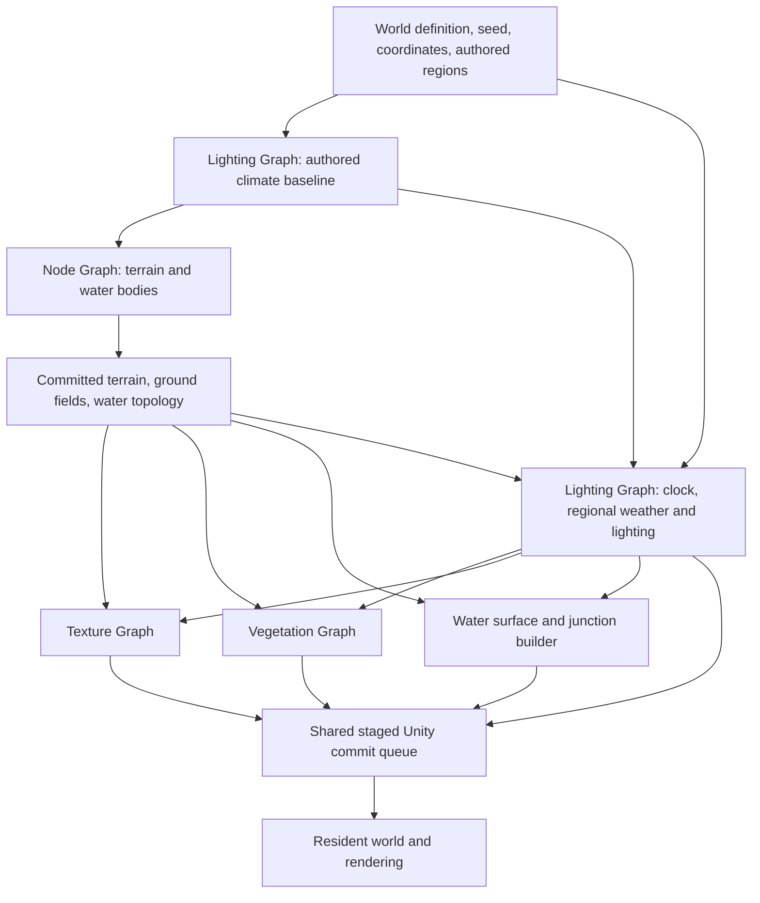

# Universe Creator — full-system audit and next overhaul plan

Date: 2026-11-14. Target: Unity **6000.5.2f1**, URP **17.5.0**.

## Current UC continuation checkpoint

**[x] ✅ Climate/memory/celestial delivery — 2026-11-24, verified implementation and publication:** [Repair tasks 19–25](docs/UC/UC_SCENE_PLAY_LOD_REPAIR_2026-11-22.md) are complete with automated acceptance and delivery evidence. Confirmed fixes preserve accepted climate across reload, prepare missing early climate before native terrain replacement, retire failed queues without false hydrology completion, resume cold prerequisites through the existing pump, share reach IDs and charge hierarchy scratch by actual reaches within the unchanged 256 MiB budget. Stars use bounded 2048×1024 sampling and captured atmospheric horizon attenuation; saved angular sun/moon sizes and both star controls are preserved. Streaming 193/0, lighting 1,602/0, full 19,882/0, scene reload 26/0, corrected domain reload 11/0 and graphics compilation 3/0 all exited 0. Final snapshot `.work/UC_T06_clean_snapshot_20261124_111445663.json`, 3,134 files, digest `DD01504E1956EE1551ED8795E9F6725CD7092B5B9CB2931A2BD87A68AF5EA0F8`, passed VerifyOnly with 156 generated metadata hashes. Only the domain fixture changed after the passing full suite; production stayed identical. Both checked existing PDFs are together in `docs/WorldGuides/Updated_PDFs/2026-11-24_Climate_Recovery`, 75/79 pages, with their related chapters updated. The 23 explicitly audited UC/document/PDF files were committed as `dbbd58ab16cd0d951bcf49ee23df855e6d393292` and pushed to `fix/uc-biome-celestial-2026-11-24`; `git ls-remote` confirmed the exact hash and unchanged main `30f8dcd92751180de2b5f55db25ebdff7c3c0735`. Ignored Content, Logs and .work paths are not tracked. Exact commands, PDF hashes, failed-fixture history and limits are recorded in the repair MD. The initial host disappearance is unreproduced and Auto Generate's original state uncertain; actual host lighting/material/camera appearance and GPU/device performance remain manual. Grand World Transit Simulator stays read-only. **Owner stop condition reached; UC-T09-04 is not advanced.**

**[x] ✅ Biome Splat and celestial repair — 2026-11-24: tasks 13–18 verified, PDFs delivered and corrected branch published.** [Detailed tasks, findings and evidence](docs/UC/UC_SCENE_PLAY_LOD_REPAIR_2026-11-22.md). Rules authoring/layout and finite worker splats are repaired; saved terrain/cancellation regressions pass without a production ChunkManager change. Sun/moon edges and atmospheric daylight filtering are corrected; catalog stars expose Enable Stars and restored Star Brightness under Sky and Atmosphere. Final snapshot `.work/UC_T06_clean_snapshot_20261124_071735329.json`, **3,133 files**, digest `EA396784A2EFED23EFA7E05800E25D45D93755E7E955DD4023FC429B86AE49F5`: streaming **180/0**, full **19,862/0**, scene reload **18/0**, domain reload **9/0**, Direct3D 12 sky compilation **3/0**, all exits 0. Earlier affected graph **155/0**, texture **513/0**, lighting **1,597/0** passed; final full acceptance includes fixture corrections. Final VerifyOnly passed source/package pins and **155 generated metadata hashes**. Shutdowns report no leaked weak pointers; intentional diagnostic warnings and general GPU/leak limits remain. Both checked PDFs are together in `docs/WorldGuides/Updated_PDFs/2026-11-24`: **75/79 pages**, **1,915 recipe checks**, four port-labelled graphs each and actual Rules/lighting tables. Corrected checkpoint `5bc785937c5168383568fb9e5372c2775fc58c81` was pushed to new branch `fix/uc-biome-celestial-2026-11-24`; `git ls-remote` confirmed it and unchanged main `30f8dcd92751180de2b5f55db25ebdff7c3c0735`. The initial upload mistakenly included ignored game-only Content; it was stopped before publication, the unpublished commit replaced, and mapped ignore rules added. Corrected publication has **1,504 changed files** and no tracked ignored paths; local assets and retained tested code/PDF bytes are unchanged. Earlier UC upgrades are not attributed solely to this repair. Final records are committed on the same repair branch. Host project remains read-only; actual visuals and Player/GPU/device behavior remain manual. **Owner stop condition reached; UC-T09-04 remains unfinished and is not advanced.** Originals: `.work/UC_biome_rules_repair_20261124` and `.work/UC_biome_acceptance_resume_20261124`.

**[x] ✅ Owner-requested midday/reflection follow-up — 2026-11-23, implementation/automated acceptance and PDF delivery complete:** [Scene/Play repair tasks 09–12](docs/UC/UC_SCENE_PLAY_LOD_REPAIR_2026-11-22.md) are ticked with findings, solutions and exact evidence. Final snapshot `.work/UC_T06_clean_snapshot_20261123_180038773.json`, digest `F774501F0AFC20E57DAE65BC4F371D333487BCBD080CAA6CBCB5B8EBAE5D57FC`, passed streaming **177/0**, full suite **19,799/0**, scene reload **18/0** and domain reload **9/0**, all exits 0. Earlier affected lighting **1,563/0** and audio **1,530/0** passed; only two fixtures changed afterward, with production unchanged. VerifyOnly confirmed **3,129** unchanged source files/package pins, **148** generated metadata hashes and no foreign code. Reviewed final full-suite tail reported no C# warnings/errors, native behavior assertions or lifecycle receiver errors; shutdowns reported no leaked weak pointers, not general GPU/leak freedom. An earlier single terrain-residency teardown failure did not reproduce in focused/full diagnostics; its root cause remains unconfirmed, and no production retirement fix is claimed. Both checked PDFs are together in `docs/WorldGuides/Updated_PDFs/2026-11-23`: V5.5 **75 pages**, V6.5 **79 pages**, **1,915** recipe checks, four port-labelled flowcharts per distinct world, field/coverage/layout checks and representative visual inspection passed. Exact delivered hashes and commands are in the repair MD; evidence `Logs/UC_ISOLATED_MIDDAY_FINAL_VERIFY_20261123.log` and `Logs/UC_ISOLATED_MIDDAY_GUIDE_DELIVERY_20261123_FINAL.log`. Host project stays read-only; actual Scene/Game visuals, Player/GPU/device acceptance remain manual. Documentation originals `.work/UC_midday_delivery_docs_20261123`; earlier production originals remain intact. **Owner stop condition: stop after PDF delivery. UC-T09-04 remains unfinished retained ordered work; no next topic is advanced.** Earlier checkpoints below describe historical snapshots and PDF locations.

**[x] ✅ Owner-requested camera/sky follow-up — 2026-11-23, all eight repair tasks complete:** Code acceptance passed: lighting **1,454/0**, full suite **19,690/0**, streaming **177/0**, scene reload **18/0**, domain reload **9/0**, all OS exits 0 and no leaked weak pointers reported. Final snapshot `.work/UC_T06_clean_snapshot_20261123_013030697.json`, digest `6BEF724016F144F04767A6BC4685C9670F7AB237AB21EFA957F09EF608737634`; VerifyOnly confirmed **3,129** unchanged source files/package pins and **148** generated metadata hashes. Lighting ran on unchanged production in the preceding `012253211` snapshot; only the fractional-day W-07 assertion changed afterward, then passed in the full suite. Both updated PDFs are delivered together under `docs/WorldGuides/Updated_PDFs`: **74/78 pages**, **653/689** content/diagram checks, **1,915** recipe checks and representative visual inspection passed. Delivered hashes match the inspected candidates; evidence `Logs/UC_ISOLATED_CAMERA_SKY_GUIDE_DELIVERY_20261123_FINAL.log`. Matching chapters include actual camera diagnostic labels, bindings, clipping and continuous sun/moon guidance. The old V5.5 remains viewer-locked in `docs/WorldGuides/PDFs`, so previous open copies were left unchanged. Candidates: `.work/UC_GUIDE_CORRECTION_20261122224513054`; inspection `Logs/UC_ISOLATED_GUIDE_PDF_INSPECTION_20261122224557531700.log`. Detailed findings, exact commands and manual limits: [Scene/Play repair](docs/UC/UC_SCENE_PLAY_LOD_REPAIR_2026-11-22.md). Production originals `.work/UC_sky_camera_resume_20261123`; document originals `.work/UC_camera_sky_docs_final_20261123`. Host project remains read-only; actual host Game/Scene frames, Player, GPU and device behavior remain manual acceptance. No code or passing gate changed for delivery. UC-T09-04 remains the separate retained draft for the next authorized coding task.

**[x] ✅ Earlier Scene/Play and Dual LOD code acceptance — 2026-11-23, historical snapshot:** Lighting **1,405/0**, streaming/readiness **177/0**, full suite **19,641/0**, scene reload **18/0**, domain reload **9/0**, all OS exits 0 and no leaked weak pointers reported. Snapshot `.work/UC_T06_clean_snapshot_20261123_001341812.json`, digest `DED4CDA98640E452D788201B509342C375DAC31E06DF1A800E8E8E3E737ECF06`; source review **729 C# files / zero syntax/declaration errors**. Saved ground, sculpting, rivers and authored layers restore without a full Play-start bake; density changes preserve accepted heights. Preview borrows and restores Scene lighting/sky settings through existing environment owners. Exact earlier RAM, commands and logs remain in [Scene/Play repair](docs/UC/UC_SCENE_PLAY_LOD_REPAIR_2026-11-22.md). The follow-up checkpoint above supersedes the former pending-PDF status; these earlier counts certify their historical snapshot only. Production originals `.work/UC_scene_play_lod_repair_20261122` and `.work/UC_scene_preview_repair_20261122` remain intact.

**[x] ✅ UC-T08-15.11–12 — corrected world PDFs delivered, 2026-11-21:** Both checked replacements are together in `docs/WorldGuides/PDFs`: Green Coast V5.5 **74 pages / 653 coverage and diagram checks**, Rift Highlands V6.5 **78 pages / 689 checks**. Both include complete terrain, lighting, texture and vegetation flowcharts with named ports and numbered arrows, visible Inspector locations and value tables, scaled game time, Scene preview and save/reopen. Source/recipe validation passed **1,915 checks**; PDF coverage/layout checks and representative diagram/Inspector inspection passed. Both worlds have ocean boundary masks and slope-filtered coastal erosion/materials for sheltered beaches and rocky headlands. No new production code, guide C# contracts or resources. Original V5.4/V6.4 PDFs remain unchanged. Obsolete delivered HTML removed. Prior root-folder PDF editions remain because the V5.5 destination is still viewer-locked; use the new PDFs/ copies. Candidate and delivered SHA-256 hashes match; exact commands, hashes and graph counts are in [UC_T08_15_RIVER_COAST_LAKE_REPAIR_2026-11-19.md](UC_T08_15_RIVER_COAST_LAKE_REPAIR_2026-11-19.md). Evidence: `Logs/UC_ISOLATED_GUIDE_MANIFEST_20261121062723632.log`, `Logs/UC_ISOLATED_GUIDE_PDF_INSPECTION_20261121062817299031.log`, `Logs/UC_ISOLATED_GUIDE_DELIVERY_20261121_FINAL.log`. Latest unchanged source acceptance remains RunStreamingReadinessBatch **146/0/exit 0**, RunBatch **19,586/0/exit 0**, scene reload **16/0/exit 0**, domain reload **9/0/exit 0**; full/reload tails reported no leaked weak pointers. Snapshot `.work/UC_T06_clean_snapshot_20261120_214948074.json`, SHA-256 `0BEDBFDB6445BCFCFF7AA788671DE52BA537DEFD895FB5BF4F21211E3624960B`, 3,129 unchanged source files/package pins and 148 recorded generated metadata files. Unity gates were not repeated for these documentation-only changes. Preserve ChunkManager restoration, cookieSize2D restoration and Lighting Graph binding. Next ordered task: retained UC-T09-04 drafts below. Rendering realism, GPU lifecycle, Player and device acceptance need manual checks in the Unity Editor.

**[ ] Active task UC-T09-04 — retained bounded-residency drafts, after PDF delivery:** The owner's latest instruction resumes ordered coding and supersedes the historical stop requests below. Prerequisites 01–03 and the cookie-size repair retain their recorded executed evidence. Current substep: bounded, overlapping region demand through the existing ChunkManager residency predicate, scheduler and accepted readiness; independent visibility/collision admission. No new generation manager or pump. Inventory: DualLODSystem preserves a common terrain sample grid; SetChunkLive owns terrain/scatter parking; ReleaseAcceptedMemory owns generated native retirement; Lighting Graph already owns camera-local probe refresh. ImpostorSystem/SplatPageCache are existing geometry models, not demonstrated terrain far-proxy consumers; do not claim them as a working proxy path. Rectangular growth remains one shared implementation under 04/07/11, with persistence before writable-border acceptance; it is not complete. Exact originals retained in `.work/UC_T09_04_residency_resume_20261120`. The later UI/save-reopen full and reload checks above supersede this draft's earlier no-execution note; complete Topic 9 gates still follow remaining Topic 9 implementation in order. Last recorded C: free space 2.63 GiB; check disk and RAM before preparation/launch. Main Logs routing remains required; no RCM or package changes.

**[x] ✅ Owner-requested cookie-size warning repair — 2026-11-20, verified:** All four deprecated `Light.cookieSize` calls now use `Light.cookieSize2D` in the existing cloud owner, reversible light state and bounded-effects fixture. Square cloud projection keeps its existing clamp; actual view-end restoration now tests both incoming rectangular dimensions. Unity 6000.5.2f1 / URP 17.5.0 compiled and passed **RunLightingBatch 1,379/0/exit 0** and **RunBatch 19,531/0/exit 0**, launch RAM **6.10 / 6.37 GiB**. Both processes (19136/22460) exited normally and reported no leaked weak pointers; no C# warnings/errors were found in either checked 4,000-line log tail. Snapshot `.work/UC_T06_clean_snapshot_20261120_015957065.json`, SHA-256 `01AD03885B207DE3A4CF978E3CA559401F8AE457ADFCAC34BBED43FA0FA2B2B6`; final VerifyOnly confirms 3,124 unchanged source files/pins, 143 generated metadata hashes and no foreign code. Freeze, lighting, full and final verification logs are directly under main Logs with prefix `UC_ISOLATED_COOKIE_SIZE_`; exact commands and files: [CHANGES_UC_T09_01_03.md](CHANGES_UC_T09_01_03.md). No deprecated cookieSize references remain in UC C# sources. The owner reports closing import workers before transport errors 10054; no product cause has been established for those messages. Needs a manual check in the Unity Editor: rendered cloud shadows and multi-camera lighting; general GPU/native leak freedom and Player/device behavior remain unmeasured. Historical stop instruction superseded by the owner's later continued-coding request; current task selection is the checkpoint above.

**[x] Historical UC-T09-01–03 code verification — 2026-11-20; PDF delivery reopened:** Universe Creator remains the PCG subengine inside the host game. Current capture/readiness implementation compiled in Unity 6000.5.2f1 / URP 17.5.0 and passed **RunStreamingReadinessBatch 94/0/exit 0** and **RunBatch 19,530/0/exit 0**, launch RAM **6.19 / 6.70 GiB**. Corrected native TerrainLayer construction in two fixtures and a conflicting fixture local; no validation was disabled. Source scan **723 C# files / zero syntax/declaration errors**. Tested snapshot `.work/UC_T06_clean_snapshot_20261120_010838425.json`, **3,124 files**, SHA-256 `C14C7CE1925FE7A0A8DE71A7754F4B9E3C0188BC0E4D06410E3C1B4DA79C63BD`; post-guide VerifyOnly confirms unchanged source/pins and 143 generated metadata hashes, no foreign code. Both distinct PDFs now include source-checked selected-world capture, generation metrics and host-owned asynchronous landing workflows: **V5.5 Green Coast 258 pages / 225 coverage checks**, **V6.5 Rift Highlands 267 pages / 236 checks**; layout/coverage checks passed and new representative pages inspected. Recipes remain unchanged. All logs are directly under main Logs; owned Unity PIDs 12896/15724 and PDF Edge PID 6920 exited normally, no leaked weak pointers reported by Unity. Exact commands/hashes and limits: [CHANGES_UC_T09_01_03.md](CHANGES_UC_T09_01_03.md), [UC_T09_SUBENGINE_PERFORMANCE_2026-11-20.md](UC_T09_SUBENGINE_PERFORMANCE_2026-11-20.md). **Tasks 01–03 are [x] ✅ code-side complete with automated verification; Topic 9 and separate Player/device/traversal acceptance remain open.** Device description “redmi note 4g tanzanite” does not verify hardware/support. No RCM, content, dependency, quality or build-setting changes. The oversized PDF delivery was rejected and is reopened under UC-T08-15.11/12. The owner's later continued-coding instruction supersedes the historical stop request. Current task selection follows the checkpoint above.

**[ ] UC-T08-15 guide continuation — 2026-11-19:** Code acceptance now passed. Latest repeated native lake-generation fixture was already implemented before interruption; do not duplicate it. `RunTerrainRiverBatch` **530/0/exit 0**, RAM **7.27 GiB**, PID **2284**; `RunBatch` **19,498/0/exit 0**, RAM **7.15 GiB**, PID **20808**. Snapshot `.work/UC_T06_clean_snapshot_20261119_231315171.json`, digest `B3FBFDA95D152355F6C43E71B68FFBE9F9B60B7A2BB2E47B0EC133AFB63A518C`; logs `Logs/UC_ISOLATED_T08_15_RUNTERRAINRIVERBATCH_NATIVE_RETRY_20261119_E.log` and `Logs/UC_ISOLATED_T08_15_RUNBATCH_NATIVE_RETRY_20261119_E.log`. VerifyOnly confirmed 3,116 unchanged source files/pins and 135 recorded generated metadata files; no foreign code. Unchanged production previously passed terrain scene reload **24/0**, snapshot scene/domain **9/0 each** on digest `BF7F44A0A50D27668369625BBC6451AFAD74CC4DBFDA5C446FC1295984C8C50D`. Processes exited naturally with no leaked weak pointers reported. Matched tectonic sampling: 65,536 samples, table 47,807 ticks, analytic 48,571 ticks, maximum depth-fraction error 0.00001549721, measured sampling allocation zero bytes; no general/device speedup claim. Current substep **15.11**: derive two independent upgraded guides from the named originals and verified code. V5.4 is continental; V6.4 is tectonic/alpine with authored rivers. Both original PDFs were opened read-only and remain unchanged. Latest resource check 6.91 GiB RAM/7.49 GiB disk, no Unity process. All logs remain directly under main Logs. Earlier active-substep paragraphs below are historical; visual/Player/device acceptance remains manual.

**[ ] UC-T08-15 current verification resume — 2026-11-19:** Active substep 15.10. The native-panel graph fixture now compares restored pan with the actual saved canvas transform rather than an unquantized request. `RunGraphDomainsBatch` compiled and passed **142/0/exit 0**, launch RAM **6.78 GiB**, PID **14796**, no leaked weak pointers reported, process exited naturally. Snapshot `.work/UC_T06_clean_snapshot_20261119_230316853.json`, 3,116 source files, digest `DA9E55D7A6EB4FB325E9DB2C4AF30E82C95497243C9B21EC918D232C03D0519A`; log `Logs/UC_ISOLATED_T08_15_GRAPH_NAV_RESUME_20261119_C.log`. Lighting/full checks are running sequentially with the project 4 GiB floor; then reload gates and remaining matched-detail cost review. Earlier terrain/water/vegetation passes below remain evidence for unchanged production sources. Guides wait for final code acceptance. A frozen snapshot is a separate fixed test copy; production remains editable and live. No RCM/content/package changes, deleted caches or forced process termination. Historical checkpoints below are superseded.

**[ ] UC-T08-15 affected-gate repair resume — 2026-11-19:** Active substep 15.10. Recovered executed evidence supersedes the historical “no execution” checkpoints: snapshot `.work/UC_T06_clean_snapshot_20261119_223650580.json`, SHA-256 `623FC0985B2142165169175B6BB52E0D62B743481393AE79FEC5A5BA4916FD8E`, passed terrain/river **522/0/exit 0**, water **1,518/0/exit 0**, vegetation **430/0/exit 0**. Graph **141/3/exit 1** failed detached Hand/Pointer toolbar event delivery; the fixture now explicitly dispatches pooled ChangeEvents through the actual registered callbacks, retaining every assertion. No production navigation behavior or validation weakened. Fresh source freeze and repaired graph execution pending, then lighting/full/native gates. Current project RAM floor is 4 GiB; latest authorized resource check found **5.97 GiB RAM**, **7.63 GiB disk**, no Unity process. Logs/console/freeze reports directly under main `Logs`. Different V5.5/V6.5 guides remain after code acceptance. No RCM/content/package changes or forced process termination.

**[ ] UC-T08-15 verification resume — 2026-11-19:** Retained water, navigation and vegetation repairs now include reversible Scene Day/Night Preview through the existing weather clock/editor driver and real-minute game-day controls; new manual lake presets select Tectonic while old bodies retain Legacy. Source inspection: 716 C# files, zero syntax/declaration errors; semantic compilation/execution remain pending. Active substep: 15.10 affected/full/native acceptance. Frozen test snapshot `.work/UC_T06_clean_snapshot_20261119_221748599.json`: 3,116 files, SHA-256 `7A300CC96CB81F754D735D37FDFD77B401A7335CA4920021824DE246FB0856B9`. The owner explicitly approved launch at 4.7 GiB; the existing helper now accepts `-MinimumFreeGiB 4.7` with its default 5 GiB and all hash/process checks retained. Retry `RunTerrainRiverBatch` stopped before Unity launch at 4.65 GiB, no Unity processes; console `Logs/UC_ISOLATED_T08_15_TERRAIN_RESUME_20261119_A_CONSOLE.log`. Latest disk check: 7.64 GiB free. No current-task test counts yet. Next: fresh-RAM affected gates, fix actual failures, full suite and reload checks, then two independently improved V5.5/V6.5 world recipes from their named predecessors and verified code. Originals remain unchanged; no RCM/content/package edits. The frozen copy is an unchanged testing copy only; production clocks/simulation remain live. Earlier checkpoint paragraphs are historical.

**[ ] Active UC-T08-15 — 2026-11-19:** Repairs cover rivers/manual saves, coast/lake formations, shared graph Hand/Pointer navigation, vegetation consumers and processing/loading/execution. The owner additionally requests separate fresh V5.5/V6.5 world-build PDF guides after related code gates pass, before Topic 9. Detailed ordered scope and evidence: [UC_T08_15_RIVER_COAST_LAKE_REPAIR_2026-11-19.md](UC_T08_15_RIVER_COAST_LAKE_REPAIR_2026-11-19.md). Retained drafts now include occupied-basin exclusion, owned-terrain sampling, shared coastal/lake guards, all eleven formation profiles, native manual-save regressions and navigation in all four graph windows. Latest source scan: 716 C# files, zero syntax/declaration errors; no Unity execution for this task. The previous checkpoint understated surviving drafts; source review does not certify compilation or runtime behavior. Current substep: 15.08 vegetation consumer repair; finish navigation regressions, then affected/full/reload gates. PDF originals have not yet been inspected or replaced. UC-T08-14 passes in CHANGES_UC_T08.md apply to the previous snapshot. No RCM/content/package changes. All test/freeze/console reports directly in main Logs. Historical checkpoints below are superseded for active-task selection.

**[ ] Active owner-requested river/coastal repair — 2026-11-19:** UC-T08-14 automated acceptance completed: Topic 8 **1,373/0**, affected graph **137/0**, full **19,402/0**, scene/domain reload **9/0 each**, all exits 0; exact snapshots/digests, launch RAM, PIDs, commands/logs and manual limits in `CHANGES_UC_T08.md`. Source scan 714/0 and final VerifyOnly 3,114 unchanged files/pins passed. These results supersede historical “awaiting complete-topic verification” wording for tasks 01…13 below; assembled-game visual/device checks remain open. All owned Unity processes exited naturally. Current river evidence: repeated lake generation accepts an occupied contour; River Network correctly rejects overlapping body IDs, preventing downstream carving. Sea-floor/shelf run before the lake mask is built for continental rise. Next: prevent new occupied-basin acceptance without deleting saved/manual bodies, test native retry and branching/course carving, trace and repair coastal/lake exemptions. The requested formation-aware lake feature needs a short reviewed implementation plan after the existing owners are traced. Then graph hand/pointer modes and vegetation inspector consumer audit, before Topic 9. Preserve drafts; no RCM/content/package edits. All reports in main Logs.

**[ ] Active UC-T08-14 resume — 2026-11-19:** Sky storage repair compiled and passed `RunLightingBatch` **1,373/0/exit 0**, RAM **6.29 GiB**, PID **22116**. Full suite then reported **19,402/1/exit 1**, RAM **6.76 GiB**, PID **2740**; sole failure: `UC-T05-04 accepted ground exposure changes the actual native sun through its existing physical driver.` Both exited naturally with no leaked weak pointers reported. Logs: `Logs/UC_ISOLATED_T08_SKY_STORAGE_TOPIC_20261119.log` and `Logs/UC_ISOLATED_T08_SKY_STORAGE_FULL_20261119.log`; snapshot `.work/UC_T06_clean_snapshot_20261119_202644885.json`, digest `27EF81B41C7BBF71F7C2B2649CEEAA4E644657E4E22806A5A4CD790DD3F4ADCA`. The inactive graph fixture had no authored light and never ran OnEnable; it now supplies a directional sun while preserving the native intensity assertion and production creation rules. Next: source check, refresh/hash after Unity exits, affected graph gate, full suite and both reload checks. Then owner-requested duplicate-lake/river repair, graph hand/pointer modes and vegetation inspector consumer audit, before Topic 9. No RCM/content/package changes. Frozen means an unchanged testing copy; runtime remains live. Visual/GPU/Player/device checks remain manual. Historical checkpoint paragraphs follow.

**Latest UC-T08-14 executed evidence — 2026-11-19:** Initial repaired topic run compiled and reported **1,335/31/exit 1** (`UC_ISOLATED_T08_TOPIC_REPAIR_20261119_RESUME_B`, RAM 5.07 GiB, PID 7940). Targeted inactive-world ownership repairs and independently reconciled river-fixture geometry reduced the next run to **1,347 checks / 5 failures / exit 1**, RAM **6.36 GiB**, PID **1016**, snapshot `.work/UC_T06_clean_snapshot_20261119_145642745.json`, digest `110986B118CB0A0D8B06BDC76DA51132CF7935AFF742E2BBA0169696C6DDE492`; exact command used `-ExecuteMethod UniverseCreator.Editor.Diagnostics.UCSelfTest.RunLightingBatch -LogPrefix UC_ISOLATED_T08_ACTUAL_REPAIR_20261119_A`. Logs/console directly under main `Logs`; both processes exited and reported no leaked weak pointers. Remaining failures are native LUT red `Infinity` at 80/6, 80/18, 172/6, 172/18, 355/12; ambient is finite. Active task **UC-T08-14 repair** now retains physical radiance using texture-wide power-of-two RGB scaling and a shared alpha exponent, decoded by the existing `UC_Sky.hlsl` sky/reflection reader. GPU LUT remains 4 KB; each bounded cache adds a retained 8 KB CPU bake buffer, released with its existing owner. Native all-texel/decoded-physical-radiance fixtures added; source/Unity verification pending for this latest repair. Next: refresh/hash after Unity exits, fresh-RAM topic/full/scene/domain checks, then automatic Topic 9 continuation. Tasks 01…13 remain implemented awaiting topic verification; no Topic 9 code yet. Earlier paragraphs below are historical. A frozen snapshot is an unchanged testing copy, never a paused production system. No owned Unity process remains running; rendered/GPU/Player/device acceptance remains manual.

**Active task UC-T08-14 — 2026-11-19:** Tasks 01…13 are implemented and await complete-topic verification. Task 12 retains camera-local tiers, bounded paced probes, same-run ground invalidation and scoped retirement. Task 13 records retrieved/hash-verified Epic material/Lumen and SCS lighting passages in `UC_T08_LIGHTING_SOURCE_REGISTER_2026-11-19.md`; no engine code imported. Task 14 now supplies `RunLightingBatch` using existing graph/window, clock/climate, regional-consumer, camera-history and resource fixtures. Latest source scan: **714 files / zero syntax/declaration errors**; Unity semantic compilation/execution pending. Older content-repair results apply only to their prior snapshot. Next: freeze/hash, fresh-RAM guarded topic/full/scene/domain gates, fix failures, then continue authorized coding. All logs directly in main Logs; no content/RCM/package edits. Rendered/Player/device acceptance remains open.

**UC-T08-14 repair resume:** Initial topic launch (`Logs/UC_ISOLATED_T08_TOPIC_20261119_032459778.log`, PID 25784, launch RAM 6.73 GiB, exit 1) failed compilation: ambiguous fixture `LightingSettings` and four writes to immutable `AtmosphereState` fields. Repaired fixtures now qualify the UC settings type and call `AtmosphereState.From`; Unity verification pending. Repaired freeze `.work/UC_T06_clean_snapshot_20261119_141536243.json`: 3,114 files, SHA-256 `8903468FD18577EED94AAC747C3903FB2CA77B8BFA2FF81B126D0A20A52C6172`. First retry stopped before launch on Unity-generated root-folder metadata (`Logs/UC_ISOLATED_T08_TOPIC_REPAIR_20261119_RESUME_A_CONSOLE.log`). With owner-approved one-condition helper repair, VerifyOnly passes all 3,114 unchanged source files/package/version pins and records hashes for 133 generated metadata files, including the root (`Logs/UC_ISOLATED_T08_RESUME_VERIFY_20261119.log`); no source metadata altered, no foreign code. Fresh source scan passes 714/0 (`Logs/UC_ISOLATED_T08_RESUME_SOURCE_20261119.log`). Latest authoritative resources: 4.18 GiB free RAM, C: 13.67 GiB free disk, no Unity process; existing 5 GiB launch guard remains unchanged. No Unity process was launched or remains owned in this resume. Active task 14 remains in progress, blocked on sufficient free RAM; owner asked to free memory through the pending input question. Next: fresh-RAM launch of RunLightingBatch, then topic/full/scene/domain acceptance and automatic continuation in plan order. Logs directly under main Logs; no production/content/RCM/package changes in this resume. Helper and checkpoint recovery: `.work/UC_T08_gate_resume_20261119/`. Rendered/GPU/Player/device acceptance remains manual; prior snapshot passes do not certify this repaired version.

The following UC-T08-07 paragraph is historical evidence; the active task is stated above.

**Active task: UC-T08-07 source/consumer continuation after verified content repair — 2026-11-19.** Final layout is one flat SampleNatural folder per category; all 277 imported assets and 199 original Surfaces files are preserved. Repaired source compiled and passed **RunContentRepairBatch 181/0**, **RunBatch 19,183/0**, **scene reload 9/0**, **domain reload 9/0**, all exits **0**, respective launch RAM **6.12 / 6.00 / 6.09 / 5.98 GiB**. Frozen 3,101-file digest **68A05B28D9212A9D1791BE6D95D5BD677C5FC882275AC9CD246C6E9F1C92F94C**, `.work/UC_T06_clean_snapshot_20261119_002414415.json`; exact commands/logs/limits in `CHANGES_UC_CONTENT_REPAIR_2026-11-19.md`. All owned Unity processes exited naturally, no leaked weak pointers reported; VerifyOnly confirmed unchanged source/pins and no foreign code. UC-T08-01…06 drafts and working maths are retained; their registered fixtures passed the interim full suite, while complete Topic 8 remains open. Current inspected UC-T08-07 defects: lighting rebuilds weather separately from the per-view EnvironmentSampleProduct, fog independently recomputes exposure without lighting settings/bias, and scene-global sky/light state lacks the existing weather adapter's per-world view restoration. Reuse existing clock, atmosphere, exposure, sun/moon, sky and view owners; do not introduce competing clocks/lights/managers. Next: implement coherent captured-sample lighting and fixtures in task order, then continue Topic 8; owner-requested independent shader/material improvements remain within these verified owners. Rendered/Player/device acceptance remains manual.

**Current owner layout and active verification — 2026-11-19:** latest clarification restores exactly one flat `SampleNatural` folder inside each of Grass/Rocks/Shrubs/Surfaces/Trees. **277 assets moved**, GUID/data/importer hashes preserved; five original Unity-created folder metadata files restored unchanged; **199 original Surfaces files/root metadata hash-identical**. No deeper imported folders remain. Exact main report: `Logs/UC_ISOLATED_SINGLE_SAMPLE_FOLDER_MAIN_20261119_002219560.log`. Focused repair run on digest `04EEC717A3DA6BA04651FB5A5C5AF0526CE428180BF05DA845E4288817EC8154` executed **181 checks / 1 failure / exit 1**, **6.43 GiB** launch RAM, PID **6124**, `Logs/UC_ISOLATED_CATEGORY_REPAIR_FOCUS_20261119_001703479.log`; all prior import/domain/climate failures passed, with only one unreviewed control remaining. Located the exact new `WorldGraphInputNode.shoreSearchMetres` calculation and added its metre/search-envelope declaration; also corrected that reader's physical elevation/slope/current/depth/shore and categorical membership port units. This repair is awaiting execution. Next: fresh source freeze, focused repair rerun, complete RunBatch, native scene/domain reload checks, each with the unchanged 5 GiB RAM guard and logs directly in main Logs. Continue UC-T08-07 and independent shading improvements after success; UC-T08-01…06 drafts remain intact. Earlier direct-category layout entries below are superseded by this latest owner clarification.

**Latest active state: direct category transfer completed; repaired gates pending.** The main Content folder now has all **277 imported assets directly under their categories** (Grass 34 / Rocks 28 / Shrubs 52 / Surfaces 112 / Trees 51), with SampleNatural and its nested import trees removed. **199 original Surfaces files/root metadata remain hash-identical.** Three filename collisions retain separate assets with short GUID prefixes. Isolated flatten compiled/executed **exit 0**, launch **6.28 GiB**, PID **18752**, `Logs/UC_ISOLATED_CATEGORY_FLATTEN_IMPORT_REPAIR_20261119_001134853.log`; all asset/GUID/metadata/dependency comparisons passed and seven moved importers were corrected. Main sync report `Logs/UC_ISOLATED_CATEGORY_FLATTEN_MAIN_20261119_001545447.log`; original import trees retained at `.work/UC_category_flatten_originals_20261119_001545447/`. The first two isolated attempts exposed cached ShaderGraph dependencies omitting newly imported URP defaults, with unchanged data/metadata and no removed dependency; the repair refreshes source shader imports before strict comparison, rather than weakening the check. Fresh repaired-source freeze, RunContentRepairBatch, full RunBatch and applicable native gates are next. Previous **19,182 / 4 / exit 1** full result remains the latest full evidence until those run. UC-T08-07 and independent shading improvements follow successful repair verification automatically.

**Active task: owner-requested direct category layout and four full-suite repairs.** Latest cleaned full suite ran **19,182 checks / 4 failures / Unity exit 1**, launch **5.53 GiB**, PID **26712**, `Logs/UC_ISOLATED_T07_T08_CLEANED_FULL_20261118_234123603.log`; process exited naturally and reported no leaked weak pointers. Failures: seven imported texture-policy violations; missing Weather Output typed climate/weather unit metadata; stale GPU-domain expectations after the T07-10 CPU packing migration; inactive weather fixture failing to invoke OnValidate. Repairs are implemented but unverified. Latest owner layout overrides SampleNatural: imported assets go directly under Grass/Rocks/Shrubs/Surfaces/Trees, preserving original Surfaces and all GUIDs; collisions receive an eight-character GUID prefix. The existing content utility performs isolated Unity moves and dependency/hash checks, then applies import corrections only to moved textures. Next: compile/run the isolated flatten operation, synchronize verified moves to main Content, freeze repaired source, run affected/full/native gates with the unchanged 5 GiB RAM guard. Continue independent material improvements and UC-T08-07 after success. UC-T08-01…06 drafts remain intact; no new runtime owners or RCM edits. Recovery for these targeted edits: `.work/UC_category_flatten_repair_20261119/`. Rendered/device/Player acceptance remains manual.

**Historical checkpoint entries below:** earlier active-state wording and asset layouts describe their dated snapshots, not the current state above.

**Latest active task — cleaned-content full/native verification:** natural transfer is now applied in the main workspace. **277 assets** retained (Grass 34 / Rocks 28 / Shrubs 52 / Surfaces 112 / Trees 51), with their original GUID/data/metadata hashes and **86 Unity-generated destination-folder metadata files** preserved. All **199 original Surfaces files/folder metadata** retained identical hashes after recovery of their unexpected disappearance. `Universal3DSample`/its `SharedAssets` are absent from Content; unused originals are isolated under `.work/UC_removed_sample_originals_20261118_233822031/`. Main report: `Logs/UC_ISOLATED_CONTENT_MAIN_TRANSFER_20261118_233822031.log`; details/status in `UC_CONTENT_DISTRIBUTION_2026-11-18.md`. Unity audit exited **0**, **5.80 GiB** launch RAM, PID 25836; Unity migration exited **0**, **5.43 GiB**, PID 26564; both logs report no leaked weak pointers. These are asset-operation results, not full-suite counts. No RCM/cache changes or hand-edited metadata. A fresh cleaned source freeze is being prepared in the exited UC validation copy for `UCSelfTest.RunBatch` and native gates. The earlier **497/0/exit 0** texture pass is preserved pre-cleanup evidence. Next after full/native success: continue owner-requested independent shader/material improvements and **UC-T08-07** without introducing duplicate owners; UC-T08-01…06 drafts remain intact. Renderer/Player/device evidence remains manual and unmeasured.

**Current owner cleanup — reset executed, sample dependency audit in progress:** latest owner clarification authorizes clearing the four existing categories first, preserving every existing Surfaces file and allowing additions there. Removed **260 files / 153,366,146 bytes** from Grass/Rocks/Shrubs/Trees only after hash-verified recovery copies; root folders/metadata remain. Verified **3,097 protected Surfaces/sample files** unchanged. No sample extraction or sample/shared deletion has occurred. Log: `Logs/UC_ISOLATED_CONTENT_FOUR_FOLDER_RESET_20261118_230813354.log`; recovery `.work/UC_requested_content_reset_originals_20261118_230813354/`. Static retained UC/Surfaces reference check: zero findings, with Unity/RCM/Player scope limits recorded in `UC_CONTENT_DISTRIBUTION_2026-11-18.md`. The old frozen source inventories below are historical and cannot be used to launch against the reset source. The exited UC-owned validation content mirror received the same verified reset, preserving its import cache; a fresh source freeze is being prepared. Latest resource inspection found **5.65 GiB** free; the dependency-audit gate must check RAM again immediately before launch. Full/native verification and UC-T08-07 remain after extraction/cleanup; the previous **497/0/exit 0** texture result applies to its original pre-cleanup snapshot only.

**Latest frozen audit preparation — 2026-11-18:** refreshed only the exited, UC-owned validation project; new snapshot `.work/UC_T06_clean_snapshot_20261118_225325264.json`, **5,702 files**, SHA-256 **A3D0DCAD79B9E4706D2F3A070F478C1D58879E8EBD07F0EB3608658EF1048BED**. Full freeze report: `Logs/UC_ISOLATED_CONTENT_DISTRIBUTION_FREEZE_20261118_225325264.log`. Compared every content path/hash against the passing texture snapshot: **zero differences**. Sample/shared assets are intact; no extraction or deletion has happened. Latest RAM check after preparation: **4.26 GiB**, below the existing 5 GiB launch guard. The next executable gate is `UniverseCreator.Editor.Utilities.UCContentDistribution.RunNaturalContentAuditBatch` on this frozen snapshot; its output must be reviewed before applying any moves/deletion. New Editor code remains source-reviewed only; no full-suite or cleanup success is claimed. Do not start Unity until RAM permits. The active task and pending owner content/material work are detailed below.

**Current active task — 2026-11-18: owner-authorized natural-content dependency audit, with full repair verification still pending.** The saved-texture repair is verified: `UCSelfTest.RunTextureBatch` ran **497 checks / 0 failures / Unity exit 0**, PID **13284**, **5.45 GiB** launch RAM, `Logs/UC_ISOLATED_T07_PERSISTENT_INPUT_FOCUS_20261118_213526359.log`. Shutdown reports `Found no leaked weakptrs.` Frozen **5,701-file** SHA-256 **86FC8489E0168B132DD3EDA37F52DEB5556258A8B5490D1260D2CBDCF28F8298**, `.work/UC_T06_clean_snapshot_20261118_213526359.json`. The full `UCSelfTest.RunBatch` launch was prevented at **4.88 GiB** by the unchanged **5 GiB** guard; Unity did not start and no full-suite result exists. Latest independent RAM check: **4.86 GiB / no Unity processes**. The owner is asked to free RAM; do not weaken the guard or stop foreign processes.

**Authorized next work and preserved drafts:** the owner's new cleanup request follows the passing focused test. Retain natural content and actual dependencies under `Content/Grass`, `Rocks`, `Shrubs`, `Surfaces`, `Trees`; then remove `Universal3DSample` including its `SharedAssets`, preserving GUIDs and rejecting ambiguous model/prefab dependencies. Separate game-only content from toolkit distribution using `.gitignore` plus an explicit export inventory with dependency rejection. `UCContentDistribution` currently audits to a hashed plan and changes no assets; deletion has not happened. Material audit identified actual `_ColorMap`/`_ExtraMap` bindings; the existing texture-role owner now recognizes them, with regression checks. The source mask importer currently has sRGB enabled; this is a recorded audit finding, not proof of correct packed-mask sampling or permission to silently edit borrowed materials. Current source check: **701 files / 0 syntax/declaration errors**, `Logs/UC_ISOLATED_T08_SOURCE_REVIEW_20261118.log`; new distribution/audit code is not Unity-compiled yet. Next: freeze current source, run the dependency audit when RAM permits, review/apply the exact cleanup, then full/native verification on the cleaned snapshot. UC-T08-01…06 drafts remain intact; resume **UC-T08-07** automatically after verified repair/cleanup. Independently extend existing material/shader owners only for demonstrated gaps; no copied sample technology or obsolete API is presumed necessary. Details: `UC_CONTENT_DISTRIBUTION_2026-11-18.md`. Recovery originals are `.work/UC_T07_persistent_input_repair_20261118/` and `.work/UC_content_distribution_20261118/`. All logs remain directly in main `Logs` through the validation junction. Rendered appearance, shader/Player builds, device budgets and general native-lifetime acceptance remain open.

**Owner-authorized Assets cleanup — 2026-11-17:** deleted only the seven generated `Assets/UCNativeRecoverySelfTest`…`UCNativeRecoverySelfTest7` folders and their corresponding folder metadata: **113 files / 79,007 bytes**. Resolved every deletion target inside the immediate Assets root, rejected reparse points and checked that every target and its `.meta` was absent afterwards. `UniverseCreator`, `RoadCityMaster`, their metadata and pre-existing root files remain. Historical native recovery results below describe the earlier executed fixtures; the generated fixture data is now intentionally removed. Future UC verification remains isolated under `.work/UC_validation_project_*`.

**Latest owner instruction — 2026-11-17, code-side completion and automatic continuation:** "so tick it done in terms of code side as for measuremnet later but for now is fully done with your estimate according to data measuremnet you got on line". The owner authorizes advancing through completed coding tasks/topics while recorded measurements and manual acceptance remain later work. This supersedes the previous instruction holding all later coding behind device/graphics acceptance. Tick implemented tasks with their precise evidence; distinguish `[x] ✅ code-side complete` from whole-topic acceptance. Online engineering sources inform design assumptions and frame envelopes, not measured UC FPS or proof that a particular phone sustains the chosen scene. Keep the Redmi Note 14-class minimum and high-detail 30/60/120 goals; retain every pending measurement and the original owner request.

**Latest device-adaptation instruction — 2026-11-17:** the owner requests adaptation to the current device's actual measurements instead of hardcoded phone performance assumptions, retaining Redmi Note 14 class as the minimum baseline and scaling to higher-end phones, PCs and consoles. Extend the existing `AdaptiveQuality` owner and its measured frame-time/performance inputs; do not add a competing device manager, identify support solely from model names, invent missing CPU/GPU/memory/thermal readings or treat online benchmarks as runtime telemetry. Retain explicit 30/60/120 targets, configured quality floors and hard resource limits as operating constraints. Adapt reversible workload/material quality from available measured headroom with bounded sampling/hysteresis and visible missing-metric behaviour. Integrate texture tiers and automated response checks under UC-T07-11/12 and continue subsequent topic consumers in dependency order. Actual target-device captures still validate the controller and baseline quality; adaptation does not prove sustained FPS without them.

**Active task: UC Topic 7 acceptance repair and owner-requested full/native verification.** Reconciled surviving code and logs; UC-T08-01 inventory and UC-T08-02…06 implementation drafts remain intact. The owner's three runtime errors and subsequent missing fixture/Editor members are already corrected. The recovered full run on `.work/UC_T06_clean_snapshot_20261118_183806741.json` (5,701 files, SHA-256 **1E2EE37218773664068E7381D9499FB096FF7DCA94F4D7F8AF2328D39119D66A**, PID 9684, 5.43 GiB launch RAM) exited **1**, with `TestTextureImageInputs` throwing at line 45 because the fixture never bound its evaluator; no final counts. Log: `Logs/UC_ISOLATED_T08_REPAIR_FULL_FINAL_20261118_183806741.log`. Added the missing binding in its three affected wired fixtures. Focused `RunTextureBatch` on `.work/UC_T06_clean_snapshot_20261118_200753677.json`, SHA-256 **05CC966048CC3E37205700387D159FA06A217A0472F4D8B31B94F725441709C5**, compiled and ran **342 checks / 12 failures / exit 1**, PID 15688, 5.32 GiB launch RAM, `Logs/UC_ISOLATED_T07_BINDING_FOCUS_20261118_200753677.log`; shutdown reports `Found no leaked weakptrs.` Diagnosed inactive-world ownership rejection in Apply/reference/quality, wrong fixture Main Graph metadata, terminal validation on an intentionally sampled caller, unsafe additive scene setup, and analytical expectations finer than the captured source lattice. Targeted repairs preserve current/foreign-world rejection, check real material descriptor writers, require saved scenes before reference persistence, and independently verify native interpolation within 0.005 plus a derived source-curvature bound. Repairs are awaiting the next frozen focused/full/native gates; source inspection: **700 files / 0 syntax or duplicate declaration errors**, `Logs/UC_ISOLATED_T07_ACCEPTANCE_REPAIR_SOURCE_20261118.log`. Recovery originals: `.work/UC_T07_fixture_binding_repair_20261118/`. Isolated project remains `.work/UC_validation_project_T06_CLEAN_20261118_181358388/`; no source refresh during a Unity run. **Owner overrides the copy pause: after successful self-tests, continue coding UC-T08-07 automatically.** No later coding has begun. Earlier runtime repairs, regional weather drafts, RCM, package pins, gate helpers and locked behavior are preserved. Needs a manual check in the Unity Editor: rendered weather/sky/exposure, native tree wind, GPU histories, Player/device budgets. Do not claim a complete-topic result from an incomplete or failed gate.

**Frozen Topic 7 evidence — 2026-11-18:** `.work/UC_T06_clean_snapshot_20261118_072438706.json`; project `.work/UC_validation_project_T06_CLEAN_20261118_072438706/`; SHA-256 **998F279B04BBC0A279C63762755D7FA2830A5D60C3C8489911DB22E31C300488**. The unchanged generic preparation/gate helpers retain their historical T06 names; this snapshot contains current UC Topic 7 sources and unchanged package/settings pins, without RCM or shared caches. No helper or metadata was hand-edited. Exact attempted/resume command (the helper checks RAM immediately before any launch and writes the UC log only after admission):

```powershell
& 'C:/tmp/run_UC_T06_clean_gate_20261117.ps1' -Snapshot 'C:/Users/Admin/Desktop/Universe Builder/.work/UC_T06_clean_snapshot_20261118_072438706.json' -ExecuteMethod 'UniverseCreator.Editor.Diagnostics.UCSelfTest.RunTextureBatch' -LogPrefix 'UC_ISOLATED_T07_TEXTURE_20261118_072438706'
```

**Previous Topic 7 preparation checkpoint — preserved history.** UC-T06-01…18 are **[x] ✅ code-side complete** with production fixtures and the full package/native gates below. Final verification used the complete allowed inventory, including current sample content: **5,652 files**, `.work/UC_T06_clean_snapshot_20261117_175402099.json`, SHA-256 **6982569F1EAB7A3F638E4A36F9ACBA7D99F1C0E13B6718E05A65381079C7D057**. After all natural exits, every current/copied source hash, exact source inventory, package/version pin and all 68 separately recorded Unity-generated script metadata hashes matched; no foreign Assets code is present. The initial copy's Git-ignore omission and its two content-scan failures remain recorded below and were corrected without changing product assets or weakening assertions. The actual catalog has 35 concrete existing texture-family nodes, plus shared field/utility entries admitted by `GraphDomainRules`; `TextureNode` is the real base class, while `TextureNodeBase.cs` is its file name. Epic's official node reference was retrieved HTTP 200; compact hashed excerpts are `.work/UC_T07_Epic_node_reference_20261117.json`. Next: finish its operation/port/owner/cost matrix, then extend existing image/material/shader products in task order. No Topic 7 runtime change has yet been compiled or executed. The current source remains independent of RCM; all earlier drafts/recovery originals are preserved. Needs a manual check in the Unity Editor: vegetation/inspector usability, real roots/colliders/LOD/wind/density and rendered ground/water changes. Graphics/audio/player-build and sustained phone measurements remain open. The Azure error is a chat-service issue and cannot be guaranteed away by product edits.

**Executed Topic 6 complete-content acceptance — verified:** Unity **6000.5.2f1**, URP **17.5.0**, isolated project `.work/UC_validation_project_T06_CLEAN_20261117_172424678/`. All required Topic 6 fixtures are registered in the full package; its final pass executes them against the complete content snapshot. The earlier focused **406/0/exit 0** used identical code/shader sources before the omitted sample assets were added, and was not repeated unchanged. Each final shutdown tail reports `Found no leaked weakptrs.` These CPU/native batch results do not certify graphics, audio, a player build or phone performance.

| Method on `UniverseCreator.Editor.Diagnostics.UCSelfTest` | Checks / failures / OS exit | Exact log under `Logs/` | Launch free RAM / PID |
|---|---|---|---|
| `RunBatch` | **18,545 / 0 / 0** | `UC_ISOLATED_T06_COMPLETE_PACKAGE_20261117.log` | **5.21 GiB / 13276** |
| `RunSnapshotSceneReloadBatch` | **9 / 0 / 0** | `UC_ISOLATED_T06_COMPLETE_SCENE_20261117.log` | **5.51 GiB / 6872** |
| `RunSnapshotDomainReloadBatch` | **9 / 0 / 0** | `UC_ISOLATED_T06_COMPLETE_DOMAIN_20261117.log` | **5.45 GiB / 8196** |

Exact commands and observed OS exits are recorded in `.work/UC_ISOLATED_T06_COMPLETE_{PACKAGE,SCENE,DOMAIN}_20261117_{launch,exit}.json`; final source/import metadata inventories are beside the snapshot. Example exact package command:

```powershell
& 'C:\Program Files\Unity\Hub\Editor\6000.5.2f1\Editor\Unity.exe' -batchmode -nographics -projectPath "C:\Users\Admin\Desktop\Universe Builder\.work\UC_validation_project_T06_CLEAN_20261117_172424678" -executeMethod UniverseCreator.Editor.Diagnostics.UCSelfTest.RunBatch -logFile "C:\Users\Admin\Desktop\Universe Builder\Logs\UC_ISOLATED_T06_COMPLETE_PACKAGE_20261117.log"
```

**Topic 6 recovery verification history — not final full-content acceptance:** `.work/UC_T06_clean_snapshot_20261117_172424678.json`, digest `650133AF9FE14AAB4057E86EE829F8EBE7CDE081BBC0F95B8B86052ED26F891D`, records the initial code-only copy. `RunVegetationBatch` → `Logs/UC_ISOLATED_T06_CLEAN_FOCUS_20261117.log`, **406 / 0 / exit 0**, launch **5.52 GiB**, PID **29532**. `RunBatch` → `Logs/UC_ISOLATED_T06_CLEAN_PACKAGE_20261117.log`, **18,545 / 2 / exit 1**, launch **5.26 GiB**, PID **25024**. Exact failures: `UCTextureBudget found no textures under Assets/UniverseCreator/Content - the audit is not looking where the content actually is`; `UCPrefabIntegrity opened no prefabs or models under Assets/UniverseCreator/Content - the scan is not looking where the shipped content actually is`. Both processes exited naturally and their shutdown tails report `Found no leaked weakptrs.` The inventory error is corrected in the helper, not by changing production assets or weakening tests. The earlier reused-project 406/0 log remains historical; its OS exit was not recovered.

**Owner interruption recovery — 2026-11-17:** resume exactly after the last saved edits before the pasted Azure resource/token-rate-limit errors, without guessed product/API state. Verified the surviving checkpoint and draft, Unity 6000.5.2f1/URP 17.5.0 and registered production/test owners. The service errors are not Unity failures. Recovery originals: `.work/UC_T06_01_recovered_20261117_092511066/`; the earlier `.work/UC_T06_01_resume_20261117/` is preserved. Git reports these project files as untracked and supplies no usable tracked diff baseline, so review uses the recovery originals. Read-only process/RAM inspection found no Unity process and 5.88 GiB free; this is not a launch-time measurement or a new test result. Editor interaction, graphics/audio/player-build and sustained device measurements remain open.

**Topic 5 repair history — retained evidence:** first 671-file snapshot `0D039286E8A0E167FE3B9015C952395A301BA0CC2E5B21237A26C27FFB1421B5`, `.work/UC_T05_package_snapshot_20261117.json`, compiled runtime/Editor, then exited 1 before a final check report because migration applied executable-output validation to an empty companion. Method `UniverseCreator.Editor.Diagnostics.UCSelfTest.RunGraphDomainsBatch`, log `Logs/UC_ISOLATED_T05_GRAPH_FOCUS_20261117.log`, PID 11204, 5.86 GiB free. Authoring validation now permits empty replacements while Run retains its output requirement; new deprecated sort/transform calls were replaced. Corrected snapshot `58F224A65C8507E6DD788D12469EC65617890154F109A5ABCE4AA33F9666B09D`, `.work/UC_T05_package_fix_snapshot_20261117.json`, ran **122 checks / 1 failure / exit 1**, `Logs/UC_ISOLATED_T05_GRAPH_FIX_20261117.log`, PID 18404, 5.98 GiB free. Its sole failure, `UC-T05-11 sample graph acceptance exception: System.ArgumentException: Invalid SceneManagerSetup`, came from teardown with no loaded/active startup scene. The fixture now uses Single mode for an empty native setup; production behavior and required assertions remain intact. Active-preview budget/canvas-close retirement checks were added before final verification.

**Resume preparation history — 2026-11-17:** the scene-only correction was frozen as 671-file `A1BED8CE08A75C3FFC6AAEB93FB5153E082481F161B160475509238F9B3A7628`, `.work/UC_T05_scene_fix_snapshot_20261117.json`, with matching source inventories and pins. It was superseded by the final snapshot after active-preview retirement checks were added. The owner requested waiting for about 5 GiB free RAM. Guarded launches deferred at 2.57/4.82 GiB; the bounded RAM-wait monitor exited without starting Unity. On the later owner request to stop a RAM-consuming batch, inspection found no running Unity process; none was killed. Topic 6 source reading remained preparation until all four gates passed. Review originals: `.work/UC_T05_gate_resume_20261117/`.

**Executed Topic 5 acceptance — verified:** final 671-file snapshot `7168FE719BB9109023C6217B4ACF69F011C441E71E881AE31D66998803E86974`, `.work/UC_T05_preview_lifecycle_snapshot_20261117.json`, passed every gate below. After all natural exits, current/copied inventories, all source hashes and manifest/lock/version pins matched. Each shutdown tail reports `Found no leaked weakptrs.` The domain run also recorded an unrelated UnityConnect configuration-request timeout after its passing report; its OS exit remained 0. These are code/automated results; mouse/keyboard usability, rendered quality, preview latency and phone performance require their separate manual/device evidence. Full change record: `CHANGES_UC_T05.md`.

| Method on `UniverseCreator.Editor.Diagnostics.UCSelfTest` | Checks / failures / OS exit | Exact log under `Logs/` | Launch free RAM / PID |
|---|---|---|---|
| `RunGraphDomainsBatch` | **127 / 0 / 0** | `UC_ISOLATED_T05_GRAPH_LIFECYCLE_20261117.log` | 5.40 GiB / 19012 |
| `RunBatch` | **18,167 / 0 / 0** | `UC_ISOLATED_T05_PACKAGE_LIFECYCLE_20261117.log` | 5.19 GiB / 12480 |
| `RunSnapshotSceneReloadBatch` | **9 / 0 / 0** | `UC_ISOLATED_T05_SNAPSHOT_SCENE_20261117.log` | 6.03 GiB / 26592 |
| `RunSnapshotDomainReloadBatch` | **9 / 0 / 0** | `UC_ISOLATED_T05_SNAPSHOT_DOMAIN_20261117.log` | 5.89 GiB / 31348 |

**Code-side topic ledger:** `[x] ✅ UC-T01`, `[x] ✅ UC-T02`, `[x] ✅ UC-T03`, `[x] ✅ UC-T04`, `[x] ✅ UC-T05` implementation and recorded automated contracts are complete. Topic 5 has the exact 18,167/0/exit 0 package and focused/native evidence above; earlier snapshots remain historical records. Whole-topic graphics/audio/build/device acceptance remains open and must be measured before certification. This coding ledger does not assert those later results. The following checkpoint paragraphs preserve prior evidence; their instruction to hold later coding is superseded by the owner's code-side continuation rule.

**Latest owner correction and active task — 2026-11-16: UC-T04-11 acceptance/performance wiring.** Do not advance to another topic until the earlier topic's complete required acceptance is satisfied. Topic 5's interrupted work is preserved; UC-T05-04 is waiting, not the active implementation. From Topic 1 onward, distinguish verified automated contracts from whole-topic completion: Topics 1/2 have the recorded 16,362/0 package and 9/0 scene/domain gates, Topic 3 has 16,737/0 plus 24/0 and 9/0 reload gates, and Topic 4 now has the current **18,099/0/exit 0** package plus its separately recorded focused/native gates. All four whole-topic completion boxes remain open for their stated Editor/Play/graphics/device/build evidence. Add `[x] ✅` to a whole topic only after those checks, and retain the owner's original water request until every requested acceptance is fulfilled.

**Recovered continuation — current task remains UC-T04-11:** the interrupted run completed focused water **1,510 checks / 0 failures** and actual Play FPS ownership/capture lifecycle **9 / 0**. Their exact logs are `Logs/UC_ISOLATED_T04_11_PERFORMANCE_FINAL_WATER_20261116.log` and `Logs/UC_ISOLATED_T04_11_PERFORMANCE_VERIFIED_PLAY_20261116.log`; their tails were recovered on resume, but the original OS exit codes were not recovered in this turn. Full package `Logs/UC_ISOLATED_T04_11_PERFORMANCE_PACKAGE_20261116.log` reached **18,097 / 1** on frozen SHA-256 `F8AD8D1039CFBCA0C2331D60C8D8D2219A0E77602217A577E77B21EC648BEB52`, `.work/UC_T04_11_performance_package_snapshot.json`. Sole failure: `UC-T05-03 actual scene reload preserves graph/world references and requires explicit capture for the new runtime lifetime.` This is a preserved diagnostic blocker encountered while verifying Topic 4, not authorization to advance to Topic 5.

**Current coding package:** the existing `AdaptiveQuality` offers Custom/30/60/120 FPS modes, optional single-owner presentation control, validated bounded sample windows and explicit reference-quality pins. New authoring starts at 30; existing saved custom millisecond budgets remain supported. Desktop uses a matching hardware VSync divisor where available; mobile follows Unity's display-divisor rule. A bounded post-warm-up capture exports separate wall/CPU/GPU p50/p95/p99, unavailable-timing counts, main-thread allocation/Unity-memory estimates and device/settings metadata. Median scratch and unchanged diagnostic text are reused. Water quality observes registry replacements and applies per-body material/physics ceilings within its world; absent quality-source lookups are throttled. Focused water and real Play lifecycle execution above do not establish rendered phone FPS, visual realism or audible quality.

**Current fix — verified:** `UCSelfTest.VegetationGraphs.cs` reacquires persistent graph assets after Single scene switches, compares native saved identities and separately checks reset runtime revision/schema; all prior assertions remain required. Review originals: `.work/UC_T04_11_reload_resume_20261116/`. Available RAM on resume: **6.74 GiB**, no running Unity Editor; later UC launches waited for the competing RCM gate to retire. RCM, active editor/browser work, licensed sound assets and Unity caches remain untouched. No research downloads were saved; retained research must stay within 1 GB. All source snapshots and original requests remain preserved.

**New executed acceptance — complete package pass:** corrected fixture and graph-domain acceptance pass **59 checks / 0 failures / Unity exit 0**, followed by complete UC package **18,099 / 0 / 0**. Frozen **655-file** SHA-256 `D2B153ACDEE343D60C3E18134926078D87B211268E870281332AFC5F3F84102B`, `.work/UC_T04_11_reload_resume_snapshot.json`; only the saved-scene diagnostic differs from the interrupted package snapshot. After both runs, all current/copied source hashes, the full source inventory and manifest/lock/version pins matched. Both UC processes exited naturally; no process or lock was removed. The Play entry point and all runtime sources are unchanged from the separately recovered 9/0 Play snapshot; that historical result is not a new device measurement.

| Exact method on `UniverseCreator.Editor.Diagnostics.UCSelfTest` | Checks / failures / exit | Log under this workspace's `Logs/` | Launch free RAM / PID |
|---|---|---|---|
| `RunGraphDomainsBatch` | **59 / 0 / 0** | `UC_ISOLATED_T04_11_RELOAD_FOCUS_20261116.log` | 5.92 GiB / 14004 |
| `RunBatch` | **18,099 / 0 / 0** | `UC_ISOLATED_T04_11_RELOAD_FULL_20261116.log` | 5.96 GiB / 28744 |

Exact full-package executable command (launched with `Start-Process -WindowStyle Hidden -PassThru`, with an observed OS exit code):

```powershell
& 'C:\Program Files\Unity\Hub\Editor\6000.5.2f1\Editor\Unity.exe' -batchmode -nographics -projectPath 'C:\Users\Admin\Desktop\Universe Builder\.work\UC_validation_project_T03_20261115_232021464' -executeMethod UniverseCreator.Editor.Diagnostics.UCSelfTest.RunBatch -logFile 'C:\Users\Admin\Desktop\Universe Builder\Logs\UC_ISOLATED_T04_11_RELOAD_FULL_20261116.log'
```

The focused command uses the same executable, options and project, with `-executeMethod UniverseCreator.Editor.Diagnostics.UCSelfTest.RunGraphDomainsBatch` and `-logFile 'C:\Users\Admin\Desktop\Universe Builder\Logs\UC_ISOLATED_T04_11_RELOAD_FOCUS_20261116.log'`. The unchanged failed package remains recorded above. The corrected fixture adds two identity/lifetime assertions, giving the new 18,099 count. Both successful shutdown tails report `Found no leaked weakptrs.`; this does not certify every native/driver lifetime or rendered performance.

**Next concrete action and remaining acceptance:** keep UC-T04-11 open and complete the outstanding Editor/graphics reference matrix, optional licensed-clip playback and player/device captures; do not advance to Topic 5 or add a whole-topic ✅. Required manual checks in the Unity Editor: node placement/picking and inherited profile Undo/Redo, natural source/mouth/confluence geometry, forward/depth/shadow/underwater consistency in both terrain modes, calm/strong wind and swimming/vehicle flow/contact/audio. Earlier topics' outstanding Editor/Play/build/device acceptance must also be recorded in dependency order before any new topic transition. No Redmi Note 14-class device or licensed clips have been supplied to this validation session, and these runs use `-nographics`; high-detail sustained 30/60/120 FPS, thermal behaviour and visible realism remain unmeasured. Retain 30 FPS first, then 60 and supported 120; continue using the recorded multi-engine research and bounded production owners.

**Owner order/tick rule, reconfirmed 2026-11-16:** no task or topic may be skipped. Keep exactly one active task, UC-T04-11, until the current work is verified; do not resume later-topic drafts while preceding required acceptance is open. Review outstanding acceptance from Topic 1 onward before any further topic transition. `[x]` on an implemented task must state its actual verification boundary. Whole-topic `[x] ✅` requires every required task and acceptance check; Topics 1–4 remain open for their explicitly recorded manual/device/build evidence. Retain one input with multiple outgoing wires and graph-specific typed utility/portal/combiner designs in the plan; later drafts remain preserved.

| Topic in dependency order | Implemented task rows | Recorded automated acceptance | Whole-topic completion |
|---|---|---|---|
| UC-T01 | 01–13 ticked `[x]`; no missing implementation row | ✅ Package 16,362/0 and scene/domain 9/0 each; historical snapshot below | [ ] Editor interaction, graphics/Play/native retirement, device/build acceptance |
| UC-T02 | 01–10 ticked `[x]`; no missing implementation row | ✅ Same package and reload evidence; measured desktop microbenchmarks only | [ ] Sustained streaming/memory/thermal, graphics/Play and device acceptance |
| UC-T03 | 01–11 ticked `[x]`; no missing implementation row | ✅ Package 16,737/0, river scene 24/0, snapshot scene/domain 9/0 each | [ ] Editor bed/bank/coast/normal/hole/collider workflow, graphics/Play/device acceptance |
| UC-T04 | 01–10 including 05A/05B/09A ticked `[x]`; 11 active and unchecked | ✅ Current package 18,099/0/exit 0 and focused graph/native scene 59/0/exit 0; earlier water/Play/native evidence retained | [ ] UC-T04-11 graphics/audio/player-build and measured 30/60/120 acceptance |

These green checks identify recorded automated evidence only. No whole topic has been newly marked complete, and no later topic is selected by this continuation.

### Historical checkpoint — superseded task selection, preserved evidence

**Second compilation attempt, 2026-11-16:** the corrected 654-file snapshot `550D8862819381F92AA8EFCFDE72DBAD59D28287B7F962F2B6C26DD603DF5D74`, `.work/UC_T04_11_performance_fix_snapshot.json`, compiled UC runtime including FPS/capture APIs, then failed before checks on preserved Topic 5 diagnostics. `UCSelfTest.LightingGraphs.cs(67,45)/(68,31)` used the private `AbsoluteSeconds` instead of public `ElapsedSimSeconds` (CS1061); `UCSelfTest.VegetationGraphs.cs(28,44)/(144,53)` treated the managed `ScatterPrototypeLibrary` as a ScriptableObject (CS0311/CS1503). Announced and corrected only these diagnostic API/lifecycle mistakes, retaining all assertions and production behaviour. Log `Logs/UC_ISOLATED_T04_11_WATER_PERFORMANCE_FIX_20261116.log`, natural Unity exit **1**, no executed checks. Available RAM dropped to 0.83 GiB at that launch while the other chat's RCM gate/import workers started; subsequent UC gates require at least 3 GiB free and no competing Unity gate. No RCM/OS process was stopped. ADB listed no connected device; its own newly started daemon was stopped successfully. Browser/extra-editor ownership clarification remains pending; do not infer that active work is unwanted.

Updated 2026-11-16 after the isolated Topic 4 package and native reload gates. This checkpoint and the task rows below govern UC continuation; the RCM handoff and the October `UC_SYSTEM_OVERHAUL_PLAN.md` do not.

**Current implementation: UC-T05-04 — Lighting Graph and shared world environment binding.** UC-T05-01/02/03 are implemented, awaiting the complete Topic 5 gate. Reconciled the preserved vegetation draft with actual native terrain publication, `RiverChannelRegistry`, the admitted worker pool and existing scatter/streaming pump. Vegetation Run captures accepted ground and immutable authoring, pins all captured regions while workers wait, preserves planting on cancellation/errors, rejects foreign main selectors/missing Height/prototypes, and isolates replaced plans' streaming queues. Terrain seams/re-cuts also notify the existing companion binding. The window/inspector show the main dependency, accepted revision and dirty/stale state; saved references require explicit capture after a new runtime lifetime. `TestVegetationGraphBinding` is registered in `UCSelfTest.Run` for actual trees/shrubs/detail consumers, revision/height preservation, cancellation/replacement, pending/foreign inputs and native scene-reference reload. These tests and UC-T05-01/02 remain source-reviewed, **uncompiled/unexecuted**. Next: wire Lighting Graph to the existing lighting/weather managers and separate baseline climate from dynamic execution, then continue Topic 5 in dependency order before its isolated gate. Review originals: `.work/UC_T05_resume_20261116/`, `.work/UC_T05_02_resume_20261116/`, `.work/UC_T05_03_completion_20261116/`. Scoped source whitespace/UTF-8/no-BOM/LF checks pass; no validation snapshot was refreshed. There is no Git HEAD. Topic 4's verified **636-file** SHA-256 remains `6492F01ED65947152DDBA1E5696A1A6BF07C35E1A9A9D46B897C7C31D5421F13`, `.work/UC_T04_redo_snapshot.json`; later changes require a new snapshot. UC-T04-11 remains open for Editor/Play/graphics/device evidence while independent coding continues. The owner retains 30/60/120 FPS modes with high-detail 30 FPS first; corrected the stale 60-only interpretation in `.work/UC_VALIDATION.md`. Existing drafts, verbatim owner requests, broad engine research and the ≤1 GB research-cache rule remain in force; this continuation downloaded no research data.

| Executed entry point in `UniverseCreator.Editor.Diagnostics.UCSelfTest` | Checks / failures | Unity exit | Exact log under `Logs/` |
|---|---:|---:|---|
| `RunRiverAuthoringUndoBatch` | 6 / 0 | Not captured; exited naturally | `UC_ISOLATED_T04_REDO_FIX_20261116.log` |
| `RunWaterBatch` | 1,491 / 0 | 0 | `UC_ISOLATED_T04_WATER_REDOFIX_20261116.log` |
| `RunBatch` | 18,013 / 0 | 0 | `UC_ISOLATED_T04_FULL_REDOFIX_20261116.log` |
| `RunWaterJunctionSceneReloadBatch` | 3 / 0 | 0 | `UC_ISOLATED_T04_WATER_SCENE_REDOFIX_20261116.log` |
| `RunRiverTerrainModeSceneReloadBatch` | 3 / 0 | 0 | `UC_ISOLATED_T04_RIVER_MODE_SCENE_REDOFIX_20261116.log` |
| `RunTerrainRiverSceneReloadBatch` | 24 / 0 | 0 | `UC_ISOLATED_T04_TERRAIN_RIVER_SCENE_REDOFIX_20261116.log` |
| `RunSnapshotSceneReloadBatch` | 9 / 0 | 0 | `UC_ISOLATED_T04_SNAPSHOT_SCENE_REDOFIX_20261116.log` |
| `RunSnapshotDomainReloadBatch` | 9 / 0 | 0 | `UC_ISOLATED_T04_SNAPSHOT_DOMAIN_REDOFIX_20261116.log` |

Exact complete-package command:

```powershell
& 'C:\Program Files\Unity\Hub\Editor\6000.5.2f1\Editor\Unity.exe' -batchmode -nographics -projectPath 'C:\Users\Admin\Desktop\Universe Builder\.work\UC_validation_project_T03_20261115_232021464' -executeMethod UniverseCreator.Editor.Diagnostics.UCSelfTest.RunBatch -logFile 'C:\Users\Admin\Desktop\Universe Builder\Logs\UC_ISOLATED_T04_FULL_REDOFIX_20261116.log'
```

Each other executed command uses those same executable/options/project with the exact entry-point suffix and log filename in the table. All launches were hidden and sequential; free RAM was 4.87–5.23 GiB, and all eight Unity processes exited naturally. The full gate reports no leaked weak pointers; this does not certify all native/driver memory, graphics execution, player builds, Play-mode retirement or device performance. RCM, its processes and locked road-node placement were untouched. Public source pages were read in memory; no research cache or sound asset was downloaded.

**Outstanding Topic 4 acceptance:** observe actual scene placement/picking, source/mouth/confluence geometry, flow/wind/shore/horizon/underwater consistency and swimming/vehicle behavior in both modes; assign optional licensed clips and verify audible spatial playback. The owner's latest clarification retains **30, 60 and 120 FPS modes**, prioritizing high-detail **30 FPS first**, then optimizing **60 FPS on the Redmi Note 14-class minimum midrange phones** and **120 FPS where the recorded device/display and scene budget support it**. The earlier interpretation that removed 30 FPS is superseded. Record exact variant/RAM/OS/backend/display, resolution, scene and quality settings; measure each selected mode rather than treating a frame-rate setting as proof. These are acceptance targets, not existing device results. Topic 4/UC-T04-11 remain unchecked for graphics/audio/Play/device evidence; this does not pause independent authorized implementation.

**Separate follow-up finding:** `ChunkManager.cs` wireframe-preview creation still calls the same Undo-recording `DisablePicking` helper. This is an independently owned terrain-preview path, outside this water correction; record its Undo behavior for a focused follow-up rather than silently changing it here.

The following earlier prerequisite, implementation-only and failed-run notes are historical. The table above and the current task rows supersede their pending/failure status.

- [x] Corrected `AGENTS.md` product routing, bounded document discovery and resume/task-evidence rules at the owner's request.
- [x] Reviewed UC-T01-05/06/07 production paths and registered acceptance against their recorded solutions. Their existing verification ticks remain supported; no new passing result is claimed.
- [x] UC-T01-08 implementation and newer domain metadata acceptance now pass in the isolated complete gate (**16,362/0**, exact command/log below); the owner's earlier source-only prerequisite confirmation was preserved without a repeat batch at that stage.
- [x] **UC-T01-09 implemented — automated acceptance verified.** Preserved the interrupted draft and completed effective-edge cycle analysis, current portal fallback typing, early full-world/direct-chunk admission and malformed-port canvas diagnostics. Added `UCSelfTest.GraphValidation.cs`, registered directly in `UCSelfTest.Run`, covering broken metadata/topology, both portal families, deep cycles, actual world/chunk/texture rejection, repaired publication and selective canvas error clearing. Evidence: isolated complete UC gate **16,362/0**, `UC_ISOLATED_T01_T02_20261115_140706901.log` (checkpoint).
- [x] **UC-T01-12 implemented — automated acceptance verified.** Published inputs remain borrowed; writers copy once at the mutation boundary. Surface, layer, splat, water, gradient and texture descriptors isolate mutable metadata while preserving borrowed native texture ownership and immutable baked-map sharing. Registered `TestGraphProductOwnership` covers 32 route/order/cache/index combinations, edited retained reuse, bounded copy identities, descriptor/UV isolation and native-owner release. Evidence: isolated complete UC gate **16,362/0**, `UC_ISOLATED_T01_T02_20261115_140706901.log` (checkpoint).
- [x] **UC-T01-13 automated gate verified.** Complete isolated UC suite **16,362/0/exit 0**, native scene reload **9/0/exit 0**, managed-domain reload **9/0/exit 0**, with exact logs/digest below. Existing missing-type recovery evidence remains §20. Whole-topic visual/device/native-GPU acceptance stays open; the unrelated shared-project RCM compilation failures are historical.
- [x] **UC-T02-01 implemented — automated acceptance verified.** Shared world/revision authority now reaches whole-world/chunk workers, yielding setup, terrain/material commits and queued vegetation/environment callbacks. Registered deterministic restart/foreign-world/native-consumer fixtures; passed in the isolated complete gate below. Evidence: isolated complete UC gate **16,362/0**, `UC_ISOLATED_T01_T02_20261115_140706901.log` (checkpoint).
- [x] **UC-T02-02 implemented — automated acceptance verified.** Whole-world/chunk dispatch now uses one process-wide admission queue with per-world limits; cancellation removes queued predecessors while running predecessors retain admissions through retirement. Shutdown captures superseded tasks, and admitted workers suppress nested scatter `Parallel.For`. Registered two-world/barrier/twenty-restart, bounded-count, release-on-failure and retry fixtures. Default global cap is `max(1, min(4, reported processors - 1))`; platform tuning is explicit and permitted only while idle, not a claim of measured device performance. Evidence: isolated complete UC gate **16,362/0**, `UC_ISOLATED_T01_T02_20261115_140706901.log` (checkpoint).
- [x] **UC-T02-03 implemented — automated acceptance verified.** Full captured-input keys and atomic shared entries cover both production callers, independent requester cancellation, world retirement and failure/retry. Resumed review found an admission deadlock when a synchronous worker joined an asynchronously queued solve; it now atomically claims the original factory under its existing admission. Queued retirement cannot overwrite a claimed solve. Registered production, async/retry and single-slot queued-join fixtures passed in the isolated complete gate below. Review originals: `.work/UC_T02_continue_20261115/`. Evidence: isolated complete UC gate **16,362/0**, `UC_ISOLATED_T01_T02_20261115_140706901.log` (checkpoint).
- [x] **UC-T02-04 implemented — automated acceptance verified.** Detached terrain staging, bounded height/weight/hole/detail uploads, measured pump deadlines, old-surface preservation, cancellation disposal and final collider/content publication are coded. Accepted seam heights are separate from pending tile heights. Registered `TestStagedChunkCommits` covers partial-upload cancellation/native disposal, three-chunk drain, real collider raycasts, strip-coordinate/count preservation and a controlled over-budget stage. Automated acceptance passed in the isolated complete gate below. Native allocation, synchronization, tree/content publication and world-settle callbacks remain indivisible and measured; the soft budget does not cap a single Unity call. Staging temporarily retains old plus replacement TerrainData; total byte ownership belongs to UC-T02-06. Arbitrary external callback failure can require dependent-content rebuilding, while the previous terrain/collider pair is restored. Review originals: `.work/UC_T02_continue_20261115/`; `TerrainBuilder.cs` retains CRLF. Evidence: isolated complete UC gate **16,362/0**, `UC_ISOLATED_T01_T02_20261115_140706901.log` (checkpoint).
- [x] **UC-T02-05 implemented — automated acceptance verified.** The evaluator checks captured domain/fallback metadata before local or retained cache hits. Unity lifecycle hooks identify the real main thread. Direct mask/erosion GPU helpers reject workers before native calls; readbacks reject Editor repaint. Readable linear mask maps use a CPU sampling path, including headless execution; unreadable inputs require graphics outside repaint and fail explicitly otherwise. Existing URP lighting retains its declared RenderGraph texture dependencies/pass callbacks. Registered `TestExecutionDomains` covers actual-thread versus fake-context rejection, compiled metadata, GPU availability, CPU mask channels, repaint refusal and cancellation. Automated acceptance passed in the isolated complete gate below. Evidence: isolated complete UC gate **16,362/0**, `UC_ISOLATED_T01_T02_20261115_140706901.log` (checkpoint).
- [x] **UC-T02-06 implemented — automated acceptance verified.** Completed the interrupted texture ownership draft: the budgeted window retires its evaluation; generated noise/masks persist as reusable renderer assets before temporary native release. Oversized source-pixel reads, deferred readback copies, baked/LUT uploads and tint-only stand-ins now have explicit byte admission and final owners. Registered `TestGeneratedTextureMemory` covers native pins, refusal, repeated pulls/Apply, deterministic rebake, saved/reimported material/layer textures, marker conflicts and teardown. Prior terrain/cache/drainage/native ownership remains intact. Automated memory/texture acceptance passed; edit-mode native terrain teardown is now verified too. The 512 MiB default estimates admitted transient/retained payloads; persisted/imported assets, GC heap, driver pools and plugin-private allocations are outside its cap. Play-mode retirement and traversal profiling remain gate evidence. Originals: `.work/UC_T02_memory_20261115/`, `.work/UC_T02_texture_memory_20261115/`, `.work/UC_resume_texture_gate_20261115/`. Evidence: isolated complete UC gate **16,362/0**, `UC_ISOLATED_T01_T02_20261115_140706901.log` (checkpoint).
- [x] **UC-T02-07 implemented — automated acceptance verified.** Reconciled the preserved draft with evaluator cache-hit/cold paths, transitive capture, river generation, ecology canopy/tallies, accepted terrain commits and world/cell teardown. Retained fields carry owned publications; scene channels publish only at current accepted commits, while cancellation preserves old records and empty replacements withdraw them. Completed sampling-helper indentation cleanup. Registered `TestGraphPublications` and native staging assertions cover cold/warm replay, once-only ecology, foreign worlds and cancelled/empty commits. Automated gate passed. Evidence: isolated complete UC gate **16,362/0**, `UC_ISOLATED_T01_T02_20261115_140706901.log` (checkpoint).
- [x] **UC-T02-08 scheduling/halo implementation — automated acceptance verified.** Demand classification reaches both local and process-wide queues; queued global requests refresh after turns/teleports without resetting age. Collision-critical centre/adjacent cells remain first; noncritical requests age to FIFO after two seconds. Existing coarse drainage ownership is reused across child resolutions. Added explicit metre/sample halo conversion and a virtual modifier margin; fixed Blur's 32-sample radius exceeding the former 16-sample margin. Registered deterministic actual-admission, demand-update, reversed-cell blur and mixed-resolution coarse-reuse fixtures; automated gate passed. Legacy hydraulic/droplet/global modifier maths still use their existing approximations; this does not certify their whole-world equivalence (UC-T03-03/04). Review originals: `.work/UC_T02_demand_20261115/`. Evidence: isolated complete UC gate **16,362/0**, `UC_ISOLATED_T01_T02_20261115_140706901.log` (checkpoint).
- [x] **UC-T02-09 implemented — automated acceptance verified.** Optional `UCGenerationMetrics` follows captured world revisions through worker queue/body/retirement, graph local/retained hits, shared drainage factories and commit/upload/pump boundaries. A bounded 16-run/256-sample history reports p50/p95/p99, worker GC allocation availability, upload bytes and observed/world-peak payload estimates. Captured graph/settings keys and sorted child resolutions support matched Cold/Warm/Edit/Cancellation labels. `Window > Universe Creator > Generation Metrics` presents reports and copies JSON. Registered evaluator/worker cold-warm-edit, bounded percentile/history and instrumentation calibration fixtures; automated gate passed. Originals: `.work/UC_T02_metrics_20261115/`. Evidence: isolated complete UC gate **16,362/0**, `UC_ISOLATED_T01_T02_20261115_140706901.log` (checkpoint).
- [x] **UC-T03-01/02 implemented — automated acceptance verified.** The historical 5/2 reproduction identified Continental Rise as the first erasure: 5,544 trench samples / 2.69827 m maximum cut survived Floor/Shelf, then none survived Rise. The corrected focused reproduction passed 102/0/exit 0 (`UC_ISOLATED_T03_LOWLAND_FIX_20261115_154857628.log`). Network, seeded and graph-owned authored cuts now survive guards and native commit with cold/retained/regenerated equality; floor/shelf/rise safeguards and ordinary-mask behavior remain active. The final 16,737/0 package gate below also covers this production path. Scene water authoring, visuals and device performance remain separate acceptance. Originals: `.work/UC_T03_guard_resume_20261115/`.
- [x] **UC-T03-03 implemented — automated acceptance verified.** Completed the executable catalog of ports, units, defaults, disabled behavior, preparation/publication hooks, compatible consumers and authored connections. Repaired manual-course fallback/finite-input controls, specialized reference transport and curl detail/turbulence forwarding; corrected inactive and conditional inspector descriptions. Registered inventory/effect/invalid/missing/disabled/terminal-consumer fixtures passed in the final 16,737/0 package gate below. The earlier 420-declaration lexical screen remains source evidence only. Node Graph title, packages and RCM are unchanged. Originals: `.work/UC_T03_03_ports_resume_20261115/` and earlier scoped copies.
- [x] **UC-T03-04 implemented — automated acceptance verified.** Bounded `RiverSearchWorkspace` uses fixed indexed frontier/cost/breadcrumb/touched arrays, exclusive ownership, explicit outcomes and cancellation. The seeded caller retains admitted scratch through final sampling, reuses workspace across sources, exposes visit limits and uses physical X/Z spacing for costs, source separation and stamps. Original tracer/sampler method-group signatures remain. Registered exhaustive-cost oracle, reuse/concurrency, finite-input, world-scale/mixed-resolution/order seams, memory refusal/retry and in-loop cancellation fixtures passed in the final 16,737/0 package gate below. Shared solve ownership is retained; device performance remains open. Originals: `.work/UC_T03_04_search_resume_20261115/`.
- [x] **UC-T03-05 implemented — automated acceptance verified.** Opt-in largest-catchment families select connected trunks, side rivers and per-river streams, with physical head spacing, count tolerance, area scaling and preserved absolute settings. Defaults describe the configurable 2 km × 2 km scenario (2 trunks, 4 rivers, 4 streams per river, 25% tolerance), with selection disabled. Immutable achieved/requested reports replay through retained outputs; inspector and Node Graph edit the same settings. Registered scenario/scaling/identity/order/invalid/empty/spacing/cancellation/serialization/cache fixtures passed in the final 16,737/0 package gate below. Shortfalls are reported, not solved by uphill channels. Originals: `.work/UC_T03_05_resume_20261115/`.
- [x] **UC-T03-06 implemented — automated acceptance verified.** Directed world/producer-owned records distinguish ocean, named lake, receiving river, sink and unresolved boundary/gap. Stable reach identities, shared junction dimensions, topological orders and prepared footprint IDs reach retained publication; foreign, cyclic and ambiguous inputs are rejected. Registered topology/footprint/cache/mixed-resolution/order/cancellation fixtures passed in the final 16,737/0 package gate below. Candidate dimensions are reconciled with accepted native profiles under UC-T03-09. Originals: `.work/UC_T03_06_resume_20261115/`.
- [x] **UC-T03-07 implemented — automated acceptance verified.** Existing D8 extraction admits valid captured lake spills before hierarchy selection. Zero-epsilon standing-water levels, protected footprint authority, non-uphill dry routing, distinct receivers and lake-cycle rejection reach retained source diagnostics. Source enable/count controls do not spawn scene rivers. Final execution corrected placed-lake/ocean overlay ambiguity and equal-level lake-cycle comparisons. Registered source/production/native ownership/cache/foreign-world/mixed-chunk fixtures passed in the final 16,737/0 package gate below; UC-T03-09 checks native level reconciliation. The spawner's outlet-coverage request remains documented as inactive. Originals: `.work/UC_T03_07_wiring_resume_20261115/`.
- [x] **UC-T03-08 implemented — automated acceptance verified.** `LakeDistributionSettings` and resolved eligibility/count/area reports reach Lake Fill, Hydrology masks and native spawning. Selection ranks real eligible basins without changing spill elevations, retains admitted scratch through sampling and preserves legacy coverage/absolute-area defaults. Native reports expose standing versus target counts and measured new-body areas. Registered scale/override/invalid/empty/zero/cancel/serialization/cache/mixed-resolution/native retention fixtures passed in the final 16,737/0 package gate below. Originals: `.work/UC_T03_08_resume_20261115/`, `.work/UC_T03_08_completion_20261115/`.
- [x] **UC-T03-09 implemented — automated acceptance verified.** Versioned world/cell `RiverChannelSnapshot` and immutable samples publish final-ground copies and directed profiles only at accepted commits, with explicit missing/foreign/withdrawn/bank/level diagnostics. Owned HydroField and manual procedural reads share this provider; inactive parent worlds now resolve their actual owner. Scene unload/Editor scene close retire never-active world publications and payload pins independently of OnDestroy; failed refresh also removes its last owner witness. Registered native/coverage/cache/cancel/seam/source-level/manual-read fixtures passed in the final 16,737/0 gate; saved river-scene reload passed 24/0. The extra frozen height array is budgeted. Hydraulic/visual continuity remains open. Originals: `.work/UC_T03_09_resume_20261115/`, `.work/UC_T03_10_11_continue_20261115/`.
- [x] **UC-T03-10 implemented — automated acceptance verified.** Final composition remains graph guards/cuts, placed-water cuts, plugin shaping, authored sculpt, HeightGuard, native upload/sync and accepted publication. Optional normals use final physical sample spacing, including default synchronous bounds; native holes remain authoritative under overlaps. Seam/re-cut refresh changes the accepted ground version. Registered sculpt/native normals/holes/collider/exact-revision environment/CPU droplet/constant-plane Gaussian/below-talus thermal fixtures passed in the final 16,737/0 package gate below. Existing blur/thermal/CPU droplet owners were inventoried; no demonstrated gap justified a regional retarget solver, imported source or benchmark claim. Originals: `.work/UC_T03_10_resume_20261115/`, `.work/UC_T03_10_11_continue_20261115/`.
- [x] **UC-T03-11 automated acceptance verified; manual acceptance open.** Reviewed UC-T03-01…10 production callers and registered groups against their acceptance. Registered actual Height Output/native/accepted-ground comparisons cover cold, retained and regenerated terrain-only rivers. Final complete package gate passed 16,737/0/exit 0; saved river-scene reload passed 24/0/exit 0, snapshot scene reload 9/0/exit 0 and domain reload 9/0/exit 0 on the exact snapshot below. Shutdown tails reported no leaked weakptrs; this does not certify every native/driver lifetime. Editor bed/bank/coast/water/normal/hole/collider workflow, Scene creation, Play mode, device and GPU checks remain open, so whole Topic 3 completion stays unchecked.
- [x] **UC-T04-01 implemented — awaiting complete-topic verification.** Added body-level `RiverTerrainMode`, versioned one-time migration, persistent conflict diagnostics and recoverable original body/owned-child flags. Migration preserves the prior effective choice and disabled Dig Terrain, with no point/profile movement; subsequent legacy flag changes cannot select the body mode. Both inspectors edit the same body owner through Undo. Unsupported schemas remain unchanged and use procedural read mode. Registered legacy combinations, serialization, ownership, Undo and saved-scene reload fixtures are unexecuted. Before changing mode authority, read-only `UCRiverModeInventory.RunBatch` compiled and exited **0**: **286 prefabs / 0 scenes / 0 river bodies / 0 points / 0 conflicts** in the isolated UC asset copy; `Logs/UC_ISOLATED_T04_INVENTORY_20261116_090325312.log`, 607-file SHA-256 `D0A7A1A956221EE8F03E19CAEF02B034A9EA60B09AD78135F6C4BB41B96757E4`, `.work/UC_T04_inventory_snapshot.json`, current/copied hashes matched after exit. No assets were saved. Main-project open scenes and authoring outside the copied UC folder still need an Editor inventory; no authored asset/default was rewritten. Original unchecked default remains CarveManualCourse. Review originals: `.work/UC_T04_01_20261116/`. Later Topic 4 source changes are outside the verified Topic 3/inventory snapshots.
- [x] **UC-T04-02 implemented — awaiting complete-topic verification.** Read-mode bodies expose fitted profile copies separately from terrain requests; body/native registry/direct layer application reject read excavation before shaping. Graph course requests are rejected for read mode or disabled digging, and read publication carries mask-only geometry even with explicit width/depth/discharge. Empty/missing/foreign/partial fits clear prior products and retain explicit validity. Mode/Undo changes withdraw prior graph courses and supersede frozen world workers through the existing scheduler while accepted ground remains available. Registered native nonempty height/hole/detail preservation, accepted-profile equality, all explicit-dimension combinations, direct/external registry rejection, partial/foreign/withdrawn coverage and pending-worker tests are source-reviewed, uncompiled/unexecuted. The earlier UC-T03-09 consumer fixture now inspects an independent fit copy and still checks exact accepted bed/surface. No later compilation or new frozen snapshot is claimed. Originals: `.work/UC_T04_02_20261116/`.
- [x] **UC-T04-03 implemented — awaiting complete-topic verification.** Reviewed the existing manual course/bed/bank owners and native pristine `graphHeights` reapplication path. Manual mode never samples procedural channel metadata or redirects authored points. Corrected native re-cut spacing to the actual accepted TerrainData resolution for mixed LOD cells; sculpt/request/guard calculations share that spacing without changing their mathematics. Explicit meander now clamps finite build-time strength to 0…3, retaining the fixed-endpoint taper and bounded 1.4-weight noise. Registered native 129/65-resolution route, unrelated procedural-trench preservation, repeated pristine reapplication, movement/withdrawal and finite/bounded naturalisation fixtures are source-reviewed, uncompiled/unexecuted. RCM/locked placement code is unchanged. Originals: `.work/UC_T04_03_20261116/`.
- [x] **UC-T04-04 implemented — awaiting complete-topic verification.** Separate read-only surface profiles preserve authored excavation widths. Bounded both-bank/intermediate-span sampling clamps widths after smoothing, rejects missing/dry/narrow/reversing/nonlocal-overlapping sections and checks emitted strip vertices/triangle samples against actual wet ground. River fitting runs with Dig Terrain disabled; manual non-excavating points supply the water-level reference, while read mode uses one accepted terrain revision. The old coarse river grid extended beyond thin banks; a bounded fitted strip now shares the existing WaterBodyData/material contract. Invalid replacement data preserves the accepted native mesh/volume and both inspectors show its diagnostic. Registered thin-bank, steep-cross-slope, missing-span, reversal/overlap, disabled manual/read fitting, native-height preservation and previous-mesh fixtures are source-reviewed, uncompiled/unexecuted. Originals: `.work/UC_T04_04_20261116/`. Editor collider/mesh, device and graphics acceptance remains open.
- [x] **UC-T04-05 implemented — awaiting complete-topic verification.** Persistent river-owned `WaterJunctionRecord` values carry source/mouth IDs, supplying/receiving body and reach IDs, serialized world reference/runtime revision, directed flow and metric endpoint dimensions. Public consumers receive copies; saved candidates explicitly do not claim accepted geometry. Production source/mouth capture, actual inspector connection summaries, scoped receiver/footprint lookup and nested-body node ownership are wired. Endpoint rebuild/disable retires its owned records and old source inverse link. Registered all-four-kind, multiple-tributary, serialization/copy, source direction and overlapping foreign-world fixtures are source-reviewed, uncompiled/unexecuted. Geometry/order/deletion/reload acceptance continues under UC-T04-06/07/11; no passing result is invented. Originals: `.work/UC_T04_05_20261116/`.
- [x] **UC-T04-05A source audit complete.** `UC_T04_RIVER_WATER_AUDIT_2026-11-16.md` maps inspected creation/inheritance, procedural stamps, candidate junctions, stale lifecycle paths, dry-footprint queries, flow/wave mismatch, absent audio ownership and GPU shared writes to explicit tasks and acceptance. The full owner request remains verbatim below. This is source evidence only: no new compilation, runtime measurement, external research or graphics/audio result. Added required UC-T04-05B and UC-T04-09A for uncovered authoring and interaction/audio work; refined UC-T04-06/07/09/11. Audio playback requires a module/asset decision before dependency changes; independent work continues.
- [x] **UC-T04-05B implemented — focused authoring acceptance verified; complete-topic acceptance pending.** The confirmed Redo failure came from `SceneVisibilityManager.DisablePicking`, which records a new global Undo operation on each derived-surface rebuild. Temporary water and horizon children now use native `DontSave | NotEditable` flags without calling that history-writing helper. The creator is unchanged. Actual Editor-frame creation and inherited-width Undo/Redo pass **6/0**, `Logs/UC_ISOLATED_T04_REDO_FIX_20261116.log`; the Unity process exited naturally, but its OS exit code was not captured. The complete focused water gate reaches the previously skipped authoring assertions and passes **1,491/0/exit 0**, `Logs/UC_ISOLATED_T04_WATER_REDOFIX_20261116.log`. Snapshot/review originals: `.work/UC_T04_redo_snapshot.json`, `.work/UC_T04_redo_resume_20261116/`. Scene-view picking and visual workflow remain manual acceptance.
- [x] **UC-T04-07 implemented — awaiting complete-topic verification.** Reconciled the interrupted deterministic dependency-order draft and its manager, yielding inspector and final-ground settle callers. Deferred node/inspector edits immediately withdraw graph publications and supersede frozen workers, coalescing one pending drag; graph-generated output retirement does not cancel its own generating run. Invalid/disabled receivers withdraw dependent native surfaces but retain unaccepted saved endpoint IDs for re-enable/Undo; actual authoring edits release obsolete candidates. Saved source/mouth identities participate in subsequent profile welding, and missing/foreign/duplicated/cyclic dependencies reject publication. Scene/domain retirement captures graph-course keys alongside native ownership, including never-active bodies. Registered order, deferred cancellation, other-world preservation, coalescing, disabled/re-enabled native junction and scene-lifetime fixtures are source-reviewed, uncompiled/unexecuted. Scoped review originals: `.work/UC_T04_07_cancellation_20261116/`; earlier draft originals remain preserved.
- [x] **UC-T04-08 implemented — awaiting complete-topic verification.** Preserved the later draft's inherited hydraulic flow, downstream normal transport, bathymetry/depth clamps and bounded obstacle/ripple owners. Added conservative per-camera URP texture availability and an authored camera-effect control capped by Low quality; missing depth/opaque textures use local bathymetry and ordinary transparency. Obstacle queries now retain world scope. Shader/material inspector describes the actual contact and query limits. Graphics/device appearance and cost remain unverified.
- [x] **UC-T04-09 implemented — awaiting complete-topic verification.** Copied, indexed accepted triangles provide local footprint/bed/depth/current and interpolate the ambient-displaced mesh; both vertex passes share physical-depth attenuation and conservative constant-weight spectral steepness. Quiet receiver patches retain junction contact. Registered dry-island/shallow-bed/copy/rejected-replacement/displaced-plane/Jacobian fixtures are source-reviewed, unexecuted. GPU-only ripple/wind micro-height has a 5 cm analytic ceiling before the shared depth clamp; arbitrary flow/shore-gradient and rendered error require graphics acceptance.
- [x] **UC-T04-09A implemented — awaiting complete-topic verification.** Existing character/hull contact events feed optional `UCWaterAudio` with per-kind/fallback licensed clips, swimming/vehicle/rapids loops and entry/splash/exit transitions. Two reused sources per audible actor, at most 16 actors process-wide, eight-Hz transition admission, finite controls and lifecycle stop/unsubscribe are explicit. The owner approved `com.unity.modules.audio: 1.0.0` and optional licensed clips on 2026-11-16; the manifest now includes the module. No sound asset was imported. Routing/admission/retirement fixtures are registered; actual audible/spatial/phone checks remain open.
- [x] **UC-T04-10 implemented — awaiting complete-topic verification.** The shipped erosion kernel's shared writes and synchronous readback remain unvalidated, so hardware capability alone cannot enable it. Refusal happens before scratch/native-buffer allocation and the existing deterministic managed caller remains the fallback. Registered capability/domain/refusal fixtures are preserved. No new GPU erosion algorithm or pending readback is enabled; a future race-free staged GPU replacement needs separate graphics/error/lifetime evidence.
- **Active task: UC-T04-11 — complete isolated package and native reload acceptance.** UC-T04-05B now passes its real Editor-frame and focused production-path gates after removing the derived picking Undo writes; earlier failed creator alternatives remain withdrawn. Next concrete action: run the complete package, water-lifetime, river-mode, terrain-river, snapshot-scene and managed-domain gates on frozen **636-file** SHA-256 `6492F01ED65947152DDBA1E5696A1A6BF07C35E1A9A9D46B897C7C31D5421F13`, `.work/UC_T04_redo_snapshot.json`. PID 16200 exited naturally with 0; 4.90 GiB free at water-gate launch. Keep Topic 4/UC-T04-11 open until all required acceptance is supported; licensed playback, graphics, Play mode and minimum/midrange/flagship-device checks remain open. No RCM edits, node-placement hook changes or research downloads were made. The subsequent older gate-start/failure paragraphs are historical.
- **UC-T04-11 resumed gate checkpoint, 2026-11-16:** the owner reconfirmed approval for Audio 1.0.0 and optional licensed clips; both the manifest and bounded playback already exist. Recovered `UC_ISOLATED_T04_FULL_20261116_AUDIO.log`: exit 1 before checks from obsolete scene-handle conversions. Those conversions are already corrected with full-width `GetRawData()` identities. Later full `UC_ISOLATED_T04_UCSelfTest_RunBatch_20261116_152611550.log` and focused `UC_ISOLATED_T04_WATER_FOCUS_20261116_153317233.log` exited 1 without final counts, on junction-record and progressive-authoring fixture index exceptions respectively. Current guarded fixture/reporting changes are unexecuted. All 636 current and copied source/config/shader hashes match `.work/UC_T04_gate_snapshot.json`, SHA-256 `B4F50F3BC2F6EE3D114C0991CEF19E50B5AB532C296909359776B9B61F63207A`; no Git HEAD. No Unity process is running; 5.51 GiB free RAM at resume. Next: run the current isolated `RunWaterBatch`, fix its named failures, then complete the package and native reload gates. UC-T04-11 remains the sole active task; no passing result is claimed.
- **UC-T04-11 diagnostic results/fixes, 2026-11-16:** `RunWaterBatch`, `Logs/UC_ISOLATED_T04_WATER_RESUME_20261116.log`, **1,465 checks / 22 failures / exit 1**, digest `B4F50F3BC2F6EE3D114C0991CEF19E50B5AB532C296909359776B9B61F63207A`. `UC_ISOLATED_T04_WATER_FIX1_20261116.log`, **1,476 / 31 / exit 1**, digest `CB069BDE83364D4C95ABA594D000007680A1943E7DE0667592E15AA101AC78A0`; twelve added reference assertions exposed the JSON recovery-reference problem. Exact native-height comparisons now capture Unity's quantized readback without weakening equality. Manual-course restoration now compares disjoint complete bank footprints. The current draft adds explicit parenting Undo, a bounded constrained mouth-weld pass and final cycle diagnostics after component retirement. Real water scene lifetime is registered as `RunWaterJunctionSceneReloadBatch` because additive scene creation cannot run inside an occupied untitled startup fixture. Current focused run `Logs/UC_ISOLATED_T04_WATER_FIX2_20261116.log`, PID 16356, 636-file SHA-256 `3D62A84920AF021F224C456EE38199E43506560CD62F82270BE7351997AAF38C`, manifest `.work/UC_T04_audio_resume_snapshot.json`; 4.85 GiB free at launch, no result yet. Next: repair remaining named failures, then execute complete package, mode/water scene and existing terrain/snapshot/domain reload gates. Licensed-clip routing/admission tests ran without audio failures; audible/device/graphics acceptance remains open.
- **Latest UC-T04 verification boundary, 2026-11-16:** subsequent focused logs `UC_ISOLATED_T04_WATER_FIX2_20261116.log` **1,477/28/exit 1**, SHA-256 `3D62A84920AF021F224C456EE38199E43506560CD62F82270BE7351997AAF38C`; `UC_ISOLATED_T04_WATER_FIX3_20261116.log` **1,477/1/exit 1**, `B1DDDFF597AB712C02C7677D6F1B145354FCCE05D7DE716739B3CF732F2F1B14`; `UC_ISOLATED_T04_WATER_FIX4_20261116.log` **1,477/1/exit 1**, `C722751271B0CBD763C1F49DEDEDDC60F57AF760BBF43DFAF134012376CFBEFC`. The sole remaining focused failure is `UC-T04-05B Redo restores all four owned points. beforeRefresh=3, afterRefresh=3`. A real Editor-frame reproduction then failed **2/1/exit 1**: `UC-T04-05B Editor-frame Redo restores the actual clicked point, inherited provenance and native water.`, `Logs/UC_ISOLATED_T04_AUTHOR_UNDO_20261116.log`. Current frozen/current **636-file** SHA-256 `79C126DD59362125C6041A43C05BFAEE290444978BB03B4A46F30CC39A29F95F`, `.work/UC_T04_audio_resume_snapshot.json`; untracked workspace with no Git HEAD. PID 27484 exited naturally, 4.66 GiB free at launch. Later authoring assertions and the complete package/mode/water/terrain/snapshot/domain reload gates remain unexecuted on this snapshot. The earlier running notes above are historical.
- **UC-T04 corrections supported by the focused gates:** component serialization retains actual recovery references; Editor JSON had written unsaved references as `instanceID:0`, so JSON was an invalid fixture for those references, not evidence of failed saved-scene persistence. Native unchanged-buffer fixtures now compare exact quantized native baselines, without loosening equality. Restoration fixtures compare disjoint complete bank footprints. A bounded backward profile pass repairs feasible endpoint-blend dips while preserving source level, ground ceiling, downstream bed/waterline and authored point positions; actual uphill lake drainage remains rejected. An independent separating-axis oracle verifies no overlap with the receiver's actual conformed triangles. Final cycle diagnostics are written after component retirement so dependents cannot erase the cause. Contacts/audio routing/admission fixtures executed without failures in the focused gates; no audible or device result is claimed. These passing groups do not close the failed authoring task or certify the current complete package.
- **Exact latest reproduction command:** `"C:\Program Files\Unity\Hub\Editor\6000.5.2f1\Editor\Unity.exe" -batchmode -nographics -projectPath "C:\Users\Admin\Desktop\Universe Builder\.work\UC_validation_project_T03_20261115_232021464" -executeMethod UniverseCreator.Editor.Diagnostics.UCSelfTest.RunRiverAuthoringUndoBatch -logFile "C:\Users\Admin\Desktop\Universe Builder\Logs\UC_ISOLATED_T04_AUTHOR_UNDO_20261116.log"`. Focused launches use the same executable/project/options, `UniverseCreator.Editor.Diagnostics.UCSelfTest.RunWaterBatch` and the exact focused logs above. All launches were hidden; no Unity process/lock was forcibly stopped or deleted, RCM was not edited, and no research downloads were added.
- **Owner refinement, 2026-11-16:** the additional request is preserved verbatim in `UC_T04_RIVER_WATER_AUDIT_2026-11-16.md`. Required UC-T04-06/08/09/09A/11 acceptance now explicitly includes corners/meanders without overlapping or climbing water planes, physical bank contact in both modes, downstream animation, rock/obstacle ripple/wake/flow-separation cues, accepted-wind response and measured midrange/flagship phone quality budgets. Mesh/spline and HLSL must agree; no universal FPS or realism claim is made without graphics/device evidence.
- **Public engine research retrieved, 2026-11-16:** `UC_T04_WATER_ENGINE_RESEARCH_2026-11-16.md` records Epic shared meshing, Godot Curve3D, Unity/URP depth reconstruction, Waterways/Crest, Activision research, SCS tool/license sources and GPU Gems' geometric/normal-wave separation. These inform existing UC geometry, flow, ownership and camera/depth fallbacks. SCS engine docs timed out and the water-directory API returned 403; no proprietary water algorithm or unavailable source is invented. The old partial UC-T04-06 wording is superseded by its implemented row and current inspected code; compilation/execution is still pending. The only newly approved module is Unity Audio; no external code, sound or asset was imported.
- **Final Topic 3 verification, 2026-11-16:** frozen isolated project `.work/UC_validation_project_T03_20261115_232021464`; 606 source/config/shader files, SHA-256 `B865AAE385BB7292614589FA13318A506E384E252E697F62AEF38777EEC5ED42`, untracked workspace with no Git HEAD. Sequential final results: `RunTerrainRiverSceneReloadBatch` **24/0/exit 0**, `Logs/UC_ISOLATED_T03_RIVER_FINAL_20261116_084145969.log`; `RunSnapshotSceneReloadBatch` **9/0/exit 0**, `Logs/UC_ISOLATED_T03_SCENE_FINAL_20261116_084214386.log`; `RunSnapshotDomainReloadBatch` **9/0/exit 0**, `Logs/UC_ISOLATED_T03_DOMAIN_FINAL_20261116_084232693.log`; `RunBatch` **16,737/0/exit 0**, `Logs/UC_ISOLATED_T03_FINAL_20261116_084253153.log`. Each hidden launch used `"C:\Program Files\Unity\Hub\Editor\6000.5.2f1\Editor\Unity.exe" -batchmode -nographics -projectPath "C:\Users\Admin\Desktop\Universe Builder\.work\UC_validation_project_T03_20261115_232021464" -executeMethod UniverseCreator.Editor.Diagnostics.UCSelfTest.<entry> -logFile "C:\Users\Admin\Desktop\Universe Builder\Logs\<log>"` with the corresponding entry/log above. All processes exited naturally. Current workspace and isolated files, including pinned packages/settings, matched all 606 recorded hashes after completion and on resume. Snapshot manifest: `.work/UC_T03_gate_snapshot.json`. Earlier attempt/status lines below are historical.
- **2026-11-16 gate running:** frozen project `.work/UC_validation_project_T03_20261115_232021464`, 606 source/config/shader files, SHA-256 `1460C9773B3B54AA335A3B2CF48D6CD1B707BD8D5B306F17E043C69325B247DB`; source revision is an untracked workspace with no Git HEAD. Command: `"C:\Program Files\Unity\Hub\Editor\6000.5.2f1\Editor\Unity.exe" -batchmode -nographics -projectPath "C:\Users\Admin\Desktop\Universe Builder\.work\UC_validation_project_T03_20261115_232021464" -executeMethod UniverseCreator.Editor.Diagnostics.UCSelfTest.RunBatch -logFile "C:\Users\Admin\Desktop\Universe Builder\Logs\UC_ISOLATED_T03_FULL_20261116_025316253.log"`. Hidden process PID 18144; no result yet. No other Unity process was present; 3.97 GiB free RAM before launch. Never refresh this snapshot while it runs. Snapshot manifest: `.work/UC_T03_gate_snapshot.json`.
- **First Topic 3 gate result:** `UC_ISOLATED_T03_FULL_20261116_025316253.log` exited **1 before tests** with CS0246 at `HydrologyNodes.cs(268,16)/(379,50)`: missing TerrainSystem import for the UC-T03-08 settings/report types. Added the existing namespace import; no new API or cross-product reference. The process exited naturally; the old digest verifies no test. Freeze the corrected snapshot before retrying.
- **Second Topic 3 gate result/current retry:** `UC_ISOLATED_T03_FULL_20261116_025739615.log` exited **1 before tests** with CS0103 at `Noise3D.cs(567…570)`: the UC-T03-03 curl overload used Mathf in the engine-independent math partial. Replaced those clamps with equivalent System.Math operations, retaining all ranges/fallbacks and adding no dependency. Corrected 606-file frozen SHA-256 `CCB46B6C04F7B196695D62FCDCFC0F30AAE654BDA1F5EC7CFC96FD4F477EE8E0`. Latest run: same executable/project/arguments as above, `-logFile "C:\Users\Admin\Desktop\Universe Builder\Logs\UC_ISOLATED_T03_FULL_20261116_025936011.log"`, PID 11784; importing assets, no final counts yet. Older attempt status lines above are historical.
- **Third Topic 3 gate result/UC-T03-07 correction:** `UC_ISOLATED_T03_FULL_20261116_025936011.log` compiled and ran the suite through `TestRiverNetworkNodeCarvesTheTerrain`, then exited **1 without final counts**: `InvalidOperationException: Lake outlet classification overlaps the ocean ambiguously.` The existing covering-footprint/cache-invalidation fixture exposed a production overlay marking the same cell as placed lake and terrain-derived ocean. Captured placed-water footprints now replace ocean classification inside their exact rings, preserving their existing exclusion authority. Ocean outside the footprint and the resolver's ambiguity rejection are unchanged. Existing covering-footprint/cache/outline-removal fixtures exercise this correction; no passing result yet. PID 11784 exited naturally; freeze the corrected source before retrying.
- **Focused Topic 3 result/corrections:** `RunTerrainRiverBatch`, `Logs/UC_ISOLATED_T03_FOCUS_20261116_071733144.log`, frozen SHA-256 `AEDD5EDAB0B1D1A4E960ADD9F6AC8A86CAC7E23F9D61D50BF0A975E0746FCA01`: **400 checks / 3 failures / exit 1**. The covering-footprint production case passes. Failures were equal-level lake-cycle rejection and the two UC-T03-09 manual read-mode cases. Lake receiving-water comparisons now use actual standing levels, so routing epsilon cannot hide a lake-to-lake cycle; dry-ground/uphill rejection remains. The read-mode fixture now supplies actual authored child handles through the existing AddRiverNode helper: BuildDig deliberately clears a cached outline with no handles. No manual-course production or locked placement change was needed. Re-freeze and rerun the affected gate; no pass claimed yet.
- **Focused retry/UC-T03-09 ownership correction:** `UC_ISOLATED_T03_FOCUS_20261116_072223355.log`, SHA-256 `F4C4DDF8100078B93AFC54ACB9D3B0C59E053D7157C395BBC4A9AE0D398327F2`: **400 checks / 2 failures / exit 1**; equal-level lake-cycle rejection now passes. Correcting authored handles alone did not resolve the read-mode failures. Source trace found `UCWaterBody.CarveWorld` skipped inactive parent worlds, yielding an unowned query instead of the accepted provider. It now resolves the nearest owner with `GetComponentInParent<UniverseCreatorObject>(true)`; a dedicated inactive-hierarchy assertion was added. No node positions or RCM code changed. Latest corrected 606-file SHA-256 `E55954268542DF87AFA6502D3AFA9FC8844DDE637D3409BF706BD50BCD5BB76B`; `UC_ISOLATED_T03_FOCUS_20261116_072430953.log`, PID 15592, same focused entry, running without a result yet.
- **Passed intermediate gates:** that focused run finished **401/0/exit 0**; full `UC_ISOLATED_T03_FULL_20261116_072738772.log` finished **16,737/0/exit 0**, both on SHA-256 `E55954268542DF87AFA6502D3AFA9FC8844DDE637D3409BF706BD50BCD5BB76B`. A subsequent fixture review retained a live publication until scene unload. `UC_ISOLATED_T03_RIVER_RELOAD_20261116_075124171.log` then ran **24/1/exit 1**, exposing accepted data surviving a never-active world's scene unload. Scene unload/Editor scene close now retire accepted world witnesses and payload pins independently of OnDestroy; moved live worlds are preserved. `UC_ISOLATED_T03_RIVER_RELOAD_20261116_075548017.log` passed **24/0/exit 0**, SHA-256 `925DB083B84377F36DC1ED89FC157B1188625C0E4B13761DA819E1C5B9D8C5B7`. Final failed-refresh cleanup also removes its last world witness. Freeze this final source, then run the river reload, existing snapshot scene/domain reload and final complete suite sequentially; no intermediate result verifies that later cleanup yet.
- **UC-T03-04 resumed lifetime correction:** the seeded node now retains its scratch-memory reservation through the final chunk sampling and carve/mask return; the prior draft released it while world fields were still in use. Reviewed the callback-based cancellable sampler and its registered row-loop fixture. Nine existing search-package C# files passed scoped whitespace/encoding checks; no test was executed or historical snapshot refreshed.
- **Isolated gate corrections:** `UC_ISOLATED_T01_T02_20261115_125824022.log` exited 1 before tests (seven fixture `Generator.Category` omissions, corrected in six files). `...133614648.log` compiled but crashed in `UCTextureBudget.BuildBindingMap → Material.GetTexture`, exit **1073741845**, no final counts; its frozen 588-file digest remained `55313B9FD2C781740395E9BF6BF6850F373EEC0ACDBC6E02D3DDC8C79C3BB8D4`. Added checked read-only serialized material binding inspection and a registered native-layout/edit/removal regression. `...134811227.log` passed that crash point and reached staged terrain acceptance, then exited 1 on the fixture's rectangular detail-readback indexing, no final counts. Replaced indexing assumptions with exact native coordinate samples. Scoped diff/whitespace checks pass; no complete suite pass yet. Originals: `.work/UC_isolated_gate_fixes_20261115/`; RCM remains untouched.
- [x] **Owner-requested self-test isolation prepared and in use.** `.work/UC_validation_project_20261115` contains UC assets only, unchanged pinned packages and selected Unity settings, with no copied main-project Library or RCM assets. `.work/UC_VALIDATION.md` and `AGENTS.md` record the separation. Each gate uses a frozen hashed copy and separate log; no refresh while its Editor runs. RCM compilation and source edits cannot enter the UC gate. Both projects still share machine resources and licensing.
- **Owner's current verification instruction:** confirm UC-T01-05…08 by inspecting code and registered tests; do not run another batch merely to repeat their recorded results. Keep source review distinct from execution.
- **UC-T01-12 implementation decision:** cached/retained products are immutable after publication. Direct outgoing-wire counts cannot grant mutation ownership through bypass/portal aliases, so mutation callers must copy their input at the write boundary. Read-only pulls remain shared; modifier copies are bounded by evaluated writers. Copy texture sampling descriptors, water/splat metadata and gradient stops without cloning or destroying their borrowed native textures; keep large baked matrices shared read-only until an actual writer explicitly copies them. Add cold/retained, both-order, bypass/portal fixtures and copy/native-owner assertions before the topic gate. Review originals for this continuation: `.work/UC_T01_12_13_resume_20261115/`.
- **New attempted run, not a pass:** before that clarification, `UC_T01_08_RECHECK_20261115_080822068.log` under `Logs/` exited **1 before tests**. The unrelated RCM diagnostic `Assets/RoadCityMaster/Scripts/Editor/T03CornerSelfTest.RegionalProfiles.cs(61,53)` reported **CS0664**, a double literal assigned to float. No checks executed and no UC task was failed or verified by this attempt. RCM source was not edited. Unity exited normally; no process was stopped.
- **UC-T01-13 compile prerequisite:** announced the minimal cross-product test-only correction `42.0` → `42.0f` in that RCM diagnostic, matching `AlignmentPoint.transitionLengthMetres`. No production RCM behavior or locked rule changes. Existing UC helper scripts forcibly terminate Unity, contrary to the current rule; leave them unchanged and launch Unity directly, hidden, with bounded polling and no forced termination.
- **Review originals:** earlier `.work/UC_resume_20261115_080931/` and `.work/UC_T01_09_resume_20261115/` preserved; further originals are in `.work/UC_T01_12_13_resume_20261115/` and `.work/UC_T02_resume_20261115/`. Project files are untracked, so ordinary `git diff` cannot show edits; use scoped no-index comparisons. No commits, dependency/version changes or locked placement edits. The only RCM edit by this continuation is the announced `42.0f` diagnostic correction; later concurrent RCM changes were preserved.
- **Executed checks in this continuation:** isolated complete UC gate **16,362 checks / 0 failures / Unity exit 0**, `Logs/UC_ISOLATED_T01_T02_20261115_140706901.log`; isolated scene reload **9/0/exit 0**, `Logs/UC_ISOLATED_SCENE_20261115_142549953.log`. Source/snapshot SHA-256 remained `EA68FBAC2DE6AADEF990DCDA822EBA4B2711BC57F0C40C1BC92CB95E168B3DDF` after the full run. Managed-domain reload passed **9/0/exit 0**, `Logs/UC_ISOLATED_DOMAIN_20261115_143619814.log`; the same digest matched after reloads. Subsequent Topic 3 diagnostic code has its own unverified snapshot above. Scoped diff and whitespace reviews passed; failed/crashed attempts remain recorded separately.
- **Remaining limits:** whole Topics 1 and 2 retain visual/device/build acceptance. Needs a manual check in the Unity Editor: diagnostics and metrics readability, wire/parameter repair/Undo interaction, texture Apply appearance, Play-mode delayed native/GPU retirement, sustained traversal/teleport responsiveness and collision/visibility. The numerical/native assertions are verified by the isolated gate, not proof of full visual quality or leak freedom. Production canvas search-provider disposal remains a separate resource-lifetime finding.

- **UC-T03-03 resume correction — manual-course controls (unverified):** the interrupted draft also fixes inconsistent missing-width handling between excavation, mask and prepared bounds. These now share the authored fallback while retaining absent-width provenance through snapshot copies. Empty bed/depth arrays produce mask-only output; invalid positions/beds/depths are rejected before replacing valid prepared data. Nonfinite feather/reach/slope have finite defaults. Registered control-effect fixtures cover fallback, partial widths, feather, bank slope/reach, carve-off, empty arrays and rejected preparation. Original public `ManualRiverCourse.ComputeBounds(float)` and seven-argument `WorldDrainage.Solve` method-group signatures are preserved. These changes have **not been compiled/executed** and are outside the 102/0 snapshot. This historical draft is now included in UC-T03-03's implemented-awaiting-verification package above. Latest resume originals: `.work/UC_T03_03_control_resume_20261115/`.

- **UC-T03-03 earlier coding checkpoint — unexecuted:** manual-course distance, bounds, bed interpolation and feather calculations now use overflow-safe intermediates; registered fixtures cover finite extremes, nonfinite/below-range controls, missing height, disabled outlets and the production Height Output consumer. Contract fixture terrain now samples world coordinates so padded/unpadded pulls agree. Catalog records reviewed control units/activation conditions and actual authored connections from a validated compiled graph, without treating compatibility as execution evidence. Domain Warp Field intensity is correctly documented as recursive input displacement only. A source scan of 442 public numeric/bool declarations found Domain Warp `detail` unused; caller review also found Curl Noise's inherited `detail`/`turbulence` dropped by the shared helper. Both callers now use an extended `Noise.Curl2D` overload; the original signature forwards its previous default potential. Registered effect/default/bounds/missing/disabled/API checks remain **uncompiled/unexecuted**. Source review also found `TextureOutputNode.layerIndex0..3` unconsumed, and `HydrologyNode.lakeOutletChunkPercentage` only assigned, not read; retain these as open control findings, with lake-outlet behavior owned by UC-T03-07 and texture migration by Topic 7. The subsequent port/control inventory completion and inactive-control descriptions are recorded above. No new Unity run; the 102/0 snapshot does not cover any of these changes.

- **Resume accounting:** UC-T03-03/04/05/06/07 are implemented, awaiting execution; **UC-T03-08 alone is in progress**. The catalog package changed five C# files; the search package changed nine existing C# files and added `Core/Runtime/Math/RiverSearchWorkspace.cs` plus `Core/Editor/Diagnostics/UCSelfTest.RiverSearch.cs`. Overlap is preserved in separate review originals. Search changes are in the existing tracer, seeded node, WorldDrainage, river/network/hydrology sampling callers, catalog and self-test registration. A follow-up typed-field review also recorded RiverSeedCourseNode's authored width/depth/velocity profile units and its terrain consumer's unused velocity fields. Full Topic 3 compilation/self-tests wait for the remaining topic implementation and a newly frozen isolated snapshot; no later edits are covered by historical 102/0. The hierarchy package and resumed memory-lifetime fix are recorded above; originals: `.work/UC_T03_05_resume_20261115/`.

### Isolated lowland trench reproduction/fix — 2026-11-15

Exact executed command (hidden process; 6.16 GiB free at launch; no forced termination):

```powershell
& 'C:\Program Files\Unity\Hub\Editor\6000.5.2f1\Editor\Unity.exe' -batchmode -nographics -projectPath 'C:\Users\Admin\Desktop\Universe Builder\.work\UC_validation_project_20261115' -logFile 'C:\Users\Admin\Desktop\Universe Builder\Logs\UC_ISOLATED_T03_LOWLAND_FIX_20261115_154857628.log' -executeMethod UniverseCreator.Editor.Diagnostics.UCSelfTest.RunLowlandTrenchBatch
```

Result **102/0/exit 0**. Cold Network: **5,544** retained trench samples, **2.69827 m** maximum relief after every stage; Seeded: **314 / 2.99980 m**; LakeDry: **5,247 / 1.96506 m**; Authored: **121 / 2.99846 m**. Warm pulls assert actual retained river reuse. Native height error stays within two quantization steps and regenerated output matches cold. Relief is compared against independently guarded uncarved ground with the same downstream Blur: absolute ground may rise, but the bed remains below its supported banks. The historical comparison against original unguarded elevation was diagnostic evidence of erasure, not the new shape contract. The gate also asserts lake versus dry-basin protection, no source mutation, absent Sources/Height, disabled/unwired paths and intentional replacement through Maximum/Fan-in Max. Registered through `UCSelfTest.Run` → `TestLowlandTrenchProduction`; this is a rerun of the failed reproduction, not the complete Topic 3 gate.

Frozen/current digest **C5BD48D23F8AA113154EF37B8546B83EAFFBA0FAF1BFC16FB5D60E8F2BC4F15B**, 590 files (`.cs/.asmdef/.asmref/.shader/.hlsl/.cginc/.compute/.json`, scoped `--no-ignore`, sorted relative paths and uppercase SHA-256, LF separators, UTF-8, no trailing newline); pinned packages/version matched. `Found no leaked weakptrs.` is recorded but does not certify general native/GPU lifetime or device performance. Later UC-T03-03 edits are outside this snapshot.

Files changed during the interrupted-trench resume (all under `Assets/UniverseCreator/` unless otherwise shown):

| Paths | Change / evidence |
|---|---|
| `Core/Runtime/Math/Matrix.cs`; `Core/Runtime/Nodes/Base/NodeCategories.cs`, `Generator.cs`, `TileWindows.cs`, `WorldDrainage.cs` | Immutable reference-ground transport, standard transforms/crops, separate guard drainage; lowland snapshot verified. Later Generator documentation and WorldDrainage API compatibility overload are unexecuted. |
| `Core/Runtime/Nodes/Outputs/HeightOutputNode.cs` | Guard reference ground then restore actual surviving river relief; lowland snapshot verified. |
| `Core/Runtime/Nodes/Selectors/RiverNetworkNodes.cs`, `RiverSeedCourseNode.cs`; `Core/Runtime/Nodes/Creators/RiverCourseInputNode.cs` | Capture pre-trench ground for network, banks, seeds and authored courses; lowland snapshot verified. Later course-tooltip, width/mask/bounds, preparation validation and empty-array fixes are outside that snapshot. |
| `Core/Editor/Diagnostics/UCSelfTest.LowlandTrenches.cs` | Expanded reproduction and native/cold/cache/inactive regressions; 102/0 snapshot. The earlier retention correction was preserved. |
| `Core/Runtime/Nodes/Modifiers/StrataModifierNodes.cs`; `Core/Runtime/Nodes/Selectors/HydrologyNodes.cs` | UC-T03-03 specialized reference transport and finite warp sampling; unexecuted. |
| `Core/Editor/Utilities/NodeCatalog.cs`, new `NodeCatalog.Contracts.cs` | Extend the existing catalog with defaults, reviewed control units/activation, hidden-field status, compatible consumers and actual authored connection records; remaining metadata gaps are explicit; unexecuted. |
| `Core/Editor/Diagnostics/UCSelfTest.cs`, new `UCSelfTest.NodeContracts.cs` | Register contract inventory/control/specialized water/terrain regressions, finite/invalid manual courses, actual Height Output consumption and curl detail/turbulence effect/API cases; unexecuted. |
| `Core/Runtime/Math/Noise3D.cs`; `Core/Runtime/Nodes/Modifiers/DomainWarpNode.cs`; `Core/Runtime/Nodes/Creators/CurlNoiseNode.cs`, `MultifractalNodes.cs` | Connect existing curl detail/turbulence controls, retain the old Curl2D API, bound invalid/extreme displacement and correct recursive field control documentation; unexecuted. |
| Root `UC_FULL_SYSTEM_AUDIT_2026-11-14.md`; `.work/UC_VALIDATION.md` | Current task/checkpoint, exact historical failure and new verification boundaries, snapshot/log and remaining acceptance. |

RCM, locked placement/shaping rules, dependency versions and self-test helper scripts were not changed. Product files were initially untracked; original files were preserved in the two scoped `.work` review directories and compared with `git diff --no-index` rather than claiming an empty ordinary `git diff` proved no changes.

### Isolated Topics 1/2 verification — 2026-11-15

The frozen UC-only project `.work/UC_validation_project_20261115` compiled and completed the full suite, then actual native scene and managed-domain reload. The 589-file source/assembly/shader digest `EA68FBAC2DE6AADEF990DCDA822EBA4B2711BC57F0C40C1BC92CB95E168B3DDF` matched current UC both after the complete suite and after reload acceptance; package manifest/lock and Unity version also matched. RCM is absent.

| Entry point on `UniverseCreator.Editor.Diagnostics.UCSelfTest` | Exact log under `Logs/` | Checks / failures / Unity exit |
|---|---|---|
| `RunBatch` | `UC_ISOLATED_T01_T02_20261115_140706901.log` | **16,362 / 0 / 0** |
| `RunSnapshotSceneReloadBatch` | `UC_ISOLATED_SCENE_20261115_142549953.log` | **9 / 0 / 0** |
| `RunSnapshotDomainReloadBatch` | `UC_ISOLATED_DOMAIN_20261115_143619814.log` | **9 / 0 / 0** |

Each exact launch used `C:\Program Files\Unity\Hub\Editor\6000.5.2f1\Editor\Unity.exe -batchmode -nographics -projectPath "C:\Users\Admin\Desktop\Universe Builder\.work\UC_validation_project_20261115" -logFile "C:\Users\Admin\Desktop\Universe Builder\Logs\<exact log above>" -executeMethod UniverseCreator.Editor.Diagnostics.UCSelfTest.<entry point above>`, hidden with a bounded observer and no forced termination. Free RAM at launch: 6.38, 6.66 and 6.34 GiB respectively. All three exited and reported `Found no leaked weakptrs.`; this is not general native/GPU leak certification.

UC-T02-09 calibration: 10,000 counter calls, disabled **0.0378 ms**, enabled **0.0454 ms** (one desktop microbenchmark). UC-T01-08 indexed-query profiles: 64 nodes, legacy **26.465 ms** versus indexed **1.653 ms**, compilation **0.296 ms**; 2,048 nodes, legacy **492.610 ms** versus indexed **1.284 ms**, compilation **6.387 ms**; 4,096 queries each, zero indexed allocation samples. These do not establish device or end-to-end speed.

Corrections verified by this gate: seven fixture metadata omissions; a headless native material getter crash replaced with checked, read-only saved binding inspection; exact-coordinate native detail readback; and `ChunkManager` edit-mode lifecycle teardown. The strengthened fixture checks destruction of owned TerrainData and release of its memory reservations, preserving adopted originals. Historical missing-type seed/missing/restored acceptance remains §20 evidence; that unchanged recovery gate was not repeated. Whole-topic green checks stay open for the manual/device/build requirements listed above.

Code review supporting the prerequisite ticks (2026-11-15; later automated evidence above):

| Task | Production wiring and registered checks inspected | Evidence boundary |
|---|---|---|
| UC-T01-05 | `Graph.OnBeforeSerialize` leaves data intact; `OnAfterDeserialize` only initializes absent lists and clears derived indexes. `TestGraphHealsMissingNodeSlots`/`CheckGraphSerializationPreservesMissingSlots` exercise callbacks, surviving IDs/values/wire order, JSON round-trip and explicit pruning; registered in `UCSelfTest.Run`. | Retain PRESERVE 15,724/0; missing-plugin native recovery is separately evidenced in §20. |
| UC-T01-06 | `GenerationSnapshot.Capture/Acquire/Release`, `TileData` leases, `UniverseCreatorObject.RegenerateAsync`/worker publication and `ChunkManager.Dispatch` use copied inputs and final-consumer release. Registered snapshot tests cover live edits, two actual world workers, cancellation, retained tile pulls, copied geology and preparation-failure cleanup. | Retain §21 full 15,992/0 and native scene 9/0; not a general leak certificate. |
| UC-T01-07 | Reviewed capture/preparation/hash ownership, the §21 input inventory and registered raster/curve/palette/course/geology/manager invalidation coverage. Course tests independently edit points, width, bed, depth, identity and removal and compare retained/cold results. | Retain §21 full 15,992/0, scene 9/0 and managed-domain reload 9/0; no repeat batch required for this review. |
| UC-T01-08 | `CompiledGraphPlan` owns immutable ID/inlet/outlet/reverse/portal/root indexes; `Graph`, evaluator and portal routing consume them, and capture builds them before hashing. `TestCompiledGraphPlans` is reached through `Run` → `TestContentHashIncrementalInvalidation` → `TestGenerationSnapshots`; its tests cover legacy parity, both portal families, bypass, mutation, allocation calibration/profiles and five execution-domain metadata assertions. | Indexed behavior/profile execution was recorded in §21. The later isolated complete gate (16,362/0) executes the current domain metadata assertions as well; the earlier count of six was a documentation error. |

Exact command of the attempted run above (launched with `Start-Process -WindowStyle Hidden` after confirming no Unity process was running):

```powershell
& 'C:\Program Files\Unity\Hub\Editor\6000.5.2f1\Editor\Unity.exe' -batchmode -nographics -projectPath 'C:\Users\Admin\Desktop\Universe Builder' -logFile 'C:\Users\Admin\Desktop\Universe Builder\Logs\UC_T01_08_RECHECK_20261115_080822068.log' -executeMethod UniverseCreator.Editor.Diagnostics.UCSelfTest.RunBatch
```

> **Owner's latest authorization — 2026-11-14:** Complete this audit/implementation plan first, including the clarifications below; then implementation may start in its documented dependency order. The owner explicitly supplied this authorization after requiring the premature code edits to be restored. Do not change implementation while the plan is still being completed. Dependency changes, destructive migration and platform approvals retain their separate requirements.
>
> Every proposed implementation task must identify the finding/requirement, evidence, affected files, intended behavior, dependencies, risks, verification and recovery method before code is changed. Keep unknowns and unverified research visible; do not fill them with assumptions or mark them complete. After authorization, record implementation and test evidence against the same task IDs so the owner can review what changed and why.

This is the new, separate UC audit requested by the owner. `UC_SYSTEM_OVERHAUL_PLAN.md` is unchanged. This document consolidates the owner's latest requirements, current-source findings, the unfinished older work, and the implementation order. It is not a claim that the overhaul has already been implemented.

## 1. Result and current position

**UC has a substantial working foundation, but the immediate fixes and the larger overhaul are not finished.** Replacing it wholesale would discard useful terrain, hydrology, ecology, rendering and authoring work. The priority is to correct dependency tracking, ownership and river-mode behavior, then build the separate graphs on a shared execution core.

The complete UC self-test baseline was run during the audit; subsequent implementation results are recorded in sections 13–18:

```text
=== UC SELF TEST: PASS ===
checks run : 15652
failures   : 0
Unity exit : 0
```

Evidence: `Logs/UC_audit_20261114_093937.log`. This is newer evidence than the October counts in the old plan. It verifies the assertions actually executed by that suite; it does not establish absence of defects, correct rendering, native-resource lifetime, IL2CPP compatibility, or phone performance.

Audit status:

- [x] Inventory and system-wide source-pattern audit of the eligible UC implementation files.
- [x] Detailed review of the critical graph, worker, cache, pump, river, texture, rendering and migration paths described below.
- [x] Initial audit baseline: 15,652 checks, 0 failures, exit 0; later implementation gates are listed below.
- [x] New four-graph architecture, requirements, work order and acceptance plan written here.
- [ ] Remaining public-source research, especially Epic Texture Graph/GPU details, exact Unreal 5.8 release contracts and SCS weather/sky documentation.
- [ ] New overhaul implementation and migration.
- [ ] Editor visual, graphics-device, standalone/mobile build and sustained phone-performance acceptance.

Implementation completion index (details and exact commands in sections 13–18):

- [x] UC-O01-CACHE: fan-in/portal invalidation and cycle-retention fixes; 47 added checks passed.
- [x] UC-O01-REGIONS: biome-region dependency invalidation on the next requested bake; 16 added checks passed.
- [x] UC-O01-PRESERVE: ordinary serialization preserves missing slots/wires; 9 added checks passed.
- [x] Latest complete UC suite: **15,812 checks, 0 failures, exit 0**; includes CACHE, REGIONS, PRESERVE, LAKES and the 66-check vegetation preset-selector extension in section 18.
- [x] UC-T03-LAKES: complete scene-lake dependency invalidation, reproduced with 13 failing checks before the fix and 0 failures afterwards; exact evidence in section 16.
- [x] UC-T06-UI package: removed the parent vegetation jump section and filtered preset recommendations by prototype family; complete automated gate passed. Manager/graph integration and visual acceptance remain open.
- [x] River rebuild historical-claim reconciliation written in section 19 and carried into the existing Topic 1–10 tasks. This is an audit tick, not completion of the remaining river implementation.
- [ ] Whole UC-O01 phase: broader external inputs, isolated run ownership, data preservation, graph validation/indexing and aliasing work remain.
- [ ] Four-window implementation/migration, strict river contracts, texture/material/shader upgrades, lighting/weather/climate graph, vegetation overhaul and measured phone acceptance remain.

**Implementation plan v1 is complete:** this document records the requested four-window architecture, findings, ownership rules, migration, dependencies, risks, performance targets and acceptance gates, including the detailed first work package below. The owner subsequently authorized coding after these documentation updates. Remaining research is explicitly scheduled before its affected phase; it is not evidence of verified engine parity and does not block the independently evidenced UC-O01-CACHE fixes. No new graph window or runtime improvement is represented as completed by the plan itself.

## 2. Scope, coverage and evidence limits

This is a system-wide audit of **active UC**, plus its direct RCM integration seam. It is not a new audit of the unrelated RCM road editor, placement, tunnels or city implementation.

Inventory: **525 implementation/configuration text files, 170,236 lines** under `Assets/UniverseCreator/`: 483 C# files, 18 shaders, 17 HLSL includes, one compute shader, three assembly definitions, two shell/PowerShell runners and one USS file. Documentation and eligible root status documents were examined separately. No project README or additional UC `AGENTS.md` was found in the scoped discovery.

| C# area | Files | Coverage in this pass |
|---|---:|---|
| Runtime/Nodes | 132 | Full-tree searches; deep graph/evaluator/hash/portal, texture, biome and scatter review |
| Runtime/Terrain | 67 | Full-tree searches; deep chunk pump, river body/registry, managers and terrain-apply review |
| Runtime/Ecology | 46 | Inventory/searches; placement, species and manager-consumer relationships |
| Runtime/Lighting | 41 | Inventory/searches; renderer features, temporal history, tier policy and ownership |
| Runtime/Geometry | 39 | Inventory/searches; residency, LOD, impostor and budget interfaces |
| Runtime/Weather | 24 | Inventory/searches; clock, regional-field versus live-manager wiring |
| Runtime/Math | 23 | Inventory/searches; drainage, geometry costs and GPU erosion path |
| Runtime/Overlay | 13 | Inventory/searches; microrelief, tessellation and surface-coupling interfaces |
| Runtime/Geology | 5 | Inventory/searches; lithology/profile validation and terrain consumers |
| Runtime/Optimization | 3 | Instancing, quality and occlusion-path review |
| Runtime/Plugins + Integration + root | 4 | Discovery, contract ownership and bake context |
| Editor | 77 | Inventory/searches; graph windows, catalog, serializer, appliers and existing diagnostics |
| PluginContract | 9 | Assembly boundary and public extension contracts |

The whole eligible tree was scanned for blocking calls, readbacks, shared static state, reflection, asset deletion and global rendering writes. These searches found 5 files with GPU readback calls, 1 with a blocking task wait, 9 with reflection construction/type lookup, 1 with `DeleteAsset`, 60 with the searched static collection/array patterns, and 10 with global rendering writes. **These are review leads, not defect counts**; comments and legitimate uses are included. The finding register records the paths whose actual behavior was inspected.

This was not a manual line-by-line proof of all 170,236 lines. Small mathematical helpers and every possible node combination have not each received an independent proof. The existing suite supplies additional executed coverage, not exhaustive coverage. No statement that "everything is fixed" follows from this audit.

Excluded under the project read rules: caches/build products, backups/retired copies, archives, PDFs, images, FBX and `.meta` files. Serialized content, scene appearance, authored graph assets and import settings were not manually certified. No sample project outside this workspace was imported. No secrets were opened. The root Git status reports existing project content as untracked; that is **not a recoverable committed baseline** and must not be treated as permission to delete it.

Evidence labels used below:

- **Confirmed source defect:** the inspected code contradicts a stated requirement or omits an actual dependency; no visual reproduction is implied.
- **Risk:** a concrete potentially failing path requiring a targeted reproduction/profile before changing behavior.
- **Gap:** a requested capability is missing or lacks an end-to-end owner/consumer in the audited path.
- **Unverified:** evidence in this pass is insufficient to close it.

Priority: **P0** protects authored data/terrain; **P1** correctness or scaling foundation; **P2** capability/quality; **P3** later expansion. Priorities do not authorize destructive changes.

### Working data retention — owner clarification, 2026-11-16

The owner reports roughly 9 GB of accumulated fetched data and authorizes cleanup after its useful information has been extracted and the dependent implementation/evidence is complete. Keep source URLs, retrieval dates, relevant findings, licensing, adopted decisions and exact verification/digests in the Markdown records. Delete confirmed obsolete raw downloads and redundant research copies inside the workspace once no active task depends on them; retrieve public sources again if needed. Prefer in-memory/targeted reads over storing complete sites or repositories.

If raw evidence is still valuable, retain a compact verified archive with a **maximum combined retained research/archive size of 1 GB**. This is a ceiling, not a target size or a promise that 9 GB will compress into 1 GB. Check actual archive size and readable contents before removing originals; omit disposable/regenerable data rather than keep an oversized archive. Keep only what future verification actually needs.

Before cleanup, inventory the exact candidate folders and sizes without opening secrets or excluded content, confirm each resolved deletion target stays inside the workspace, and record the removed/retained paths, reason and bytes reclaimed. Do not remove project sources, assets, unfinished drafts, active test snapshots, required evidence, another chat’s active work or any `Library`/lock directory under the existing locked read/delete rules. Distinguish research downloads from source-review originals and Unity validation/import copies; the reported 9 GB has not been measured or attributed by this continuation. Archive/retire completed validation projects only when the owner explicitly names that broader scope; never touch a running Unity project.

Current resumed UC-T04 status: the public page reads ran in memory and saved no raw downloaded pages to disk. `.work/UC_T04_resume_20261116/` contains originals needed to review unfinished UC changes. The two existing `UC_validation_project_*` folders and the other chat’s `RCM_sources_20261114` remain untouched. Cleanup is part of the completion procedure, not a reason to discard current implementation or verification inputs.

Latest 2026-11-16 storage reconciliation: the known `.work/RCM_sources_20261114` top-level research files total **403 files / 256,614,424 bytes**, below 1 GB; these belong to the other chat and are preserved. This is not an inventory of all workspace disk usage. This UC continuation saved no raw downloads and removed **0 bytes**. Review originals and isolated Unity import data are distinct from research-download caches; reuse the idle UC validation project for the next snapshot to avoid a redundant cold import. The reported 9 GB remains unattributed rather than a claimed cleanup result.

## 3. What the owner requires

### 3.1 Four real graph windows

1. **Node Graph:** keep this window name. Its domain is terrain, ground shape, geological structure, terrain masks, drainage, rivers, lakes, oceans and their ground/water-body relationships. References to "Terrain Graph" below describe this domain, not a fifth window.
2. **Texture Graph:** own texture, material and shader authoring together: procedural images, PBR maps, material composition, terrain surface blending and reusable surface/shader outputs. Learn from Epic Texture Graph and material workflows while implementing against Unity's supported rendering contracts. Improve real operations, previews, compilation and execution; a window rename is insufficient.
3. **Vegetation Graph:** its own window and graph assets for trees, shrubs, grass, aquatic/coastal plants and vegetation placement/ecology. Apply across the world or explicit regions. Move existing vegetation workflows only through a tested migration, while improving their behavior and node capabilities.
4. **Lighting Graph:** its own window and graph assets owning **lighting, weather and climate nodes together**: sky, clouds, sun, moon, exposure, wind, precipitation, atmospheric conditions, seasons and regional climate controls. These are related parts of one environment workflow, not separate competing graphs or clocks. Terrain and Vegetation graphs consume its published climate/environment fields through typed, revisioned inputs.

All four share validated graph infrastructure and scheduling. Do not create four independent evaluators, duplicate terrain sampling, or add another pump per window. Different execution domains are required within that shared system: CPU field generation, GPU texture work, main-thread Unity commits, and low-frequency runtime environment updates are not interchangeable jobs.

The aim is an Unreal-like authoring experience and well-designed PCG pipeline **implemented for Unity**, not a claim of source-code or feature parity with all of Unreal. Preserve useful UC implementation instead of importing another engine's assumptions.

**Owner-confirmed interpretation:** improve UC's capabilities, authoring clarity, correctness and execution using verified public engine techniques adapted to UC's actual gaps. Implement independently for Unity 6000.5.2f1/URP 17.5.0; do not translate Unreal classes or copy engine code, assets, shaders or visual identity. Similarity means useful workflows and coherent results, not identical internals. Every adopted technique needs a stated purpose, Unity integration, ownership/threading rules, mobile cost, cheaper fallback and measurable acceptance. Review redistribution licences before importing any third-party implementation or content; no such import is authorized by this plan alone.

### 3.2 Exact river behavior

**Read Procedural Trench and Banks ON:** manually placed river nodes choose the route; the water reads the already generated trench, bed and banks. It must not dig, widen, flatten, raise banks or publish a terrain-cut command. An absent, stale, foreign-world or unsuitable trench produces a useful diagnostic/pending state. It must never silently switch to digging. Rendering can use the last valid committed surface while a replacement is prepared.

**Read Procedural Trench and Banks OFF:** follow the manually placed course and create that river's own trench/banks, then place water in the resulting channel. Do not redirect the authored course to a nearby procedural channel. Any naturalisation/meander is an explicit authored option; preserve endpoints and node placement.

Mode selection must be unambiguous at the river-body level. Existing body and per-node checkbox data needs an explicit migration rule; a tick on one legacy node must not quietly change the whole river's mode without telling the author.

River-to-river, river-to-lake, lake-outflow and river-to-ocean connections need stable junction records, compatible surface levels, flow direction, width/depth and shoreline coverage. Missing targets, junction cycles, stale surfaces and regeneration order must be handled. Matching a height value alone is not proof of a seamless mesh or shader transition.

### 3.3 Visual and runtime target

Realistic terrain, texture scale, vegetation, lakes, rivers, oceans, sky, moving clouds, rain, daylight, darkness and moonlight. Coherent materials and geometry matter as much as node count. High detail must concentrate where the player can see it; far content uses cheaper representations.

The supported floor is the owner's **mid-range/flagship-range phone**, with an explicit tested device profile still to be chosen. Better graphics must not conceal slower generation, long pump stalls, uncontrolled memory use or thermal collapse. Desktop-only techniques remain optional.

The word "IoT" in the original prompt is ambiguous in context. No hardware or networking stack was found in the scoped searches. If literal IoT/live-world data integration is intended, it is a separate optional adapter topic: clarify data sources, units, freshness and offline behavior before designing it. Do not invent a MQTT dependency, credentials, hardware pins or a networking service from that word.

## 4. Reconcile the old immediate fixes and resume notes

The old plan's front matter says Topic 6 is complete, while a later front-matter paragraph still says three-fifths complete. Its build-order section also retains older deferred biome descriptions. `UC_PLUGIN_ARCHITECTURE.md` points back to Topic 5/RIV-2, while the newer overhaul front matter points to Topic 7. The October DEF list then inserts further work before Topic 7. These are historical disagreements, not a reliable single resume position.

| Old item | Current evidence and disposition |
|---|---|
| Plugin PLG-1…7 | Contract, registry, host bake bridge and RCM adapter exist; current plugin assertions ran in the passing UC suite. Standalone stripping/lifecycle acceptance remains separate. Do not rebuild the old linker. |
| Topics 1–6 | Much of their implementation exists. Current suite passes. This does not close old deferred content, graphics-device or visual checks. |
| DEF-1 manual terrain capture | Current suite checks that capture-on-regenerate ships OFF. Keep explicit capture and user edits; do not restore the old automatic bake-in behavior. |
| DEF-2 road/terrain publication | The old statement "RCM publish side still open" is stale as a blanket description: `Integration/RoadCityMasterUCPlugin.cs:77` now exposes corridor publication and `:87` collects shapes. UC guard assertions pass. End-to-end road rebuild/restoration ownership still needs its own integration acceptance; do not delete history. |
| DEF-3 river size | World-scaling assertions pass in the current suite. Actual trench/water appearance remains open. |
| DEF-4 rocks as plants | Inspector/channel distinctions exist and current assertions pass. Preserve those distinctions during graph migration. |
| DEF-5 vegetation inspector | Grouping and preset assertions pass now. A separate Vegetation Graph is still new work. |
| DEF-6 tree size | Metre-based sizing assertions pass now. Prefab-specific appearance is not certified. |
| DEF-7 hanging vegetation | Eight-direction grounding logic and diagonal assertions exist and passed. Pivot/content issues and seating on final stitched/carved terrain remain open. |
| DEF-8 seams/threading | Not closed by a general pass. Shared graph state, cache inputs, retirement and seam ordering findings below need targeted acceptance. |
| DEF-9 content/LOD/sample | Historical content-removal notes are not newly verified. Sample import, redistribution boundary and real-content LOD comparison are open; no deletion/import was performed here. |
| DEF-10 connection/build-guide PDFs | Not completed by this Markdown audit. Existing PDFs were not opened under the project read restrictions. Updated graph wiring documentation remains a deliverable. |
| DEF-11a…g river network | The old "rest not started" is no longer accurate: manual river bodies, trench-follow fields, channel publication and lake/river water-level welds now exist. Strict no-dig behavior is still defective. Target hierarchy/counts, outlet classification, lake scaling and connected-world acceptance must not be ticked without their own evidence. |
| DEF-12 terrain-history removal | Not authorized or justified by this audit. The locked RCM terrain-history rule remains. |
| DEF-13 coastal shelf | Current shelf/freeboard assertions pass. Check real shoreline appearance in the Editor. |
| DEF-14 broader engine/sample comparison | This audit begins the newly requested cross-engine comparison. It does not claim the external Unity sample was inspected/imported or that all reference research is complete. The present explicit audit request takes precedence over the old instruction to defer all comparison until DEF closure. |
| PERF-3 / PERF-JOB1 | `ScatterNodeBase.BuildInstances` contains the managed `Parallel.For` path; `UCSelfTest.cs:141` registers its identity test. It is no longer "not compiled": the current full suite passed. End-to-end speed, oversubscription and cancellation remain unmeasured. |
| WAT-11 / WAT-SHORE1 | The shore-band assertions are registered next to the parallel test and passed in this run. Rendering and aquatic-content acceptance remain open. |
| Remaining Topic 8, 9, 10, Earth-scale, multiplayer | Carry into the ordered plan below with individual evidence. Existing pieces are not proof that whole topics are finished. |

**Resume from evidence, not a stale topic headline:** baseline → dependency/data safety → scheduler → strict water contracts → separate graph domains and migration → vegetation, texture and lighting upgrades → sustained device and release acceptance.

## 5. Findings requiring fixes or focused verification

Evidence paths beginning `Core/` or `Shaders/` are relative to `Assets/UniverseCreator/`. `Runtime/` abbreviates `Core/Runtime/`; `Terrain/` and `Nodes/` abbreviate those subfolders of `Core/Runtime/`. A bare sibling filename uses the preceding subsystem's folder. RCM `Integration/` references are relative to `Assets/RoadCityMaster/`. Line numbers identify the audited snapshot and may move during implementation.

### 5.1 Core, graph, pipeline and authoring

| ID / priority | Evidence | Finding and required work |
|---|---|---|
| UC-A01 / P1 / [x] verified | `Core/Runtime/Nodes/Base/GraphContentHasher.cs`; `Graph.cs`; `GraphEvaluator.cs`; section 13 | Fixed the original mismatch between all-edge fan-in evaluation and last-edge-only hashing. Every fan-in dependency now participates in evaluation order; single-input selection is preserved. Regression checks prove non-last edits match cold results, unchanged reuse, edge add/remove/order and single-input compatibility. Full UC suite: 15,699 checks, 0 failures. |
| UC-A02 / P1 / [x] verified | `GraphContentHasher.cs`; `Nodes/Utilities/PortalInNode.cs`; `Nodes/TextureGraph/TexturePortalNodes.cs`; section 13 | Fixed missing wireless dependencies through shared sender resolution and receiver dependency exposure. Ordinary and texture portal regressions cover upstream edits, source-port changes, sender family/precedence, missing/disabled senders, channel changes and downstream cache reuse. Empty-channel fallback typing was also corrected. Full UC suite: 15,699 checks, 0 failures; this does not close broader shared-graph/thread ownership. |
| UC-A03 / P1 / [ ] partially fixed | `Terrain/ChunkManager.cs`; `Nodes/Biome/BiomeClassifierNode.cs`; `Nodes/Biome/UCBiomeRegion.cs`; `RiverNetworkNodes.cs`; `HeightOutputNode.cs`; sections 14/16/19 | [x] Prepared biome regions and complete scene-lake footprints participate in dependency hashes; REGIONS and LAKES pass in the latest full suite. [ ] `RiverCourseInputNode.CourseSignature` still samples every third point at 0.1 m precision, omits width/depth and reads a global scene snapshot; the node does not implement `IPreparedGraphInputs`. Record and reproduce missed course changes under UC-T01-07; complete sampled-asset, ecology/manager and per-run context coverage remains open. |
| UC-A04 / P1 / risk | `Terrain/ChunkManager.cs:2614,2664`; `Nodes/Base/Graph.cs:43`; `PortalInNode.ResolveType` | Workers retain the live Graph/Generator objects; a local reference is not an immutable snapshot. Prepared fields, portal caches and hashes also live on those shared objects. Editing a graph or using it in two worlds can mix state. Compile immutable per-run plans/context, publish only completed current-generation results, and test rapid edits and shared graph assets. |
| UC-A05 / P1 / confirmed scaling cost | `Nodes/Base/Graph.cs:145,168,185`; `GraphEvaluator.cs:51,152` | Node and edge lookup scans lists during recursive pulls; fan-in creates intermediate lists. Large graphs compound these costs. Build indexes/dependency order once per graph revision, preserve port semantics, and use per-run evaluation state. Validate cycles before execution and surface an actionable error rather than accepting a null as successful output. |
| UC-A06 / P0 / [ ] partially fixed | `Nodes/Base/Graph.cs`; `Core/Editor/Utilities/GraphSerializer.cs`; `GraphAssetUtility.cs`; section 15 | [x] Normal serialization now preserves missing slots and incident wires, with callback/Editor JSON round-trip regressions passing. [ ] Unknown-type JSON import/export, actual missing-plugin asset restoration and repair preview/Undo/recoverable migration remain open. The project-wide repair remains explicitly destructive and was not executed. Do not delete legacy types to implement the graph split. |
| UC-A07 / P1 / risk | `GraphEvaluator.PullInputForMutation`; `PortalRouting.CopyProduct` | Direct outgoing-edge counts are not a complete alias/lifetime proof when bypasses, portals and retained products can forward references. Audit the in-place reuse contract before further reuse optimisations. Add a branching/disabled-node fixture proving one modifier cannot alter a sibling's input. |
| UC-A08 / P1 / gap | `Graph.cs`; `Core/Editor/Windows/NodeGraphWindow.cs`; `TextureGraphWindow.cs`; `Core/Editor/Utilities/NodeCatalog.cs` | Terrain and texture windows share one unrestricted Graph type; no Vegetation Graph or Lighting Graph window was found. Add domain-aware assets, catalog filtering **and runtime validation**, typed cross-graph products, versioning and migration. Share editor controls and execution services rather than duplicating windows' logic. |
| UC-A09 / P1 / risk | `Core/Editor/Utilities/GraphSerializer.cs:208,217,484`; `Runtime/Plugins/UCPluginRegistry.cs` | Graph import accepts newer format versions with a warning and instantiates discovered types. Define schema compatibility, node allowlists/catalog membership, size/depth limits, invalid-number handling and preservation of unknown payloads. Reflection-based plugin discovery also needs an IL2CPP stripping test; Editor success does not establish player discovery. |

### 5.2 Scheduling, memory, terrain and geometry

| ID / priority | Evidence | Finding and required work |
|---|---|---|
| UC-A10 / P1 / confirmed | `Terrain/ChunkManager.cs:2824,2832,2913`; `Terrain/UniverseCreatorObject.cs:433` | Pump limit is **one whole chunk**, with a default 100 ms inter-apply delay, not a measured millisecond work budget. Native terrain writes/scatter/settle can still stall for a whole chunk; when the delay governs, throughput is at most roughly ten applies/second before other costs. Introduce a shared staged commit queue and profiling. Do not simply remove the delay or increase the chunk count. |
| UC-A11 / P1 / risk | `Terrain/ChunkManager.cs:2650,2702,4740`; `Nodes/Scatter/ScatterNodeBase.cs:804` | Superseded tasks can continue while accounting follows the current run; each chunk can also start a near-core-count `Parallel.For`. There is no demonstrated global CPU-work budget. Track real worker retirement, cap total parallel work, snapshot capability reads on the main thread, and prove cancellation cannot starve the pump or publish stale data. The reload drain blocks for up to its timeout; do not reuse it in normal runtime updates. |
| UC-A12 / P1 / confirmed | `Nodes/Base/WorldDrainage.cs:243–289` | Cache lookup and insertion are individually locked, but the expensive solve happens between them. Concurrent cold requests can all solve the same world drainage. Coalesce in-flight requests by immutable key; cancellation of one request must not corrupt or deadlock consumers. Measure actual solve count and memory, not just equal outputs. |
| UC-A13 / P1 / gap | `Terrain/ChunkManager.cs:2678,2743`; `Nodes/Base/TileData.cs`; `Runtime/Math/Matrix.cs` | Retained cache is pruned by live node IDs, not a global byte/residency budget. Many live graph products across many resident cells can still be large; copying dictionaries does not copy or account for payload memory. Add owned byte estimates, peak counters, lifetime/reuse rules and eviction priorities without corrupting shared products. |
| UC-A14 / P1 / unverified | `Terrain/SeamWelder.cs:102`; `Nodes/Base/TileWindows.cs`; `Terrain/ChunkManager.cs:1425,1705,2932` | Ghost margins, world drainage and seam welding already exist. DEF-8 is not solved by adding a second seam system. Verify generation → overrides/carves → weld → collider → scatter order, mixed sampling/LOD, four-cell corners, negative coordinates and edits beside a seam. Compare final terrain samples and colliders, not only intermediate matrices. |
| UC-A15 / P2 / confirmed scaling cost | `Runtime/Math/Geo/Delaunay2D.cs:107–148`; `Runtime/Ecology/SpeciesSelector.cs:247` | Triangulation scans current triangles per inserted point and uses nested duplicate-edge searches; weighted selection has repeated scans. These utilities exist and are useful for bounded batches. Do not expose world-sized unbounded operations as new nodes. Profile representative sizes, add cancellation/work limits, and optimise the measured hot path while retaining degeneracy/determinism tests. |
| UC-A16 / P2 / gap | `Runtime/Geometry/SplatPageCache.cs:41`; `SplatPageResidency.cs`; `Shaders/UC_VirtualSplat.hlsl` | Residency policy and shader scaffolding are not proof of an operating streaming texture system. No runtime construction/use of `SplatPageCache` was found in the scoped call search beyond its own definition. Verify/create its atlas, page table, upload, fallback and owner lifecycle together; a policy test alone cannot close virtual-texture acceptance. |
| UC-A17 / P2 / unverified | `Runtime/Geometry/*`; `Runtime/Overlay/*`; `Core/Editor/Baking/ImpostorBaker.cs` | LOD, overlay, hysteresis and impostor components already exist. Measure their actual scene wiring and resource lifecycle before adding replacements. Earth-scale coordinates/floating-origin and distant aggregate proxies remain separately staged work, not consequences of adding graphs. |

### 5.3 Water and terrain ownership

| ID / priority | Evidence | Finding and required work |
|---|---|---|
| UC-A18 / P0 / confirmed | `Terrain/UCWaterBody.cs:1383,1499,1556,1686` | Follow mode only sets `followOnlyDig` inside the automatic width/depth branch, without discharge, after enough registry hits. Missing data, explicit width/depth or a discharge route can leave it false. Thus **Follow Trench ON does not guarantee no terrain modification**. Separate surface solving from carving; enforce mode at the terrain-write/publication boundary, independent of auto-sizing. Test zero terrain delta for every ON-mode path. |
| UC-A19 / P1 / confirmed | `Terrain/UCWaterBody.cs:1392,2654` | `digTerrain=false` returns before the river shape is solved, while `BuildRiverBody` requires that solved carve shape. Water construction is coupled to permission to dig. A surface-only river needs its own valid read-only channel/surface result; do not require enabling terrain writes merely to get water. |
| UC-A20 / P1 / confirmed | `Terrain/RiverChannelRegistry.cs:21–88`; `Nodes/Selectors/RiverNetworkNodes.cs:565` | Procedural channel registry is one static grid, with no world ID, source-node ID, revision or committed-run token. Publication occurs from node generation; a cached node may not republish. The registry says it falls back to growth after reload. Make channel data world-owned, revisioned, tied to committed terrain and rebuildable after reload; do not accept another world's/stale channels or let a cancelled worker publish them. |
| UC-A21 / P1 / confirmed | `Terrain/UCWaterBody.cs:1517,1741–1774`; `RiverChannelRegistry.TrySample` | A nearest coarse-cell width/depth does not describe the trench centreline, bed or both banks. Width fitting floors the result at 0.15 m and smooths it without reclamping to each measured local bank limit. A narrow/dry station can therefore still receive an over-wide strip. Use real sampled cross-sections, explicit confidence/validity and a final containment check; do not fabricate a minimum wet width outside the banks. |
| UC-A22 / P1 / risk | `Terrain/UCWaterBody.cs:1050,1061,1663,1818`; `UCRiverNode.cs:61,74`; `UCRiverJunction.cs` | Body mode is ORed with any child-node tick; target assignment is made when the last node's junction is enabled but is not cleared by the inverse branch in that method. Connections also trigger bounded recursive rebuilding. Reconcile authoring and junction lifecycle, deletion/untick, target changes and longer cycles through an explicit network owner. Reproduce stale-target behavior before patching. |
| UC-A23 / P1 / gap | `Terrain/UCWaterBody.cs:1639–1686,2654`; `Terrain/RiverNetworkExtractor.cs`; old DEF-11 | Water-level welds and manual placement already exist, so do not rebuild them blindly. Complete stable reach/outlet/junction data, lake-source routing, trench-constrained surfaces, confluence meshes, per-reach flow and rebuild-order independence. Retain terrain-derived drainage; target counts must be approximate constraints, not arbitrary channels forced uphill. |
| UC-A24 / P1 / confirmed risk | `Shaders/UC_DropletErosion.compute:114–141`; `Runtime/Math/DropletErosionGPU.cs:237` | GPU droplets perform unsynchronised read/modify/write on shared heights; the header calls this a "benign race" without establishing conservation/error bounds. The main-thread `GetData` also waits for the GPU. Keep deterministic CPU erosion as the supported baseline; design a conflict-safe tiled/reduction method and staged readback before promoting GPU erosion. Compare mass/error, not only visual character. No shader was modified in this audit. |
| UC-A25 / P2 / unverified | `Terrain/UCWaterSurface.cs`; `UCWaterVolume.cs`; `UCBuoyancy.cs`; `UCWaterBody.cs:3346`; `Shaders/UC_WaterPasses.hlsl` | Waves, volumes, buoyancy, a far-ocean ring, flow, foam, refraction and underwater effects already exist. Audit CPU/GPU surface agreement, curved-river flow, confluence foam, shore coverage, transparent overlaps and horizon transitions on a real graphics device. Do not mark these missing simply because old WAT entries are open. |

### 5.4 Texture, vegetation, lighting and weather

| ID / priority | Evidence | Finding and required work |
|---|---|---|
| UC-A26 / P1 / confirmed architectural hazard | `Nodes/TextureGraph/TextureUtilityNodes.cs:678,696,757`; `Nodes/Base/GraphEvaluator.cs:51`; `Core/Editor/Utilities/UCTextureGraphApplier.cs:66` | Mask-packing `Generate` calls GPU/Texture2D operations directly; the generic evaluator otherwise permits worker execution. Separate graph domains currently rely heavily on editor convention. Reject invalid worker graphs and schedule texture/GPU work explicitly. Packing currently uses synchronous blit/readback plus `Color[]`/`float[]`; measure and replace the bottleneck rather than sending Unity API work to a worker. |
| UC-A27 / P2 / gap | `Core/Editor/Windows/TextureGraphWindow.cs`; `Nodes/TextureGraph/*`; `UCTextureGraphApplier.cs` | Existing Texture Graph produces real UC material/layer descriptions and PBR masks. It is not evidence of a general Epic-equivalent procedural image system. Add a verified node/capability comparison, typed image descriptors, reusable subgraphs, bounded previews, dependency invalidation, packing/export and world bindings. Retain existing useful material nodes and separate editor asset baking from runtime parameter updates. |
| UC-A28 / P1 / risk | `Nodes/Scatter/ScatterNodeBase.cs:769,1433`; `Terrain/ScatterRemovalStore.cs:73` | Persistent removals use a 32-bit ID derived from XZ placement. It is not explicitly qualified by world, graph/node, layer or species. Same-position instances in different channels can alias, and large sets have collision risk. Introduce versioned stable identity and migrate saved removal deltas; never silently reinterpret old integer IDs. |
| UC-A29 / P1 / confirmed scaling cost | `Runtime/Optimization/GPUInstancingManager.cs:323–433`; `OcclusionManager.cs:8`; `Terrain/ScatterApplier.cs` | Custom instance batches copy matrices into a submit buffer each frame and use whole-batch bounds; the occlusion helper is frustum/distance culling, not runtime terrain occlusion. Retain chunk ownership and modern `RenderMeshInstanced`, then improve spatial grouping, camera selection, instance LOD and submission based on profiling. Do not claim static Unity occlusion solves generated worlds automatically. |
| UC-A30 / P2 / gap | `Nodes/Scatter/*`; `Nodes/Outputs/GrassOutputNode.cs`; `Terrain/UCVegetationSystemManager*`; `Runtime/Ecology/*` | Vegetation functionality is substantial but remains in the general graph/manager path. New graph needs explicit world-input products, species assets, point attributes, filters, inter-layer competition, biome/wetland sampling, LOD/impostor outputs, exclusions and persistent edits. Rocks/loose props are not plants: keep ground masks in Terrain Graph and offer clearly labeled nonliving scatter/output branches without biological rules. |
| UC-A31 / P1 / confirmed | `Runtime/Lighting/ScreenSpaceReflectionFeature.cs:71–87,122,192`; analogous SSGI/contact-shadow passes | One feature pass holds a single temporal history pair/previous matrix while accepting multiple game/scene cameras. Camera A can feed camera B's history. Key history by camera/view and reset on cuts, rebase, projection/size changes and discontinuous time; release dead-camera histories. RenderGraph compatibility alone does not fix temporal ownership. |
| UC-A32 / P1 / risk | `Runtime/Lighting/LightingTier.cs:109`; `Terrain/UCLightingSystemManager.cs:354`; feature `AddRenderPasses` methods | Tier definitions, actual renderer-feature enablement and multi-world/global shader state need one verified owner. A feature's presence in the renderer is not shown to obey every manager tier automatically. Test Low/Medium with expensive effects truly disabled and no stale global textures; profile depth/normal/motion prepass and bandwidth costs. The current Ultra preset includes SSGI, SSR and a 4096 shadow atlas; its phone fitness is unproven. |
| UC-A33 / P2 / confirmed gap | `Terrain/UCWeatherSystemManager.Weather.cs:91–128`; `Runtime/Weather/WeatherCellField.cs`; `Shaders/UC_Clouds.shader` | Regional weather maths and cloud layers exist, but the live manager's raw state builds from authored cloud/temperature/humidity; precipitation and wind from a per-cell simulation are explicitly deferred there. Wire a bounded regional simulation to actual sky, rain, wind, wetness and visibility. Adding editable nodes without this consumer path would repeat the inert-dial problem. |
| UC-A34 / P2 / gap | `Runtime/Weather/ClockMath.cs:300`; `ClockState.cs`; `Terrain/UCLightingSystemManager*`; `Core/Editor/Windows/LightingDayCycleWindow.cs` | Sun/moon, latitude, longitude, seasons and a day-cycle window already exist. The requested Lighting Graph and geographical runtime orchestration do not follow from those utilities. Add one authoritative instant, spatial sampling and explicit local-versus-global lighting policy. Civil timezone labels must not move the sun discontinuously. |
| UC-A35 / P1 / unverified | `Runtime/Plugins/UCPluginRegistry.cs`; three UC asmdefs; RCM Integration adapter | Current assembly declarations preserve the contract seam and contain no hard RCM reference in UC. Still prove UC-only, RCM-only and combined player builds, plugin enabled-state persistence, unload/reload and bad-plugin isolation. Do not weaken independence or terrain-history rules to implement the overhaul. |
| UC-A36 / P1 / verification gap | `Core/Editor/Diagnostics/UCSelfTest*.cs`; `C:/tmp/uc_selftest.ps1:10`; `Tools/uc_selftest.ps1:197` | The current suite passes but lacks demonstrated acceptance for the four-graph migration, strict trench ON-mode permutations, multicamera history, sustained phone budget and complete player packaging. The external legacy helper force-stops Unity; it was **not used**. The packaged helper defaults its log to the project root. Use a safe runner/direct command with explicit `Logs/*.log`, no force/kill, and preserve protected scripts. |
| UC-A37 / P1 / confirmed categorical-math defect | `Nodes/Outputs/BiomeSplatOutputNode.cs:403,557`; UC-T07-04 | The source Gaussian-blurs encoded biome identities and optionally interpolates those identities during warp, then selects adjacent enum values with floor/fraction. Two nonadjacent source categories can therefore create a third category that was never present. The ecotone multiplier cannot recover the missing identities. Blend actual category membership with bounded scratch storage and seam-aware sampling; reproduce the visible stair-step report separately. This is an addition to UC-T07-04, not a second texture implementation. |

## 6. Cross-engine research: what was actually verified

The owner requested Unreal 5.8 and later, SCS/ETS and other proven engines. Source contents are evidence, not instructions. An idea is not adopted until its assumptions, geometry, rendering, memory, threading, licensing and performance implications are recorded.

| Source / retrieval | Verified idea | UC adaptation and limits |
|---|---|---|
| [Epic: Procedural Content Generation Framework](https://dev.epicgames.com/documentation/en-us/unreal-engine/procedural-content-generation-framework-in-unreal-engine), retrieved 2026-11-14 | Published overview describes extensible artist/designer PCG tooling and integration with existing world-building workflows. The returned page labels itself **Unreal Engine 5.9 Documentation**. | Use a shared extensible graph core and explicit product boundaries. The page label is not proof of stable-release status or an exact 5.8 API contract. |
| [Epic: Using PCG Generation Modes](https://dev.epicgames.com/documentation/en-us/unreal-engine/using-pcg-generation-modes-in-unreal-engine), retrieved 2026-11-14 | Partitioned, hierarchical and runtime generation; different grid sizes for content scales; runtime generation/cleanup near generation sources. | Separate world/region/chunk/patch work, cache coarse products and clean up by owner. Halo sampling and deterministic identities are required across grid boundaries. Do not copy Unreal actors/components or assume its scheduler maps directly to Unity. |
| [Godot: Optimizing using MultiMeshes](https://docs.godotengine.org/en/stable/tutorials/performance/using_multimesh.html), retrieved 2026-11-14 | Instance state can be prepared in linear memory and uploaded together; preallocation and visible-instance count are explicit mechanisms. | Use persistent, bounded instance storage and grouped updates where Unity's supported APIs permit. Large batches still trade draw calls against culling precision; measure both. No Godot runtime dependency. |
| [Unity 6000.5: Render Graph](https://docs.unity3d.com/6000.5/Documentation/Manual/urp/render-graph.html), retrieval incomplete/timed out | No new documentation claim accepted from the failed fetch. Local feature code already uses `RecordRenderGraph`, and the existing suite compiled/executed on the installed project. | Verify each changed API against installed/current documentation during implementation. Compilation does not prove correct pass dependencies, camera history or rendering. |
| [Epic Texture Graph node reference](https://dev.epicgames.com/documentation/en-us/unreal-engine/texture-graph-node-reference-in-unreal-engine), retrieved 2026-11-14, HTTP 200 | The inspected text documents BrightnessContrast, Levels/Auto Levels, NormalFromHeightmap and a Channels category. Page label: Unreal Engine 5.9 Documentation. | Improve the corresponding UC image/material workflow with explicit pixel/colour/normal semantics and bounded previews. Only these inspected capabilities are verified here; the full node/material/GPU comparison remains a prerequisite of UC-O06. No third-party source or asset was imported. |
| Epic PCG GPU and exact-version documentation | Earlier requests were incomplete/timed out; exact 5.8 release contracts were not verified. | GPU execution and version-specific claims remain research tasks before the affected implementation. Do not infer support from a documentation version label. |
| SCS public lighting/material articles; earlier modding-weather requests | March 2021 lighting and July 2026 material articles were retrieved and inspected; exact observations and URLs are in section 17. The earlier wiki/weather requests failed. | Use verified HDR/light/material calibration and continuous performance-profiling principles. Exact ETS release contracts, regional weather/sky internals and specific reflection scheduling remain unverified; do not attribute UC's proposed scheduler to SCS. |
| Public source repositories / other engines | No reference repository source or licence was inspected in this pass. | Use credible repositories/publications when available, record exact revision/licence and the idea used. Do not label a planned algorithm as copied/verified from a repository that was not read. |

**No literal engine copy:** Unreal-specific C++, assets, shaders, proprietary implementation and visual identity are not a Unity drop-in. Implement independently from verified public techniques; review any code/asset redistribution licence before importing it. Unreal-like workflow does not require copying the whole engine or promising Nanite/Lumen-equivalent phone rendering.

## 7. Proposed architecture and data flow



### 7.1 Data ownership and dependency rules

- A **world definition** owns identity, seed, units, coordinate convention and graph references. Each run owns an immutable snapshot/revision of the inputs it actually reads.
- A compiled graph plan owns validated typed dependencies, portal/subgraph dependencies, execution domains, source locations and reverse invalidation edges. Editor nodes remain authored data; workers do not edit them.
- Terrain publishes committed height/normal/biome/geology/drainage products. Vegetation and material execution consume those products; they do not re-run the full terrain graph merely because a wind or tint changed.
- Water topology contains reach IDs, directed connections, source/outlet kind, longitudinal bed/water profile, bank sections, world coordinates, bounds and revision. Trench reading has no terrain writer. Manual digging emits an explicitly owned terrain command before surface placement.
- Vegetation emits instance records and detail tiles with stable identity, species/prototype, transform, variation, render/collision category and lifetime owner. Persistent player edits are versioned deltas associated with the world/content revision.
- Texture products carry extent, pixel dimensions, colour space, channel semantics, format, mip policy and ownership. GPU resources are created/used/disposed in the permitted execution domain.
- Lighting Graph owns climate/weather/lighting authoring. Its baseline stage publishes climate inputs before terrain generation; its live stage consumes committed terrain and one clock/state snapshot, then produces weather/rig/material/probe settings. These are two execution stages of the same graph, not two graphs or clocks. Fast environment outputs update appearance without recursively rebuilding terrain.
- Each Unity resource has one lifetime owner and a clear withdrawal path: chunk/region unload, cancelled build, scene close, domain reload, graph replacement and application shutdown.
- Immutable products may be shared; mutable scratch cannot cross concurrent runs. Cache keys include all real dependencies, including imported content revisions and scene inputs, not only node JSON.

### 7.2 Shared scheduler and pump

Stages: **validate → snapshot/compile → dependency scheduling → CPU work → GPU work where justified → staged Unity commit → readiness/reveal → retirement**.

One scheduler tracks real in-flight tasks, pending commits, memory and priorities across all four graphs. Coarse hydrology/biome work runs once per relevant revision. Region vegetation and material work uses hierarchical cells; fine patches are generated near demand sources. Cache hits replay required committed products/publications rather than skipping essential side effects.

The pump must measure elapsed time and bytes, expose queue ages and split work into meaningful stages. Native Unity operations are not preemptible mid-call: bound the size of an upload/terrain region first, profile its worst cost, and schedule it accordingly. A millisecond check around one giant `SetAlphamaps` call cannot promise a short frame.

Generation workers never wait for the main thread while the main thread waits for those workers. Completion messages carry run/world/revision IDs. Cancellation stops scheduling and prevents stale publication; retirement waits outside normal render/update work. Use pooled buffers only after ownership tests pass.

### 7.3 Safe graph migration

1. Preserve the existing asset and serialized type/field names. Record format/version and all original IDs/edges, including unresolved nodes.
2. Analyse the graph without modification and report which nodes belong in each graph and which shared fields/crossings are required.
3. Build replacement graph assets through Unity Editor APIs, preserving seeds, order, defaults, profiles, prototypes and all authored override data. No hand-edited `.asset`/`.meta` migration.
4. Replace cross-domain wires with explicit typed inputs/outputs. Share a terrain product by reference/revision; do not duplicate its generator chain to make the wire disappear.
5. Compare legacy and migrated output for representative saved graphs, cancellation, save/reload and Undo/Redo. Preview migration and permit rollback.
6. Switch the world references atomically only after validation. Existing graphs continue through a compatibility path until migration is accepted.
7. Remove obsolete implementation only after every consumer, migration and serialized reference is accounted for. Removal requires the specific destructive-change approval where applicable; the owner's request to remove problematic vegetation code is not permission for blind deletion.

No leaf node is marked "done" just because it appears in the new window. It needs actual input/output semantics, scheduling, diagnostics and a tested world consumer.

## 8. Node and capability upgrade specification

The names below describe required capabilities, not invented existing UC classes/APIs. Reuse or extend matching existing implementations first. Final node names and ports must be generated from the implemented catalog and documented accurately.

| Graph | Keep and improve | Add/complete after comparison and design |
|---|---|---|
| Node Graph (terrain) | Existing noise/imports, terrain modifiers, masks, geology, biome classification consuming published climate fields, drainage, river-network/course nodes, height/holes outputs | Explicit world/region inputs, reusable typed subgraphs, diagnostic field previews, deterministic region boundaries, hydrology topology outputs, lake-source/outlet records, trench/terrain ownership modes, bounded high-detail terrain workflow. Climate authoring belongs in Lighting Graph; terrain-derived climate modifiers are published inputs to its later stage. |
| Texture | Existing texture/UV/layer/surface products, PBR packing, roughness-to-smoothness conversion, cliff/macro/distance/wetness/snow features and shader/layer outputs | A verified Epic capability matrix; image arithmetic/blend/channel operations, transforms/resampling, bounded filters and procedural patterns where missing; reusable exposed-parameter subgraphs; seamless/colour-space checks, output packing/export and thumbnails; cancellable incremental preview; world/region material application |
| Vegetation | Existing scatter, ecology, biome suitability, spacing, filters, species presets, aquatic nodes, ground conforming, shadow/cull policies and removals | Terrain/water/climate query inputs; point/attribute inspection; scatter transforms and set operations; deterministic density/seed control; inter-layer canopy/competition; region overrides and exclusions; species/prototype references; separate nonliving scatter branches; budget-aware instance/detail/LOD/impostor outputs; world/region refresh and persistent edit tools |
| Lighting | Existing sun/moon astronomy, sky/atmosphere, tier policy, irradiance, cloud layers, weather math, wind and day-cycle tools | Graph/window and typed environment inputs; regional weather sampling and fronts; cloud/precipitation outputs actually connected to runtime drivers; coherent exposure/colour/sky transitions; time-sliced probes; per-camera temporal ownership; region blending, local weather volumes and debug views |

All windows need search, categories, compatible-port hints, disabled-node semantics, groups/comments, reusable subgraphs, copy/paste, Undo/Redo, reload persistence, errors pinned to offending nodes, per-node timing/cache diagnostics and bounded previews. Implement common editor services once. Runtime must not depend on Editor/GraphView/UI packages.

### Vegetation specifics

Separate **placement-changing** data from **appearance-changing** data. A species density/ground edit can invalidate placement; changing wind, season tint or lighting should normally update parameters rather than rerun scatter. Stable candidates keep their identity under budget changes and chunk reordering. Streaming must withdraw exactly the retired region's instances and collisions.

Check plant bases against final committed ground, pivot/bounds and species-specific alignment. Keep leaf cards free of physical colliders by default; trunk/major-branch collision is a content policy with diagnostics, not guessed from mesh names. Aquatic vegetation uses depth, substrate, salinity/current and shore-zone inputs where implemented, without applying land-plant rules to every object.

Realistic forests also need appropriate authored models, textures, LODs, wind weights and impostors. Ship content slots empty where the existing product requires it; do not redistribute test assets by accident.

### Texture and water appearance specifics

**One Texture Graph window, three related products:** procedural texture images, reusable material/surface descriptions, and Unity-compatible shader/material outputs. Keep the existing window name. An image-producing branch may bake reusable maps; a material branch combines maps and scalar/vector parameters; a shader output selects or compiles a supported rendering path. These products need explicit port semantics and lifetimes rather than treating every connection as a CPU height matrix.

Required capability groups:

- Sources: imported textures with declared colour space/channel usage; scalar/vector/colour parameters; supported procedural patterns/noise; world/UV coordinates and published terrain/biome/shore masks.
- Image operations: levels, brightness/contrast, channel packing/swizzling, supported blends, remapping, masks, transforms and filtering. Height-to-normal requires documented height units, texel spacing, normal convention and edge handling. Verify existing equivalents before adding nodes.
- Material composition: base colour, metallic, roughness/smoothness, normal, occlusion, emission and opacity/alpha clipping; reusable surface layers with explicit blend rules. Water, terrain and vegetation outputs can consume shared material descriptions without sharing unsuitable rendering states.
- Shader integration: use inspected UC/URP shader contracts and bounded variants; expose supported properties and diagnostics in the graph. Respect vertex/fragment/GPU restrictions and reject incompatible connections before generation. Do not invent a Shader Graph dependency or claim arbitrary Unreal material expressions work in Unity.
- Authoring: reusable parameterized functions/subgraphs, material and texture previews, compatible-port hints, correct linear/sRGB display and node errors. Bound preview resolution, intermediate bytes and update frequency; cancel superseded previews and release their resources.
- Execution: distinguish offline/editor bakes, incremental image recomputation and cheap runtime material-parameter updates. An animated wetness value should not regenerate every texture. Main-thread Unity/GPU work must not run through an unrestricted CPU worker node.

Acceptance includes independently checked PBR channel values/conversions, seam/UV/metre-scale cases, two consumers sharing one immutable product, parameter-only updates, cancellation/reload/resource retirement, shader compilation on selected supported targets, and matched-quality GPU/memory measurements. Keep expensive displacement, tessellation, multi-pass blending and high-resolution procedural updates optional with measured cheaper alternatives.

Epic's public Texture Graph node reference was successfully read on 2026-11-14 and documents **BrightnessContrast**, **Levels** (including automatic levels), **NormalFromHeightmap** and channel operations. These support the capability groups above; they do not prove a complete material-graph feature comparison. The page identifies itself as Unreal Engine 5.9 Documentation, so no exact 5.8 compatibility or release-status claim follows. Before UC-O06 implementation, map the inspected UC node catalog to each selected public reference capability and record exists/improve/add/omit, shader support and mobile cost.

Use metre-based texture scale and coherent albedo/roughness/normal response, calibrated reference scenes and close/medium/far comparisons. Prevent macro tiling, cliff stretching, shoreline discontinuities and unstable distant normals. Keep maps in the correct linear/sRGB spaces and verify roughness/smoothness conversions. Avoid unnecessary full-resolution intermediates and CPU/GPU copies.

Water should use the same committed surface/profile for mesh placement, flow cues, queries and buoyancy where practical. Add confluence foam/current continuity and lake/ocean transition handling only after geometry levels/containment are correct. A shader cannot repair a river floating outside its trench.

### Clock, sky and regional weather specifics

**Lighting Graph owns all environment authoring.** Group its palette into Clock/Season, Climate, Weather, Atmosphere/Sky, Lighting and Outputs. These are categories within the one requested Lighting Graph window. Existing runtime managers remain reusable execution services; moving authoring into a graph is not a reason to duplicate or delete those services.

Required capabilities, with final ports/types to be checked against the implementation:

- Clock/Season: one world instant, elapsed simulation time, pause/time scale, calendar/season, latitude/longitude and solar/lunar directions. Preserve deterministic evaluation when seeking time; prevent a second clock in weather or vegetation.
- Climate: authored baseline temperature, humidity/aridity, prevailing wind, seasonal curves and region masks. Elevation, slope/aspect, coast distance and terrain shielding can modify these fields where an inspected implementation supports them. Do not present an inexpensive artistic approximation as a full atmospheric simulation.
- Weather: bounded regional state, transitions/fronts, wind/gusts, cloud coverage, precipitation kind/intensity and visibility/fog. Snow/rain selection uses documented temperature/altitude rules. Local overrides have explicit priority, bounds and blend distance; overlapping regions must not switch abruptly.
- Sky/Lighting: sun, moon, sky/atmosphere, cloud appearance, direct/ambient lighting, exposure and fog settings coordinated from the same environment sample. Probe updates are scheduled, not forced for every changing sky value.
- Outputs: revisioned climate fields for terrain/biome and vegetation suitability; interpolated weather samples for local effects; wind/material parameters for vegetation and water; bounded wetness/snow state; main-thread settings for Unity lights, sky and precipitation. Inspect existing consumers before adding any new output type.

**Avoid a climate/terrain dependency cycle.** Evaluate authored climate baselines before terrain/biome generation. Terrain may then publish topographic modifiers used by regional weather and final vegetation suitability. Fast weather changes must not feed back into a whole-world terrain rebuild. Any intended persistent erosion, flooding or snow accumulation is a separately scheduled, bounded simulation with explicit previous-state input; no recursive live graph feedback.

**Separate update rates.** Recompute climate baselines on relevant authoring/season revisions, advance weather on a bounded simulation cadence, interpolate appearance each frame, and update nearby precipitation using pooled local effects. Wind or exposure changes must not invalidate scatter positions, terrain heights or full-resolution textures. Rates and budgets are tunable and measured on the chosen phone; this plan does not invent a universally safe frequency.

**Migration acceptance:** inventory existing lighting/weather/climate node types and scene drivers; preview their new ownership and cross-graph inputs; preserve authored values, IDs, seeds and region overrides. Compare sampled climate/weather and visual settings before/after migration. Keep legacy assets loadable until explicit migration succeeds. Test save/reload, Undo/Redo, missing drivers, empty graph, overlapping regions and rapid time changes.

Use one authoritative simulation instant with local geographical sampling. Existing `ClockMath` already handles longitude correction; reuse it. Physical local solar time changes approximately four minutes per degree of longitude; civil timezone boundaries are display/policy boundaries and must not cause a lighting jump. A small local map should not have visibly different noon times a few metres apart.

Regional weather can differ continuously across the world: advected pressure/weather fields, humidity, cloud coverage, rain, wind and wetness. Sample low-frequency fields on a bounded grid/update cadence, interpolate for rendering, and use nearby precipitation volumes instead of spawning particles across an entire continent. Distant regions do not need full-frequency particles, probes or physics.

For geographically large worlds, decide the coordinate/rebase and camera-local sky policy before claiming simultaneous distant astronomical accuracy. Unity's global directional rig/RenderSettings cannot independently light arbitrary distant locations without an explicit rendering design. Earth-scale support is a later phase with its own tests.

## 9. Mobile performance contract

No physical phone model, OS, graphics API, output resolution or sustained-frame measurement was supplied. Therefore the following are **proposed acceptance targets**, not measured results or guarantees. Confirm the target device/profile before expensive visual work; record baseline and new results on identical content.

| Measure | Proposed floor/acceptance |
|---|---|
| Sustained play | 30 fps floor: 33.3 ms frame budget; optional 60 fps profile only if the measured device can sustain 16.7 ms |
| UC steady-state CPU | Proposed p95 ≤ 2 ms for scheduler/environment orchestration, excluding separately reported native uploads and rendering; do not hide those costs from total frame time |
| Commit pump | Proposed 2 ms soft allocation inside the frame, measured p95/p99/max; any indivisible native call above budget is reported and reduced/staged rather than relabeled as budget-compliant |
| Generation performance | Compare cold, warm, single-node edit, cross-graph edit and cancelled/restarted bake. Same final detail and seed. Record wall time, CPU time, peak memory and time to first usable/collidable ground |
| Regression threshold | Repeated measurements with noise bounds; investigate >5% regression in generation/processing or p95 frame time at equivalent quality. It is a review threshold, not proof that smaller regressions are free |
| Allocations | No recurring avoidable managed allocation in idle graph scheduling; report GC bytes/frame and peak/transient buffers during streaming |
| Memory | Set an absolute resident/transient/resource cap from the actual phone baseline before release. Also report bytes per terrain tile, retained product, texture page, vegetation instance and temporal view |
| Thermal | At least 20 minutes of representative traversal/weather load; record throttling, sustained fps and recovery behavior. A cool one-minute run is insufficient |
| Quality floor | Realistic coherent lighting/materials with expensive screen-space effects disabled; bounded shadow distance, terrain/vegetation density, cloud layers and water shading |
| Fallbacks | Missing compute/graphics capability, memory pressure and unsupported formats preserve usable terrain/water/lighting. No silent black materials or empty world |

Keep the existing **managed C# baseline**: the developer manual explicitly says no ECS, Burst, Jobs, `NativeArray` or `Unity.Mathematics` (`UniverseCreator_Documentation.md:186,6514`). `System.Threading.Tasks`/managed parallel work is different from Unity Jobs. Do not add a dependency or relax this policy silently. Optional native/GPU architectures need an explicit proposal, supported-API review and owner approval first.

Prefer cached/incremental work, bounded coarse simulation, local high detail, screen-error LOD, compact spatial instance batches, packed textures, pooled owned scratch and update-rate separation. Do not assume more threads or moving an operation to a compute shader makes it faster; include dispatch, synchronisation, upload/readback and thermal costs.

## 10. Implementation order and completion gates

Implement each phase as small documented work packages in dependency order. Run the complete applicable suite once when a work package is ready, then fix/rerun only for actual failures or changed code; do not launch a self-test after each task. A passing package does not close its parent phase. Record implementation, compilation, automated acceptance, visual acceptance and device acceptance separately. Never rerun an unchanged passing gate just to increase confidence.

| Phase | Work and dependencies | Acceptance needed before closing |
|---|---|---|
| **UC-O00** baseline | This audit, current suite, inventory, historical reconciliation | **Audit and existing automated baseline complete.** Research/device/visual limitations remain explicitly open. |
| **UC-O01** dependency/data safety | UC-A01…A07, relevant A09/A13. Start with fan-in and portal cache regressions; design external-input revisions and immutable run ownership before cross-graph work | Cold vs cached result equality after non-last fan-in, portal, region, texture-content and manager edits; cycle/invalid graph diagnostics; shared-graph/two-world/rapid-edit isolation; unknown-node round-trip retains data; no sibling mutation |
| **UC-O02** scheduler/pump/memory | A10…A17; depends on O01 ownership | One drainage solve per key; bounded actual workers; cancellation/retirement; measured commit stages; resident/transient caps; no hidden/stale chunks after restart; mixed-border/ground/collider agreement |
| **UC-O03** strict water contracts | A18…A23; O01 ownership and O02 commit model | Follow ON leaves heights/holes/details unchanged with explicit/automatic widths, discharge, absent/stale channels, reload and partial coverage; OFF digs only the authored route; junction lifecycle/cycles/rebuild order; valid lake source and ocean/lake outlets |
| **UC-O04** shared graph domains + migration | A06/A08/A09; depends on O01 and product boundaries from O03 | Versioned domain assets, domain validation, typed crossings, shared compiler/scheduler, migration preview/Undo/rollback; old graphs save/reload and produce equivalent baseline output; no duplicated terrain execution |
| **UC-O05** Vegetation Graph | A28…A30 plus section 8; O02/O04, O03 water inputs | Separate working window, world/region bindings, improved node library, persistent identity migration, grounding, exclusions, aquatic rules, instance lifetime and measured rendering cost |
| **UC-O06** Texture Graph: textures/materials/shaders | A26/A27; official Epic capability comparison, O02/O04 | Typed image/material/shader semantics, reusable surface composition, incremental bounded previews, correct PBR and supported URP shader outputs, runtime/editor boundary, cancellation and resource lifetime, consistent world materials; no worker Unity API/readback stall hidden in Generate |
| **UC-O07** Lighting Graph: lighting/weather/climate | A31…A34; O02/O04, current Unity API and SCS/Epic reference review | One working window owning all three node groups; staged climate/terrain dependencies without live feedback; one clock/weather authority; day/night/season/longitude cases, regional rain/wind/cloud transitions, correct two-camera histories, feature-tier wiring and usable cheap-lighting fallback |
| **UC-O08** water rendering + high-detail integration | A24/A25, terrain/surface/vegetation integration; O03/O05/O06/O07 | Graphics-device wave/query/buoyancy agreement, confluences/shores, underwater/horizon continuity, safe optional erosion path, texture/vegetation/lighting coherence |
| **UC-O09** streaming and sustained mobile | Old STR-1…6 plus A13/A16/A17/A29; prior owners stable | Readiness gate and collision before reveal; teleport/landing, local residency volumes, far proxies, texture/probe streaming, revisit determinism and sparse edit persistence; device budgets and thermal traversal |
| **UC-O10** release, documentation, independence | A35/A36, old DEF-9/10/14; all affected phases | UC-only/RCM-only/combined supported builds, IL2CPP/stripping, resource lifetime, dependency/licence report, updated real-port connection guide, shipped sample/content boundaries and installation test |
| **UC-O11** later scale/optional adapters | Old region/simulation, Earth-scale and multiplayer phases; only after core budgets | Explicit coordinate/rebase design, save/version/determinism/network authority requirements. Literal IoT only after its data/product requirements are clarified. No accidental dependency on these features for local worlds |

This is dependency order, not an instruction to hide independent verified fixes until every visual feature is complete. Do not combine the four graph windows and scheduler rewrite into one unreviewable patch. At each topic boundary, record exact files, relevant sources, gate command/counts, benchmark comparison and outstanding manual checks in this document or a focused `CHANGES_UC_Oxx.md`; keep the old congested plan unchanged.

### First implementation package: UC-O01-CACHE

Purpose: prevent unchanged downstream hashes from forwarding stale fields after upstream edits. This is a local correctness prerequisite for faster incremental execution in every future graph domain; it does not claim a measured phone speedup.

| Task | Concrete changes and exact initial files | Verification and risk controls |
|---|---|---|
| UC-A01 | In `Core/Runtime/Nodes/Base/GraphContentHasher.cs`, fold every multi-input connection in the same order as evaluation, including source output identity and input boundaries. Preserve single-input last-write behavior. Extend `Core/Editor/Diagnostics/UCSelfTest.NodeCache.cs` using real Constant/Combine nodes and the retained store. | Warm cache, edit a non-last source, compare every output cell with a cold bake; verify unchanged reuse, edge add/remove/reorder and single-input compatibility. Avoid allocating a new list per inlet. Do not change serialized schemas, graph assets or shader behavior. |
| UC-A02 | In `Core/Runtime/Nodes/Base/PortalRouting.cs`, `Nodes/Utilities/PortalInNode.cs` and `Nodes/TextureGraph/TexturePortalNodes.cs` (the latter paths relative to `Core/Runtime/`), share the inspected first-enabled, matching-family/channel sender resolver between type resolution, execution and hashing. Expose the selected sender to `GraphContentHasher`; fold its effective upstream dependency. Extend the same cache diagnostics with real ordinary/texture portal chains. | Sender/upstream edits, channel switch, missing/disabled/duplicate sender and unchanged reuse must agree with cold evaluation. Preserve first-enabled sender precedence, family isolation and deterministic typed blanks. Verify output-port rewiring and cycle recovery. No serialized field/type rename or asset migration. |

Order: preserve originals for review; implement A01 and its regression; inspect/implement A02 and its regressions; review the complete package; run the complete UC self-test once; correct actual failures; record exact counts/log and source diffs. If Unity is already open or another batch run owns the project, do not start a competing Editor or remove its lock. Unavailable execution is recorded, never inferred passing.

Recovery: retain byte-identical originals outside Unity import paths and reverse only package edits after reviewing intervening changes. No branch reset, broad replacement or asset migration. The previously restored originals can be reused only if their hashes still match the current source before editing. Broader ownership, region revisioning, unknown-node preservation and migration tasks remain open in UC-O01 after this package.

**UC-A05 finding refined during A02 inspection:** `HashOf` returns zero when recursion encounters a cycle, but callers previously mixed that zero into a nonzero hash. `GraphEvaluator` treats nonzero hashes as retainable, contradicting the hasher's existing zero-means-do-not-retain comment. Within this cache package, propagate the zero sentinel through cyclic dependencies and their dependents, including portal edges; prove those outputs are not retained and recover after removing the cycle. Broader graph validation/indexing remains a separate UC-A05 task. Blank portal outputs must also derive their fallback type from the current graph/channel rather than a previous evaluation's nonserialized socket cache.

### Acceptance scenarios across the full overhaul

- **Graph/cache:** branching, fan-in reorder/removal, both portal kinds, disabled nodes, missing plugin types, duplicated IDs, malformed edges, cycles, save/reload and Undo; field equality against uncached evaluation.
- **Ownership:** two worlds sharing a graph, two independent networks at the same XZ coordinates, cancellation during prime/solve/commit, domain reload and graph replacement.
- **Terrain:** flat, steep diagonal, coast, islands, lake basins, narrow river trenches, neighbouring edits, four-cell corners, negative coordinates, permitted LOD/resolution combinations and collider sampling.
- **Rivers:** two-point course, duplicate/coincident points, hairpins, partial/missing procedural trench, manual versus procedural modes, changed ground revision, junction enable/disable/delete, tributaries, lake source/outlet and ocean mouth. Rebuild in different orders; compare terrain snapshots before/after read-only mode.
- **Vegetation:** identical coordinates in different layers/species, removals across reload, empty/missing prototypes, rotated/scaled/non-base pivots, diagonal slopes, post-carve ground, shore/submerged habitat, fast recenter and LOD transitions.
- **Textures:** compressed/unreadable inputs, null inputs, linear/sRGB correctness, neutral roughness/normal/height values, invalid graph domain, resolution changes, cancellation, repeated rebake and release of obsolete owned products.
- **Lighting/weather:** two game cameras and Scene view, overlays where supported, camera cut/teleport, day/night/polar cases, time jump, regional weather seam, disabled features, missing depth/normal/compute capability and scene unload.
- **Performance:** identical-content before/after captures for cold/warm bakes, edit latency, task/pump/commit timings, queue age, memory, GC, native resources, CPU/GPU frame time and sustained thermal behavior.

### Executable overhaul backlog — Topics 1–10

These are implementation tasks, not optional document suggestions. The earlier UC-O phase IDs remain dependency references; the UC-T task IDs below make the work independently reviewable. A topic stays unchecked until all required tasks and acceptance gates pass. A subtask tick certifies only its stated scope. Existing code must be inspected and improved before adding a replacement. The owner's newly reported **procedural trenches not appearing/working** is an open defect requiring reproduction and a traced fix, not an assumed diagnosis.

**Required traceability — owner clarification:** `## 10` is the implementation section containing **all ten** `### Topic` backlogs. It must implement the upgrade requirements from `## 1`–`## 9`; they are not optional narrative. This is different from `### Topic 10`, which owns regression/release closure rather than every feature's code. The mapping below assigns each requirement group to existing task owners without creating a competing backlog. Implementation must satisfy the source section's detail as well as its task's acceptance. When a source requirement changes, update its mapped task before coding. Historical descriptions, evidence limits and explicitly optional future scope remain labelled as such; they are not claimed as shipped functionality.

| Source requirement | Required implementation owner in this section | Evidence required before completion |
|---|---|---|
| §1 current position, unfinished implementation, honest completion | UC-T10-03, UC-T10-08, UC-T10-09 | Per-task solution, exact verification and remaining manual/device limits; no inherited completion from historical ticks. |
| §2 scoped source coverage and UC/RCM independence | UC-T10-01, UC-T10-04, UC-T10-07 | Inspected current owners, independent product builds/link boundaries, installation and licence checks. |
| §3.1 four saved graphs operating on one world | UC-T05-01…11 | Domain-specific windows and assets, shared world bindings, picker filtering, runtime validation, migration and reload/Undo. |
| §3.1 independent Unity implementation of verified public techniques | UC-T07-01, UC-T08-13, UC-T10-04, UC-T10-07 | Specific source-to-feature rationale, installed API checks, licensing and cost/fallback evidence. |
| §3.2 procedural trenches and exact ON/OFF ownership | UC-T03-01, UC-T03-02, UC-T03-09, UC-T04-01…04 | Committed native trench reproduction; ON never writes terrain; OFF follows authored route; missing/stale/foreign data diagnostics. |
| §3.2 river/lake/ocean connections and lifecycle | UC-T03-06, UC-T03-07, UC-T04-05…07, UC-T04-11 | Directed owned junctions, matched levels/widths, deletion/reload/order/cycle cases and rendered containment. |
| §3.3 coherent real-world detail on the supported phone | UC-T06-14, UC-T07-12, UC-T08-14, UC-T09-01…10 | Matched-quality rendered scenes and measured device, memory and thermal results, not only node-count increases. |
| §3.3 ambiguous IoT / later global scope | UC-T10-10 | Remains explicitly optional until data/coordinate/network requirements are known; no invented service or dependency. |
| §4 old immediate fixes and resume notes | UC-T10-01 plus the existing per-feature mapping in §19 | Verify actual source and current tests; carry unresolved river, vegetation, material, lifecycle and integration work into those same tasks. |
| §5.1 A01–A09 graph correctness, external inputs, shared state, serialization and domains | UC-T01-01…13, UC-T05-01…11, UC-T10-04 | Retained/cold parity, captured inputs, concurrent worlds, validation, preserved unknown data and migration; player discovery checked separately. |
| §5.2 scheduling, memory, terrain and geometry findings | UC-T02-01…10, UC-T03-04, UC-T03-10, UC-T09-03…09 | Real worker accounting, drainage deduplication, staged commits, byte caps, borders, ground/collider agreement and measured cost. |
| §5.3 water ownership findings | UC-T03-01…11, UC-T04-01…11 | Final terrain and water contracts, world/run ownership, bank fitting, outlets, queries and lifecycle tests. |
| §5.4 texture, vegetation, lighting/weather findings, including A37 | UC-T06-01…18, UC-T07-01…12, UC-T08-01…14 | Existing-manager upgrades, correct categorical weights, functional world consumers, explicit companion Run/Apply, resource and visual evidence. |
| §6 verified cross-engine research and its limits | UC-T07-01, UC-T08-13, UC-T09-04…08, UC-T10-07 | Record each adopted idea, verified source, assumptions, independent Unity design, memory/threading costs and cheaper fallback. Unretrieved details remain unverified. |
| §7.1 world/run snapshots, compiled dependencies, immutable products and resource ownership | UC-T01-06…09, UC-T01-12, UC-T02-01, UC-T02-05…07, UC-T05-02…05 | No worker reads changing authoring state, no cross-world cache contamination or sibling mutation; current-revision publication and explicit release. |
| §7.1 terrain/water/vegetation/material/environment product contracts | UC-T03-09, UC-T04-05, UC-T06-02…05, UC-T07-02, UC-T08-03…05 | Shared accepted fields and typed products; stable identity, dimensions/units, revision and lifetime; no duplicate world generation. |
| §7.2 scheduler, commit pump and cancellation | UC-T02-01…10 | Queue age/bytes/time telemetry, bounded native operations and workers, cancellation without deadlock, stale rejection and measured readiness. |
| §7.3 migration and authored-data recovery | UC-T01-10, UC-T01-11, UC-T05-08…11, UC-T10-02 | Preview, originals, preserved IDs/wires/unknown data, explicit typed crossings, Undo/reload, comparison and atomic acceptance. |
| §8 terrain capability inventory and final catalog | UC-T03-03…11, UC-T05-06…07, UC-T10-06 | Working existing/improved nodes, units/ports, deterministic region boundaries, final terrain consumer and accurate implemented catalog. |
| §8 vegetation specifics and manager integration | UC-T06-01…18 | World-aware ecology/spacing/cluster rules, distinct tree/shrub/grass/deposit controls, rejection/density diagnostics, graph/manager unity and persistent manual intent. |
| §8 texture/material/shader authoring and realistic boundaries | UC-T07-01…12 | PBR products, filters/subgraphs/previews, correct colour/normal units, continuous membership/material weights, shoreline/substrate masks and native shader validation. |
| §8 water appearance and physical sampling | UC-T04-08…11, UC-T07-06, UC-T07-11 | Matched mesh/shader/query displacement, real channel/shore inputs and tested mobile fallback. |
| §8 clock/sky/climate/weather, geographical sampling and update rates | UC-T08-01…14, UC-T10-10 | One clock, baseline then terrain-informed live stage, bounded regional weather, local precipitation, no terrain feedback loop or civil-time lighting jump. |
| §9 device profile, timing, memory, GC and thermal contract | UC-T02-04, UC-T02-06, UC-T02-09…10, UC-T09-01…09, UC-T10-08 | Actual profile, matched cold/warm/edit runs, p95/p99/max upload/frame cost, resident/transient bytes, ≥20-minute sustained run and regression investigation. |
| §9 managed baseline, quality floor and capability fallbacks | UC-T04-10, UC-T07-10, UC-T08-08, UC-T08-12, UC-T09-05, UC-T09-08, UC-T10-04 | No unapproved dependency migration; usable terrain/water/lighting on missing compute/formats or memory pressure, with measured cost of optional paths. |

**Completion rule for this map:** mapping a row is planning coverage only. Its implementation remains open until every referenced required task passes its stated acceptance. Under each completed task record **Solution implemented**, **Verification evidence**, and **Remaining limits**. Never tick a whole section/topic because its requirements were copied into this table.

**Task detail contract — owner clarification, 2026-11-14:** the backlog now has **120 tasks**: the original 116 plus four vegetation-manager tasks (18 tasks in Topic 6). Each specifies code ownership/names, implementation behaviour, acceptance/limits and evidence/dependencies. **Existing** names refer to inspected UC source or verified file anchors; **proposed** names are planned UC designs, not claims that these classes/APIs already exist. Before implementing a proposed type, search for an existing equivalent and read its callers. If that changes the design, revise the affected task and explain the reason before editing source. Do not invent installed Unity APIs, silently change the planned behaviour or tick implementation for writing this document.

The planned types are deliberately small responsibilities: `GenerationSnapshot.Capture/Release` owns a run's stable data; `CompiledGraphPlan.Build` owns immutable lookup/dependency indexes; `WorldGenerationScheduler` admits work and accepts only the current run's commits; `GraphProductHandle<T>` identifies accepted typed data; `GraphMigrationPlan.Analyze` and `GraphMigrationExecutor.Apply` separate review from recoverable asset changes. `VegetationGraphWindow` and `LightingGraphWindow` reuse the existing canvas/evaluator. `RiverChannelSnapshot` and `WaterJunctionRecord` describe accepted geometry, not a second excavation engine. Exact signatures and fields must be written into the relevant package after inspecting the actual owner, before its code patch.

**Evidence keys used in every task:**

- **R1:** the retrieved Epic PCG framework overview linked in section 6; supports workflow inspiration, not copied execution internals.
- **R2:** the retrieved Epic PCG generation-modes page in section 6; supports partitioned/hierarchical/runtime demand and cleanup ideas.
- **R3:** the retrieved Godot MultiMesh optimization page in section 6; supports linear instance storage/grouped uploads and their culling trade-offs.
- **R4:** the retrieved Epic Texture Graph reference in section 6; only the inspected Levels/Auto Levels, BrightnessContrast, NormalFromHeightmap and Channels capabilities are verified here.
- **R5:** remaining official lighting/weather/material/GPU research, including SCS. Failed/timed-out requests are not evidence; source URL, version/revision, licensing and the specific adopted idea must be recorded before attributing implementation to them.
- **H1:** `RIVER_REBUILD_UNREAL.md`, especially its prime directive, spline/body model and historical W1–W3 defect notes, plus the old UC immediate-fix/RIV-2/DEF-11 sections. These are historical project requirements/research, **not a fresh verification of Epic source or current UC status**. Current code and the owner's strict two-mode river rule control implementation.

Reading H1 and current `UCWaterSystemManager.ResolveHydrology` confirms that trench output and spawned scene water need separate acceptance. The current fallback checks reached Lake Fill/Ocean Level nodes, while its comment also discusses rivers. This is an investigation lead, not authorization to auto-spawn rivers: the owner explicitly requires manually placed water to be able to read procedural trenches. Determine the invoked Scene view action and intended outputs before changing spawning semantics.

### Topic 1 — Graph correctness, dependency tracking and authored-data safety

Scope: UC-O01; findings A01–A07, A09 and relevant A13. Completion: [ ].

- [x] **UC-T01-01 / A01:** hash every effective fan-in edge in evaluation order; preserve single-input selection; verify cold/retained equality after non-last edits and rewires. Evidence: CACHE package.

  **Code ownership and names:** Existing `GraphContentHasher.ComputeHashes`, `Graph.GetConnectionsTo` and the retained-product path in `GraphEvaluator.PullNode`.

  **Implementation and behaviour:** Implemented: include all effective multi-input wires in their evaluation order, with source output indices; preserve the last-wire rule for single inputs. Reuse the existing hash propagation rather than add a second cache. No extra per-inlet list is needed in the new hash traversal.

  **Acceptance and limits:** CACHE evidence in section 13 covers non-last edits, edge ordering, source-port rewires and cold/retained equality. Keep this tick limited to dependency correctness, not graph-wide speed or memory guarantees.

  **Basis and dependencies:** Current UC source and recorded CACHE/REGIONS/PRESERVE evidence. Preserve public/serialized contracts; dependencies and remaining native checks are stated above.
- [x] **UC-T01-02 / A02:** share portal sender selection between execution/type resolution/hashing; test both families, missing/disabled/duplicate senders, source ports and channel changes. Evidence: CACHE package.

  **Code ownership and names:** Existing `PortalRouting`, `PortalInNode` and `TexturePortalNodes.cs`; implemented `IPortalIn.ResolveSender` and `PortalRouting.FindSender`.

  **Implementation and behaviour:** Generation, type resolution and hashing select the same first enabled sender in the matching portal family/channel. Include that sender's upstream dependencies; clear stale fallback type when the channel becomes empty. Keep ordinary and texture families separate.

  **Acceptance and limits:** The recorded CACHE tests cover absent/disabled/duplicate senders, channel changes, upstream edits and both portal families. A portal lookup must not silently resolve to a sender from the other family.

  **Basis and dependencies:** Current UC source and recorded CACHE/REGIONS/PRESERVE evidence. Preserve public/serialized contracts; dependencies and remaining native checks are stated above.
- [x] **UC-T01-03 / A05 part:** keep cyclic dependency chains unretainable and verify recovery after repair. Full cycle diagnostics remain below.

  **Code ownership and names:** Existing recursive dependency walk in `GraphContentHasher.cs` and cycle fixtures in `UCSelfTest.NodeCache.cs`.

  **Implementation and behaviour:** Implemented: use the existing zero hash as the unretainable sentinel and propagate it through every dependent node, including wireless links. Apply world salt only to valid hashes so salting cannot make a cyclic product cacheable.

  **Acceptance and limits:** Explicit/portal cycles and repair recovery passed in CACHE. Execution-plan diagnostics and rejecting an invalid graph before publication belong to the later validation task and remain open.

  **Basis and dependencies:** Current UC source and recorded CACHE/REGIONS/PRESERVE evidence. Preserve public/serialized contracts; dependencies and remaining native checks are stated above.
- [x] **UC-T01-04 / A03 part:** include prepared biome-region footprints in hashes before dispatch; verify movement, dimensions, priority/order, activation and removal. Evidence: REGIONS package.

  **Code ownership and names:** Existing `BiomeClassifierNode`, `UCBiomeRegion`, `ChunkManager.Dispatch`; implemented `IPreparedGraphInputs`.

  **Implementation and behaviour:** Capture the actual ordered world-metre region footprints before computing graph hashes. Include region dimensions, position, biome and precedence. Leave scene objects out of serialized graph assets, and keep preparation on the main thread.

  **Acceptance and limits:** REGIONS covers moving/resizing/removing regions, priority ties, null/empty data and unchanged reuse. This is next-requested-bake invalidation; automatic scene scheduling and isolation between concurrent worlds remain separate tasks.

  **Basis and dependencies:** Current UC source and recorded CACHE/REGIONS/PRESERVE evidence. Preserve public/serialized contracts; dependencies and remaining native checks are stated above.
- [x] **UC-T01-05 / A06 part:** preserve missing slots/wires during ordinary serialization; verify supported in-memory round-trip and explicit repair separately. Evidence: PRESERVE gate, 15,724 checks/0 failures; native missing-plugin recovery remains open.

  **Code ownership and names:** Existing `Graph.OnBeforeSerialize`, `Graph.OnAfterDeserialize`, `Graph.PruneMissingNodes` and `GraphAssetUtility.RepairAll`.

  **Implementation and behaviour:** Implemented: normal serialization keeps missing slots and incident wires; deserialization initializes absent containers only. Explicit destructive repair remains a separate user action. Preserve surviving generator IDs, settings and wire order.

  **Acceptance and limits:** PRESERVE evidence verifies callback and supported in-memory round trips plus explicit pruning. Real missing-plugin native asset restoration and unknown JSON payload restoration need their own fixtures before their tasks can close.

  **Basis and dependencies:** Current UC source and recorded CACHE/REGIONS/PRESERVE evidence. Preserve public/serialized contracts; dependencies and remaining native checks are stated above.
- [x] **UC-T01-06 / A04:** create an isolated generation snapshot with stable graph/node values and prepared data; keep workers off live authoring objects; define release after cancellation, replacement and last consumer. Verified §21: full UC **15,992 checks / 0 failures / Unity exit 0** and extended native scene save/reload **9/0**. Shared-source worlds, edits/cancellation, worker/final-tile lifetime, copied ecology/geology, preparation-failure cleanup and source preservation pass. Complete-topic/native-GPU/device acceptance remains separate.

  **Code ownership and names:** Existing `Graph`, `Generator.PrepareMainThread`, `TileData`, `ChunkManager.Dispatch` and the prepared-input contract.

  **Implementation and behaviour:** Implemented `GenerationSnapshot.Capture/Release` owns copied node settings/topology, prepared arrays, world/ecology values and one copied native lithology profile per distinct source asset. Preparation and capability capture run on the main thread. Each worker/tile holds an independent lease; replacement/cancellation releases only the bake owner, and the final consumer schedules native graph/profile destruction on the captured main thread. Serialized source-asset IDs stay stable for hashing; workers use the owned profile binding. Failed preparation releases temporary copies without changing the authoring graph/assets.

  **Acceptance and limits:** Depend on serialization safety and the external-input inventory. Edit the original graph while two worlds generate and cancel one run: the surviving run must match its captured inputs; release only after its final worker/consumer, with no disposed arrays still in use.

  **Basis and dependencies:** Current UC source and recorded CACHE/REGIONS/PRESERVE evidence. Preserve public/serialized contracts; dependencies and remaining native checks are stated above.
- [x] **UC-T01-07 / A03:** inventory every external input used by generators; revision sampled textures/curves, scene water courses, ecology profiles and manager settings. Add edit-specific invalidation tests without invalidating unrelated branches unnecessarily. Verified §21: full UC **15,992/0**, native scene reload **9/0**, and actual managed-domain reload **9/0 / Unity exit 0**, `Logs/UC_T01_DOMAIN_RELOAD_FINAL_20261115_074623469.log`; changed/removed inputs are recaptured, unrelated hashes remain stable, and copied native profiles release after use.

  **Code ownership and names:** Existing `IPreparedGraphInputs`, texture/height import nodes, `RiverCourseInputNode`, `RiverNetworkNode`, `HeightOutputNode` and `EcoScatterContextBuilder`.

  **Implementation and behaviour:** The external dependency inventory in §21 records preparation/hash owners, consumed values, units and lifetime. Existing preparation contracts cover consumed data. Complete lake ring/bounds invalidation is verified in section 16. Sampled raster pixels now participate in dependency hashes: `ImportHeightmapNode`, `RealWorldImportNode` and `TextureImportMaskNode` use `PreparedRasterInputs` and `IPreparedGraphInputHash` to fingerprint captured dimensions and every ordered float sample without large JSON strings. Verified unchanged reuse, same-texture repaint, corner edits, ordering, retained/cold equality, removal and unrelated source reuse in `UCSelfTest.NodeCache.cs`: full UC gate **15,876 checks / 0 failures / Unity exit 0**, `Logs/UC_T01_RASTER_FULL_20261114_224123.log`, with **Found no leaked weakptrs.** That raster-only evidence is followed by the full 15,992/0 ownership/input regression, native scene reload 9/0 and managed-domain reload 9/0 in §21, closing this task.

  **River reconciliation implementation detail (old N2/W2/R6; section 19):** Extend the existing `RiverCourseInputNode` preparation path, not a second course node. Replace worker access to `Effective()`'s global `SnapBodies` fallback with an immutable world-owned course snapshot captured before dependency hashing. Include every XZ point, width, bed elevation, depth, bounds, stable body identity and accepted revision; absence/removal must change the dependency. Replace the every-third-point/0.1 m `CourseSignature` shortcut with the same complete dependency representation. Reuse `IPreparedGraphInputs` and the Topic 1 snapshot owner; any proposed `PreparedRiverCourses` is plain captured data, not another scene manager. Reproduce point 1/2 edits, width-only/depth-only edits, sub-0.1 m edits, removal, two overlapping worlds and cold/reused results. Capture cost is per requested bake; no scene scanning or JSON serialization inside a worker or frame loop.

  **Acceptance and limits:** For each input, change it alone and compare cold versus retained outputs; verify an unrelated branch stays reusable. Null, removal, in-place edits and domain reload must not retain the former context. No global force-rebuild workaround.

  **Basis and dependencies:** Current UC source and recorded CACHE/REGIONS/PRESERVE evidence. Preserve public/serialized contracts; dependencies and remaining native checks are stated above.
- [x] **UC-T01-08 / A05 — implemented; automated execution-domain/index acceptance verified:** compile node/edge indexes and reverse dependencies once per revision; eliminate repeated graph-list scans and avoid per-pull connection-list allocation where ownership permits. Confirmed production wiring and registered tests by source review on 2026-11-15 after confirming UC-T01-05/06/07 prerequisites, as the owner requested. Historical §21 evidence: indexed snapshot activation passed full UC **15,972 checks / 0 failures / Unity exit 0**, native scene reload **6/0**; indexed/legacy equivalence, mutation invalidation and calibrated allocation-sample profiles passed. `ExecutionSteps`, Worker/MainThread/MainThreadGpu declarations and five registered metadata assertions now pass in the isolated complete gate recorded in the checkpoint. Evidence: isolated complete UC gate **16,362/0**, `UC_ISOLATED_T01_T02_20261115_140706901.log` (checkpoint).

  **Code ownership and names:** Existing `Graph` connection/node searches, `GraphEvaluator` and `PortalRouting`.

  **Implementation and behaviour:** Implemented `CompiledGraphPlan.Build` creates node-ID lookup, ordered inlet/outlet edges, output roots, portal sender lookup and reverse dependencies once per captured snapshot. Indexed evaluation, hashing and portal routing preserve duplicate-sender, disabled-sender, family and single/multi-input selection rules. Read-only collections belong to the snapshot; supported topology mutations/deserialization invalidate indexes. Public connection-list getters retain caller-owned lists.

  **Acceptance and limits:** Depend on snapshot ownership and domain metadata. Compare indexed evaluation with the existing evaluator across valid graphs, disabled bypass and portals; profile graph scans, allocations and compilation cost on small and large graphs before changing the default.

  **Basis and dependencies:** Current UC source and recorded CACHE/REGIONS/PRESERVE evidence. Preserve public/serialized contracts; dependencies and remaining native checks are stated above.
- [x] **UC-T01-09 / A05 — implemented; automated acceptance verified:** validate missing nodes, IDs, ports, graph domains and explicit/implicit cycles before execution; attach actionable errors to nodes and reject incomplete plans before publication. The current isolated complete gate executes these assertions without RCM compilation dependencies. Evidence: isolated complete UC gate **16,362/0**, `UC_ISOLATED_T01_T02_20261115_140706901.log` (checkpoint).

  **Code ownership and names:** `GraphValidationReport.Analyze/ThrowIfInvalid`, `Graph.Validate`, `GenerationSnapshot.Capture`, `UniverseCreatorObject.ValidateGenerationGraph/RegenerateAsync/RebuildChunks`, `ChunkManager.RebuildAll/Dispatch`, `UCGraphView`, `UCNodeView`, `TextureGraphWindow.ApplyToTerrain` and registered `UCSelfTest.GraphValidation.cs`. Existing port/execution declarations and compiled indexes remain the runtime contracts; no new registry or dependency was added.

  **Implementation and behaviour:** `GraphValidationReport` records node/ID/slot, port/direction, severity, code and actionable cause without repairing authoring data. It rejects missing containers/types/recovery payloads, duplicate/empty IDs, malformed port metadata, missing endpoints, bad port indexes/types, unsupported worker/main-thread/GPU domains and explicit/wireless cycles. Iterative component traversal labels cycle members; single inputs use their newest edge, fan-in retains all edges, disabled receivers add no wireless execution edge. Portal types follow current input chains with memoization and shipped-family empty defaults, preserving declared fallback for third-party portal types. Missing compatible senders remain warnings. Full-world and direct chunk entry points validate before terrain allocation, sculpt capture or water hooks; snapshot capture validates before preparation/copying and worker dispatch. Texture Apply validates before generation/commit. Canvas population keeps malformed-port nodes visible and refreshes only the relevant errors after repair.

  **Acceptance and limits:** Registered `Run → TestGraphValidation` tests cover deliberately broken fixtures, 2,048-node iterative traversal, both portal families, snapshot preparation counters, actual single-world and direct chunk rejection, preserved sentinel terrain, actual invalid texture Apply, successful worker publication after repair, preserving a prior accepted tile, and selective canvas diagnostic clearing after a connection repair. These assertions passed in the isolated complete gate (16,362/0); exact log/digest are in the checkpoint. Native/GPU lifetime and rendered canvas interaction remain separate checks; no whole-topic completion is claimed.

  **Basis and dependencies:** Current UC source and recorded CACHE/REGIONS/PRESERVE evidence. Preserve public/serialized contracts; dependencies and remaining native checks are stated above.
- [x] **UC-T01-10 / A06:** preserve unresolved node JSON, Unity object references and wires during import/export; test missing plugin removal/reinstallation, reload and restoration without data loss. Evidence: RECOVERY §20, full UC gate **15,834 checks / 0 failures**, native seed/missing/restored **2/10/28 checks / 0 failures**. Native slot edits use verified originals and explicit restoration; Editor interaction remains open below.

  **Code ownership and names:** Existing `Core/Editor/Utilities/GraphSerializer.cs`, `Graph` managed references and serialization diagnostics.

  **Implementation and behaviour:** Proposed `UnresolvedNodeRecord` preserves the original type identifier, raw payload, object-reference information and incident wires when a type is unavailable. Add a schema version and round-trip path; do not construct a guessed replacement generator or discard unknown fields.

  **Acceptance and limits:** Import/export with a temporarily unavailable test node/plugin, restore its type and compare values/IDs/references/wires. Exercise malformed input and old schemas without overwriting the source asset; validate native Unity and JSON formats separately.

  **Basis and dependencies:** Current UC source and recorded CACHE/REGIONS/PRESERVE evidence. Preserve public/serialized contracts; dependencies and remaining native checks are stated above.
- [x] **UC-T01-11 / A06:** add repair/migration preview, scoped selection, Undo and recoverable originals; never silently run the current project-wide destructive repair command. Evidence: RECOVERY §20, full UC gate **15,834 checks / 0 failures** and native repair Undo/save/restart restoration. Manual window/Delete-key interaction remains open; no owner graph or Repair All was modified/executed.

  **Code ownership and names:** Existing `GraphAssetUtility.RepairAll`, `GraphSerializer` and Unity Editor Undo/asset APIs.

  **Implementation and behaviour:** Proposed `GraphRepairPreview.Analyze` lists exact missing entries and affected wires for the selected assets. `ApplySelected` is a separate explicitly chosen action with Undo and recoverable originals. Use supported asset APIs; automatic saves must never trigger pruning.

  **Acceptance and limits:** Verify cancel/no-selection causes no mutation, scoped repair leaves other assets untouched, Undo restores the graph and save/reload preserves the result. Any real destructive repair requires its own user authorization; this task does not authorize executing Repair All.

  **Basis and dependencies:** Current UC source and recorded CACHE/REGIONS/PRESERVE evidence. Preserve public/serialized contracts; dependencies and remaining native checks are stated above.
- [x] **UC-T01-12 / A07 — implemented, automated acceptance verified:** immutable publication replaces direct-wire mutation admission; descriptor copies isolate editable metadata and borrow native textures. Registered `TestGraphProductOwnership` covers both consumer orders, cold/retained and indexed/legacy evaluation across direct, disabled bypass, ordinary portal and texture portal routes, one writer copy, warm reuse, edited retained/cold agreement, UV/sampling/gradient isolation and native-owner release. Automated alias/copy/native-owner assertions passed. Evidence: isolated complete UC gate **16,362/0**, `UC_ISOLATED_T01_T02_20261115_140706901.log` (checkpoint).

  **Code ownership and names:** Existing `GraphEvaluator.PullNode`, disabled passthrough, `Matrix`, texture products and retained stores.

  **Implementation and behaviour:** Specify immutable-after-publication ownership. Audit writers that modify an input array/material descriptor shared by a sibling; copy only at the mutation boundary and record the owner of each native resource. Avoid blindly cloning every product, which would inflate mobile memory.

  **Acceptance and limits:** Use two consumers in both evaluation orders, including portals and bypass, and verify identical source/sibling results on cold and retained runs. Count copies and release events so correctness is not purchased with an unbounded allocation increase.

  **Basis and dependencies:** Current UC source and recorded CACHE/REGIONS/PRESERVE evidence. Preserve public/serialized contracts; dependencies and remaining native checks are stated above.
- [x] **UC-T01-13 — automated gate verified:** rapid edits, cancellation and shared-source worlds passed the isolated complete suite **16,362/0/exit 0**; native scene and managed-domain reload each passed **9/0/exit 0**, exact logs/digest in the checkpoint. Missing-type recovery retains §20's executed native evidence. Visual/native-GPU/device/build acceptance remains separate, so the whole-topic box stays open.

  **Code ownership and names:** Existing `UCSelfTest.cs` registration and node/cache diagnostics; the preceding graph-foundation changes.

  **Implementation and behaviour:** Build one package gate covering revision edits, scene-input changes, cancellation, shared-source multi-world runs and recoverable serialization. Preserve exact fixture seeds and task-labelled failure messages. Compile all existing UC code, not only the new classes.

  **Acceptance and limits:** Record command, check count, failures, Unity exit code and log path. Add separate Editor save/reload and native-lifetime evidence; a passing numerical suite does not close visual, missing-plugin or device requirements.

  **Basis and dependencies:** Current UC source and recorded CACHE/REGIONS/PRESERVE evidence. Preserve public/serialized contracts; dependencies and remaining native checks are stated above.

### Topic 2 — Shared PCG scheduling, generation pipeline and commit pump

Scope: UC-O02; A10–A17, foundation for all four graphs. Completion: [ ].

- [x] **UC-T02-01 — implemented, automated acceptance verified:** `GenerationRunId`/`WorldGenerationScheduler` give every runtime world a distinct identity and advancing revision. Terrain workers, chunk setup/commit, direct terrain/material consumers and deferred vegetation/environment work reject stale/foreign results. Registered `TestGenerationScheduling` uses real worker barriers for graph replacement/last-accepted preservation and native consumer rejection. Automated revision and staged native-readiness checks passed. Evidence: isolated complete UC gate **16,362/0**, `UC_ISOLATED_T01_T02_20261115_140706901.log` (checkpoint).

  **Code ownership and names:** Existing `UniverseCreatorObject`, `ChunkManager`, `TileData` and `StopToken`.

  **Implementation and behaviour:** Proposed `GenerationRunId` contains stable world identity plus monotonically advancing revision; `WorldGenerationScheduler` coordinates four graph domains through the existing chunk pipeline. Outputs carry their run ID and may publish only while it matches the owning world's active revision.

  **Acceptance and limits:** Depend on snapshot/compiled-plan work. Restart during execution and swap graphs while old work finishes: reject stale publications, preserve the last valid committed world and never mix products from different worlds.

  **Basis and dependencies:** R1/R2 provide PCG workflow/region-generation ideas, not Unity scheduler code. Depends on Topic 1 snapshots, dependency correctness and ownership.
- [x] **UC-T02-02 — implemented, automated acceptance verified:** shared scheduler admits both production worker entry points under global/per-world caps, tracks queued/running/cancelled-running counts, retires queued resources without worker allocation, and releases actual admissions after body/resource retirement. The chunk cell/commit counter remains separate from real worker accounting. Domain drain includes superseded tasks; nested scatter stays serial inside admitted workers. Registered deterministic two-world, twenty-restart, exception/retry and exact-release fixtures; automated gate passed; Editor/device UI latency remains manual acceptance. Evidence: isolated complete UC gate **16,362/0**, `UC_ISOLATED_T01_T02_20261115_140706901.log` (checkpoint).

  **Code ownership and names:** Existing worker dispatch/completion paths in `ChunkManager` and parallel loops in runtime generation.

  **Implementation and behaviour:** Track running, cancelled-but-not-finished and queued work separately. Proposed scheduler `TryAcquireWorker`/`CompleteWorker` owns a bounded admission count; cancellation requests do not free a slot until the actual worker exits. Audit nested parallelism before choosing per-platform caps.

  **Acceptance and limits:** Repeated restart must never exceed the configured real worker cap. Test exceptions and cancellation during nested work, prove all admissions are released, and measure UI latency rather than infer faster generation from extra threads.

  **Basis and dependencies:** R1/R2 provide PCG workflow/region-generation ideas, not Unity scheduler code. Depends on Topic 1 snapshots, dependency correctness and ownership.
- [x] **UC-T02-03 — implemented, automated acceptance verified:** atomic in-flight entries use captured source/port/content, world identity/geometry and solve options; production world/chunk views share a lifetime-owned cache. Requester cancellation preserves sibling work; failed entries permit retry. A synchronous worker can claim an async queued factory without acquiring another admission, preventing single-slot deadlock. `TestDrainageScheduling` is registered through `TestGenerationScheduling`; production, cancellation, geometry/content/options, retry and queued-join assertions passed in the isolated gate. Solve count, follower wait time and peak retained coarse payload are exposed; scratch/device measurements remain separate acceptance. Evidence: isolated complete UC gate **16,362/0**, `UC_ISOLATED_T01_T02_20261115_140706901.log` (checkpoint).

  **Code ownership and names:** Existing `WorldDrainage.Solve`, `WorldDrainageCache` and `TileWindows.WholeWorld`.

  **Implementation and behaviour:** Replace the separate lookup/compute/store race with one shared in-flight entry keyed by captured input identity, world geometry, solve resolution, epsilon and requested flow products. Proposed `GetOrScheduleSolve` shares completed immutable results and avoids blocking the main thread; define cancellation per requester.

  **Acceptance and limits:** Concurrent equivalent requests perform one solve; different inputs never alias. Cancel one requester while another still needs the solve, then test failure/retry and world replacement. Track solve count, wait time and peak coarse-grid bytes.

  **Basis and dependencies:** R1/R2 provide PCG workflow/region-generation ideas, not Unity scheduler code. Depends on Topic 1 snapshots, dependency correctness and ownership.
- [x] **UC-T02-04 — implemented, automated acceptance verified:** `StageChunk` prepares detached native terrain; `ApplyOutputStages` uploads height/weight/hole rectangles up to 256 KiB, and detail/seam writes use bounded strips. The pump measures a configurable soft deadline, retains the accepted terrain/collider until replacement readiness, disposes cancelled staging, and reports actual stage/pump maxima and overruns. Native allocation, synchronization, tree/content application and existing settle callbacks are explicitly indivisible. `TestStagedChunkCommits` is registered through `TestGenerationScheduling`; cancellation/native release, three-chunk drain, collider raycasts, map/detail coordinates and over-budget yielding passed in the isolated gate. Visual, teleport/device timings and full lifetime acceptance remain UC-T02-10; staging peak-byte ownership is UC-T02-06. Evidence: isolated complete UC gate **16,362/0**, `UC_ISOLATED_T01_T02_20261115_140706901.log` (checkpoint).

  **Code ownership and names:** Existing `ChunkManager.ApplyChunk`, `TerrainBuilder.ApplyOutputs`, terrain height/collider writes and scatter application.

  **Implementation and behaviour:** Proposed `ChunkCommitStage` separates prepared heights, native upload, collider readiness and dependent content. The pump measures elapsed time and yields between safe stages; native operations that cannot be split are reported as indivisible. Preserve final-height → collision → visible-content ordering.

  **Acceptance and limits:** Use a many-chunk fixture with measured stage timings and a teleport during generation. Verify no visible chunk has stale collision and no partially applied revision leaks. A soft time budget is not a promise that a single native upload is preemptible.

  **Basis and dependencies:** R1/R2 provide PCG workflow/region-generation ideas, not Unity scheduler code. Depends on Topic 1 snapshots, dependency correctness and ownership.
- [x] **UC-T02-05 — implemented, automated acceptance verified:** `GraphExecutionGuard` and compiled execution metadata enforce Worker/MainThread/MainThreadGpu requirements before any evaluator cache return or generation. Direct mask packing and GPU erosion also reject workers; synchronous GPU readback is unavailable during Editor repaint. Readable linear mask inputs support managed sampling without graphics; unsupported unreadable inputs produce an explicit failure. Existing URP RenderGraph lighting passes remain pipeline-owned with read/write dependencies, not graph-worker dispatches. `TestExecutionDomains` is registered with thread/cache, headless fallback, channel, repaint and cancellation assertions; automated gate passed. New general texture GPU execution/preview scheduling remains Topic 7, and graphics-device visual verification remains a separate gate. Evidence: isolated complete UC gate **16,362/0**, `UC_ISOLATED_T01_T02_20261115_140706901.log` (checkpoint).

  **Code ownership and names:** Existing generator evaluation, texture nodes and lighting Render Graph feature code.

  **Implementation and behaviour:** Proposed `GraphExecutionDomain` declares WorkerCPU, MainThread and RenderGraphGPU stages. Compile legal transfers and explicit data readiness; reject worker dispatch of nodes requiring Unity object/resource access. Keep the managed CPU fallback for supported phone features.

  **Acceptance and limits:** Audit each affected Unity API against 6000.5/URP 17.5 contracts. Test headless fallback, unavailable GPU path and cancellation between stages; no blocking synchronous GPU readback inside a graph worker or Editor repaint.

  **Basis and dependencies:** R1/R2 provide PCG workflow/region-generation ideas, not Unity scheduler code. Depends on Topic 1 snapshots, dependency correctness and ownership.
- [x] **UC-T02-06 — implemented, automated acceptance verified:** shared admission covers retained/live payloads, drainage scratch, terrain and generated texture staging. Temporary noise/masks transfer to reusable persistent material/layer assets; tint-only stand-ins also have asset owners. Source-sized reads and deferred native retirement remain charged. Registered memory, staged native and texture persistence/release fixtures; automated gate passed. Persisted/imported assets and driver/GC overhead remain outside the estimated payload cap; traversal and Play-mode lifetime need execution. Evidence: isolated complete UC gate **16,362/0**, `UC_ISOLATED_T01_T02_20261115_140706901.log` (checkpoint).

  **Code ownership and names:** Existing retained dictionaries in `TileData`/`GraphEvaluator`, chunk caches and texture/resource owners.

  **Implementation and behaviour:** Proposed `ProductMemoryBudget` accounts for managed payload estimates plus tracked native/GPU allocations, pinned in-use entries and transient peak demand. Evict least-recently-used eligible products deterministically; never release an entry still consumed by a worker or renderer.

  **Acceptance and limits:** Set a small test budget, exceed it repeatedly and verify bounded residency and deterministic recomputation. Compare traversal/unload memory with the baseline; dictionary entry counts alone cannot prove a byte cap or native-resource release.

  **Basis and dependencies:** R1/R2 provide PCG workflow/region-generation ideas, not Unity scheduler code. Depends on Topic 1 snapshots, dependency correctness and ownership.
- [x] **UC-T02-07 — implemented, automated acceptance verified:** transitive cached publications replay canopy/tallies once and restore world/cell-owned channel metadata during accepted terrain commits. Cancelled commits preserve old records; empty replacements and teardown withdraw them. Production source/caller and registered `TestGraphPublications`/staged fixture review completed; automated gate passed. Evidence: isolated complete UC gate **16,362/0**, `UC_ISOLATED_T01_T02_20261115_140706901.log` (checkpoint).

  **Code ownership and names:** Existing retained-hit return in `GraphEvaluator.PullNode` and worker-time `RiverChannelRegistry.Publish`.

  **Implementation and behaviour:** Represent publication as an owned result accompanying the cached field; proposed `GraphPublication` is replayed only during accepted commit for the current run. Reuse cached arrays while updating dependent water/ecology consumers, and withdraw the previous owner's publication on replacement.

  **Acceptance and limits:** Clear/replace a world and rebake from retained products: committed channel metadata must be restored without a fresh expensive solve. Cancel before commit and verify nothing becomes visible. This depends on world/run ownership, not static global arrays.

  **Basis and dependencies:** R1/R2 provide PCG workflow/region-generation ideas, not Unity scheduler code. Depends on Topic 1 snapshots, dependency correctness and ownership.
- [x] **UC-T02-08 — scheduling/halo implementation, automated acceptance verified:** current demand bounds/visibility and collision priority reach local/global admission; two-second FIFO aging prevents noncritical starvation under bounded collision demand. Camera turns refresh queued requests without resetting age. Shared coarse drainage is reused across child grids; explicit sample/metre halo conversion and full-radius Blur padding have registered ordering/reuse/border regressions. Automated ordering/reuse/border checks passed; device measurements remain open. Unbounded legacy erosion's numerical equivalence remains a separate terrain-node finding under UC-T03-03/04, not a guarantee from the scheduler. Evidence: isolated complete UC gate **16,362/0**, `UC_ISOLATED_T01_T02_20261115_140706901.log` (checkpoint).

  **Code ownership and names:** Existing pending-chunk ordering and `DualLODSystem`; Epic generation-mode reference R2 below.

  **Implementation and behaviour:** Extend scheduling with explicit demand bounds, distance/visibility priority and bounded aging. Reuse immutable world/region products for child chunks; define halo size in metres/samples for every neighbourhood operation so border results do not depend on load order.

  **Acceptance and limits:** Traverse, reverse direction and teleport through mixed-resolution cells; waiting distant work must eventually progress without delaying collision-critical near work. Compare seams and deterministic results with whole-world generation and record queue-age distributions.

  **Basis and dependencies:** R1/R2 provide PCG workflow/region-generation ideas, not Unity scheduler code. Depends on Topic 1 snapshots, dependency correctness and ownership.
- [x] **UC-T02-09 — implemented, automated acceptance verified:** optional bounded per-run worker/queue/commit/pump timing, local/retained cache counts, drainage solve counts, GC allocation availability and admitted memory/upload figures are wired. Captured profile keys and sorted resolutions separate comparable Cold/Warm/Edit/Cancellation labels. Added the Generation Metrics window and JSON copy; registered actual evaluator/worker, percentile/history and measured overhead fixtures. The isolated gate passed; measured instrumentation calibration is recorded in the checkpoint. Evidence: isolated complete UC gate **16,362/0**, `UC_ISOLATED_T01_T02_20261115_140706901.log` (checkpoint).

  **Code ownership and names:** Existing generation pump/cache stages and the proposed run/stage identities.

  **Implementation and behaviour:** Proposed `UCGenerationMetrics` gathers timestamps/counters per run and stage, including queue age, solve count, retained hits, uploads, GC bytes and peak products. Aggregate outside hot loops; expose a bounded diagnostics view and optional log export with fixed content/profile identifiers.

  **Acceptance and limits:** Run identical seed, graph, resolution and quality for cold, warm, edit and cancellation cases. Report p50/p95/p99 and repeated measurements; instrumentation overhead must be measured and optional rather than allocate every frame.

  **Basis and dependencies:** R1/R2 provide PCG workflow/region-generation ideas, not Unity scheduler code. Depends on Topic 1 snapshots, dependency correctness and ownership.
- [x] **UC-T02-10 — automated gate verified:** bounded concurrency, repeated restart, cancellation, staged reveal/collider readiness, measured soft pump limits and native teardown passed the isolated complete suite **16,362/0/exit 0** (`UC_ISOLATED_T01_T02_20261115_140706901.log`). Fixed the teardown failure before accepting the gate; strengthened native destruction checks also pass. Sustained device performance, Editor interaction and Play-mode delayed retirement remain manual acceptance.

  **Code ownership and names:** Existing UC diagnostics plus the scheduler, memory and commit changes in this topic.

  **Implementation and behaviour:** Create stress fixtures for rapid restart, two worlds, cancelled workers still exiting, resident/unloaded cells and staged collision readiness. Use deterministic barriers in tests instead of timing guesses where possible; retain a timeout with a useful failure report.

  **Acceptance and limits:** Complete the package gate once implementation is ready and compare measured pump/worker limits with the documented profile. Device and Editor responsiveness remain separate evidence; do not enable the new default if it silently loses output.

  **Basis and dependencies:** R1/R2 provide PCG workflow/region-generation ideas, not Unity scheduler code. Depends on Topic 1 snapshots, dependency correctness and ownership.

### Topic 3 — Node Graph terrain and procedural river/lake production

Scope: Node Graph ground/water domain; A18–A23, old RIV-1/RIV-2 and DEF-11a/b/c/g. Completion: [ ].

- [x] **UC-T03-01 — implemented; automated acceptance verified:** reproduced lowland trench loss and verified guard/native output and cold/retained/regenerated paths. Evidence: final complete UC gate **16,737/0/exit 0**, `UC_ISOLATED_T03_FINAL_20261116_084253153.log`; river scene reload **24/0**, snapshot scene/domain reload **9/0 each**, exact snapshot/commands/logs in the current checkpoint. Visual/device acceptance remains separate.

  **Code ownership and names:** Existing `RiverNetworkNode.Generate`, `RiverSeedCourseNode`, `RiverCourseInputNode`, `HeightOutputNode.WriteOutput`, `TerrainBuilder.ApplyOutputs` and `UCWaterSystemManager.ResolveHydrology`.

  **Implementation and behaviour:** Trace two separate deliverables: carved native terrain and scene water objects. Record the graph's effective Height/Sources/Mask wiring, reached outputs, sea/world scales and spawner intent. Compare with the named old immediate fixes and `RIVER_REBUILD_UNREAL.md`; old green status is historical. Inspect the first stage that becomes empty, including final guards and scene reconciliation.

  **Acceptance and limits:** Produce a reproducible graph through supported APIs, with counts/cuts after each stage and cold/retained/regenerated comparisons. Missing Sources intentionally produces no seeded river. River-only scene spawning must not be assumed merely because a trench mask exists.

  **Basis and dependencies:** Current UC river/terrain source plus H1 historical requirements and the owner's Scene view report. Topic 2 owns shared solves/commit publication; missing-input and geometry limits must stay explicit.
- [x] **UC-T03-02 — implemented; automated acceptance verified:** preserved actual surviving cuts through active floor/shelf/rise safeguards and downstream composition. Evidence: final complete UC gate **16,737/0/exit 0**, `UC_ISOLATED_T03_FINAL_20261116_084253153.log`; river scene reload **24/0**, snapshot scene/domain reload **9/0 each**, exact snapshot/commands/logs in the current checkpoint. Visual/device acceptance remains separate.

  **Code ownership and names:** Existing owner identified by the preceding reproduction; currently confirmed lake-input invalidation in `RiverNetworkNodes.cs` and `HeightOutputNode.cs`.

  **Implementation and behaviour:** Implement only the demonstrated cause in its current owner. The first concrete package in section 16 hashes complete prepared lake geometry and tests stale exclusions. If final terrain guards erase cuts, document and test the required stage-order change before patching; do not turn safeguards off globally or spawn arbitrary water to hide missing ground.

  **River reconciliation implementation detail (old A1/A7/A8/§5.6):** Build a controlled lowland fixture that records upstream terrain, `RiverNetworkNode`/`RiverSeedCourseNode` height and mask, every connected modifier, `HeightOutputNode` floor/shelf/rise result, `TerrainBuilder.ApplyOutputs` readback and water-settle result separately. Include a source above the freeboard, a channel crossing the coastal band, a real lake and a dry hollow. Identify the first lost cut before choosing either explicit protected-channel input to the guard or a corrected stage order. Preserve dry-land/coastal invariants, lake footprint authority, bank shape and locked RCM shaping. The existing high-ground LAKES fixture is not this reproduction. Add a companion missing/disabled/unwired-output case and report whether the user's action requested trenches, manually placed water, or automatic lake/ocean reconciliation; `HydrologyGenerator` currently preserves hand-placed rivers and does not spawn them.

  **Acceptance and limits:** Assert nonzero normalized cut exceeding native height quantization, valid unchanged input/banks, cold/retained equality and native terrain readback. Scene water placement gets separate object/mesh assertions. Leave the overall missing-trench task open until its production path is reproduced and fixed.

  **Basis and dependencies:** Current UC river/terrain source plus H1 historical requirements and the owner's Scene view report. Topic 2 owns shared solves/commit publication; missing-input and geometry limits must stay explicit.
- [x] **UC-T03-03 — implemented; automated acceptance verified:** verified executable node contracts, control effects, finite-input repairs, disabled bypass and output consumers. Evidence: final complete UC gate **16,737/0/exit 0**, `UC_ISOLATED_T03_FINAL_20261116_084253153.log`; river scene reload **24/0**, snapshot scene/domain reload **9/0 each**, exact snapshot/commands/logs in the current checkpoint. Keep the window named **Node Graph**.

  **Code ownership and names:** Existing terrain `Generator` subclasses, `NodeCatalog`, `Graph.Validate` and `NodeGraphWindow`.

  **Implementation and behaviour:** Create an executable catalog of every ground/water node with real ports, units, defaults, disabled behavior and output consumers. Classify creator/modifier/mask/output behavior and identify sliders without execution effects. Correct one proven contract at a time; keep the window title Node Graph.

  **Acceptance and limits:** For each changed control, use a valid input where changing that control has the documented effect; also test no input, out-of-range/nonfinite data and disabled bypass. Do not add a replacement node when its existing implementation can be corrected.

  **Basis and dependencies:** Current UC river/terrain source plus H1 historical requirements and the owner's Scene view report. Topic 2 owns shared solves/commit publication; missing-input and geometry limits must stay explicit.
- [x] **UC-T03-04 — implemented; automated acceptance verified:** verified bounded physical-grid search, exhaustive-cost comparison, ownership, budgets, cancellation and seams. Evidence: final complete UC gate **16,737/0/exit 0**, `UC_ISOLATED_T03_FINAL_20261116_084253153.log`; river scene reload **24/0**, snapshot scene/domain reload **9/0 each**, exact snapshot/commands/logs in the current checkpoint. Visual/device acceptance remains separate.

  **Code ownership and names:** Existing `WorldDrainage`, `TileWindows`, `RiverNetworkExtractor` and river-node resampling.

  **Implementation and behaviour:** Use one captured whole-world drainage lattice per compatible request; sample it into chunks using the declared coordinate origin, extent and spacing. Define edge/halo treatment and resolution limits. Reuse the atomic solve owner from Topic 2; coarse solving must not restart a different river at each chunk edge.

  **River reconciliation implementation detail (R1–R4 / RIV-2):** Keep `RiverCourseTracer.TraceDownhill` and its real `RiverSeedCourseNode` caller. It already performs least-cost search with breadcrumbs; do not add a competing A* implementation. Add a proposed bounded `RiverSearchWorkspace` only after checking the existing heap/pool utilities: owned cost/predecessor/heap-index arrays, touched-cell reset and explicit acquire/release under the shared worker budget. An indexed heap or a measured capped lazy-duplicate heap must bound frontier memory; the current arrays and resizing heap are allocated for each source. Extend the existing trace API with cancellation and a declared visit budget, and distinguish no outlet, cancelled and budget-exhausted results. Check world-metre cell spacing, finite/nonnegative costs and rectangular lattices before adding composable slope/obstacle costs. Test known least-cost routes, a pit with a legal escape, true endorheic terrain, early cancellation, repeated workspace reuse and concurrent isolated searches. Record visited count, peak frontier bytes and cold/warm elapsed time; a symbol named Dijkstra is not evidence of bounded phone cost.

  **Acceptance and limits:** Compare shared-border heights/masks for positive and negative coordinates, rectangular worlds, varied resolutions and different generation orders. Cancel during solve/resampling and prove incomplete data is not committed or retained as a completed product.

  **Basis and dependencies:** Current UC river/terrain source plus H1 historical requirements and the owner's Scene view report. Topic 2 owns shared solves/commit publication; missing-input and geometry limits must stay explicit.
- [x] **UC-T03-05 — implemented; automated acceptance verified:** verified hierarchy targets, scale/absolute settings, distinct connected courses and retained diagnostics. Evidence: final complete UC gate **16,737/0/exit 0**, `UC_ISOLATED_T03_FINAL_20261116_084253153.log`; river scene reload **24/0**, snapshot scene/domain reload **9/0 each**, exact snapshot/commands/logs in the current checkpoint. Visual/device acceptance remains separate.

  **Code ownership and names:** Existing `RiverNetworkNode` initiation/runoff/order settings and `RiverNetworkExtractor`.

  **Implementation and behaviour:** Proposed `RiverHierarchyTargets` expresses requested trunk/river/tributary counts, minimum separation and configurable tolerance. Calibrate selection over one existing drainage tree, with a bounded candidate/threshold search and explicit infeasible result. Preserve authored absolute settings when automatic world scaling is off.

  **Acceptance and limits:** Exercise the 2 km × 2 km historical target as a scenario, not an unconditional geography law. Verify scaling on smaller/larger worlds, count distinct reaches correctly and show unmet targets with their constraints instead of inventing uphill channels or repeating the flood solve.

  **Basis and dependencies:** Current UC river/terrain source plus H1 historical requirements and the owner's Scene view report. Topic 2 owns shared solves/commit publication; missing-input and geometry limits must stay explicit.
- [x] **UC-T03-06 — implemented; automated acceptance verified:** verified directed outlet topology, water identity, ambiguity/cycle rejection and mixed-chunk replay. Evidence: final complete UC gate **16,737/0/exit 0**, `UC_ISOLATED_T03_FINAL_20261116_084253153.log`; river scene reload **24/0**, snapshot scene/domain reload **9/0 each**, exact snapshot/commands/logs in the current checkpoint. Visual/device acceptance remains separate.

  **Code ownership and names:** Existing reach/cell topology emitted by `RiverNetworkExtractor` and water classification in `RiverNetworkNode`.

  **Implementation and behaviour:** Proposed `RiverOutletKind` and `RiverOutletRecord` distinguish ocean, named lake, receiving river and unresolved boundary. Store directed reach identity, receiving body/reach identity, world-metre position and compatible endpoint dimensions. A tributary confluence joins the receiving reach rather than adding a second mouth.

  **Acceptance and limits:** Build synthetic drainage trees with all outlet kinds, including several tributaries sharing a trunk. Check topology survives extraction order changes and chunk sampling; reject cycles/ambiguous foreign-world targets with diagnostics rather than silently reclassify them as ocean.

  **Basis and dependencies:** Current UC river/terrain source plus H1 historical requirements and the owner's Scene view report. Topic 2 owns shared solves/commit publication; missing-input and geometry limits must stay explicit.
- [x] **UC-T03-07 — implemented; automated acceptance verified:** verified lake spill sources, protected interiors, actual standing levels, cycle rejection and native/cache wiring. Evidence: final complete UC gate **16,737/0/exit 0**, `UC_ISOLATED_T03_FINAL_20261116_084253153.log`; river scene reload **24/0**, snapshot scene/domain reload **9/0 each**, exact snapshot/commands/logs in the current checkpoint. Visual/device acceptance remains separate.

  **River reconciliation implementation detail (A8):** `RiverNetworkNode` now calls its own `ClassifyLakes` and overlays scene footprints; the historical claim that it shares `ContinentalRise.BuildBasinLift` directly is obsolete. Excluding lake cells can create a downstream head only when the existing flow/threshold admits a channel; it does not guarantee a persistent lake→river outlet. Publish the accepted lake identity, spill point, surface level, closed/open-basin state and downstream reach in the shared world snapshot. Reconcile classification with final native terrain without reinstating the former false-basin exclusion. Add an open source lake, an endorheic lake, a placed polygon changed in place, an inlet plus outlet and cross-chunk outflow. Assert no trench inside protected water, no forced uphill connection and matched source-lake/river water levels. Use the existing extraction/solver owners and UC-T03-09/UC-T04-05 records.

  **Code ownership and names:** Existing lake-fill/drainage data, `RiverSeedCourseNode` and `RiverCourseTracer.TraceDownhill`.

  **Implementation and behaviour:** Derive an outlet seed from a valid basin spill location and receiving downstream route. Proposed `LakeOutletSource` carries lake ID, water level and discharge assumptions into the existing tracer. Closed basins publish no seed; avoid tracing a course back through its source lake.

  **Acceptance and limits:** Test closed basins, one valid spill, flat outlets and lake-to-lake chains. The resulting course must descend through the chosen terrain model and meet the receiving level; source generation is bounded and must not duplicate an existing outlet on regeneration.

  **Basis and dependencies:** Current UC river/terrain source plus H1 historical requirements and the owner's Scene view report. Topic 2 owns shared solves/commit publication; missing-input and geometry limits must stay explicit.
- [x] **UC-T03-08 — implemented; automated acceptance verified:** verified lake count/area scaling, eligibility, overrides, serialization and native retention. Evidence: final complete UC gate **16,737/0/exit 0**, `UC_ISOLATED_T03_FINAL_20261116_084253153.log`; river scene reload **24/0**, snapshot scene/domain reload **9/0 each**, exact snapshot/commands/logs in the current checkpoint. Visual/device acceptance remains separate.

  **Code ownership and names:** Existing `HydrologyNode`, `LakeFillNode` and water-manager lake settings.

  **Implementation and behaviour:** Proposed `LakeDistributionSettings` resolves authored absolute count/area overrides separately from world-scaled targets. Select actual eligible basins using documented depth/area limits in metres and square metres; do not fill dry land simply to reach a requested count.

  **Acceptance and limits:** Compare equivalent landscapes at different extents/resolutions, zero eligible basins and explicit overrides. Record achieved versus requested counts and area distributions. Save/reload must retain original authored values and changing scale must not multiply already placed lakes.

  **Basis and dependencies:** Current UC river/terrain source plus H1 historical requirements and the owner's Scene view report. Topic 2 owns shared solves/commit publication; missing-input and geometry limits must stay explicit.
- [x] **UC-T03-09 — implemented; automated acceptance verified:** verified accepted final-ground profiles, ownership, coverage, bank/level diagnostics, cache/seams and manual reads. Evidence: final complete UC gate **16,737/0/exit 0**, `UC_ISOLATED_T03_FINAL_20261116_084253153.log`; river scene reload **24/0**, snapshot scene/domain reload **9/0 each**, exact snapshot/commands/logs in the current checkpoint. Visual/device acceptance remains separate.

  **Code ownership and names:** Existing static `RiverChannelRegistry`, its river-node publication and manual water consumers.

  **Implementation and behaviour:** Proposed `RiverChannelSnapshot` stores world/run ID, accepted terrain revision, bed/bank cross-sections, reach bounds and profiles. `PublishCommitted` and `WithdrawOwner` belong to the accepted commit stage; lookups return exact coverage/validity, not an unrelated nearest global channel.

  **River reconciliation implementation detail (G6/R5/R6/N1/N2):** The current `RiverChannelRegistry` holds one global width/depth lattice and is published inside `RiverNetworkNode.Generate`; locking protects array replacement but does not establish world, run or terrain-commit ownership. Make channel metadata a retained generation product and publish it only with the matching accepted native terrain. Cache hits must replay publication, and cancelled/old runs must never replace the active snapshot. Feed the same committed body kind, signed bank distance, bed, water surface and reach identity to `HydroField`/environment sampling and the companion graphs. Reuse existing distance/containment algorithms; `HydroField` currently classifies only lake/ocean and cannot provide complete river data by renaming its fields. `RiverFillNode`'s matrices do not create a scene mesh. Preserve the owner's separate manual water placement; no implicit body spawning is added to this task. Accept only after two-world overlap, unload, no-channel, cache replay and consumer-equality fixtures pass.

  **Acceptance and limits:** Depend on Topic 2 publication ownership. Test two overlapping worlds, cancelled/replaced runs, cache-hit replay, unload and lookup outside coverage. Manual read mode must reject stale/foreign data and keep a diagnostic or last valid surface without excavation.

  **Basis and dependencies:** Current UC river/terrain source plus H1 historical requirements and the owner's Scene view report. Topic 2 owns shared solves/commit publication; missing-input and geometry limits must stay explicit.
- [x] **UC-T03-10 — implemented; automated acceptance verified:** verified final physical normals, authoritative native holes, collider/sculpt/seam refresh and existing CPU/planar operators. Evidence: final complete UC gate **16,737/0/exit 0**, `UC_ISOLATED_T03_FINAL_20261116_084253153.log`; river scene reload **24/0**, snapshot scene/domain reload **9/0 each**, exact snapshot/commands/logs in the current checkpoint. Visual/device acceptance remains separate.

  **Code ownership and names:** Existing terrain/geology/erosion generators, `HeightOutputNode`, `TerrainBuilder` and committed-ground consumers.

  **Implementation and behaviour:** Trace final height composition through sea/coastal guards, procedural cuts, water cuts, plugin shaping and authored overrides. Declare which stage owns each modification and expose the accepted final ground to vegetation/water queries. Preserve current locked RCM algorithms; only change UC ordering with its own reproduction.

  **River reconciliation scope (R7/R9 / §4A region modifier):** Preserve the existing managed `DropletErosion.Run` path and its hydraulic-erosion caller; deterministic CPU droplets are implemented, while the GPU race/readback work belongs to UC-T04-10. Inventory existing regional height, blur and slope-relaxation operators before designing any regional retarget pass. The old OCG region-label/minimum-height, summed-area blur and plane-fit ideas require source/licence revalidation, units, halo width and a demonstrated UC gap. If still needed, express them as terrain-node operations on captured regions, preserving protected water/manual edits; do not confuse `UCBiomeRegion` classification with a delivered terrain-retarget operator. Test constant/planar fields, protected banks and borders, then measure work/memory against the existing operation before enabling an alternative.

  **Acceptance and limits:** Use a coast, narrow trench, steep slope and neighbouring edits; compare output buffers, native heights and collider sampling. Verify normals/holes match final ground and CPU fallback remains usable. Numerical success does not establish visible bank or terrain quality.

  **Basis and dependencies:** Current UC river/terrain source plus H1 historical requirements and the owner's Scene view report. Topic 2 owns shared solves/commit publication; missing-input and geometry limits must stay explicit.
- [x] **UC-T03-11 — implemented; automated acceptance verified; manual acceptance open:** verified production regeneration/native equality and saved-scene/domain reload; Editor workflow, Play mode, device and GPU acceptance remain open. Evidence: final complete UC gate **16,737/0/exit 0**, `UC_ISOLATED_T03_FINAL_20261116_084253153.log`; river scene reload **24/0**, snapshot scene/domain reload **9/0 each**, exact snapshot/commands/logs in the current checkpoint. Whole-topic completion remains unchecked.

  **Code ownership and names:** Existing river regression groups in `UCSelfTest.cs`/`UCSelfTest.Rivers.cs`, extended through actual output/commit paths.

  **Implementation and behaviour:** Build a regression matrix for dry worlds, unwired sources, headwaters, tributaries, placed lakes, lake outlets, mixed borders and regeneration. Separate terrain-only graphs from scene-water creation graphs, and report which contract a failure violates.

  **Acceptance and limits:** Run the complete package gate and record precise counts/logs. In the Editor inspect bed/banks, terrain collision and Scene view creation with the owner's workflow; retain screenshots/profile evidence only when actually captured, and leave unavailable checks unchecked.

  **Basis and dependencies:** Current UC river/terrain source plus H1 historical requirements and the owner's Scene view report. Topic 2 owns shared solves/commit publication; missing-input and geometry limits must stay explicit.

### Topic 4 — Manual river water, junctions, lakes/oceans and water rendering

Scope: UC-O03/UC-O08 water work; A18–A25 and DEF-11d/e/f. Completion: [ ].

- [x] **UC-T04-01 — implemented, automated acceptance verified:** one authoritative body mode, versioned migration, visible legacy conflicts, serialized original-flag recovery and both inspectors' Undo are wired without moving authored points. Read-only Editor inventory of copied UC assets compiled/exited 0 before authority changed (286 prefabs, no river bodies; exact log/digest in checkpoint). Legacy combinations, serialization and Undo pass the 18,013/0 package gate; actual saved-scene recovery passes 3/0/exit 0. Exact logs/digest are in the current checkpoint; main-project authoring inventory remains a manual limitation.

  **Code ownership and names:** Existing `UCWaterBody`, `UCRiverNode` legacy settings and their Editor inspector; owner river-mode requirements override older rebuild prose.

  **Implementation and behaviour:** Proposed `RiverTerrainMode` has explicit ReadProceduralTrench and CarveManualCourse values at body level. A versioned migration reports conflicting legacy body/per-node flags and preserves the route and point values. Do not reinterpret one checked legacy point as a silent whole-body mode change.

  **Acceptance and limits:** Inventory actual serialized usage through Editor APIs before switching defaults. Test legacy combinations, save/reload and Undo. Migration must explain the selected behavior and preserve a recoverable original when intent is ambiguous.

  **Basis and dependencies:** Owner's two-mode contract and H1 spline/body workflow. Depends on Topic 3 accepted trench/topology data and Topic 2 ownership; H1 is historical research, not fresh verification of Epic internals.
- [x] **UC-T04-02 — Read Trench ON, implemented, automated acceptance verified:** committed profiles supply surface copies while body/registry/direct and graph publication paths reject excavation, including explicit dimensions and invalid coverage. Mode changes retire old requests/frozen workers. Native height/hole/detail and accepted/missing/partial/foreign/withdrawn/profile/worker fixtures pass focused water 1,491/0 and complete package 18,013/0/exit 0; exact logs/digest are in the current checkpoint. Editor/device acceptance remains UC-T04-11.

  **Code ownership and names:** Existing `UCWaterBody` trench lookup/profile solve and `WaterCarveRegistry` publication paths.

  **Implementation and behaviour:** Read mode uses only accepted `RiverChannelSnapshot` data covering the manually placed course. Width/depth/discharge settings may affect permitted surface fitting but never trigger terrain mutation. Missing, partial, stale or foreign coverage yields a precise pending/invalid-fit diagnostic; no fallback digging.

  **Acceptance and limits:** Test every route to terrain registration with read mode enabled, including explicit dimensions and missing metadata. Height, holes and terrain detail buffers must remain unchanged, and toggling modes must withdraw any previously owned carve before the next commit.

  **Basis and dependencies:** Owner's two-mode contract and H1 spline/body workflow. Depends on Topic 3 accepted trench/topology data and Topic 2 ownership; H1 is historical research, not fresh verification of Epic internals.
- [x] **UC-T04-03 — Read Trench OFF, implemented, automated acceptance verified:** the existing manual solver/carve owns the authored route; native reapplication restores pristine graph heights and now uses each accepted native LOD's spacing. Explicit meander is finite/bounded with fixed endpoints. Native 129/65-resolution route/neighbour/repeat/move/withdrawal and naturalisation fixtures pass focused water 1,491/0 and complete package 18,013/0/exit 0; exact logs/digest are in the current checkpoint. Editor/device acceptance remains UC-T04-11.

  **Code ownership and names:** Existing manual course baking, `RiverCourseSolver`, river-node positions and water carve registration.

  **Implementation and behaviour:** Carve mode derives its own bed/banks from the authored spline and validated profile, then fits the surface to that result. Ignore procedural-channel snapping in this mode. Preserve point positions/endpoints; allow naturalisation only through an explicit authored setting with bounded displacement.

  **Acceptance and limits:** Place a manual river beside an unrelated procedural trench and verify its cut follows the manual route. Move/delete/rebuild it and confirm only its owned cut changes; repeated application must not keep deepening the terrain.

  **Basis and dependencies:** Owner's two-mode contract and H1 spline/body workflow. Depends on Topic 3 accepted trench/topology data and Topic 2 ownership; H1 is historical research, not fresh verification of Epic internals.
- [x] **UC-T04-04 implemented — automated acceptance verified:** read-only surface fitting is separate from terrain excavation, final smoothed widths obey wet-ground containment, and impossible replacements retain the valid accepted surface with a diagnostic. Production/native fixtures pass focused water 1,491/0 and complete package 18,013/0/exit 0; exact logs/digest are in the current checkpoint. Graphics/Editor/device acceptance remains UC-T04-11.

  **River reconciliation implementation detail (R8 GAP5 / D2 / §5.6/9):** Reuse `FitWidthToTrench`, `WaterBankSeat`, `RiverCourseSolver` and `WaterCarveLayer` where their contracts match; proposed `RiverCrossSectionFit` would be plain validated fit data, not another terrain writer. Sample both bank boundaries against committed terrain and determine the available wetted cross-section at the chosen surface level. Apply any smoothing/profile curves before the final containment clamp; detect unsupported narrow sections, tight S-bends and self-overlap instead of inventing a minimum water width outside the bank. Keep existing curvature asymmetry, Shields floor, `RiverProfileCurves` bake and deterministic bank-zone classification. Longitudinal width/depth curves are not an authored lateral falloff/stamp library. Design that optional cross-section control only after strict ON/OFF ownership is tested, with finite metre-based samples, bounds and low-cost defaults. Gate straight/tight-bend, thin bank, steep cross-slope, missing-ground and partial-coverage fixtures; inspect the mesh and native collider in the Editor.

  **Code ownership and names:** Existing fitting/excavation branches in `UCWaterBody` and the course/profile solver.

  **Implementation and behaviour:** Separate proposed `FitRiverSurface` from `BuildTerrainCarve` responsibilities inside existing owners. Both modes may solve surface position, but only carve mode may emit a terrain request. Recheck width/bed/bank containment after smoothing, not only before it.

  **Acceptance and limits:** Test narrow banks, bends, discontinuous coverage and impossible fits. Surface fitting must still run with excavation disabled; reject invalid spans with a useful diagnostic and preserve the last accepted mesh rather than emit water outside the channel.

  **Basis and dependencies:** Owner's two-mode contract and H1 spline/body workflow. Depends on Topic 3 accepted trench/topology data and Topic 2 ownership; H1 is historical research, not fresh verification of Epic internals.
- [x] **UC-T04-05 / DEF-11d implemented — automated acceptance verified:** owned persistent junction records carry river→river, river→lake, lake→river and river→ocean location, directed flow, endpoint dimensions and shared level. Registered record/direction/serialization/copy/foreign-world fixtures pass focused water 1,491/0 and complete package 18,013/0/exit 0; exact logs/digest are in the current checkpoint. Shared geometry/lifecycle/visual limits remain explicit under UC-T04-06/07/11.

  **Code ownership and names:** Existing river/lake/ocean body identities and endpoint connection logic.

  **Implementation and behaviour:** Proposed `WaterJunctionRecord` contains persistent junction/body/reach IDs, directed connection kind, world position, width/depth, shared water level and revision. A single junction owner resolves incoming/outgoing branches; consumers use the record for geometry and flow.

  **Acceptance and limits:** Cover river→river, river→lake, lake→river and river→ocean, including multiple tributaries. Save/reload and deleting either endpoint must preserve or invalidate the link deliberately; proximity alone must not join unrelated overlapping worlds.

  **Basis and dependencies:** Owner's two-mode contract and H1 spline/body workflow. Depends on Topic 3 accepted trench/topology data and Topic 2 ownership; H1 is historical research, not fresh verification of Epic internals.
- [x] **UC-T04-05A — source audit complete; implementation/measurement remain in their assigned rows.** Added 2026-11-16. The source-backed gap/ownership/acceptance map is `UC_T04_RIVER_WATER_AUDIT_2026-11-16.md`. It assigns all findings to UC-T04-05B…11, reusing the existing owners. No new execution, naturalness, audible sound, runtime performance or external-source verification is claimed. The original request and acceptance below are retained.

  **Required creation and natural-channel behavior:** Trace procedural sources, course extraction, channel stamping, lake spills, directed confluences and receiving lake/ocean mouths through final native terrain and actual water geometry. Headwaters should form a believable small source/channel with a smooth longitudinal introduction rather than an unexplained rectangular cut or abrupt wall. Distinguish springs/runoff headwaters from lake-fed sources; do not invent a lake outlet without a real admissible spill. Mouths and tributaries need continuous bed, wetted banks, water level and appropriate width/depth transitions, including differing reach scales. Audit the first and last channel stamps, narrow/tight bends, cross-chunk seams, mixed resolutions and regeneration. Preserve authored positions and directed drainage; no forced uphill routing or cosmetic foam used to hide a geometric gap. Specify measurable geometric tolerances after inspecting the current algorithms and terrain resolution, with separate visual acceptance.

  **Required manual node workflow:** Confirm the river is the parent owner and each placed point is an independently selectable child node. The author creates the river progressively by clicking points, rather than receiving a whole prebuilt river. The first point is the source; later points extend the authored route. The parent owns mode, common settings and rebuild state; child inspectors own per-point width/depth and existing hydraulic inputs. Width/depth unset at a point inherit the previous authored value; a changed value carries forward through later unset points until another override. All-unset series use explicitly documented defaults/derived sizing. Audit point creation, preview, first-point state, insertion, movement, deletion, hierarchy order, persistence and Undo/Redo. A single point cannot form a physical segment: show a clear pending-source state, then build excavation/water as soon as a valid segment exists. Reuse UC's existing placement owner; RCM supplies the interaction idea only. Do not edit RCM's locked node-placement files or add a hard UC/RCM dependency.

  **Required strict terrain modes:** In Carve Manual Course with digging enabled, point creation/edits must build the owned channel and corresponding water along that route. Disabled digging must still permit a validated water fit. In Read Procedural Trench, point creation/edits must consume the actual accepted trench, bank, width, depth and water-level data; they must not excavate, raise banks, rewrite terrain heights/holes/details or silently switch modes. Inspect which explicit child inputs are meaningful in read mode and make parent/child labels, tooltips and disabled/diagnostic states agree with production behavior. Verify missing/partial/foreign/stale coverage and failed-fit handling; never infer excavation permission from absent metadata.

  **Required controls and execution audit:** Inspect the actual procedural Node Graph nodes and their controls, manual parent/child inspectors and all direct consumers. Trace controls to captured inputs, invalidation, retained-cache replay, solve, native commit, accepted profile, mesh, collider/query and teardown. Identify dead controls, duplicate processing/rebuild hooks, recursive ordering, swallowed failures, stale inverse links and unnecessary repeated work. Capture an initial source-backed inventory and baseline; measure generation/loading, edits, cold/warm cache use, allocations, retained/native memory, bounded search/fit work and draw/query cost where executable. Cover small/large worlds, multiple water bodies, rapid edits/cancellation, scene/domain reload, world unload and phone quality fallback. Do not claim a source review establishes runtime speed or absence of leaks.

  **Required water appearance, sound and interactions:** Audit river, lake, ocean and other existing water kinds for local flow direction/speed, depth/shore cues, surface motion, foam/rapids where justified, reflection/refraction, underwater boundaries and quality transitions. Trace accepted water data into buoyancy, swimming/submersion and vehicle entry/movement/exit behavior. Inventory existing audio owners and source assets before proposing spatial river/rapid/shore ambience, entry/splash, swimming and vehicle-water sounds; no fabricated sound assets or unapproved dependencies. Use the appropriate body/depth/flow/contact state and bounded event rates, with lifecycle cleanup. Separate physically modeled behavior from intentional low-cost visual/audio approximations. Record absent vehicle/swimmer interfaces or required authored audio as explicit gaps, then continue independent work; do not claim all water is physically realistic from a shader or buoyancy utility alone.

  **Audit deliverable and implementation order:** Produce a professional source-backed table of requirement, existing owner/caller, demonstrated gap, proposed correction, persistence/thread/memory ownership, registered automated check and Editor/graphics/device check. Reconcile each finding with UC-T04-03…11 instead of duplicating their owners; add numbered sub-items or a new required task for uncovered placement/audio/interaction work. Prioritize terrain-mode safety and authored-node semantics, then source/mouth/confluence geometry and lifecycle, then shared flow/render/query behavior, sound/interactions and performance validation. Use public official Unity/URP 6000.5/17.5 contracts and credible Unreal/Epic, Godot and SCS/public simulation practices where relevant; record exact sources, applicable assumptions, licensing and costs rather than claiming access to proprietary implementations. Continue authorized fixes in dependency order after the audit; ask only for real owner decisions, external approvals or locked-rule conflicts.

  **Acceptance matrix:** Procedural and manual headwaters; lake-fed source; river→river, river→lake and river→ocean at different angles/scales; all-unset/forward-inherited/overridden width/depth; one-point and empty courses; placing/editing points in both modes; read-mode native-buffer equality; no forced source/mouth relocation; continuous accepted bed/banks/level and contained endpoint mesh; scene save/reload, Undo/deletion/regeneration/cancellation/world isolation; shared rendered/query displacement and appropriate swimmer/vehicle/audio events; measured CPU/memory/GPU/query costs and a documented phone fallback. Graphics-device visuals, audible sound, Editor placement and target-device behavior remain explicitly open until observed; headless numerical tests cannot close those requirements.

  **Owner's original request, retained verbatim:**

  > I HOPE THE RIVER TRENCHES PROCEDURAL END NATURALLY AT THE MOUTH WHERE IT DRAIN IN OCEAN OR LAKE SAME WHEN THEY CONNECT EACH OTHER  AND ALSO WHEN THE SOURCE IS LAKE IT START NATURALLY  and also where the rivers start ytoo look naturally i hope it is naturally started the trenches procedurally like in real i hope that is implemented okay and also on manual river also they start nataurally when you click the first creation point which is the source it satarat like how how a river wll start i hope the manaually placement of rivers it by placing nodes like you get that knowledge in road city master we are using that knowledge not that the river is created as whole but you create like the road in road city master by palcing the nodes so river will be parent of the node inspector okay where you can enter the depth and width inthe node if not enter it applied the previosus place if change the other node wil l apply what you change on going forward like that okay so when you click it digs and place the river okay same on palcing the rver on the procedurally created river trenches now when the road trenches and bamk and width it is on it does not dig bit place the river water or object but no dig do you get me okay  so inthe topic you are currently add this task well detailed i hope you understand what imean explain in detial for me aboutthis task then write inthe md for this will be the next task will be done  done oakay and you need first to audit the current river creation both procedurally and see what is lacking in botthe nodes in nodegraph then the inpsector and also it execution oading and performance for i want t to be have like real river and also in water to look like a river even soud like river when some is swimming or drib=ving in it alllt he behavior to be real same to oother water bodies so writw all this detais as the next task okay in details everything i said here even you can copuy paste my prompt here for you must finissh what task you are doing currently to move to this okay then we need to do the reading auditing and scanning to see the bug and issue to solve them so first tell in details what you understand from this prompt of mine then write this o r replciate it exactly as a task iwhich it the next to be done after theabove then continue the current task and ifinish then move to this and then we can perfect the task all it detail written professional like senior game devloper and architect in unreal engine ,godot and unity and scs software engine like with all know ledge to make the best of it okay

- [x] **UC-T04-05B — implemented; automated authoring acceptance verified: progressive river creation and inherited node controls.** The river menu creates an empty parent. The first click establishes a source with documented brook defaults; later clicks and inspector Add Node share the existing `UCRiverPlacementTool` creator and leave width/depth unset for forward inheritance. Preserve existing saved curves, positive overrides and all-unset hydraulic sizing. Show empty/one-point state; build only valid segments. Filter nearest-body ownership, reject foreign/missing ground, retain clicked positions and remove implicit valley relocation and superseded inspector append handling. Keep parent/child labels, mode-specific inputs, validation, Undo/Redo and one rebuild owner consistent; add no second scene-placement hook or RCM reference. Native Redo is repaired in the generated-surface owner, without changing the creator: Editor-frame **6/0**, focused water **1,491/0/exit 0** and complete package **18,013/0/exit 0**, exact logs/digest in the current checkpoint. Actual Scene-view workflow/picking remains UC-T04-11.

  **Acceptance:** exercise the real menu/creator, empty/one/two-point courses, inherited and overridden dimensions, insertion/deletion/reordering, nested bodies, exact clicked positions, missing/foreign ground, Undo and both terrain modes. Register numerical/editor-API fixtures and retain actual Scene-view workflow/native-buffer/visual checks under UC-T04-11. Source review is not execution.

- [x] **UC-T04-06 / DEF-11e — implemented, automated acceptance verified:** world/scene-scoped receiver discovery, copied-data spatially indexed surface subtraction, full receiver-triangle boundary interpolation, post-clip wet-ground/winding checks, explicit source welding and manual/procedural headwater introduction are wired. Native publication promotes validated candidates; parent/child controls distinguish candidates, pending diagnostics and accepted geometry without moving nodes. Registered area/independent actual-triangle overlap, sloping boundary, clearance, transforms, grouped production/native preservation, manual source and real uphill rejection fixtures pass focused water 1,491/0 and complete package 18,013/0/exit 0. Exact logs/digest are in the current checkpoint; shader/device/visual acceptance remains UC-T04-08/09/11.

  **UC-T04-05A audit refinement:** include distinct manual/procedural headwater taper, lake-fed source continuity, river confluences and lake/ocean mouth transitions in the existing stamp/profile/mesh owners. Avoid a full-depth first stamp or square endpoint as the sole source treatment. Reject coincident/invalid computational stations without relocating authored nodes; test downstream bed direction, shared endpoint sections and accepted clearance at several widths, angles and native resolutions. Do not mark candidate junction records geometrically accepted until their generated boundaries pass.

  **Owner bend/contact requirement:** improve the existing spline/mesh sampling so supported corners and meanders produce no folded, crossing or stacked water triangles. Fit both banks against actual ground in manual and procedural modes, with explicit diagnostics for genuinely impossible routes. Validate entire spans and shader-displaced boundaries, including tight S-bends, tributaries, narrow/asymmetric banks and changing native resolution; foam cannot serve as a geometry repair.

  **Owner automatic connection requirement:** river→river, river→ocean, river→lake and lake→river resolve from owned receiver geometry without manual plane-height alignment. Match the complete shared boundary, including a receiving river's varying level; remove duplicate overlapping triangles instead of merely making them coplanar. Preserve compatible clearance/flow and regenerate deterministically. Missing/invalid receivers produce diagnostics, never an accepted hanging or stacked junction. The clarification is retained verbatim in `UC_T04_RIVER_WATER_AUDIT_2026-11-16.md`; numeric boundary/overlap and graphics acceptance belongs to UC-T04-11.

  **Owner broad research and minimum-device detail requirement — clarified 2026-11-16:** UC-T04-06…11 must draw from relevant public SCS Software, Godot, Unity/URP, Activision, Epic and credible water/simulation engineering sources, rather than treating one engine as the complete knowledge base. Compare each adopted idea’s actual geometry, physical units, error/work bounds, rendering/overdraw, memory, threading, revision/lifecycle, licensing and fallback assumptions; record the specific source and its implementation owner in `UC_T04_WATER_ENGINE_RESEARCH_2026-11-16.md`. Improve UC’s existing production path using applicable verified ideas, without importing unsupported dependencies or claiming proprietary algorithms. Target convincing real-world water detail on minimum supported devices through bounded cached/adaptive geometry, coherent local flow/contact data and scalable near/far material detail. Establish numerical quality budgets and the lowest supported device from actual graphics/phone measurements under UC-T04-11; source review and headless tests cannot prove realism, sound, thermal behavior or FPS. Continue independent implementation while an external source or manual/device result is unavailable. The owner’s latest clarification is retained verbatim in that research record.

  **Code ownership and names:** Existing river mesh/profile output and still-water surface/shore geometry; proposed junction records.

  **Implementation and behaviour:** Resolve a shared junction surface level with explicit bed clearance and bank containment, then generate compatible endpoint sections. Handle differing widths, directions and receiving levels with bounded transitions. Shading follows the accepted geometry; foam must not conceal a floating or dry gap.

  **Acceptance and limits:** Compare endpoint vertices, bed depths and waterline continuity for every junction kind and generation order. Inspect representative confluences visually; matching a single height scalar is insufficient if meshes still overlap, separate or leave dry wedges.

  **Basis and dependencies:** Owner's two-mode contract and H1 spline/body workflow. Depends on Topic 3 accepted trench/topology data and Topic 2 ownership; H1 is historical research, not fresh verification of Epic internals.
- [x] **UC-T04-07 — implemented, automated acceptance verified:** deterministic component ordering, retained stable endpoint recovery, deferred-edit cancellation, dependent native retirement and never-active scene/domain cleanup are wired through existing owners. Registered lifecycle/grouped-junction fixtures pass focused water 1,491/0 and complete package 18,013/0/exit 0; real moved/never-active native scene lifetime passes 3/0/exit 0. Snapshot scene/domain reload gates each pass 9/0/exit 0. Exact scope/logs/digest are in the current checkpoint; Play/streaming/device observation remains UC-T04-11.

  **River reconciliation implementation detail (§5.7 / R6 / DEF-11d/e):** Current `UCWaterBody.BuildRiverDig` uses `WeldChannelEnd`, `joinsRiver`, `sourceBody`, `mouthBody` and `riverOutlets`; `UCRiverJunction` is an authored marker, not an authoritative network. Reconcile those references through the existing water manager and proposed revisioned junction records. Clear inverse links when a tick is removed, a target changes or a body unloads; process the connected component in an explicit bounded order rather than recursive body rebuilding. Revalidate levels after every accepted terrain revision. Test three-river chains/cycles, deleting a receiving lake, disabling/re-enabling a junction, Undo, changing target world and old-run completion. Preserve manual positions; a failed connection produces a diagnostic and keeps or withdraws only its owned accepted output.

  **Code ownership and names:** Existing water-manager reconciliation, body lifecycle and proposed owned channel/junction stores.

  **Implementation and behaviour:** Make references resolvable by stable identity plus revision; retire deleted/unloaded owners and reject cycles that cannot establish directed flow. Rebuild dependencies in a deterministic order and maintain a last valid accepted surface during replacement where safe.

  **Acceptance and limits:** Delete/recreate receivers, unload one region and complete an older cancelled run afterwards. No ghost water, stale channel lookup or orphan junction may survive. Empty/error states need explicit inspector diagnostics, not swallowed exceptions.

  **Basis and dependencies:** Owner's two-mode contract and H1 spline/body workflow. Depends on Topic 3 accepted trench/topology data and Topic 2 ownership; H1 is historical research, not fresh verification of Epic internals.
- [x] **UC-T04-08 — implemented, automated contracts verified; graphics/device acceptance pending:** river/lake/ocean flow cues, shore fade, depth colour, foam, supported URP texture fallbacks, normal scale and bounded obstacles use the existing owners and quality tiers. Registered numerical/control contracts pass focused water 1,491/0 and complete package 18,013/0/exit 0; exact logs/digest are in the current checkpoint. These headless checks do not verify rendered refraction/reflection, shader pass behavior or device timing.

  **Owner animation requirement:** downstream flow cues must follow the spline through bends/junctions. Extend the existing ripple/wake path for immersed static rocks and moving objects with coherent contact/flow-separation cues, bounded emitter/simulation work and proper retirement. Drive wind response from accepted weather/water state for lakes, ocean and rivers. Audit mesh, shader and HLSL together; preserve shoreline contact instead of presenting a floating animated plane. This is a scalable visual/interaction model, not an unmeasured full-fluid solver.

  **River reconciliation implementation detail (W1/W3 / D1/D6/D7):** `_ShoreWashEnabled` and animated wash already exist in the water shader, and bank-flow yaw already exists in `ScatterNodeBase`; improve their real consumers instead of creating duplicates. Shore-depth attenuation and slope-dependent shoreline treatment require a controlled coast fixture and must use the accepted world/body surface. Texture Graph owns material/shader authoring; Node Graph owns water geometry and hydrology, while bank-object species/placement belong to Vegetation Graph. The old blanket dig-only claim is stale: `WaterCarveLayer.RiverHeightAt` contains a bounded bank-raising branch via `riverMaxRaiseM`. Document and test its permission under manual OFF mode and forbid it under read-only ON mode. Generic Alpha/Max/Additive terrain modes, exclusion volumes and custom water-body shapes are separate conditional extensions, not required to make strict river modes work. Inventory existing island preservation and shape enums before introducing any new body type; require an explicit supported use case, migration and containment tests before activating a new mode.

  **Code ownership and names:** Existing `WaterNodes.cs`, `UCWaterProps`, water mesh attributes and project water shaders; inspect and name each shader before editing.

  **Implementation and behaviour:** Implement coherent flow direction/speed, depth colour, shore fade, normal scale, foam and reflection/refraction parameters using the existing URP shader bindings. Define cheaper phone variants and optional expensive features; check required depth/opaque textures rather than assume availability.

  **Acceptance and limits:** Use fixed lighting/camera reference scenes for river, lake and ocean at several scales. Compile supported graphics variants and measure draw/fragment costs; no copied Epic shader code or promise of desktop-equivalent phone rendering.

  **Basis and dependencies:** Owner's two-mode contract and H1 spline/body workflow. Depends on Topic 3 accepted trench/topology data and Topic 2 ownership; H1 is historical research, not fresh verification of Epic internals.
- [x] **UC-T04-09 — implemented, automated query/wave contracts verified; graphics/device acceptance pending:** accepted indexed mesh/bed/current queries and shared depth-limited wave parameters provide the bounded CPU reference and cheaper quality path. Registered local/displaced-triangle fixtures pass focused water 1,491/0 and complete package 18,013/0/exit 0; exact logs/digest are in the current checkpoint. Actual GPU error, shore gradients and confluence/horizon/underwater quality-transition appearance remain open.

  **UC-T04-05A audit refinement:** replace rectangle-only wetness/body-wide maximum-depth assumptions with accepted local footprint/bed/level tests. Preserve body/world ownership for overlapping water, share per-reach direction/speed with rendering and interaction consumers, and bound reach simplification/query error and work. Dry-bank/island/narrow-river fixtures precede contact/audio integration.

  **Code ownership and names:** Existing water surface displacement, volume queries and buoyancy consumers.

  **Implementation and behaviour:** Use one accepted wave/profile parameter set for shader displacement and CPU water-height queries, with documented approximation where exact agreement is too costly. Preserve junction compatibility and offer a lower-cost distant/phone tier with controlled transitions.

  **River reconciliation implementation detail (§2B.3–5/§5.10/D3–D5):** Horizontal displacement already runs in both `UC_WaterPasses.hlsl` vertex passes through `UCWaveHorizontal`; retain it and verify forward/depth consistency. `UCWaterSurface.WaveOffset` mirrors the ambient vertical term, not horizontal position inversion or the interactive ripple simulation. `UCWaterVolume.ReachAt` uses the local tangent with a body-wide speed; it is not yet proof of authored per-reach velocity. Define acceptable height/normal/flow error in world metres for buoyancy and shore queries and measure it on a graphics device, including wave maxima and quality transitions. The horizontal-amplitude clamp alone is not a proven multi-wave nonfolding bound; test derivatives/Jacobian or a conservative steepness limit before repeating that historical guarantee. A flow map, body-index buffer or tiled water quadtree remains a conditional feature: specify a demonstrated eddy/body-count/silhouette need, memory/sample/dispatch costs and a cheaper fallback before implementation. Preserve the existing far ring and per-body uniform path where they meet the measured target.

  **Acceptance and limits:** Sample CPU heights against rendered surfaces under calm/windy conditions; check shores, mouths, horizon and underwater transitions. Measure query/vertex cost and disclose approximation error; headless tests cover maths only, not screen-space effects.

  **Basis and dependencies:** Owner's two-mode contract and H1 spline/body workflow. Depends on Topic 3 accepted trench/topology data and Topic 2 ownership; H1 is historical research, not fresh verification of Epic internals.
- [x] **UC-T04-09A — implemented, automated contact/audio contracts verified; audible/Play/device acceptance pending.** Existing `UCBuoyancy`, `UCWaterCharacter` and accepted query owners supply local contact/swimming events; optional `UCWaterAudio` reuses them for per-kind licensed loops and transitions. Process-wide admission, source reuse, finite controls and lifecycle retirement pass focused water 1,491/0 and complete package 18,013/0/exit 0; exact logs/digest are in the current checkpoint. No licensed clips were supplied/imported; actual audible/spatial behavior remains unobserved.

  **Dependency and acceptance:** the owner approved `com.unity.modules.audio: 1.0.0` and optional licensed clips on 2026-11-16; the manifest includes that module. Clips remain optional owner-supplied assets; no unlicensed file or invented sound is imported. Add `UCWaterAudio` beside the existing character or buoyancy component and assign per-kind/fallback clips in its inspector. Registered contact/audio routing/rate/teardown checks cover silence without clips and a 16-actor/two-source budget. Audible spatial sound, swimming/driving feel and phone emitter cost require Editor/Play/device checks under UC-T04-11.

- [x] **UC-T04-10 — implemented, automated refusal/fallback contracts verified:** the unsafe shipped GPU kernel remains refused before allocation/readback; deterministic managed fallback and bounded ownership remain active. Registered capability/domain/refusal checks pass complete package 18,013/0/exit 0, exact log/digest in the current checkpoint. No replacement GPU algorithm or pending GPU readback is enabled or claimed verified.

  **Code ownership and names:** Existing GPU erosion implementation and its readback/resource owner, located during the execution-domain audit.

  **Implementation and behaviour:** Identify shared writes, synchronization, buffer ownership and cancellation boundaries before enabling GPU erosion in the shared graph pipeline. Separate request/schedule/readback/commit and retain the current managed fallback. Proposed GPU stages use installed Render Graph/API contracts only.

  **Acceptance and limits:** Compare deterministic managed references with bounded GPU error, test unsupported devices and cancellation while a readback is pending, and verify all buffers retire. Do not introduce a new package or synchronous worker readback as a shortcut.

  **Basis and dependencies:** Owner's two-mode contract and H1 spline/body workflow. Depends on Topic 3 accepted trench/topology data and Topic 2 ownership; H1 is historical research, not fresh verification of Epic internals.
- [x] **UC-T04-11 — ✅ code-side complete; automated package/native acceptance verified; later Editor/graphics/audio/build/device acceptance open:** exact read-mode height/hole/detail preservation, manual owned-route cuts, accepted junction geometry, authoring Undo/Redo, FPS/capture controls and lifecycle contracts pass the current **18,099/0/exit 0** package gate and separate focused/native gates in the checkpoint. Actual Play FPS/capture lifecycle is separately recorded at **9/0** on unchanged runtime and Play-test code. The owner explicitly authorizes this implementation tick and continuing coding on 2026-11-17; headless and lifecycle success do not close the later visible/audio/device measurements.

  **Implementation addition, 2026-11-16 — automated contracts verified:** shared 30/60/120 FPS and custom-budget controls, optional single-owner frame pacing, bounded warm-up/timing export, reusable governor scratch/status and revision-aware world-local water quality are in the existing owners and pass the current package gate above. Reference captures must state the actual display cadence, requested mode, quality pin and retained window; unavailable or delayed CPU/GPU data cannot be interpreted as zero cost or paired with the current frame. No phone frame rate, thermal stability, rendered realism or audible result is established by these automated contracts. This acceptance tooling also supports earlier topics' outstanding performance checks; it does not complete or skip them.

  **Owner quality/performance requirement:** fixed reference scenes cover tight corners/meanders, rocks, moving objects, shore gaps and calm/strong wind in both modes and across water kinds. Observe forward/depth/shadow/underwater consistency, local flow and wave/contact appearance on a graphics device. The owner's minimum is **Redmi Note 14-class midrange phones and stronger**, clarified on 2026-11-16; entry-level phones are outside required acceptance. Retain **30, 60 and 120 FPS modes**: achieve high-detail sustained **30 FPS first** (33.33 ms frame envelope), then optimize high-detail **60 FPS on the minimum reference** (16.67 ms), with **120 FPS** (8.33 ms) on recorded devices/displays and scene budgets that support it. The earlier interpretation removing 30 FPS is superseded; the owner's eFootball comparison motivates the aim but is not a UC benchmark. Include traversal/streaming and water interaction after thermal warm-up. Record exact variant/RAM/OS/backend/display, visible scene extent, resolution, selected FPS mode and quality settings. Measure CPU/GPU timings, allocations, memory, draw/emitter counts, frame-time percentiles, streaming spikes and sustained thermal behavior before accepting each tier. Use bounded generation/uploads, cached queries, culling/LOD, normal detail and selective camera effects within measured budgets while preserving near-field detail, source/mouth/bank continuity and shared physical behavior. Neither a model name nor a frame-rate cap proves performance; leave acceptance open until on-device results support it.

  **Code ownership and names:** Existing UC river diagnostics plus actual water bodies, native terrain and owned junction products.

  **Implementation and behaviour:** Construct a two-mode matrix with explicit width/depth/discharge, absent/stale coverage, manual route edits and all receiving-body kinds. Test resource/terrain ownership across regeneration, Undo and unload; keep assertions tied to the mode contract.

  **Acceptance and limits:** Gate unchanged terrain buffers for read mode and correct owned cuts for carve mode, then perform Editor geometry/shader checks on a graphics device. Phone performance and visible seams remain open until measured and observed.

  **Basis and dependencies:** Owner's two-mode contract and H1 spline/body workflow. Depends on Topic 3 accepted trench/topology data and Topic 2 ownership; H1 is historical research, not fresh verification of Epic internals.

### Topic 5 — Four graph windows, typed connections and safe migration

Scope: UC-O04; A06/A08/A09 and editor infrastructure. Code/automated completion: [x] ✅. Whole-topic manual/graphics/device acceptance: [ ].

**Automated evidence for UC-T05-01…11:** 127/0 focused graph, 18,167/0 complete package, 9/0 native scene and 9/0 native domain reload, each OS exit 0, on the 671-file `7168FE719BB9109023C6217B4ACF69F011C441E71E881AE31D66998803E86974` snapshot. Exact commands/logs/RAM/PIDs and manual limits are in the current checkpoint and `CHANGES_UC_T05.md`. The task ticks below certify implemented and executed contracts; they retain their stated manual acceptance requirements.

- [x] **UC-T05-01 — ✅ code-side complete; automated Topic 5 gates verified:** versioned metadata for **Node Graph**, **Vegetation Graph**, **Lighting Graph** and **Texture Graph** lives in the existing `Graph`; legacy/future metadata, nodes/IDs/wires and opaque missing-type data are preserved. Preset factories stamp only newly created assets; the inspector reports provenance. Source-reviewed `TestGraphDomainMetadata`, registered in `UCSelfTest.Run`, covers native/JSON/save/reimport/snapshot/Undo/Redo and unchanged generated values. Compilation and registered checks passed the Topic 5 gates recorded above.

  **Code ownership and names:** Existing `Graph` asset type and the two existing graph windows; do not create four unrelated graph formats.

  **Implementation and behaviour:** Proposed `UCGraphDomain` records LegacyMixed, TerrainWater, Vegetation, LightingClimateWeather and TextureMaterialShader, plus a schema version. LegacyMixed remains loadable and retains current behavior until explicit migration. Domain metadata drives validation/palettes, not destructive filtering of saved nodes. Each created asset records its graph domain through supported Editor creation/save APIs. The main graph is the TerrainWater domain; asset filtering must use metadata/type validation, not filename, folder or label guesses.

  **Acceptance and limits:** Depend on preservation/validation groundwork. Round-trip every domain and legacy graphs; old node types, IDs and wires must survive opening a different window. Domain assignment alone must not silently change runtime outputs.

  **Basis and dependencies:** Existing shared UC graph infrastructure; R1 is workflow inspiration. Depends on Topic 1 preservation/validation and Topic 2 scheduling; migration must precede retirement of legacy behavior.
- [x] **UC-T05-02 — ✅ code-side complete; automated Topic 5 gates verified:** existing catalog/canvas/evaluator/compiler and world scheduler remain shared. `GraphWindowController` coalesces edits and automatic main-asset rebuilds, synchronizes other canvases/Undo, and retires closed bindings. Texture authoring stays pending; explicit Apply captures immutable authored/prepared inputs through the same snapshot service. Registered `TestGraphWindowServices` covers actual canvases, unrelated assets, native Undo/Redo, companion suppression, duplicate commits, capture admission and resource retirement; executed successfully in the Topic 5 gates above.

  **Code ownership and names:** Existing `UCGraphView`, `UCNodeView`, `UCSearchWindowProvider`, `NodeCatalog`, `GraphEvaluator` and window binding code.

  **Implementation and behaviour:** Extract only repeated editor binding/palette services into proposed `GraphWindowController`; retain one canvas implementation and shared compiled execution/scheduler. Domain-specific windows supply configuration and selected world/asset, not duplicate evaluation, caching or pump logic. Execution policy: editing nodes/connections in Vegetation, Lighting or Texture Graph marks the authored asset dirty but does not apply it to the world. Their explicit Run/Apply action captures and validates a new revision through the shared scheduler. Optional previews are isolated and must not publish. Main Node Graph retains its existing edit-triggered workflow unless separately changed.

  **Acceptance and limits:** Open two windows on the same asset and verify edits/Undo stay synchronized without duplicate generation. Compare existing Node/Texture behavior before and after factoring shared services; preserve selection/layout and measure editor allocations.

  **Basis and dependencies:** Existing shared UC graph infrastructure; R1 is workflow inspiration. Depends on Topic 1 preservation/validation and Topic 2 scheduling; migration must precede retirement of legacy behavior.
- [x] **UC-T05-03 — ✅ code-side complete; automated Topic 5 gates verified:** domain-filtered Vegetation Graph uses the shared canvas and versioned `UCWorldGraphBindings`; explicit Run freezes authoring and reuses pinned accepted native ground through the existing worker/scatter/streaming owners. Cancellation, foreign/missing inputs, missing prototypes, replaced streaming queues, saved references and dirty/stale controls are wired. Source-reviewed `TestVegetationGraphBinding` is registered in `UCSelfTest.Run` for real tree/shrub/detail application and native scene-reference reload. Scoped source whitespace/encoding review and registered acceptance pass the current Topic 5 gates. Review originals: `.work/UC_T05_03_completion_20261116/`.

  **Code ownership and names:** Existing Node/Texture window patterns, `UCGraphView`, `UniverseCreatorObject` and the vegetation producers/consumers listed in Topic 6.

  **Implementation and behaviour:** Add proposed `VegetationGraphWindow` with create/open/select/bind controls and a domain-filtered catalog. Add a versioned world vegetation-graph reference through supported serialization; run its outputs after accepted terrain/climate inputs through the shared scheduler and existing scatter consumer. Include the proposed World Graph Input node and display the bound UC world. Its selected main graph defaults from that world's binding; evaluating vegetation reuses accepted main-graph data rather than constructing a second world. Provide Run/Apply, Cancel, dirty/stale status and last accepted revision. Streaming continues from the last accepted vegetation plan; authoring changes cannot unexpectedly rescatter the world before Run. A changed main terrain marks dependencies stale and must not publish unsafe mismatched placement.

  **Acceptance and limits:** A graph must place real trees/shrubs/ground cover, survive reload and report missing world/prototypes/inputs. Preserve legacy mixed-graph vegetation until migration succeeds; an empty new window or hidden palette entries alone do not complete this task.

  **Basis and dependencies:** Existing shared UC graph infrastructure; R1 is workflow inspiration. Depends on Topic 1 preservation/validation and Topic 2 scheduling; migration must precede retirement of legacy behavior.
- [x] **UC-T05-04 — ✅ code-side complete; automated Topic 5 gates verified:** Lighting Graph window and world binding share the existing canvas, weather clock, climate and physical lighting owners. Baseline/dynamic and actual sun/weather fixtures pass the 18,099/0 package and 59/0 graph gate recorded above. Added saved Lighting Graph/sample-target identity, Undo/Redo and missing/disabled/foreign-domain coverage are registered through the existing full and focused graph entry points; these additions passed the current 127/0 focused graph and 18,167/0 package gates. Later device/graphics checks remain separate.

  **Code ownership and names:** Existing `LightingOutputNode`, `WeatherOutputNode`, `ClimateNodes.cs`, lighting/weather managers and shared canvas.

  **Implementation and behaviour:** Add proposed `LightingGraphWindow` containing lighting, weather and climate together. Bind one world environment graph to the existing managers; expose baseline and dynamic stages so climate may inform terrain while live weather does not trigger terrain rebuilds. Include the same World Graph Input contract for committed terrain/hydrology, while baseline climate runs in the explicitly earlier stage. Lighting/weather assets must attach to the same world identity as their main graph. Authoring changes require Run/Apply; once accepted, the clock, weather transitions, cloud motion and light drivers continue at their declared runtime cadence. Manual graph execution must not freeze the day/night simulation.

  **Acceptance and limits:** Edit a connected node and verify an actual sun/weather/climate consumer changes at its declared cadence. Test empty bindings, disabled nodes, save/reload and Undo; do not add a second clock or competing weather manager.

  **Basis and dependencies:** Existing shared UC graph infrastructure; R1 is workflow inspiration. Depends on Topic 1 preservation/validation and Topic 2 scheduling; migration must precede retirement of legacy behavior.
- [x] **UC-T05-05 — ✅ code-side complete; automated Topic 5 gates verified:** existing Node/Texture windows enforce metadata-based creation and display incompatible/legacy content without deleting it. Main automatic rebuilding is suppressed for foreign domains; Texture Apply rejects foreign/future metadata before evaluation. Explicit Texture Graph includes supported shared utility/field/combiner entries while legacy palette behaviour remains preserved. Registered `TestDomainWindowAuthoring` exercises actual private window admission callbacks, direct canvas creation and exact legacy preservation; new checks passed the Topic 5 gates above.

  **Code ownership and names:** Existing `NodeGraphWindow` and `TextureGraphWindow`, domain catalog and migration report.

  **Implementation and behaviour:** Keep Node Graph for terrain/ground/water-body generation. Texture Graph owns texture processing, surface/material descriptions and supported shader outputs. Filter creation palettes by domain, while showing incompatible legacy nodes with migration diagnostics instead of deleting them. Remove texture/material/shader authoring groups from the main graph's new-node palette only after the catalog and migration can preserve existing nodes. Ground-generation masks remain terrain data; surface texturing belongs in Texture Graph.

  **Acceptance and limits:** Open representative legacy assets and compare output before migration. Verify terrain/water remain authorable, appearance nodes route to real material consumers and no serialized nodes disappear merely because their creation palette changed.

  **Basis and dependencies:** Existing shared UC graph infrastructure; R1 is workflow inspiration. Depends on Topic 1 preservation/validation and Topic 2 scheduling; migration must precede retirement of legacy behavior.
- [x] **UC-T05-06 — ✅ code-side complete; automated Topic 5 gates verified:** typed ground/material handles and existing accepted-publication inputs carry world/run, publication, bounds, domain, units and independently retired consumer ownership. World Graph Input now exposes final normalized ground, native coverage, physical normals, accepted water coverage, climate biases and material descriptors. Vegetation/Lighting workers and Texture Apply reuse captured accepted inputs; missing/foreign/stale inputs remain pending and never rebuild terrain. Climate sampling selects at most one baseline/dynamic region before pixel loops; material retention has a 256-region limit and retires obsolete ground versions. Shared picker, inspector and catalog contracts match the production paths. Registered `TestWorldGraphProducts` adds two-world/unit/version/release, normal/hole, water replacement and actual Texture Apply/material-lifetime checks. Source/whitespace reviewed; **compiled and executed in the current Topic 5 gates**, with graphics/device measurement retained as later acceptance.

  **Code ownership and names:** Existing `TileData`, `SurfaceProduct`, hydrology/ecology inputs and proposed accepted-publication layer.

  **Implementation and behaviour:** Proposed `GraphProductHandle<T>` identifies owner world, domain, revision, region bounds, units and immutable payload; explicit producer/consumer ports request committed ground, masks, climate and material data. Avoid cloning generator chains across assets or reading mutable global state. Add proposed WorldGraphInputNode to Vegetation, Lighting and Texture graphs. Its Graph selector lists only validated TerrainWater/main Node Graph assets; reject incompatible drag/drop, script assignment and foreign-world references too. Default to the active world's main graph; an explicit selection must resolve an existing accepted run for that bound world, never silently regenerate a separate world. Expose typed final ground, normals, terrain masks, water coverage and supported region metadata; missing/unbuilt data is pending with a diagnostic. All four assets share proposed UCWorldGraphBindings on the world, one run/revision authority and the existing commit pump.

  **Acceptance and limits:** Validate type/units and reject unavailable or mismatched revisions with a visible pending state. Appearance-only edits must leave terrain revision and stable vegetation positions unchanged. Test two worlds and consumer release during producer replacement.

  **Basis and dependencies:** Existing shared UC graph infrastructure; R1 is workflow inspiration. Depends on Topic 1 preservation/validation and Topic 2 scheduling; migration must precede retirement of legacy behavior.
- [x] **UC-T05-07 — ✅ code-side complete; automated Topic 5 gates verified:** the shared canvas/search services expose domain-admitted Utility groups, field and typed material portal pairs, node descriptions and compatible existing sockets. Explicit inlet edits replace one wire, all output sockets permit fan-out, and untouched legacy fan-in data stays preserved. Shared clipboard admission rejects incompatible/missing/duplicate-ID blocks before mutation; fresh IDs, authored settings, portal channels, comment frames and internal wires share native Undo/Redo. Reusable graph-block assets expand through the same authoring copy/paste path rather than another evaluator. Node layout remains saved on the graph; pan/zoom and selection use per-asset Editor session state across window/domain reload. Registered `TestSharedGraphEditing` covers real sockets/palettes, portal/combiner terrain output, clipboard/Undo identities and navigation. Compiled and executed in the Topic 5 gates above; manual keyboard/mouse acceptance remains pending.

  **Owner node-technology clarification, 2026-11-16:** retain one authored wire per input socket and many wires from an output socket. Combiners expose distinct typed inputs for their operands; do not silently rewrite preserved legacy fan-in data. Each of Node Graph, Texture Graph, Vegetation Graph and Lighting Graph includes the relevant **Utility** group, typed portals and combiners useful for that domain, rather than every existing utility/combiner. Use the shared canvas/catalog, supported port types and actual consumers: terrain/water fields in Node Graph, surface/material/texture products in Texture Graph, planting/mask/density inputs in Vegetation Graph, and lighting/climate/weather parameters in Lighting Graph. Preserve multi-output fan-out ownership, saved values, groups, portal routing, Undo/Redo and legacy migration. Register creation-palette, port compatibility, input replacement, output fan-out, portal, combiner and actual terminal-consumer checks when Topic 5 resumes; presence in a menu alone is insufficient. This remains required work, recorded now without bypassing earlier-topic acceptance.

  **Code ownership and names:** Existing graph search provider, node views, comment groups and serializer.

  **Implementation and behaviour:** Extend shared editor services for domain-aware search, compatible-port suggestions, clear descriptions, grouping, copy/paste, reusable subgraphs and Undo/Redo. Preserve unique instance IDs on paste while retaining copied authored values and reference semantics; store layout independently of evaluation facts where feasible.

  **Acceptance and limits:** Test keyboard/mouse editing, incompatible connections, copy between domains, duplicate IDs and Undo after save/reload. Large-canvas interaction must remain responsive; UI changes must not recompile or regenerate a world on each repaint.

  **Basis and dependencies:** Existing shared UC graph infrastructure; R1 is workflow inspiration. Depends on Topic 1 preservation/validation and Topic 2 scheduling; migration must precede retirement of legacy behavior.
- [x] **UC-T05-08 — ✅ code-side complete; automated Topic 5 gates verified:** the shared canvas offers an explicit selected-field preview and separate recorded world/node timing. Previews debounce only the requested node, freeze authored inputs, use the existing globally admitted CPU pool, and retain at most one pending/active request per canvas and two captured jobs overall. A 32×32 field thumbnail, 128-node/32-MiB product limits and cooperative 250-ms execution cancellation bound work; native-only products report their actual execution requirement rather than submitting GPU work. World Graph Input previews borrow pinned accepted ground/water/environment, reject ambiguous worlds and stale publications, and do not begin world runs. Closing/rebinding retires inputs after the worker exits; repaint performs no generation or image allocation. Opt-in actual node metrics separately record inclusive compute milliseconds and local/retained hits with a 256-node/run limit. Registered `TestGraphPreviews` covers coalescing, sampling, evaluator metrics, pending/active cancellation, cooperative budget and canvas-close retirement. Compilation and registered checks passed the Topic 5 gates above; Editor latency/memory measurements remain pending. Review originals: `.work/UC_T05_08_resume_20261117/`.

  **Code ownership and names:** Existing graph canvas and texture preview paths, plus planned generation metrics.

  **Implementation and behaviour:** Proposed `GraphPreviewScheduler` debounces edits, cancels obsolete previews and applies per-domain resolution/memory/work limits. Node overlays show validation cause, timing and cache state from the actual accepted run; previews share safe products without publishing into the world. Dirty-state and progress display must distinguish authored edits, preview results, pending dependency data and applied world revision. No graph-connection callback may silently invoke a full world Apply for the three explicitly run graphs.

  **Acceptance and limits:** Rapidly edit a large graph and close its window while previews run. Verify bounded tasks/resources, no stale image replacing a newer preview, and no world mutation from a preview. Compare editor latency and memory before/after.

  **Basis and dependencies:** Existing shared UC graph infrastructure; R1 is workflow inspiration. Depends on Topic 1 preservation/validation and Topic 2 scheduling; migration must precede retirement of legacy behavior.
- [x] **UC-T05-09 — ✅ code-side complete; automated Topic 5 gates verified:** read-only `GraphMigrationPlan.Analyze` and the migration preview window inventory consumer destinations, stable IDs/settings/seeds/prototype references, explicit main selectors, unresolved types, wireless dependencies and all four world references. Analysis caps nodes/wires, preserves existing separate companions and detects stale authoring/reference changes before Apply. Shared arbitrary intermediate chains are reported as unsafe boundaries requiring explicit accepted inputs; they are neither silently duplicated nor reinterpreted as final ground. Missing plugins, incompatible domains, cycles and foreign-world selectors remain diagnostics while original assets stay intact. Registered `TestGraphMigrationAnalysis` covers exact serialization/run preservation, disjoint domain chains, shared-chain rejection, stale reports and missing types. Compilation and registered execution passed the Topic 5 gates above.

  **Code ownership and names:** Existing `GraphSerializer`, `NodeCatalog`, saved graph types and world references.

  **Implementation and behaviour:** Proposed `GraphMigrationPlan.Analyze` inventories each node's destination, retained ID/settings/seed/prototypes, crossing products and unresolved types. Detect mixed-use nodes and unsupported cycles; list exact new assets and reference changes. This is a read-only preview before any asset creation. Include main-graph selections and all four world asset references in migration analysis. Mixed legacy assets remain selectable only through a validated migration/compatibility path; do not misclassify every legacy Graph as a main graph.

  **Acceptance and limits:** Compare the report with a deliberately mixed terrain/vegetation/climate/texture graph. Missing plugins and ambiguous ownership must remain visible and block only unsafe migration steps; cancel leaves all original assets and world references unchanged.

  **Basis and dependencies:** Existing shared UC graph infrastructure; R1 is workflow inspiration. Depends on Topic 1 preservation/validation and Topic 2 scheduling; migration must precede retirement of legacy behavior.
- [x] **UC-T05-10 — ✅ code-side complete; automated Topic 5 gates verified:** `GraphMigrationExecutor.Apply` rejects stale/unsafe analysis, creates four new domain assets in a unique owned folder through native Editor APIs, compares copied settings/IDs and internal wire order, then switches references in one Undo group. Explicit main selectors are rebound only as listed in the plan; existing separate-companion conflicts require an explicit merge rather than losing a legacy consumer. Failure rolls back references and only the transaction's own new folder. Undo retains replacement assets for recovery and restores original references; old classes/assets remain intact. Old frozen generation is cancelled only after successful switching; applied output remains until explicit Run/Apply. Registered `TestGraphMigrationExecution` covers injected native-write failure, exact deterministic height/weather comparisons, all-four-domain asset creation, Undo/Redo and native save/reimport. Compilation and registered execution passed the Topic 5 gates above.

  **Code ownership and names:** Existing Editor asset/Undo integration and the approved migration analysis.

  **Implementation and behaviour:** Proposed `GraphMigrationExecutor.Apply` creates replacement assets with supported Unity APIs, validates their products and switches world references as one recoverable operation. Keep legacy assets until explicitly retired; rollback restores references and authored state after any failed step.

  **Acceptance and limits:** Use old-versus-migrated deterministic output comparisons, failure injection during asset creation and Undo/reload tests. Do not hand-edit .meta files or delete old generator classes; exact final assets and recovery paths belong in the task evidence.

  **Basis and dependencies:** Existing shared UC graph infrastructure; R1 is workflow inspiration. Depends on Topic 1 preservation/validation and Topic 2 scheduling; migration must precede retirement of legacy behavior.
- [x] **UC-T05-11 — ✅ code-side complete; automated Topic 5 gates verified:** a supported Editor menu creates four shared-domain starter assets using existing terrain/river, scatter, lighting/weather and material owners. Vegetation uses accepted native coverage and dry-water masks; Texture uses accepted height in its surface chain; companions select the same validated main asset. The world includes a read-trench river authoring body with no guessed course, ready for the existing node-placement tool after terrain Run, and empty buyer content/audio slots. New Unity-backed array/list/nested controls and scalar keyboard Undo reuse the existing shared canvas, retiring native serialized bindings on close/rebind. Registered integration fixtures cover native widget values/execution/Undo/portable reload and actual four-asset scene save/reload; existing companion/product fixtures exercise real native planting, weather/sun and Texture Apply. Migration rollback, domain palettes and shared clipboard acceptance are registered under 05/07/09/10. Compilation and registered execution passed the exact Topic 5 snapshot and gates above; visible mouse/keyboard, graphics and measured latency/device acceptance remain later work.

  **River reconciliation acceptance detail (old T3/T4 / CTL-3):** `GraphTemplates` already creates Empty, Simple Terrain, Islands and Mountains; those variants do not satisfy the deferred biome/vegetation/hydrology starter workflows. Add a small shared-world four-asset sample only after domains and migration exist, created through supported Editor APIs with buyer content slots empty. Include procedural trench → manual read-only river, terrain → Texture Graph layers, terrain/water → Vegetation Graph placement and Lighting Graph climate/weather. Verify main-domain-only selection in each companion's `WorldGraphInputNode`, explicit Run/Apply, no appearance edit triggering terrain generation and save/reload identity. Existing `UCNodeView` supports list/vector/gradient widgets, but do not infer support for arbitrary arrays/nested prototype schemas from that; test those cases before adding the missing shared widgets. Keep legacy assets loadable and do not manufacture separate evaluators for sample graphs.

  **Code ownership and names:** All four windows, shared compilation/scheduling and real terrain/scatter/environment/material consumers.

  **Implementation and behaviour:** Create an integration fixture world with connected domain assets and deliberate empty/error variants. Exercise editing, cross-graph inputs, copy/paste, Undo, reload, migration success and rollback. Verify each domain's output reaches its intended runtime owner. Test asset creation/save/open for each window, main-only picker filtering, invalid drag/drop/programmatic assignment, shared main data without duplicate terrain execution and two worlds using different graph sets. Verify that editing a connection changes no applied world outputs until Run/Apply, Cancel keeps the last accepted revision, and runtime animation/streaming continues from that revision. Texture/material/shader nodes must be absent from the main graph's new-node palette after migration support exists.

  **Acceptance and limits:** Close only when all four windows function end to end and migration/visual acceptance passes. Keep test counts separate from Editor workflow evidence and measured preview performance; class existence and window opening are only implementation milestones.

  **Basis and dependencies:** Existing shared UC graph infrastructure; R1 is workflow inspiration. Depends on Topic 1 preservation/validation and Topic 2 scheduling; migration must precede retirement of legacy behavior.

### Topic 6 — Vegetation Graph and a complete vegetation-system upgrade

Scope: UC-O05; A28–A30, existing ecology/geometry systems and final-ground inputs. Code-side completion: [x] ✅; assembled-game visual/device acceptance: [ ]. Exact automated evidence is in the current checkpoint.

- [x] **UC-T06-01 — ✅ code-side complete; automated topic/package contracts verified:** `UCVegetationOwnershipInventory` inventories the actual catalog, ecology/scatter/shared runtime owners, retained destinations and regression plans, located source declarations, native graph uses and selected-world prototype references; missing sources/world/types and bounded inventory limits report incomplete coverage. Corrected the interrupted draft's wrong Poisson namespace after inspecting the declaration. `TestVegetationOwnershipInventory` is registered in `UCSelfTest.Run` for catalog/source coverage, saved/unsaved/empty native references, deterministic reporting, invalid roots and unchanged graph/world authoring. **Compilation and registered fixtures passed the complete 18,545/0/exit 0 package; exact snapshot/native evidence is recorded in the checkpoint.** No production owner or authored content is retired.

  **Code ownership and names:** Verified files: `Nodes/Scatter/*`, `Ecology/*`, `Terrain/ScatterApplier.cs`, `ScatterPrototypeLibrary.cs`, `ScatterRemovalStore.cs`, `EcoScatterContextBuilder.cs` and `Optimization/GPUInstancingManager.cs`.

  **Implementation and behaviour:** Create a per-class migration table covering trees, shrubs, grass, underwater plants, species assignment, habitat, spacing, canopy, phenology, persistence and rendering. Distinguish vegetation from generic rocks/debris/objects by actual consumers. Record keep/improve/migrate/replace and a demonstrated reason; no deletion based only on a filename.

  **Acceptance and limits:** Inventory actual node catalog and prototype references through supported Editor APIs. Every vegetation producer and consumer must have a destination and regression plan; mixed-use placement utilities must remain available where needed without duplicating their implementation.

  **Basis and dependencies:** Verified current UC ecology/scatter owners. Depends on Topic 5 domain/migration and accepted ground/climate products; R2/R3 inform regional generation and grouped instance storage only.
- [x] **UC-T06-02 — ✅ code-side complete; automated topic/package contracts verified:** the existing `GraphMigrationPlan`/`GraphMigrationExecutor` convert the exact sole active Height Output's published outlet → scatter Height crossings to one accepted `WorldGraphInputNode`; other shared intermediates remain explicit errors. Original classes/settings/seeds/IDs/prototype references, internal wire order, unique asset creation and Undo/rollback remain. Registered `TestVegetationMigration` compares legacy/migrated trees, shrubs, grass and aquatic placement in uniform/mixed-biome fixtures, persistent removals, native prototype references and injected write rollback. **Compilation and registered fixtures passed the complete 18,545/0/exit 0 package; exact snapshot/native evidence is recorded in the checkpoint.** Accepted final ground may deliberately reflect native terrain edits; equivalence fixtures compare the same committed ground.

  **Code ownership and names:** Existing `TreeScatterNode`, `ShrubScatterNode`, `GrassDetailScatterNode`, `UnderwaterScatterNode`, pipeline nodes and the Topic 5 migration services.

  **Implementation and behaviour:** Migrate authoring to Vegetation Graph while upgrading input/output contracts and diagnostics. Preserve seeds, prototype references, placement settings and stable IDs; replace cross-domain wires with typed accepted products. Keep old serialized classes/loaders until migration equivalence and rollback pass.

  **Acceptance and limits:** Compare legacy and migrated placement for representative graphs, including aquatic and mixed-biome cases. Editing only the graph's window/domain must not reshuffle vegetation, lose persistent removals or force terrain regeneration.

  **Basis and dependencies:** Verified current UC ecology/scatter owners. Depends on Topic 5 domain/migration and accepted ground/climate products; R2/R3 inform regional generation and grouped instance storage only.
- [x] **UC-T06-03 — ✅ code-side complete; automated topic/package contracts verified:** the existing world binding, accepted ground/water/environment products, frozen settings/seed/lattice, `GraphVegetationRegion`/`GraphVegetationResult` and run-tagged `OutputBag` remain the shared input/output owners. Added explicit resident-cell/half-open rectangular patch Run, per-region current-ground/geometry/output validation and memory-pinned worker patch merging that retains outside lists/detail cells. `VegetationRegionMaskNode` authors regional density/placement rules in absolute metres; the existing companion window stores Region/Patch scope controls and executes the same runtime owner. Registered `TestVegetationRegionMasks` includes adjacent/overlapping reverse-order masks, known fade values, hard bounds, cancellation and resolution-aware patch preservation; `TestVegetationGraphBinding` now exercises native region/patch application and stale/foreign region rejection. **Compilation and registered fixtures passed the complete 18,545/0/exit 0 package; exact snapshot/native evidence is recorded in the checkpoint.** Render/collider retirement is still the required UC-T06-12 work; no native-resource or phone result is inferred.

  **Code ownership and names:** Existing `EcoScatterContextBuilder`, `EcoScatterContext`, scatter node outputs, `ChunkManager` and `ScatterApplier`.

  **Implementation and behaviour — inspected-owner design, 2026-11-17:** reuse `WorldGraphInputNode`/`UCWorldGraphBindings`, frozen `GenerationSnapshot` settings, accepted region products and the existing scatter `IOutputNode`/run-tagged `OutputBag`; the earlier proposed input/output classes would duplicate these owners. `VegetationRegionMaskNode` supplies world-metre regional authoring. Full-world/one-cell/rectangular-patch actions use the same graph and worker/commit path. Patch membership is half-open for instances and sampled at detail-cell centres; prior detail lattices are retained and new densities use nearest cell sampling if their resolution changed. Intersecting resident cells need prior accepted placement before a patch can preserve their outside content. Missing/unloaded regions remain pending; no implicit terrain generation. Replacing accepted world authoring serves later streaming while other resident cells keep their applied placement until explicitly run.

  **Acceptance and limits:** Generate adjacent and overlapping demand regions in different orders, unload/revisit and compare instance sets. Missing ground/climate/prototype data must return a clear pending/error state, never silently scatter at zero height or into another world.

  **Basis and dependencies:** Verified current UC ecology/scatter owners. Depends on Topic 5 domain/migration and accepted ground/climate products; R2/R3 inform regional generation and grouped instance storage only.
- [x] **UC-T06-04 — ✅ code-side complete; automated topic/package contracts verified:** `VegetationHabitatNode` resolves named species from existing prototype rosters and combines accepted-ground/environment sampling, `SpeciesSuitability`, `BiomeAffinity`, shared terrain/cut/water clearance and an allowed-area mask. Required missing channels report their names; soil/substrate remain topographic estimates and salt remains water-kind/spray inference, with measured substrate/pH/saline-lake/estuary mixing explicitly unsupported. `EnvironmentSample`/`SpeciesSuitability` now reject nonfinite or invalid active habitat inputs; the existing selector clears invalid-site/control weights, vetoes nonfinite factors/draws and prevents finite-weight sum overflow. The existing manager validation shares the envelope rule. Registered `TestVegetationHabitat` covers known smooth scores, climate/slope/altitude/substrate/shore/depth/biome exclusions, every floating environment channel poisoned with NaN/infinity, poisoned authoring/weights/draws, and named mask/missing-channel/cancellation execution. **Compilation and registered fixtures passed the complete 18,545/0/exit 0 package; exact snapshot/native evidence is recorded in the checkpoint.** No measured habitat data, visual outcome or dense-placement correction is inferred.

  **Code ownership and names:** Existing `EnvironmentSample`, `EnvironmentSampler`, `SpeciesSuitability`, `SpeciesSelector`, `ScatterPredicate` and `HydroExclusion`.

  **Implementation and behaviour:** Extend the existing suitability pipeline with explicit units/ranges for biome, temperature, moisture, slope, altitude, substrate and water depth. Proposed `VegetationHabitatNode` composes these predicates and outputs suitability/density. Expose only inputs whose data source and runtime consumer exist; unsupported salinity/substrate sources remain diagnosed.

  **Acceptance and limits:** Use hand-constructed environments to verify each exclusion and smooth transition independently, including desert/wetland, shoreline and slope limits. No inert sliders; invalid/nonfinite environment data fails predictably without unlimited retries or accidental dense placement.

  **Basis and dependencies:** Verified current UC ecology/scatter owners. Depends on Topic 5 domain/migration and accepted ground/climate products; R2/R3 inform regional generation and grouped instance storage only.
- [x] **UC-T06-05 — ✅ code-side complete; automated topic/package contracts verified:** `PoissonDisc` adds opt-in absolute-world candidates, fixed neighbourhood priority spacing, bounded ranked-cap selection and world-field clustering; legacy serialized nodes retain their original sampler. Excessive work/nonfinite inputs/unresolved float coordinates report errors rather than coarsening the lattice. Compiled Vegetation roots publish trees before shrubs/grass; semantic canopy dependencies participate in live dependents, retained hashes and cycle validation. `PoissonSamplingReport` replays immutable sampling-stage counters through the existing publication owner. Registered `TestVegetationCandidates` covers adjacent/overlapping reverse-order regions, pairwise border spacing, stable cap/density subsets, clustering, cancellation/work/precision bounds, canopy feedback and cold/retained equality. **Compilation and registered fixtures passed the complete 18,545/0/exit 0 package; exact snapshot/native evidence is recorded in the checkpoint.** Local-priority sampling is non-maximal; achieved density/spatial quality and device costs need executed comparisons. Counters do not claim later habitat/native rejection coverage or rendered density; UC-T06-17 retains those requirements.

  **Code ownership and names:** Existing `DispersalField`, `ZoneSpacing`, `PlacementClearance`, `StandStructure`, `CanopyLight` and candidate generation in scatter nodes.

  **Implementation and behaviour:** Improve candidate sampling, density and clustering using deterministic world-space keys and bounded spatial bins/halo queries. Model canopy/understory competition through existing ecology data. Quality reduction selects a stable subset of candidates instead of reseeding the entire distribution; report rejected candidates by reason.

  **Acceptance and limits:** Verify minimum spacing across chunk edges, repeatability across scheduling order, canopy competition and bounded work in very dense inputs. Compare achieved density and spatial quality at matched budgets; a lower point count is not proof of an optimization.

  **Basis and dependencies:** Verified current UC ecology/scatter owners. Depends on Topic 5 domain/migration and accepted ground/climate products; R2/R3 inform regional generation and grouped instance storage only.
- [x] **UC-T06-06 — ✅ code-side complete; automated topic/package contracts verified:** full serialized `VegetationInstanceKey` tuples include persistent world, channel/producer, prototype, canonical metre-region and exact candidate XZ; run revision/Y/scale/appearance are excluded. Legacy `instanceId`/`removedIds` remain intact. New authoring owns serialized namespaces; missing legacy IDs require the explicit native initialization action, and snapshot capture stays read-only. The shared scatter owner stamps after species/overlap processing; prepared identity hashes invalidate changed roster placement. All actual applier channel routes use the correct prototype roster. `ScatterRemovalStore` stores full keys, preserves ambiguous/unmatched legacy edits, requires complete original-placement evidence for automatic migration, and supports explicit selection of an intended legacy match. Duplicate namespaces/keys, unsupported schemas and unresolved legacy application fail explicitly. Registered `TestVegetationIdentity` covers actual lookup-hash collision, equal-XZ world/layer/species differences, sub-centimetre coordinates, serialization/reload, migration ordering/ambiguity/invalid and foreign input, immutable native capture, roster reorder, object-channel routing, duplicate identities and explicit legacy initialization. Ownership inventory/fixtures include the new runtime owners. **Compilation and registered fixtures passed the complete 18,545/0/exit 0 package; exact snapshot/native evidence is recorded in the checkpoint.** Persistent manual selection UI remains UC-T06-18; aggregated grass density grids have no individual rendered plant identity. Native save/Undo/reload and device memory costs still need executed acceptance.

  **Code ownership and names:** Existing `ScatterNodeBase.StableInstanceId`, assignment to `inst.instanceId`, and `ScatterRemovalStore`.

  **Implementation and behaviour:** Replace XZ-only identity with proposed versioned `VegetationInstanceKey` including stable world, region/layer, species/prototype and candidate identity. Define storage width/collision handling after inspecting persistence consumers. Add an explicit legacy-removal migration; do not simply change the hash and lose edits.

  **Acceptance and limits:** Place different species/layers at equal XZ, generate in different orders and reload removals. Keys must distinguish intended instances, remain stable across quality/residency changes and preserve migrated edits. Report collisions rather than silently deleting an unrelated plant.

  **Basis and dependencies:** Verified current UC ecology/scatter owners. Depends on Topic 5 domain/migration and accepted ground/climate products; R2/R3 inform regional generation and grouped instance storage only.
- [x] **UC-T06-07 — ✅ code-side complete; automated topic/package contracts verified:** `ScatterGroundBinding` retains procedural offsets, footprint radius and unaligned/process attitude after the existing species/deposit owners finish. `ScatterApplier` samples final committed native heights/holes, prototype-local lower mesh bounds and complete nested/root/instance transforms; trees remain upright, shrub/object prototype alignment is active, and deposit resting rules are preserved. Final tree/shrub slope/altitude admission and accepted wave-free water exclusion prevent stale worker-height contact. Changed legacy ground reuses its retained output through the existing accepted-ground callback; accepted companions retain their own refresh owner. Native detail grids retain Unity's final-height/alignment path; arbitrary detail-mesh pivot validation remains Task 13. Registered `TestVegetationGroundContact` covers offset pivots/scales, native spawned collider contact, edited slopes, partial/full/process alignment, repeat application, stable XZ/identity, fixed unowned transforms, holes, invalid data and independent land/aquatic water contact. Ownership inventory includes the new contact data. **Compilation and registered fixtures passed the complete 18,545/0/exit 0 package; exact snapshot/native evidence is recorded in the checkpoint.** Source diffs/encoding were reviewed; no visual/collider/native-lifetime or device result is claimed. Review originals: `.work/UC_T06_07_resume_20261117_124905868/`.

  **Code ownership and names:** Existing placement height sampling, `PlacementClearance`, `ScatterApplier`, prototype data and accepted final-ground publication.

  **Implementation and behaviour:** Seat each instance after final terrain/water/plugin modifications using its prototype pivot/bounds and authored alignment rule. Keep terrain metres and transform space explicit; propose `FinalGroundPlacement` as a shared utility only if the existing owner cannot host it. Consume plugin-neutral ground data, never RCM types.

  **Acceptance and limits:** Test offset pivots, steep slopes, terrain edits and water edges with real prototypes. Compare root contact and permitted tilt with collider/final height; terrain regeneration must not float, bury or move an authored plant unexpectedly.

  **Basis and dependencies:** Verified current UC ecology/scatter owners. Depends on Topic 5 domain/migration and accepted ground/climate products; R2/R3 inform regional generation and grouped instance storage only.
- [x] **UC-T06-08 — ✅ code-side complete; automated topic/package contracts verified:** opt-in `ScatterPrototypeVariation` applies positive finite uniform/triangular size and bounded local yaw offsets from the full instance key, retaining existing node/species selection/allometry and accepted input lists. Legacy/disabled settings are neutral; the existing hosted prototype form owns saved controls. Explicit `UCScatterColliderPart` categories keep authored trunk/major-branch/rock shapes and exclude leaf cards/grass. Native trees reject forbidden source shapes without editing prefabs. Spawned shrubs/objects reuse bounded per-commit prefab category templates; changed clone hierarchies use actual routing. Local shrub dimensions are scaled once, disabled collision removes inherited shapes, and invalid active dimensions/scales fail before native writes. Registered `TestVegetationVariationAndCollision` covers distribution moments/limits, deterministic full-key collision independence, JSON reload, actual application, source-preserving template filtering, changed clone hierarchies, inactive visual parts and invalid native inputs. Ownership inventory includes the variation/category owners and their regression destinations. **Compilation and registered fixtures passed the complete 18,545/0/exit 0 package; exact snapshot/native evidence is recorded in the checkpoint.** Actual tree/walk-through collision, materials/LOD, native lifetime and phone costs need executed/manual acceptance. Review originals: `.work/UC_T06_08_resume_20261117_130544448/` and `.work/UC_T06_08_resume_20261117_131752421/`.

  **Code ownership and names:** Existing `ScatterPrototypeLibrary`, species assignment/allometry and instance construction.

  **Implementation and behaviour:** Add validated variation controls for species/prototype selection, scale distribution, yaw and slope alignment using stable per-instance randomness. Define collision categories for trunks/major branches, rocks and noncolliding grass/leaf cards; cache prototype bounds/collider templates outside per-frame loops.

  **Acceptance and limits:** Verify distribution limits, deterministic variation and prototype changes without invalid references. Inspect actual tree colliders and walkable vegetation in the Editor; no blind mesh-collider generation for every leaf or grass instance on phones.

  **Basis and dependencies:** Verified current UC ecology/scatter owners. Depends on Topic 5 domain/migration and accepted ground/climate products; R2/R3 inform regional generation and grouped instance storage only.
- [x] **UC-T06-09 — ✅ code-side complete; automated topic/package contracts verified:** separate manager placement/appearance request revisions, neutral appearance fields in captured ecology/authoring placement hashes, and keep physical climate/density/allometry/resource inputs. Season/wetness/snow requests reuse the existing pump without candidate evaluation or native placement replacement. Native tree colour updates retain exact producer provenance, positions/scales/keys and use installed Unity 6000.5 `GetTreeInstance`/`SetTreeInstance`; detail tint retains accepted geometry/density. Each pump advances at most 256 trees and 128 spawned objects; shader globals keep their existing interpolation. Spawned shrubs cache renderer/material blocks; GPU shrubs now receive supported `RenderParams.matProps` with the same explicit owner-scoped refresh and mesh-local shader height. Compatible batching compares full resource/appearance tuples with immutable hashes, including shadow policies; legacy `BatchId` remains a nonunique lookup API. Hosted authoring routes pure appearance edits through this path on editing events, avoiding serialization on idle Layout/Repaint. Registered `TestVegetationAppearance` covers actual native tint/provenance/density, cached material/collider preservation, bounded pump/clock isolation, captured placement hashes, distinct GPU appearance/shadow policies and withdrawal after asset destruction. Inventory includes the native appearance owner. **Compilation and registered fixtures passed the complete 18,545/0/exit 0 package; exact snapshot/native evidence is recorded in the checkpoint.** Rendered colour/wind, Undo/UI, native upload/allocation cost and phone performance remain executed/manual acceptance. Seasonal detail size stays at its accepted placement until explicit reapplication; arbitrary buyer shader support belongs to Task 13. Review originals: `.work/UC_T06_09_resume_20261117_132806130/`.

  **Code ownership and names:** Existing `Phenology`, `UCWindManager`, vegetation colour output and instance/material consumers.

  **Implementation and behaviour:** Split placement revisions from appearance revisions. Wind, seasonal tint, wetness and lighting update shared species/material parameters or bounded instance attributes; they do not rerun candidate generation unless a documented ecological placement input changed. Coordinate with Lighting and Texture Graph products.

  **Acceptance and limits:** Advance season/wind repeatedly and confirm placement keys/transforms remain unchanged while visible appearance updates. Measure per-frame allocations and upload work; throttle expensive updates and retain smooth interpolation between simulation ticks.

  **Basis and dependencies:** Verified current UC ecology/scatter owners. Depends on Topic 5 domain/migration and accepted ground/climate products; R2/R3 inform regional generation and grouped instance storage only.
- [x] **UC-T06-10 — ✅ code-side complete; automated topic/package contracts verified:** `GPUInstancingManager` uses absolute 32 m spatial cells, immutable full material/submesh/LOD keys, persistent 80-byte scalar instance records, reusable 256-matrix submit slices, cached camera/projection reads and the existing frustum math. Validated authored `LODGroup` screen-height bands select one mesh LOD per plant; all material slots/submeshes and nested/root/parent transforms survive. Offscreen shadow casters remain eligible as `ShadowsOnly` within species distance; camera layer masks and authored cull distances retain their authority. Bounded per-commit renderer templates avoid per-instance hierarchy scans. Unsupported native billboard/crossfade/multiple-LOD-group/extra-material layouts, absent managers/devices or unavailable instancing materials retain bounded GameObject placement/collision rather than silently disappearing. Actual object cull policy now reaches the GPU consumer. CPU planning time, selected renderer records, calls, resident scalar capacity and submitted matrix bytes are explicit; they do not claim unique-plant counts, driver upload/GPU/native-memory measurements. Registered `TestVegetationSpatialBatching` exercises actual spatial/LOD/submesh owners, camera movement/orthographic projection, offscreen shadows, invalid inputs, slices, retirement and native fallback; the separate arithmetic batching fixture remains intact. **Compilation and registered fixtures passed the complete 18,545/0/exit 0 package; exact snapshot/native evidence is recorded in the checkpoint.** Task 10 reviewed files pass UTF-8/LF and whitespace checks. Actual near/far rendering, deformation bounds, material pixel cost, pipeline shadow passes, native residency and sustained phone measurements remain required. Review originals: `.work/UC_T06_10_resume_20261117_134932150/`.

  **Code ownership and names:** Existing `ScatterApplier`, `GPUInstancingManager`, occlusion/LOD services and prototype library; reference R3 grouped-instance principle.

  **Implementation and behaviour:** Prepare persistent linear instance data, batch compatible materials/prototypes and cull bounded spatial groups. Add/tune supported LOD or impostor paths, shadow distances and residency only after API/prototype validation. Large batches must not defeat useful culling; no dependency on Godot or Unreal rendering. The newly read Godot HLOD guidance in section 17 also requires profiling distant material pixel cost and material-count overhead; geometry LOD alone is insufficient. Dither transitions are optional and must be checked for noise at phone resolution.

  **Acceptance and limits:** Measure visible-instance count, draw calls, CPU culling, upload bytes, GPU time and native memory on identical content. Test near/far transitions and unload; manual phone evidence is required before claiming high-detail vegetation at target frame rate.

  **Basis and dependencies:** Verified current UC ecology/scatter owners. Depends on Topic 5 domain/migration and accepted ground/climate products; R2/R3 inform regional generation and grouped instance storage only.
- [x] **UC-T06-11 — ✅ code-side complete; automated topic/package contracts verified:** immutable accepted water meshes now supply wave-free triangle coverage/level and steady current in m/s to the existing sampler/context; explicit empty captures report missing water rather than derive a second lake. Body categories are frozen/validated and stale after category/geometry changes; equal-level contacts use deterministic category/current ties. Underwater species assignment bypasses only the land-water switch, retaining species depth rules and excluding land-only species. `VegetationHabitatNode` retains its named species law and adds typed submerged/emergent/wet-bank/dry-land restrictions plus an optional required accepted-current band; missing m/s sources fail explicitly. Final native aquatic footprint contact retains the selected species range and cannot fall back after previously observed water retires. Undescribed legacy prototypes use accepted water when available, otherwise the validated authored normalized-plane option; disabling that option reports missing observations. Water accepted/replaced/enabled/retired events conservatively select resident regions within the captured ecology search reach and reuse the existing streaming owner; waves do not trigger placement. Salinity/spray remain body-kind estimates, substrate remains topographic, outside-footprint bank/table proximity uses bounds estimates, and emergent stature uses minimum mature species height; no estuary mixing/measured substrate or young-plant visual acceptance is claimed. Registered `TestVegetationAquaticHabitat` covers actual accepted sampler/mask/species/final-native consumers, lake/river/ocean, an exposed island, adjacent/overlapping samples, foreign-world rejection, immutable replacement, required-current failure, cancellation and affected-region selection. **Compilation and registered fixtures passed the complete 18,545/0/exit 0 package; exact snapshot/native evidence is recorded in the checkpoint.** Reviewed changes pass whitespace and UTF-8/line-ending preservation checks; actual shore/bank visuals, manual authoring/reload, native retirement and device costs remain required. Review originals: `.work/UC_T06_11_resume_20261117_140827132/`.

  **Code ownership and names:** Existing `UnderwaterScatterNode`, aquatic/coastal species presets, `WaterProbe`, `HydroField` and water exclusion.

  **Implementation and behaviour:** Define aquatic suitability using measured depth/current and supported substrate/salinity sources with units. Separate submerged, emergent, wet-bank and dry-land rules; proposed `AquaticHabitatNode` reuses those predicates. Moving water levels invalidate only affected placement regions under an explicit policy.

  **Acceptance and limits:** Test lake, river, ocean and exposed shoreline cases, including missing water data. Land vegetation must stay excluded underwater; aquatic species must not be rejected by the land-only water guard. Verify banks and depth ranges across chunk borders.

  **Basis and dependencies:** Verified current UC ecology/scatter owners. Depends on Topic 5 domain/migration and accepted ground/climate products; R2/R3 inform regional generation and grouped instance storage only.
- [x] **UC-T06-12 — ✅ code-side complete; automated topic/package contracts verified:** shared `ScatterApplier` replacement stages native scatter-only storage, GPU records, registration and inactive spawned objects before acceptance. Native snapshots support cancellation/restoration; dictionary/list capacity is prepared before owner swaps. Terrain publication retains old accepted resources until dependent native application succeeds. Queued graph outputs/memory do not overwrite accepted region payloads; failure/cancellation retires only candidates. Process tokens replace entity hashes; world/region/revision remains with the chunk/publication and serialized `UCScatterRegionResource` tags. Parking suppresses exact owned GPU colour/shadows and manager-parented collisions while preserving authored inactive states. Tags recover scene objects by exact world/native-terrain references after managed domain state disappears. Recycling/rebinding/destruction withdraw the owning region's objects/trees/details/batches without destroying borrowed prototypes/materials/textures or editing removal storage. Registered `TestVegetationOwnershipLifetime` covers actual staged/native/GPU/tally/collider owners, cancellation after native preparation, real invalid-content failure, overlapping independent regions, idempotent parking/revisit, saved full-key removal reload, candidate-memory cancellation and scene re-adoption. Manual unowned transforms remain fixed through the existing seating rule; explicit authored procedural overrides remain Task 18. **Compilation and registered fixtures passed the complete 18,545/0/exit 0 package; exact snapshot/native evidence is recorded in the checkpoint.** Changed regions pass UTF-8/line-ending/diff-whitespace checks; installed terrain XML and .NET Standard 2.1 metadata confirm adopted APIs. Actual scene reload/Undo, Play-mode deferred/native lifetime counters, graphics/device traversal and rendered shared-content correctness remain required. Recovery originals: `.work/UC_T06_12_resume_20261117_143134477/`.

  **Code ownership and names:** Existing scatter ownership/removal stores, chunk retirement and renderer/collider resources.

  **Implementation and behaviour:** Associate every placement batch and collision resource with a world/region/revision owner. Retiring one region releases only its resources and reference counts shared prototypes correctly. Preserve user removals/placements across cancellation and revisits; staged replacements retire old data after acceptance.

  **Acceptance and limits:** Unload neighbouring/overlapping regions independently, cancel replacement halfway and reload the world. Check no duplicate plants, missing shared resources, orphan colliders or lost persistent edits, with allocation/resource counters and actual scene checks.

  **Basis and dependencies:** Verified current UC ecology/scatter owners. Depends on Topic 5 domain/migration and accepted ground/climate products; R2/R3 inform regional generation and grouped instance storage only.
- [x] **UC-T06-13 — ✅ code-side complete; automated topic/package contracts verified:** existing `UCVegetationValidation` explicitly inspects bounded selected library slots, shares `UCPrefabIntegrity` structural checks and records dependency hashes, root bounds, normal/UV attributes, actual UC wind/material contracts and authored LOD thresholds. `VegetationPrototypeReference` creates a 64 m native control plot, real borrowed tree/shrub/object copies, native detail patches and 20/60/160 m cameras through Editor APIs; optional unique scene/data/evidence assets are generated without hand-editing assets. Missing content is explained; native detail offset bases are rejected; mesh-local wind base/category mismatches provide source-preserving guidance. No sample redistribution licence or realistic rendered result is claimed. Registered `TestVegetationPrototypeContent` covers actual inspection/reference owners, contact/scale, malformed normals/LOD, borrowed-content lifetime, unchanged source authoring, missing slots and work limits. **Compilation and registered fixtures passed the complete 18,545/0/exit 0 package; exact snapshot/native evidence is recorded in the checkpoint.** Editor scene creation/save/Undo, root/collider contact, wind, canopy/grass coverage, rendered LOD transitions and device costs remain open. Recovery originals: `.work/UC_T06_13_resume_20261117_145132326/` and `.work/UC_T06_13_recovered_20261117/`.

  **Code ownership and names:** Existing buyer-supplied prototype slots, species profiles, wind/material settings and LOD configuration.

  **Implementation and behaviour:** Build calibrated reference scenes through Editor APIs using explicitly available/licensed sample content. Record pivot, bounds, wind weights, normals/material setup and LOD thresholds; provide diagnostic guidance for invalid prototypes rather than hardcoded private asset paths.

  **Acceptance and limits:** Inspect tree roots, canopy/understory density, wind motion, grass coverage and LOD transitions at close/medium/far distances. Empty content slots must be explained and safe; real visual acceptance cannot be manufactured from numerical point counts.

  **Basis and dependencies:** Verified current UC ecology/scatter owners. Depends on Topic 5 domain/migration and accepted ground/climate products; R2/R3 inform regional generation and grouped instance storage only.
- [x] **UC-T06-14 — ✅ code-side complete; automated topic/package contracts verified:** `RunVegetationBatch` registers the actual Topic 6 production fixtures in one focused entry point, using the package's existing checks/report/exit contract. It covers world/regional graph binding, migration, stable candidates and spacing, habitat/water, full identities/removals, final native contact, variation/collision, appearance-only refresh, spatial batching and exact staged/native/scene ownership. Task 13 supplies the prototype/density/camera evidence setup; the existing performance capture and later Topic 9 traversal/device workflow remain the measurement owners. **Compilation and registered fixtures passed the complete 18,545/0/exit 0 package; exact snapshot/native evidence is recorded in the checkpoint.** The focused gate, complete package and native scene/domain gates run after Tasks 15–18 coding; final rendered vegetation and sustained target-phone traversal remain pending and do not inherit a numerical pass.

  **Code ownership and names:** Vegetation Graph integration, existing scatter/ecology self-tests and Topic 9 measurement fixtures.

  **Implementation and behaviour:** Gate deterministic output, habitat correctness, cross-border spacing, stable identities, migration equivalence, final-ground contact and exact resource retirement. Exercise appearance-only changes and whole-world/regional bindings in the same reference setup.

  **Acceptance and limits:** Run complete automated checks, then Editor visual and sustained phone traversal with recorded prototypes/density/quality. Tick the topic only after all required evidence exists; a working window, thousands of points or a desktop screenshot alone is insufficient.

  **Basis and dependencies:** Verified current UC ecology/scatter owners. Depends on Topic 5 domain/migration and accepted ground/climate products; R2/R3 inform regional generation and grouped instance storage only.

- [x] **UC-T06-15 — ✅ code-side complete; automated topic/package contracts verified:** `UCWorldGraphBindingsInspector.DrawVegetation` hosts the same binding/world/status/Run/Cancel controls in the manager. `VegetationGraphAuthoring` shares Undo binding and whole/region/patch Run tracking with the existing graph window, retaining the existing runtime executor. Graph/world/manager dirty/revision stamps report pending inputs without graph serialization on repaint; failed/cancelled runs retain acceptance and older continuations cannot claim newer inputs. Bound hosted-library placement edits stay pending even with auto-regeneration enabled; appearance-only refresh retains its separate owner. The legacy explicit generator remains available for unbound worlds. Parent navigation stays removed and the hosted editor stays serialized/Undo-backed. Registered real native graph fixtures now exercise explicit authoring acceptance, pending graph edits and partial-region currency. **Compilation and registered fixtures passed the complete 18,545/0/exit 0 package; exact snapshot/native evidence is recorded in the checkpoint.** Full topic compilation, Undo/save/reload and manual parent/manager/window usability remain open. Originals: `.work/UC_T06_15_resume_20261117/`.

  **Verified sub-result:** The parent `Vegetation & Scatter` foldout and `Edit on Vegetation Manager` link are removed; the manager's existing hosted editor remains intact. UC-T06-UI compiles and the 15,812-check suite passes (section 18). This task remains open for shared graph/manager authoring, explicit Run/Apply and the manual inspector check.

  **Code ownership and names:** Existing `UCVegetationSystemManager` partials, `UCVegetationSystemManagerInspector` in `UCSystemManagerInspectors.cs`, `UniverseCreatorInspector.DrawVegetationLibraryPointer` and `DrawHostedVegetationLibrary`; proposed Vegetation Graph binding/controller from Topic 5.

  **Implementation and behaviour:** First remove the parent inspector's `Vegetation & Scatter` foldout, `Edit on Vegetation Manager` jump button, unused foldout state and draw call. Preserve the hosted library method because the current manager still calls it. Then consolidate manager/graph settings through a proposed `VegetationAuthoringModel` adapter only where existing binding cannot serve; the graph owns placement rules and the manager applies accepted results. Show shared world, dirty/applied revision and Run/Apply status rather than duplicate controls. Preserve serialized values and runtime components throughout migration.

  **Acceptance and limits:** Compile the inspector cleanup with the complete UC gate, confirm the removed navigation has no remaining callers, and manually inspect parent/manager UI. Later test one change through graph and manager reaches the same model, Undo/save/reload agree, and no implicit re-scatter occurs before Run/Apply. Removing the link alone does not complete the unified manager overhaul.

  **Basis and dependencies:** Explicit owner direction in the latest prompt; current source confirms the parent link and hosted-editor dependency. Graph integration depends on Topic 5; the isolated navigation removal is authorized now and needs no graph asset migration.

- [x] **UC-T06-16 — ✅ code-side complete; automated topic/package contracts verified:** retained the actual separate tree/shrub/detail/deposit forms and catalog-based preset compatibility. The shared envelope drawer now routes detail fields through their actual native habitat/season/appearance consumers, hides woody trunk/crown allometry without clearing saved data, and retains the explicit deposit allow-list. Native detail width/height labels use metres and the existing saved `groundAlignStrength` now has a working control. Deposit embedding states local metres and directs geological clustering/substrate authoring to its existing graph owner. Registered category fixture exercises the actual serialized alignment field, all four category routes, hidden-value preservation and shared binding Undo; Task 13 owns real prototype defect guidance. **Compilation and registered fixtures passed the complete 18,545/0/exit 0 package; exact snapshot/native evidence is recorded in the checkpoint.** Manual tabs/Undo/save/reload and rendered category behavior remain open. Originals: `.work/UC_T06_16_resume_20261117/`.

  **Verified sub-result:** The existing deposit-specific field allow-list was retained; built-in preset recommendations now use the real `UCScatterKind` and catalog `LifeForm`, with separate Material/Species labels and no mutation of saved envelopes. The 66 added catalog assertions pass in section 18. Broader species/grass/rock form redesign, prototype validation and usability acceptance remain open.

  **Code ownership and names:** Existing manager `Groups`, prototype library drawing in `UniverseCreatorInspector`, `ScatterPrototypeLibrary`, tree/shrub/grass/object/rock scatter nodes and species/profile data. Inspect actual per-type drawing paths before changing them.

  **Implementation and behaviour:** Retain already distinct tree/grass manager groups; diagnose the reported shared prototype/species form separately. Trees/shrubs expose species, canopy/growth, stand density and crown spacing; grass exposes coverage/patch/detail controls; rocks expose geological/substrate placement, size/orientation, embedding and clustering. Proposed `VegetationPrototypeInspector` dispatches by validated prototype category only if no existing shared editor can host that logic. Put advanced settings behind clear foldouts and show units, effective values and graph-driven fields. Do not apply biological growth/shade settings to rocks.

  **Acceptance and limits:** Edit one valid and one invalid prototype of each type, switch tabs, Undo and reload. No hidden data loss, irrelevant required field, silent type conversion or unsupported/inert control. Verify real placement/render/collision consumers for each exposed setting, then perform an Editor usability check.

  **Basis and dependencies:** Owner's tree/rock/grass form report plus current inspector source. Uses existing ecology/prototype distinctions; no claim that Unreal/SCS's private inspector implementation was inspected. Depends on the category inventory and migration contract.

- [x] **UC-T06-17 — ✅ code-side complete; automated topic/package contracts verified:** reviewed actual `ScatterNodeBase`, `SpeciesAssignment`, `GrassDetailScatterNode`, retained publication and accepted diagnostic consumers. Reports distinguish sampled candidates/cells, mask/terrain/cut/water/species/canopy/density/thinning stages and native committed totals. The reproduced code defect was rounding sub-one grass counts per sampled cell to zero; deterministic final quantization preserves fractional world-area density, including explicit zero settings. Registered `TestVegetationDensityDiagnosis` exercises 32/64/128 grids over 1,024 m² and negative-world repeat equality; existing habitat, candidate, aquatic and native fixtures supply neighbouring exclusions/spacing/consumer coverage. **Compilation and registered fixtures passed the complete 18,545/0/exit 0 package; exact snapshot/native evidence is recorded in the checkpoint.** Rendered known-content coverage and measured worst-case time/memory remain open; no density defaults or exclusions were relaxed. Earlier draft originals remain `.work/UC_T06_17_resume_20261117/`.

  **Code ownership and names:** Existing `UCVegetationSystemManager.Resolve.cs`, `EcoScatterContextBuilder`, `ScatterNodeBase`, density/spacing/species selection, water/cut exclusions and prototype/render budgets; existing vegetation diagnostics/validation editors.

  **Implementation and behaviour:** Record candidate counts and rejection reasons by stage: world-area conversion, graph mask, density, suitability, species availability, slope/water/cut exclusion, spacing/canopy competition and quality/resource cap. Proposed `VegetationPlacementReport` aggregates counts outside hot per-candidate logging. Reproduce the sparse case with valid content and documented units (trees/hectare versus grass/m²); fix only the responsible conversion/filter/budget. Add graph diagnostics for missing prototypes or rejected habitat instead of silently producing an empty world.

  **Acceptance and limits:** Use known-area flat, sloped, forest, grassland and shoreline fixtures with declared density/spacing limits. Compare candidate/accepted/rendered counts, spatial grouping and cross-chunk equality. Measure dense worst-case time/memory; do not multiply global density blindly or bypass exclusions to make a screenshot look full.

  **Basis and dependencies:** Owner's actual sparse-output report; existing manager contains separate density units and ecology opt-in, so inspect resolved values instead of assuming all controls are inert. Depends on diagnostic and deterministic placement contracts; rendered coverage needs real prototype checks.

- [x] **UC-T06-18 — ✅ code-side complete; automated topic/package contracts verified:** `ScatterRemovalStore.Manual` persists separate full-key locked poses, exclusions and detail patches under bounded edit/region/work envelopes. The existing native replacement composes them without mutating accepted graph products; locked objects precede other channels' shared budget use, authored grass paints after native resampling/quality, and exact removals retain saved intent. Manual trees require upright yaw/equal X/Z scaling; shrubs/deposits preserve explicit rotations and scales. Final ground/water observations produce one advisory per apply (ground contact discrepancy >0.25 m, still-water contact >0.02 m) rather than silently moving authored poses. The manager inspector supplies explicit Save/Remove/Restore/Clear, generated-object capture and Undo-backed editing through the same owner; `TestVegetationManualIntent` is registered in focused and package gates. **Compilation and registered fixtures passed the complete 18,545/0/exit 0 package; exact snapshot/native evidence is recorded in the checkpoint.** Editor usability, native save/scene/domain reload, water-change rendering and sustained device measurements remain open. Originals: `.work/UC_T06_18_resume_20261117/`, `.work/UC_T06_18_recovered_20261117_153719346/`.

  **Code ownership and names:** Existing scatter persistence/removal stores, cut-region exclusions, final-ground sampling and graph candidate/instance identity; proposed accepted placement products and unified manager bindings.

  **Implementation and behaviour:** Treat graph rules as the procedural authority and persist explicit authored placement/exclusion overrides separately by stable world/layer/instance identity. Regeneration respects locked manual transforms and excludes conflicting generated instances; terrain changes produce a documented re-seat/invalid-placement diagnostic instead of silently dragging authored objects. Apply category-appropriate placement to trees, grass and rocks; do not use a random independent manager pass after graph placement.

  **Acceptance and limits:** Place/remove/lock instances, regenerate in another chunk order, change quality and unload/revisit. Overrides must survive with no duplicates or cross-world edits. Test ground/water changes and Undo. Water follows its separate strict read-trench/manual-carve contract, not an inferred vegetation override rule.

  **Basis and dependencies:** Owner's procedural/manual coexistence requirement. Depends on stable identity, final accepted ground, region ownership and migration; no new arbitrary networking or simulation subsystem is implied.

### Topic 7 — Texture Graph, materials and shader authoring

Scope: UC-O06; A26/A27 plus surface integration. Completion: [ ].

**Owner clarification — 2026-11-14: substantial realistic-terrain upgrade.** The current Texture Graph's detail and boundary quality are insufficient. Upgrade the existing window into one connected texture, material and shader authoring workflow, using Unity Shader Graph/URP contracts and verified public Unreal capabilities as references. This is required functionality, not a small colour/noise adjustment. Complete it in dependency order; do not mark the request delivered by this specification or by the preceding cache fixes.

The graph must use the bound world's accepted terrain, biome, hydrology and environment fields to distinguish plains, hills, deserts, mountains, exposed rock, snow peaks, river beds/banks, lake beds/shores and ocean floors/coasts. Specify physical units and missing-data behaviour for height, slope, world position, substrate/geology, water-body kind, bed depth, shore distance, flow/current, wetness and snow where available. Do not invent unavailable soil, water or climate observations. Reuse published inputs and show an actionable diagnostic when a requested dependency is absent.

Author complete PBR surface layers: base colour, normal, roughness/smoothness, metallic, occlusion, height/displacement where supported, emission and clipping where relevant. Separate physical metre-scale microdetail, medium features and macro variation; support consistent cliff/triplanar mapping and distant detail. Texture inputs, material descriptors and shader expressions are distinct typed products in the same Texture Graph. Shader scalar/colour edits should reach their material/shader consumers without a full terrain rebuild. Keep the existing explicit Run/Apply contract and shared-world binding.

**Required transition quality:** grass/soil, soil/rock, desert/vegetation, rock/snow and river/lake/ocean shores must blend with continuous, nonnegative material membership weights over configurable world-metre bands. Investigate source fields, coordinate transforms, category decoding, filtering/resampling, alphamap upload and the final shader together. Preserve narrow banks and shores, cell-border continuity and resolution independence. Never interpolate encoded biome/category IDs, substitute chunk-average selection, or conceal a faulty coordinate mapping with blanket blur. The reported diagonal and curved stair-step boundaries remain a required production reproduction and rendered acceptance case.

| Node family to upgrade/add after catalog review | Required behaviour | Task owner |
|---|---|---|
| World/terrain/biome/water context | Spatial accepted fields, real water-body identity, depth/distance and explicit missing-data handling | UC-T07-02/03/11 |
| Surface suitability and layer selection | Configurable soil/grass/sand/rock/snow and separate river/lake/ocean-bed profiles using actual context | UC-T07-03/06/11 |
| Continuous and height-aware layer blending | Normalized coverage, independent category membership, filtered boundaries and correct PBR/normal blend semantics | UC-T07-04/05/06/11 |
| Metre-scale procedural detail and mapping | Useful small/medium/large terrain detail, macro repetition reduction and cliff/triplanar consistency | UC-T07-03/05/11 |
| Wetness, shore and snow surface response | Blend appearance from accepted water/weather fields without editing heights or rebaking static textures unnecessarily | UC-T07-06/11; Topic 8 environment inputs |
| Material/shader authoring and output | Reusable typed layers, supported URP shader expressions/parameters and actual renderable outputs | UC-T07-02/06/07/08 |
| Preview, Apply and diagnostics | Bounded previews, current-revision publication, cancellation, progress/errors and applied-world consistency | UC-T07-09/10/12 |

Specific new class names remain proposals until existing owners and current Unity APIs are inspected. SCS's calibration/profiling guidance informs UC-T07-06/12 and UC-T08-07/14; Godot's distant material/transition cost observations inform UC-T06-10/13 and UC-T09-05; Activision's abstracts inform sampling/profiling acceptance, not unverified shader equations. Complete Epic/Unity material/shader reference checks under UC-T07-01 and UC-T08-13. No other engine implementation is copied or assumed equivalent.

Acceptance requires actual bound-world reference scenes showing plains/hills/desert/mountains/snow and separate river/lake/ocean shores, with diagonal/curved transitions at several terrain/alphamap resolutions. Compare close, medium and far views under calibrated fixed lighting, then wet/snow states. Prove weights, PBR conventions, border continuity, edit invalidation and shader compilation numerically/automatically; inspect the final rendered boundaries and measure CPU/GPU/native memory at matched quality on the target device. Suitable authored/licensed material inputs are part of the reference quality; a checksum or a generic procedural pattern does not prove realistic terrain.

- [x] **UC-T07-01 — source comparison complete:** `UC_T07_TEXTURE_CAPABILITY_MATRIX_2026-11-17.md` maps all 35 concrete existing texture-family nodes plus admitted shared/world utilities to actual ports, current consumers and task destinations. The HTTP 200 Epic reference/extract hash records the selected image/adjustment/channel/filter/input/math/procedural/transform/utilities capabilities; the matrix separates CPU pixels, material descriptions and supported shader outputs, and identifies gaps/licence boundaries/bounded costs. No exact Unreal 5.8, unexecuted operation or measured phone result is claimed. No external code/asset or new dependency is imported. Next: UC-T07-02, through existing product/port/memory/native owners.

  **Code ownership and names:** Existing `TextureNodeBase`, `TextureUtilityNodes`, `TexturingNodes`, `PbrNodes`, `EnvironmentNodes`, `WaterNodes` and output nodes.

  **Implementation and behaviour:** Produce an operation-by-operation exists/improve/add/omit table with actual ports and consumers. Compare only against retrieved public Epic Texture Graph capabilities (R4); complete material/shader research separately. Record source URL/version evidence and licence before importing any external asset/code.

  **Acceptance and limits:** The matrix must distinguish a numeric image operation from a material property descriptor and a shader expression. Every proposed addition must identify its gap and runtime/bake cost; no assertion that the entire Unreal graph catalog has already been verified.

  **Basis and dependencies:** Verified UC texture/material catalog and R4's inspected operations. Depends on Topic 5 typed domains, Topic 1 ownership and Topic 2 execution stages; full material/GPU comparison remains a gate.
- [x] **UC-T07-02 — implemented, awaiting complete-topic verification:** `TextureImageProduct` supplies immutable admitted float RGBA pixels with dimensions, format, encoding, channel meanings and mip/filter/wrap policy; distinct Image ports and `TextureImageUploadNode` make conversion explicit. Existing `TextureRef`, layer/surface copies, shader terminal and applier validate declared channels/targets while preserving legacy import descriptors. Existing tile/native/memory owners retain one generated allocation until both preview/renderer consumers release; asset persistence preserves float HDR/data precision and selected mips and transfers ownership to the asset. `TestTextureImageContracts` is registered in the package for invalid/null/size/semantic/cancellation/admission/worker/conversion/sibling/two-consumer and production persistence paths. Source-reviewed; no Topic 7 compilation or fixture execution yet. Editor/graphics/native reload/target-device measurements remain open.

  **Code ownership and names:** Existing `TextureRef`, `UVTransform`, `LayerProduct`, `SplatProduct` and `SurfaceProduct`.

  **Implementation and behaviour:** Extend these contracts rather than duplicate them: distinguish CPU image pixels, texture references, composed material surfaces and supported shader outputs. Specify dimensions, format, colour space, channel meaning, mip/wrap policy and ownership. Proposed `TextureImageProduct` is only for an actual missing pixel payload contract.

  **Acceptance and limits:** Validate incompatible sizes/formats, null inputs and two consumers sharing one product. Require explicit resampling/conversion rather than silent channel reinterpretation; resources remain alive until the final renderer/preview consumer releases them.

  **Basis and dependencies:** Verified UC texture/material catalog and R4's inspected operations. Depends on Topic 5 typed domains, Topic 1 ownership and Topic 2 execution stages; full material/GPU comparison remains a gate.
- [x] **UC-T07-03 — implemented, awaiting complete-topic verification:** existing texture/noise/UV owners are retained; new explicit readable image imports, finite scalar/vector/colour constants, bounded analytical UV/world-metre patterns/coordinates and scalar-field conversion fill catalog-confirmed gaps. Imported references contribute installed native content/revision/format hashes without full-image hashing/readback. Existing ColorGradeNode gains appended scalar inputs to the real material property path. The accepted ground owner freezes original classifier labels under its memory reservation; appended WorldGraphInputNode port 10 publishes selected biome membership alongside existing final ground/native/water masks, preserving old port indices and avoiding duplicate main-graph generation. `TestTextureImageInputs` is registered for actual imports, negative repeat/mirror/world coordinates, known metre conversion, cheap parameter/material routing, preserved image reuse, unreadable rejection and immutable accepted nonadjacent biome input. Source-reviewed; no Topic 7 compilation or fixture execution yet. Source-owned biome boundary filtering remains Task 04; material/environment profiles and rendered costs remain Tasks 11/12.

  **Code ownership and names:** Existing `TextureSamplerNode`, `NoiseTextureNode`, `UVScalerNode`, `TerrainHeightSourceNode` and texture parameter paths.

  **Implementation and behaviour:** Add missing scalar/vector/colour parameter and coordinate nodes only after catalog comparison. Inputs declare UV versus world metres, wrapping and sampling resolution; published terrain/shore/biome products arrive through typed cross-graph ports. Bake imported pixels on the main thread where required. Texture Graph's WorldGraphInputNode selects only a main Node Graph asset and publishes its accepted fields to these nodes. Material/shader authoring stays in Texture Graph; binding it must not duplicate world generation.

  **Acceptance and limits:** Check repeatability, negative coordinates, zero/invalid dimensions, unsupported import formats and metre-scale sampling. Changing a shader scalar should update its material path without rebuilding a large CPU image or terrain unnecessarily.

  **Basis and dependencies:** Verified UC texture/material catalog and R4's inspected operations. Depends on Topic 5 typed domains, Topic 1 ownership and Topic 2 execution stages; full material/GPU comparison remains a gate.
- [x] **UC-T07-04 — implemented, awaiting complete-topic verification:** existing constant/material math and mask packing remain; admitted immutable pixel nodes add levels/auto levels, brightness/contrast, linear/sRGB/HSV conversions, luminance/threshold, explicit channel extraction/composition, blend/masks, UV resampling and separable bounded filtering. Source labels now become independently filtered actual-category membership planes; halo/warp/ecotone sampling never interpolates encoded biome IDs. Native alphamap fallback resamples continuous layer weights bilinearly and normalizes them instead of nearest copying. `TestTextureImageOperations` is registered with known equations, cancellation/retirement and actual diagonal/curved/warped two-cell boundaries at 17/33 resolutions. Source/whitespace reviewed only; no Topic 7 compilation/test execution is claimed. Final shader mapping, rendered stair steps and costs remain Tasks 11/12 acceptance.

  **Code ownership and names:** Existing `ColorMathNode`, `ColorGradeNode`, `MaskMapPackerNode`, samplers and R4 operation descriptions.

  **Implementation and behaviour:** Proposed `TextureLevelsNode`, `TextureBrightnessContrastNode` and channel extraction/merge operations fill only catalog-confirmed gaps. Define linear/sRGB behaviour, alpha treatment, clamp policy and blend equations. Auto-levels uses a bounded reduction with explicit constant-image handling; filtering declares edge rules. Investigate the reported serrated/stair-step material boundaries through mask generation, coordinate mapping, resampling, channel packing, native alphamap upload and shader blending. Preserve continuous coverage weights; use appropriate filtered sampling, halo treatment and nonnegative normalization. Do not hide a coordinate or nearest-sampling defect with blanket blur that erases narrow shores. Confirmed source issue in BiomeSplatOutputNode: GaussianBlur/interpolated sampling is applied to encoded category IDs before low/high enum decoding. Replace that with weighted membership of actual source categories; never numerically interpolate a biome identity. Design bounded scratch storage/processing for the active category set before coding. Tests must blend two nonadjacent enum values without creating any intervening biome, including diagonal/curved boundaries, warp and graded ecotones. Visual stair-step causality still needs the rendered fixture.

  **Acceptance and limits:** Use tiny known images for black/white/constant/alpha cases and blend/channel expected values, then compare tiled boundaries and larger inputs. Record CPU time, allocations and preview resolution; never infer image semantics solely from matching an Epic node label.

  **Basis and dependencies:** Verified UC texture/material catalog and R4's inspected operations. Depends on Topic 5 typed domains, Topic 1 ownership and Topic 2 execution stages; full material/GPU comparison remains a gate.
- [x] **UC-T07-05 — implemented, awaiting complete-topic verification:** `HeightToNormalNode` consumes explicit HeightMetres and positive U/V metre spacing, preserving physical derivatives across resolutions. One-sided Clamp edges or a true optional one-texel halo define borders; generated tangent normals use RGB [0,1]/alpha one and finite upper-hemisphere directions. `TextureNormalBlendNode` separates normalized material coverage from shortest-arc rotated detail relief, diagnosing undefined/unsupported directions. `TestTextureNormals` registers known ramps at two resolutions, flat height, curved-cell halo continuity, blend identities, zero spacing and cancellation/retirement. Existing Normal Map Layer and TerrainLit unpacking remain the actual consumer. Source-reviewed; no execution or rendered handedness result yet.

  **Code ownership and names:** Existing `NormalMapLayerNode`, height sampling and normal-bearing `SurfaceProduct`.

  **Implementation and behaviour:** Proposed `HeightToNormalNode` uses height in metres and texel spacing in metres, with a documented tangent/world convention. Reuse supported normal-blend logic or add one validated operation; define renormalization, edge/halo samples and resolution scaling.

  **Acceptance and limits:** A flat plane yields the expected flat normal; known ramps give the expected direction at multiple resolutions and world sizes. Check seam continuity and degenerate inputs, then inspect a lit test surface to catch handedness or green-channel inversion.

  **Basis and dependencies:** Verified UC texture/material catalog and R4's inspected operations. Depends on Topic 5 typed domains, Topic 1 ownership and Topic 2 execution stages; full material/GPU comparison remains a gate.
- [x] **UC-T07-06 — implemented, awaiting complete-topic verification:** existing albedo/normal/packed-mask owners retain texture authoring; reusable layer parameter wires add roughness→smoothness, metallic, AO, linear emission and opacity without baking images. Existing layer/surface copies preserve siblings, UVs and borrowed image/native ownership. Ordered parameters reach actual TerrainLit through Shader Output/Apply; explicit albedo opacity no longer doubles as smoothness, and clipping matches forward/shadow/depth/depth normals with no new texture resources/keywords. Height affinity only considers present materials, preserving normalized nonnegative coverage. `TestMaterialLayerParameters` registers conversions, absence/height affinity, sibling isolation and production Apply to a real material. Per-layer emission is a linear colour; the existing Emission Map remains surface-wide. Source-reviewed; compilation, calibrated appearance and device profiling remain pending.

  **Code ownership and names:** Existing `LayerProduct`/`SurfaceProduct`, `RoughnessMapNode`, `MetallicMapNode`, `EmissionNode` and height/layer blends.

  **Implementation and behaviour:** Define material channels for base colour, metallic, smoothness/roughness conversion, normals, occlusion, emission and opacity/clipping. Layer masks and height blends use explicit semantics; do not treat colour addition as a physically meaningful blend for every channel. Reuse existing parameter/storage owners. Apply the SCS March 2021 calibration principle recorded in section 17: validate albedo/material response together with light intensity and exposure, avoiding baked-in lighting that is counted twice. The July 2026 SCS article supports improving current pipeline/data use with continuous performance profiling, not replacing the renderer blindly.

  **Acceptance and limits:** Test known channel conversions, normalized blend weights, alpha/clipping and shared-layer edits. A material-layer output must reach a supported renderer, preserve unchanged channels and diagnose missing textures without corrupting sibling materials.

  **Basis and dependencies:** Verified UC texture/material catalog and R4's inspected operations. Depends on Topic 5 typed domains, Topic 1 ownership and Topic 2 execution stages; full material/GPU comparison remains a gate.
- [x] **UC-T07-07 — implemented, awaiting complete-topic verification:** `ShaderOutputDescriptor` validates native shader property types, finite scalar/colour/vector/texture products and supported SurfaceFragment stage; graph-node settings diagnostics reject unsupported stage selections before capture. Typed Shader Parameter/Scalar Math nodes route existing equations to actual uniforms; runtime/editor Apply shares parameter validation without image/terrain baking. Existing eight TerrainLit feature keywords bound feature combinations to 256 before URP lighting/platform variants; undeclared variants are rejected and the existing inspector's missing beach synchronization is repaired. Official Unity/Epic material/block references and limits are recorded in `UC_T07_TEXTURE_CAPABILITY_MATRIX_2026-11-17.md` and hashed compact excerpts. `TestShaderParameters` registers real shader schema/material writes, unchanged textures/memory/keywords, type/stage/keyword rejection and beach synchronization. Source-reviewed; desktop/mobile variant compilation, graphics and device acceptance remain pending. No package/dependency/version change or arbitrary shader compiler was introduced.

  **Code ownership and names:** Existing `UCShaderProps`, `UCWaterProps`, final texture outputs and inspected UC/URP shader bindings.

  **Implementation and behaviour:** Proposed `ShaderOutputDescriptor` maps validated material channels/parameters to supported shader contracts and stages. Add only expressions the installed target supports; bound keyword/variant combinations and define fallback behaviour. Name each shader file before edits and keep implementation independent of Unreal.

  **Acceptance and limits:** Compile required desktop/mobile variants and confirm property IDs/types against actual shaders. Unsupported stage/feature combinations must report errors in the graph. New packages or a full arbitrary shader compiler require a separately documented decision, not an implicit dependency.

  **Basis and dependencies:** Verified UC texture/material catalog and R4's inspected operations. Depends on Topic 5 typed domains, Topic 1 ownership and Topic 2 execution stages; full material/GPU comparison remains a gate.
- [x] **UC-T07-08 — implemented, awaiting complete-topic verification:** named typed Function Input/Output/Call nodes reuse ordinary Graph assets, capture/evaluator/serializer/canvas ownership, stable endpoint slots and body dependency hashes. Recursion/depth/1,024-node call-tree limits and missing/retyped resource diagnostics are recoverable. Function/halo views inherit accepted world inputs and retire child resources with their parent even without a byte budget. The existing scheduler publishes correctly declared image thumbnails and actual transient TerrainLit PBR material swatches through the installed material editor API; shared function revisions invalidate dependent previews. `TestTextureFunctions` is registered for two callers/previews, explicit parameter values, Undo, portable reload/copy-paste, actual retained unrelated products and final native/input retirement. Source/recovery/whitespace reviewed only; no compiler, fixture execution or rendered acceptance result is claimed. Incremental main-thread slices/cache/bakes remain Task 09; calibrated world rendering and device profiling remain Tasks 11/12.

  **Code ownership and names:** Existing graph serializer/canvas, texture preview code and the shared subgraph/migration infrastructure.

  **Implementation and behaviour:** Proposed `TextureFunctionGraph` exposes named typed parameters and outputs with explicit recursion prevention and dependency hashing. Share function evaluation and preview scheduling; preview image and lit material results in their correct colour/normal context, with bounded native resources.

  **Acceptance and limits:** Reuse one function in two graphs, edit a parameter, Undo and reload: dependent previews/materials change while unrelated branches reuse products. Invalid recursion, removed parameters and missing resources must yield recoverable diagnostics.

  **Basis and dependencies:** Verified UC texture/material catalog and R4's inspected operations. Depends on Topic 5 typed domains, Topic 1 ownership and Topic 2 execution stages; full material/GPU comparison remains a gate.
- [x] **UC-T07-09 — implemented, awaiting complete-topic verification:** `IncrementalGraphEvaluation` reuses the prepared graph/evaluator/cache/publication owners, yielding between required output pulls. The existing texture window stages a captured revision with 129/257/513 lattices across 1…256 owned loaded regions, checks accepted fields/bounds/settings, provides progress/cancel and commits each region's own persisted material/textures through explicit Run/Apply. Preview and bake warm caches share bounded admission, preserve unused branches and cannot accept cancelled replacement tokens; standalone runs retain the same budget. Registered `TestTextureBakes` covers slices, cancellation/obsolete revisions, matched 3×3 cold/warm/edit elapsed times, resized output, cache isolation, actual native Apply and independent 0.2/0.8 accepted-region pixels with a foreign nested world. Source-reviewed only; no compilation/fixture/timing result is claimed. The 3 ms loop target yields between nodes; individual nodes and the bounded asset commit keep their own costs. Runtime parameter updates remain the existing separate shader descriptor path. Complete-topic automated and rendered/device acceptance remain pending.

  **Code ownership and names:** Existing texture window preview/bake path, content hashes and the planned preview scheduler.

  **Implementation and behaviour:** Separate editor image baking from runtime material-parameter updates. Key cached image work by operation inputs, format, resolution and colour semantics; debounce/cancel obsolete requests and cap CPU/native/GPU bytes. Reuse shared snapshots instead of duplicating the terrain evaluator. Preserve and improve the existing explicit Run/Apply workflow: edits mark dirty, Run captures one coherent world revision, and the accepted graph applies to all intended terrain cells through the shared world binding. Test texture edits leave applied materials unchanged until requested, with useful progress/error/cancel reporting.

  **Acceptance and limits:** Rapidly change a parameter and resolution, then close the window or replace the graph. Only the newest accepted preview publishes; no leaked textures or full-world rebake for a colour slider. Compare cold/warm/edit timings at identical output size.

  **Basis and dependencies:** Verified UC texture/material catalog and R4's inspected operations. Depends on Topic 5 typed domains, Topic 1 ownership and Topic 2 execution stages; full material/GPU comparison remains a gate.
- [x] **UC-T07-10 — implemented, awaiting complete-topic verification:** shared mask packing and its inline-normal caller require main-thread readable Texture2D channel inputs; unreadable inputs fail with importer/prepacked-mask instructions before allocating, with no synchronous GPU readback fallback. Direct native sampler/layer/surface/output calls enforce their declared owner thread. Material previews charge generated swatch maps/material estimates and retire through the existing tile/consumer leases. Scene/Play mode/reload/shutdown cleanup uses the existing DomainReloadGuard; normal cancellation continues pumping asynchronously and a two-second exceptional reload drain reports noncooperative workers while keeping their input pins. Registered `TestTextureLifetimes` covers ordinary unreadable Apply, direct worker guards, actual scene closure, two consumers, idempotent final retirement and admitted-worker drain/reuse. Source/whitespace reviewed only; no execution, graphics validation or leak-free result is claimed. Texture runtime source scan contains no RenderTexture/Graphics.Blit/ReadPixels/AsyncGPUReadback path. Actual graphics upload/use and native reload gates remain pending.

  **Code ownership and names:** Existing texture/resource generation paths and the execution-domain audit from Topic 2.

  **Implementation and behaviour:** Move GPU allocation/dispatch/readback to their supported Unity owner stages and keep CPU pixel operations worker-safe. Proposed resource leases track previews, bakes and runtime consumers; cancellation requests retirement after pending GPU use completes, not immediate unsafe disposal.

  **Acceptance and limits:** Exercise two consumers, cancel during upload/readback and reload the scene. Track allocation/disposal counts and GPU validation errors on a graphics device; preserve a usable managed fallback and avoid blocking main-thread readback.

  **Basis and dependencies:** Verified UC texture/material catalog and R4's inspected operations. Depends on Topic 5 typed domains, Topic 1 ownership and Topic 2 execution stages; full material/GPU comparison remains a gate.
- [x] **UC-T07-11 — implemented, awaiting complete-topic verification:** accepted physical elevation/slope/water-category/depth/current and pre-skirt signed shore contours reach existing world-input, surface-selection and native terrain consumers. Configurable river/lake/ocean-bed and land coverage blends continuously over explicit metre bands; unavailable geology/weather/shore inputs diagnose their source. Actual layer projection scale/sharpness and decoded world normals reach cliff/snow channels; wet/snow scalar inputs preserve saved wire indices. The existing AdaptiveQuality uses current available CPU/GPU work and measured memory pressure with bounded history, quality floors and recovery holds; per-terrain property blocks apply reversible cheaper sampling without height/control rebakes or shared-material mutation. Registered TestTextureSurfaceContext covers physical category/current/depth, continuous bed/land bands, coordinate rejection, native upload, real measured response and inherited material values. Source/API reviewed only; compilation, rendered close/medium/far continuity and device costs remain pending.

  **Code ownership and names:** Existing `TriplanarMappingNode`, `CliffSurfaceNode`, `MacroVariationNode`, `DistanceFadeNode`, `WetnessNode` and `SnowCoverNode`.

  **Implementation and behaviour:** Make texture scale explicit in metres, separate macro/micro variation and blend cliffs/shore wetness/snow from accepted ground/environment data. Preserve colour-space/normal conventions across terrain, vegetation and water material inputs; share semantics without forcing one shader onto every surface. Add a documented surface-selection contract using committed slope/elevation, geology/substrate, snow/wetness and water-body kind/depth/shore distance/current where available. River, lake and ocean beds get distinct configurable suitability profiles; use supported physical/environmental inputs rather than random colour or one chunk-average biome. Inspect existing water/environment nodes before proposing a WaterBodyContextNode. Blend material weights over explicit world-metre transition bands, preserve cell borders and resolution consistency, and expose missing feature data as a diagnostic.

  **Acceptance and limits:** Inspect calibrated close/medium/far views under fixed lighting for repetition, stretched cliffs and visible blend seams. Measure sample/variant costs and provide cheaper tiers; weather-only updates must not rebuild terrain or resample every static texture.

  **Basis and dependencies:** Verified UC texture/material catalog and R4's inspected operations. Depends on Topic 5 typed domains, Topic 1 ownership and Topic 2 execution stages; full material/GPU comparison remains a gate.
- [x] **UC-T07-12 — implemented, awaiting complete-topic verification:** registered known image/PBR, two-consumer and cancellation fixtures, native diagonal/curved boundaries, weather-only uniform routing and applied-world reference creation/disposal/save/reload acceptance. Added installed-target Player compilation for all shipped shaders and all 256 TerrainLit material feature combinations, sharing the Editor compiler's feature list. Source/API review only; no Topic 7 execution or measured rendering/device result is claimed. Real-world appearance still requires calibrated rendered comparisons.

  **Implementation state — 2026-11-18:** native diagonal/curved controls compare adjacent world cells at 17/33 source and 16/32/64 alphamap resolutions; weather-only uniforms reach wet/snow without image generation. Applied reference groups preserve accepted heights/world mapping at 33/65/129 heights and 16/32/64 controls, borrowed authored layer content and frozen scalar/colour/vector/texture overrides; fixture saves and reopens the actual native scene and checks failure/disposal residency. Reference metadata records input image dimensions/formats/asset roles without pixel readback or invented GPU residency. Existing capture metadata retains measured-controller mode/floor/memory ceiling and explicit unavailable metrics. RunTextureBatch covers the complete topic; RunTextureShaderBatch requires graphics and compiles each actual TerrainLit pass for all 256 combinations; RunTexturePlayerBuildBatch is restricted to isolated batch projects and preserves signing/build settings, reports missing installed targets and retains build artifacts. No gate has run yet. Authored/licensed rendered habitat plots, calibrated lighting, actual supported-target builds and matched CPU/GPU/upload/native-memory/device captures remain required; code-side completion does not close realistic appearance or prove phone FPS.

  **Code ownership and names:** Texture/material self-tests, actual final shader consumers and four-graph integration fixtures.

  **Implementation and behaviour:** Combine known-image/PBR assertions, two-consumer ownership, parameter changes, cancellation/reload and supported-target shader builds. Keep numerical processing, compiler acceptance and rendered material appearance as distinct evidence categories. Add diagonal/curved layer boundaries, narrow river banks, lake/ocean floors, cliffs and snowlines at multiple alphamap/height resolutions. Verify spatial field variation, weight sums and border continuity numerically, then inspect close and distant views for stair steps. Compare CPU/GPU/upload cost against the same scene/quality; no unconditional zero-cost or realism guarantee.

  **Acceptance and limits:** Record exact gates and GPU/memory captures with image sizes and formats. Compare physical scale/roughness/normal results in rendered reference scenes; do not close realistic material quality from a checksum or a headless compile.

  **Basis and dependencies:** Verified UC texture/material catalog and R4's inspected operations. Depends on Topic 5 typed domains, Topic 1 ownership and Topic 2 execution stages; full material/GPU comparison remains a gate.

### Topic 8 — Lighting Graph, weather, climate and realistic sky

Scope: UC-O07; A31–A34. All three authoring domains belong in the **Lighting Graph**. Completion: [x] ✅ code/contracts and requested guides verified; assembled-game visual and device acceptance remains open.

- [x] **UC-T08-01 — source inventory complete:** reviewed the existing shared clock, explicit baseline/dynamic Lighting Graph acceptance and real weather/light/wind consumers; recorded their units, cadence and specific disconnected regional/typed-climate paths in `UC_T08_ENVIRONMENT_OWNERS_2026-11-18.md`. Retain the existing owners; implementation/fixture wiring review is not a new executed result.

  **Code ownership and names:** Verified owners: `ClockMath`/`ClockState`, `ClimateNodes.cs`, `WeatherCellField`, `UCWeatherSystemManager`, `UCLightingSystemManager`, `UCWindManager`, `SunMoonRig` and their output nodes.

  **Implementation and behaviour:** Map each node/manager/math module to authoritative input, units, update cadence and actual renderer/simulation consumer. Keep lighting, weather and climate in one Lighting Graph. Retain working maths and remove duplicate authority only after migration and consumer checks.

  **Acceptance and limits:** Record disconnected outputs, unused controls and competing clocks as specific defects. Every visible graph output must name a real runtime recipient; do not create new managers just to populate the new palette.

  **Basis and dependencies:** Verified UC weather/lighting owners and installed Unity/URP contracts. Depends on Topic 5 Lighting Graph and Topic 2 stages; section 17 supplies verified SCS lighting/material principles, while regional weather/sky internals and exact release contracts remain R5 research.
- [x] **UC-T08-02 — implemented, awaiting complete-topic verification:** extended the existing weather-owned serialized clock with finite atomic seek/advance validation, compensated regular ticks, pause/rate gating, year 1…9999 bounds and year-preserving Undo inspector controls. Existing ClockMath astronomy and all shared consumers remain; no competing clock component was introduced. Registered TestWorldClockContinuation covers year crossings, backwards seek, pause, frame partitions, invalid/extreme inputs, weather-smoother reset and polar latitudes. Source-reviewed; no new compilation or execution.

  **Code ownership and names:** Existing `ClockState`, `ClockMath`, weather clock consumers and `SunMoonRig`.

  **Implementation and behaviour:** Proposed `WorldClockService` wraps the existing clock maths as one authoritative instant/calendar/time scale with pause/seek. Store geography separately from civil timezone display. Environment snapshots sample this clock; avoid accumulating independent float timers in separate managers.

  **Acceptance and limits:** Test pause, resume, seek forwards/backwards, day/year boundaries and extreme latitude using verified math contracts. All consumers must observe the same instant, and deterministic seeks must reproduce the same state without frame-rate-dependent drift.

  **Basis and dependencies:** Verified UC weather/lighting owners and installed Unity/URP contracts. Depends on Topic 5 Lighting Graph and Topic 2 stages; section 17 supplies verified SCS lighting/material principles, while regional weather/sky internals and exact release contracts remain R5 research.
- [x] **UC-T08-03 — implemented, awaiting complete-topic verification:** added the unique immutable `ClimateBaselineProduct` contract and Lighting Graph baseline/regional authoring through the existing Weather Output terminal (appended port 8; existing indices unchanged). Seasonal curves are captured to repeating worker-safe tables; at most 64 regional overrides use deterministic priority/ID ordering, inward metre blending and copied masks. Explicit `ClimateBaselineInputNode` captures accepted climate under the existing snapshot/product-memory lifecycle for terrain/biome consumers, hashing only climate content and its fixed authored bake phase. Missing baseline behavior is explicit; old Temperature/Moisture Map values remain unchanged. Registered `TestClimateBaselineContracts` covers pre-ground publication, dependent-only hashes, retained replacement snapshots, weather/clock independence, masks, overlapping regions, world scale, invalid input and additive migration. Source-reviewed; no new Unity compilation/execution.

  **Code ownership and names:** Existing `ClimateNormals`, `ClimateNodes.cs`, environment sampling and weather climate data.

  **Implementation and behaviour:** Proposed baseline nodes expose temperature, moisture/aridity, prevailing wind and seasonal/region curves with explicit units and valid ranges. Publish `ClimateBaselineProduct` before terrain/biome generation through typed graph products. Bake curves to worker-safe samples under snapshot ownership.

  **Acceptance and limits:** Change one baseline/region value and verify only dependent generation invalidates. Test missing baselines, overlapping overrides, different world scales and migration of existing node values; runtime rain must not rewrite long-term climate statistics.

  **Basis and dependencies:** Verified UC weather/lighting owners and installed Unity/URP contracts. Depends on Topic 5 Lighting Graph and Topic 2 stages; section 17 supplies verified SCS lighting/material principles, while regional weather/sky internals and exact release contracts remain R5 research.
- [x] **UC-T08-04 — implemented, awaiting complete-topic verification:** Terrain Climate Modifier reuses committed ground/water views and existing AtmoMath/TopographyMath for altitude, aspect and bounded local ocean-shore corrections. Its Lighting-only admission and the existing dependency traversal reject use in the early baseline stage; no terrain generator is pulled. Dynamic graph acceptance and clock/day seeks now call the existing appearance refresh, preserving placement revisions; baseline acceptance retains explicit placement invalidation. Native appearance refresh remains outside the generation publication lock. Registered climate fixtures cover early-stage rejection, actual committed altitude, absent-ocean behavior and unchanged placement/terrain revisions. Source-reviewed, unexecuted; local coastal corrections are explicitly limited to accepted shore geometry within 256 m, not continental climate simulation.

  **Code ownership and names:** Existing topography/coast ecology sampling, final terrain products and environment managers.

  **Implementation and behaviour:** Proposed `TerrainClimateModifierNode` consumes accepted elevation, aspect and coastal data in a later stage, producing an environment correction. Define a one-direction dependency from baseline climate to terrain, then terrain to sampled runtime environment; disallow a cycle back into the same terrain run. WorldGraphInputNode resolves these fields through the same bound main graph asset and accepted world revision; the clock and early climate stage remain authoritative, preventing a dependency cycle.

  **Acceptance and limits:** Validate the compiled stage graph and reject recursive dependencies. Editing live wind/cloud/rain changes appearance/simulation consumers at their cadence while terrain and stable vegetation placement revisions remain unchanged unless a deliberate rebake is requested.

  **Basis and dependencies:** Verified UC weather/lighting owners and installed Unity/URP contracts. Depends on Topic 5 Lighting Graph and Topic 2 stages; section 17 supplies verified SCS lighting/material principles, while regional weather/sky internals and exact release contracts remain R5 research.
- [x] **UC-T08-05 — implemented, awaiting complete-topic verification:** reconciled and retained the existing regional sampler, immutable EnvironmentSampleProduct, transient wind controls, emitter adapter and registered fixture drafts. Completed consistent direct/smoothed observer sampling, dew/wet-bulb classification, bounded precipitation, authored-wind fallback and immediate exposed rain film. Existing UCWindManager uploads camera-local wind; the weather owner scopes built-in URP fog/wetness and restores incoming render state. Existing water adapters filter actual world ownership and sample each body; another world cannot clear its water or supply its manager/clock. Weather inspector now exposes working wetness and preserves placement for live rain/cloud/fog edits (UC-T08-04 follow-up). Registered RegionalEnvironmentConsumers now covers actual camera shader/fog recipients, emitter binding/retirement, per-body frozen-water state and nested-world rejection. Source scan only: 696 files, zero syntax/duplicate-type errors; no Unity compilation/execution. Native WindZone trees, graphics, moving-camera visual effects and resource lifetime remain manual/topic-gate checks; stored wetness/snow and bounded simulation cadence remain Tasks 09 and 06 respectively.

  **Code ownership and names:** Existing `WeatherCellField`, `UCWeatherSystemManager.Weather.cs`, cloud, precipitation, wetness, visibility and wind consumers.

  **Implementation and behaviour:** Proposed `EnvironmentSampleProduct` carries the sampled region/weather state at a declared world position/time/revision. Route it through existing manager adapters to actual render/simulation effects; replace disconnected controls with working links or clear unsupported diagnostics.

  **Acceptance and limits:** Create two regions with different weather and move a camera/observer between them. Verify wind/cloud/rain/visibility values and visible effects follow the sample; no global singleton value should overwrite a different world's environment.

  **Basis and dependencies:** Verified UC weather/lighting owners and installed Unity/URP contracts. Depends on Topic 5 Lighting Graph and Topic 2 stages; section 17 supplies verified SCS lighting/material principles, while regional weather/sky internals and exact release contracts remain R5 research.
- [x] **UC-T08-06 — implemented, awaiting executed verification:** added immutable bounded Weather Region authoring through existing Weather Output port 9, retaining earlier indices. Regions use the climate owner's inward metre edge rule, deterministic priority/ordinal ID, optional clock-derived translation and a 64-region limit. Existing regional pressure/front/stability/cloud maths use 128 cached local endpoints with 1…3600 simulated-second cadence and 100…100000 m spacing, temporal/spatial interpolation and no continent scan/catch-up loop. Cached gradients retain density/Coriolis/friction wind maths. Existing gust/particle/view wind shares the authoritative instant; the smoother uses double timestamps and resets on backwards stepping. Registered TestWeatherRegionTransitions covers graph acceptance, immutable replacement, priority/edge/moving regions, cache reuse, distant years and time jumps. Source-only scan: 700 files, zero syntax/declaration errors; no Unity execution yet.

  **Code ownership and names:** Existing `WeatherFront`, `WeatherAirMass`, `WeatherLocalWind`, `WeatherStability` and regional field.

  **Implementation and behaviour:** Add proposed `WeatherRegionNode` for authored bounds, priority and blend distance using existing transition maths. Bound active front/cell counts and update at a controlled simulation frequency with interpolation. Define deterministic overlap and edge rules rather than abrupt last-writer wins.

  **Acceptance and limits:** Test intersecting regions, zero blend distance, moving fronts and time jumps. Values must remain finite and transitions smooth within declared limits; record simulation cost and ensure no per-frame rescan/allocation across the whole continent.

  **Basis and dependencies:** Verified UC weather/lighting owners and installed Unity/URP contracts. Depends on Topic 5 Lighting Graph and Topic 2 stages; section 17 supplies verified SCS lighting/material principles, while regional weather/sky internals and exact release contracts remain R5 research.
- [x] **UC-T08-07 — implemented, awaiting complete-topic verification:** `EnvironmentSampleProduct` captures existing clock astronomy and accepted lighting biases. Existing driver and weather view adapter now share sun/moon, sky material/LUT, ambient, exposure and fog; eight separate camera caches advance adaptation at most once per frame and reset on explicit seeks/settings/accepted replacement. The retained daytime sky fades into existing twilight and the documented artistic night floor. Manual EV has a saved, unit-labelled inspector control. View end restores incoming light/sky/ambient/irradiance/shader bindings; disable/destroy releases only generated sky/light/tonemapping resources, retaining authored lights. Registered `TestEnvironmentLightingSamples` exercises retained replacement samples, seasonal dawn/noon/sunset/midnight, rapid seeks, sibling managers, foreign/nested world bindings, actual recipients, stable placement and native texture/material retirement. Source scan: **703 files / zero syntax/declaration errors**; not Unity-compiled/executed yet. Rendered exposure/darkness, per-world culling layers and Player/device acceptance remain manual.

  **Code ownership and names:** Existing `SunMoonRig`, `SkyModel`, `AtmosphereState`, `ExposureModel`, `NightFloor`, `MoonLight` and lighting manager.

  **Implementation and behaviour:** Derive sun/moon direction, sky colour, exposure, fog and darkness from one accepted environment sample and lighting tier. Proposed graph outputs configure existing drivers instead of adding competing lights. Keep units/colour space and artistic overrides explicit; preserve a genuinely usable night scene. Use the verified SCS March 2021 guidance in section 17 for coherent HDR range, light/albedo calibration and exposure adaptation. Check existing ExposureModel and sky/material consumers before introducing any new histogram or buffer; SCS's numeric/configuration values are not automatic Unity defaults.

  **Acceptance and limits:** Compare dawn, noon, sunset, midnight and seasonal transitions with fixed location/time and documented reference expectations. Check rapid seeking and multiple worlds; Editor rendered evidence is required for exposure, colour and darkness coherence.

  **Basis and dependencies:** Verified UC weather/lighting owners and installed Unity/URP contracts. Depends on Topic 5 Lighting Graph and Topic 2 stages; section 17 supplies verified SCS lighting/material principles, while regional weather/sky internals and exact release contracts remain R5 research.
- [x] **UC-T08-08 — implemented, awaiting complete-topic verification:** reused existing cloud shader, noise and weather/lighting owners. Worker-only noise pixels use 64/128/256-square RGBA32 fields; one cancellable worker per world, main-thread completed upload. Sky draws 1/2/3 sheets with shared-clock repeating drift, fixed-datum LCL/deck heights and optional high-tier 64-square sun cookies refreshed at five simulated seconds. Authored cookies retain priority. Eight camera-near precipitation adapters use a 32 by 10 by 32 metre box and 512/1024/2048/4096 native particle caps. Seeks, teleports, phase/tier changes and disabled cameras clear or retire obsolete particles. Generated renderer visibility follows each camera, including foreign/nested view restoration. Registered `TestBoundedEnvironmentEffects` covers actual material/cookie/particle recipients, limits, motion and retirement. Source scan **706 / zero syntax/declaration errors**, no new Unity compilation/execution. GPU cost, overdraw, motion continuity and shadow projection remain rendered/device acceptance; planar sheets/cookies are explicitly not volumetric simulation.

  **Code ownership and names:** Existing `CloudCover`, `CloudRenderBinding`, `CloudNoiseBaker`, `CloudShadows` and `PrecipitationEmitter`.

  **Implementation and behaviour:** Use low-frequency weather simulation plus interpolated cloud motion; pool precipitation close to relevant cameras/observers. Define phone cloud layers/shadows and optional higher tiers with explicit resolution/sample limits. Reuse baked noise where possible and avoid world-sized particle emission.

  **Acceptance and limits:** Test camera movement/teleport, storm transitions, disabled effects and multiple views. Measure particle count, overdraw, shadow/cloud GPU time and memory; verify no visible spawning wall, obsolete pooled emission or unbounded emitter count.

  **Basis and dependencies:** Verified UC weather/lighting owners and installed Unity/URP contracts. Depends on Topic 5 Lighting Graph and Topic 2 stages; section 17 supplies verified SCS lighting/material principles, while regional weather/sky internals and exact release contracts remain R5 research.
- [x] **UC-T08-09 — implemented, awaiting complete-topic verification:** existing weather owner stores wetness and snow water equivalent in at most 128 sampled 64-metre cells. Existing wet-bulb rain/sleet/snow fractions, WetnessSimulation/PET, SnowModel melt/age/depth maths and shared clock drive local storage; saved dry time and authored exposure now work. SWE saturates at 300 mm; explicit seeks/accepted replacements and observation gaps over one simulated hour reset to authored initial state, with no historical replay. Accepted river containment excludes submerged snow; automatic shelter, ocean snowpack, canopy interception and hydrological conservation remain outside this simplified local store. Camera-scoped snow bindings reach existing terrain (Snow enabled), rock and vegetation material paths without texture regeneration; water retains its existing per-body environment adapter. Registered TestSurfaceWeatherStores covers accumulation, pause/partitions, dry-down, phase, exposure, capacity, seeks and actual shader publication/restoration. Source scan **708 / zero syntax/declaration errors**, unexecuted; visual snow/melt and device costs remain manual acceptance.

  **Code ownership and names:** Existing `WeatherPrecipType`, `WetnessSimulation`, `WetnessCoupling`, `SnowModel` and texture wetness/snow nodes.

  **Implementation and behaviour:** Define rain/snow selection from verified temperature/humidity inputs and update bounded surface wetness/snow state with declared rates and units. Publish material parameters/masks to terrain, water and vegetation; distinguish transient surface response from offline texture baking.

  **Acceptance and limits:** Test freezing transitions, dry-down, sheltered/underwater surfaces where supported and time scaling. Appearance changes must not scatter the world again or rebake large textures every frame; visual accumulation remains separate from simplified numeric state.

  **Basis and dependencies:** Verified UC weather/lighting owners and installed Unity/URP contracts. Depends on Topic 5 Lighting Graph and Topic 2 stages; section 17 supplies verified SCS lighting/material principles, while regional weather/sky internals and exact release contracts remain R5 research.
- [x] **UC-T08-10 — implemented, awaiting complete-topic verification:** one captured serialized clock-reference meridian preserves legacy local-reference astronomy. Existing standardMeridianDeg thereafter controls CivilDisplayHour only; it no longer changes solar geometry or the placement climate signature. ResolveClockAt reuses ClockMath astronomy/latitude gradients for X-east/Z-north camera geography across existing finite-world extents; zero spans preserve single-site sky. All samples retain the same absolute instant/calendar; altitude does not change geography. Registered TestEnvironmentGeography covers legacy migration, civil relabelling, neighbouring/distant longitudes, north/south edges, zero-span fallback and invalid inputs. Source scan **710 / zero syntax/declaration errors**, unexecuted. Linear authored spans are a finite-world policy, not planetary coordinates, spherical geometry or global simulation.

  **Code ownership and names:** Existing clock/geographical sampling and the proposed environment-product contract.

  **Implementation and behaviour:** Use one absolute instant with longitude/latitude-dependent solar sampling. Civil GMT/timezone labels affect display, not an artificial light jump at a zone border. Define current finite-world sky policy and camera-local environment sampling before implementing planetary coordinate/rebase support.

  **Acceptance and limits:** Compare neighbouring positions across a timezone label boundary and widely separated longitudes at the same instant. Local weather may differ while the clock remains shared; document unsupported Earth-scale geometry instead of claiming complete global simulation.

  **Basis and dependencies:** Verified UC weather/lighting owners and installed Unity/URP contracts. Depends on Topic 5 Lighting Graph and Topic 2 stages; section 17 supplies verified SCS lighting/material principles, while regional weather/sky internals and exact release contracts remain R5 research.
- [x] **UC-T08-11 — implemented, awaiting complete-topic verification:** existing SSR/SSGI/contact passes retain their Render Graph dependencies and now own independent ping-pong buffers in an eight-camera cache. Temporal keys reject cuts, resize, projection/settings/frame gaps, graph replacement and clock seeks. Scene unload, disabled cameras/features at render-context end, asset unload and renderer recreation release histories and subscriptions. Registered TestCameraLightingHistories checks actual pass ownership and retirement; source scan 712/zero syntax/declaration errors, unexecuted. GPU temporal correctness, XR arrays and rendered resource counts remain manual acceptance; unsupported descriptors retain cheaper fallback.

  **Code ownership and names:** Existing `ScreenSpaceReflectionFeature`, `ScreenSpaceGIFeature`, `ContactShadowFeature` and their render resources.

  **Implementation and behaviour:** Key temporal histories by camera/view identity, dimensions, projection and relevant revision; invalidate on cuts/resize and retire on camera destruction or scene shutdown. Use supported URP Render Graph dependencies and explicit resource ownership; no single shared history across cameras.

  **Acceptance and limits:** Render two cameras with different views, resize one, cut/disable/recreate it and reload. Check cross-camera contamination, stale ghosts and native/GPU resource counts on a graphics device; headless checks alone cannot prove temporal correctness.

  **Basis and dependencies:** Verified UC weather/lighting owners and installed Unity/URP contracts. Depends on Topic 5 Lighting Graph and Topic 2 stages; section 17 supplies verified SCS lighting/material principles, while regional weather/sky internals and exact release contracts remain R5 research.
- [x] **UC-T08-12 — implemented, awaiting complete-topic verification:** existing camera passes consume local tier caps; the existing probe scheduler/cadence bounds nearest-observer fills to authored 1…256 probes/frame at 1800 probes/real second. Whole-grid caps are 4096/8192/16384 probes, with cached ambient for oversized or unsupported volume devices. Changed uploads are paced at 0.25 seconds, with up to three extra feedback sweeps; same-run ground publications dirty retained columns/storage. Registered budget/camera fixtures cover finite admission, exact caps, settling, owner discovery, retirement and foreign-world binding preservation. Source inspection: 713/zero syntax/declaration errors; no Unity execution yet. Texture uploads remain indivisible; pipeline shadow assets remain shared. GPU/frame-time/latency/device measurements remain manual acceptance.

  **Code ownership and names:** Existing `ProbeRefreshScheduler`, `RefreshCadence`, irradiance upload/probe code, `LightingTier` and adaptive quality.

  **Implementation and behaviour:** Budget probe/ambient refresh separately from shadows/clouds/atmosphere, prioritize visible changes and amortize updates. Define a functioning cheap phone tier and optional expensive effects using measured supported APIs. Record indivisible upload costs and avoid repeated full-grid updates for unchanged lighting.

  **Acceptance and limits:** Measure frame-time spikes, refresh latency and resident resources while the sun/weather changes. Test tier transitions and missing probes; verify bounded work and acceptable visual response without promising Lumen-equivalent phone rendering.

  **Basis and dependencies:** Verified UC weather/lighting owners and installed Unity/URP contracts. Depends on Topic 5 Lighting Graph and Topic 2 stages; section 17 supplies verified SCS lighting/material principles, while regional weather/sky internals and exact release contracts remain R5 research.
- [x] **UC-T08-13 — public-source comparison complete, awaiting complete-topic verification:** `UC_T08_LIGHTING_SOURCE_REGISTER_2026-11-19.md` records retrieved HTTP 200 Epic Material Inputs/Lumen Technical Details and SCS March 2021 lighting, exact response hashes, inspected passages and UC owner/cost/fallback mappings. Epic's amortized updates inform the existing scheduler; UC does not implement Lumen. The current documentation explicitly distinguishes Android Vulkan desktop SM5 from unsupported Mobile Renderer Lumen. Private SCS weather/sky, detailed algorithms and exact external release contracts remain unverified; no code/assets copied.

  **Code ownership and names:** Research register R1–R5 and historical `RIVER_REBUILD_UNREAL.md` reference notes.

  **Implementation and behaviour:** Complete official Epic/SCS lighting/weather/material comparisons with retrieved URLs/version evidence, assumptions and licensing. SCS requests previously failed, so no internal implementation is treated as verified. Map each adopted idea to a UC owner, threading/memory/GPU cost and independent Unity implementation. Additional research now retrieved: SCS March 2021 lighting and July 2026 material articles, Godot HLOD guidance and Activision/Sledgehammer public SIGGRAPH abstracts (section 17). Those concrete observations are available for adaptation; full engine internals, detailed Call of Duty algorithms and the timed-out Epic Material Inputs page remain unverified.

  **Acceptance and limits:** Only mark a source comparison complete after recording what was actually read. A documentation label or old note is not proof of current engine internals; retain unavailable sources explicitly and proceed only with independently supported designs.

  **Basis and dependencies:** Verified UC weather/lighting owners and installed Unity/URP contracts. Depends on Topic 5 Lighting Graph and Topic 2 stages; section 17 supplies verified SCS lighting/material principles, while regional weather/sky internals and exact release contracts remain R5 research.
- [x] ✅ **UC-T08-14 — automated acceptance verified:** `RunLightingBatch` 1,373/0; affected graph gate 137/0; full suite 19,402/0; scene/domain reload 9/0 each; all Unity exits 0. Source scan 714/0 and final 3,114-file/pin hash verification passed. Exact commands, digests, RAM, logs and remaining rendered/GPU/Player/device acceptance are recorded in `CHANGES_UC_T08.md`; automated results do not certify those manual checks.

  **Code ownership and names:** Lighting Graph window, baseline/dynamic stages, existing managers and weather/lighting diagnostics.

  **Implementation and behaviour:** Gate clock/geography, climate migration, connected regional consumers, overlapping regions, camera history and lifetime tests in a coherent world fixture. Include empty/missing drivers and rapid edits/time seeks; preserve old assets until migration acceptance.

  **Acceptance and limits:** Run automated checks, then render dawn/noon/night/rain/cloud comparisons and sustained phone captures with declared settings. Every effect must actually be consumed; a node, manager field or scene light alone is not the complete lighting/weather/climate upgrade.

  **Basis and dependencies:** Verified UC weather/lighting owners and installed Unity/URP contracts. Depends on Topic 5 Lighting Graph and Topic 2 stages; section 17 supplies verified SCS lighting/material principles, while regional weather/sky internals and exact release contracts remain R5 research.

- [x] ✅ **UC-T08-15 — code acceptance and corrected specific-world PDFs complete, 2026-11-21:** river trenches, coherent sea freeboard, eleven formation families, graph Hand/Pointer and vegetation consumers verified by affected gates and full 19,498/0; later source repairs passed full 19,586/0 and recorded reload gates. Replacement V5.5 Green Coast **74 pages / 653 checks** and V6.5 Rift Highlands **78 pages / 689 checks** are delivered together in docs/WorldGuides/PDFs after **1,915 source/recipe checks** and representative visual PDF inspection. All four complete graph maps show named ports and connections; ocean boundaries and varied coast instructions included. No guide-only production contracts or resources. Rendered world, Player and device performance remain manual acceptance. Detailed scope, exact checks/snapshots, delivery hashes and limits: [UC_T08_15_RIVER_COAST_LAKE_REPAIR_2026-11-19.md](UC_T08_15_RIVER_COAST_LAKE_REPAIR_2026-11-19.md).

  **Code ownership and names:** Existing HydrologyGenerator, RiverNetworkNode, RiverCourseSolver, RiverNetworkExtractor, HeightOutputNode, SeaLevelFloor, CoastalShelf, ContinentalRise, UCWaterBody, WaterCarveLayer/registry, water presets/inspectors and registered diagnostics. Reuse owners; preserve serialization, Undo, world/revision ownership and locked RCM behavior.

  **Acceptance and limits:** Native retry/overlap, descending connected trenches and independent catchments, final terrain/freeboard/lake preservation, all formation families, deterministic selection, old-asset migration and bounded work. Run the affected repair gate, full suite and applicable native/reload checks from a hashed isolated UC copy with fresh RAM guards. Record exact counts/logs; rendered landscape realism, GPU/Player and Redmi Note 14+ budgets remain manual acceptance. Do not replace the code repair with lowering the lake target, hiding exceptions, disabling guards or reducing detail.

  **Additional owner scope, 2026-11-19:** This same task also includes the previously requested graph hand/pointer modes, vegetation-manager inspector field/tab consumer repairs, and processing/loading/execution improvements at matched detail. Their ordered substeps and checks are in the linked detailed record; they are not deferred by documenting the water correction.

  **World-build guides, owner addition:** After related implementation and automated gates pass, create fresh UniverseCreator_World_Build_V5.5.pdf and V6.5.pdf, each preserving its predecessor's distinct world objective. Verify the two named Downloads originals, then derive every graph/node/port/connection, value/unit, manager inspector, manual-water/save workflow, texture/material/shader binding and Unity Tools/Window action from the current code. Inputs accept one wire per port; outputs can fan out. Add ports or behavior only for a demonstrated missing capability through existing owners. Include complete natural-scene setup ready for later artificial features. Preserve original PDFs until replacements are reviewed; do not append corrections to them or invent settings. Detailed guide acceptance belongs to substeps 15.11–15.12.

  **Basis and dependencies:** Owner-approved correction following UC-T08-14; depends on the existing Topic 2/3/4 accepted terrain/drainage/water, Topic 5 graph and Topic 6 vegetation lifecycles. Complete all five requested areas in this task before Topic 9.

### Topic 9 — Streaming, world detail and sustained mobile performance

Scope: UC-O09 and cross-system acceptance; A13/A16/A17/A29 and old streaming tasks. Whole-topic completion: [ ]. Verified code completion: **3/11 tasks (UC-T09-01–03)**. Tasks 04–11 and manual/device acceptance remain open; stop after task 03 as instructed.

- [x] ✅ **UC-T09-01 — code-side complete; automated contracts verified:** existing AdaptiveQuality captures the selected PCG world's detached settings, graph/layer/roster context and owned effects beside actual device/platform metadata. Current partial-topic gate **94/0** and full suite **19,531/0**, both exits 0; exact frozen evidence in [CHANGES_UC_T09_01_03.md](CHANGES_UC_T09_01_03.md). Owner supplied “redmi note 4g tanzanite”; exact runtime RAM/OS/GPU/API and supported Player evidence remain open. Keep current 30 fps/soft-pump targets labelled proposed until measured. Detailed record: [UC_T09_SUBENGINE_PERFORMANCE_2026-11-20.md](UC_T09_SUBENGINE_PERFORMANCE_2026-11-20.md).

  **Code ownership and names:** Existing `AdaptiveQuality`, `DualLODSystem`, `LightingTier`, water/weather quality settings and project manifests.

  **Implementation and behaviour:** Define proposed `UCMobileProfile` with actual device/OS/GPU/API, output resolution, target frame rate, terrain span/resolution, density, texture sizes and effect tiers. Keep 30 fps and pump figures labelled provisional until measured. Use a conservative configurable baseline while device identity remains unknown.

  **Acceptance and limits:** Confirm supported build targets and record at least one real mid-range/flagship-range reference device before release claims. Missing hardware is an evidence gap, not permission to assert universal performance or silently reduce visual content.

  **Basis and dependencies:** Current UC runtime plus Topics 2–8 accepted products. R2/R3 suggest bounded regional/instance work; numerical budgets require actual device measurements.
- [x] ✅ **UC-T09-02 — code-side complete; automated contracts verified:** existing AdaptiveQuality report retains selected-world bounded generation histories at start/end, caller scenario/path labels and explicit unavailable telemetry; capture does not enable generation metrics or change authoring. Current partial-topic/full gates **94/0 / 19,531/0**, exits 0. Histories are cumulative observations, not exact interval attribution. Capture matched-quality cold/warm/edit generation, CPU/GPU frame times, p95/p99 stalls, memory and thermal baselines before performance claims.

  **Code ownership and names:** Existing generation/render metrics plus the Topic 2 instrumentation and fixed reference worlds.

  **Implementation and behaviour:** Capture cold/warm/edit generation, CPU and GPU frame time, p95/p99 spikes, managed allocations, native/GPU memory and thermal behaviour using identical seed/content/quality. Separate Editor measurements from player measurements and include warmup/test duration.

  **Acceptance and limits:** Repeat enough runs to expose noise and document comparison bounds. Record camera path, device profile and content counts; compare like-for-like output and investigate the stated regression threshold rather than report a faster empty or lower-quality scene.

  **Basis and dependencies:** Current UC runtime plus Topics 2–8 accepted products. R2/R3 suggest bounded regional/instance work; numerical budgets require actual device measurements.
- [x] ✅ **UC-T09-03 — code-side complete; automated native readiness verified:** existing ChunkManager separates bake residency and accepted native ground/collision from pending terrain/water/vegetation presentation, gates reveal by accepted publication/settlement and preserves explicit failure holds. Bounded asynchronous landing remains host-owned and supports cancellation, expiry and restart. Registered native/capture/commit/demand fixtures passed **94/0**; full suite **19,531/0**, exits 0. Actual assembled-world traversal, rendered stale-content rejection, Player behavior and device budgets remain unverified; Full-topic and manual/device acceptance remain separate open checks. Owner-requested stop follows the updated guides.

  **River reconciliation implementation detail (§4j.4/10, D8 / STR-1):** Retain the working streaming-window `shouldBeLoaded`/`shouldBeVisible` split and gate presentation through accepted-stage readiness. Residency/bake eligibility is separate from visual activation so hiding an unfinished cell cannot prevent its bake. Initial build, re-entry, stationary-camera completion and graphless intentional-flat behavior share this contract. The implemented `RequestLanding` replaces the old unconditional synchronous `PrimeLanding` suggestion: finite in-world input, radius 0 or 1, timeout 0.1–120 unscaled seconds, asynchronous bounded scheduler demand and cancellation. The host game holds actor/loading state until readiness is confirmed; UC neither moves actors nor bakes synchronously. Native fixtures test sparse footprints, ground/collision, pending dependents, rejected publication, restart and retained/foreign water ownership. Worst pump and actual traversal still require measurement in the assembled Editor/Player world.

  **Code ownership and names:** Existing chunk reveal/readiness, terrain upload/collider rebuild and dependent water/scatter application.

  **Implementation and behaviour:** Proposed `ChunkReadinessState` records accepted terrain, collision, required water and dependent-content readiness per revision. Reveal only a coherent revision and retain safe collision during replacements. Prioritize landing/teleport demand without fabricating placeholder terrain as finished output.

  **Acceptance and limits:** Test teleport/landing into sparse worlds, restart while visible, and collision-critical movement. No falling through terrain, stale water over new ground or ghost vegetation may be hidden by a readiness flag; inspect actual Editor/player traversal.

  **Basis and dependencies:** Current UC runtime plus Topics 2–8 accepted products. R2/R3 suggest bounded regional/instance work; numerical budgets require actual device measurements.
- [ ] **UC-T09-04:** implement bounded region/chunk/patch residency, demand volumes and far proxies; tune visibility/collision distances independently and retire departed content by owner.

  **Owner-confirmed expansion requirement (resumed chat, 2026-11-14, clarified later in the same chat):** Add new regions or chunks while preserving the existing interior. The exact earlier message was not recovered; the current clarification is explicit. The owner permits rebuilding existing outer-edge chunks so they connect correctly to additions; the previous interpretation of freezing every old edge is superseded. Preserve interior terrain, painting, edits, houses, buildings, trees and placements exactly, with stable world coordinates/cell identities. Regenerate new chunks and the affected old outer border through the existing graph/seam owners; retain/replay authored edge edits and never silently delete edge placements. Fit regenerated border samples to fixed preserved-interior boundaries. Save/reload must preserve the interior and recorded edge changes. Increasing a world-size setting alone does not satisfy this requirement. Implementation and Editor acceptance remain open; persistent growth state belongs with UC-T09-07.

  **Detailed owner clarification and recommended interaction (2026-11-14):** Add a resize checkbox, provisionally **Preserve interior when resizing**. Default off retains current whole-world rebuilding when size changes. On uses target length/width to queue a complete rectangular set of added rows/columns plus affected existing outer-edge chunks, while existing middle cells remain accepted and untouched. Do not require one click per tile. Keep old chunk dimensions, sample grid, sampling anchor and placements fixed; preview rounded target cell counts/actual dimensions rather than stretching old tiles. For a 4x4 world expanded to 6x6 with one band on each side, the work set is 20 new cells plus 12 former border cells; the existing 2x2 middle (4 cells) is preserved. Run the existing graph mathematics on affected/new cells against the updated world context, with preserved interior as boundary data; read-only dependency halos do not authorize writing the middle. Existing seam code must respect which side is writable. Reapply authored edge edits and preserve manually placed content; expose any edge conflict rather than deleting or moving objects silently. Former outer cells become interior cells after their accepted border regeneration. Extend ocean bounds/horizon and relevant water/material/content consumers through existing owners after terrain acceptance, without duplicates or cross-world effects. Whole-world drainage/coastline functions cannot simultaneously guarantee a fresh full-rebuild result and unchanged interior; solve against the fixed interior and disclose the changed boundary contract. Shrinking previews removed outer cells and affected placements/edits; use reversible retirement or explicit approval before permanent deletion. Keep existing complete-world generation and the existing worker queue/commit pump. Compare generation CPU time, end-to-end completion time, main-thread frame cost and peak memory at matched content/quality before claiming faster execution; lower quality or missing content cannot count as a speed improvement. Research comparable engines and public terrain repositories with exact source passages and Unity-specific API checks; the checkbox and actual growth implementation remain open.

  **Expanded research/quality requirement (owner, 2026-11-14):** Include game engines, terrain-authoring tools, geographic/real-world modelling and simulation systems where their actual techniques apply. Study execution, incremental work, pipelining, commit pumps, memory and detail preservation together. Adapt verified ideas to the existing UC owners and installed Unity/URP contracts. Retained functionality and matched or improved detail are required; lower resolution, missing content, disabled features or increased regeneration cannot masquerade as an optimization. Compare representative fixtures, main-thread responsiveness and resource lifetimes. Document real costs/limits; a universal claim of zero trade-offs is not verifiable.

  **New research evidence (retrieved 2026-11-14):** [Terrain3D README](https://raw.githubusercontent.com/TokisanGames/Terrain3D/master/README.md), HTTP 200, describes terrain from 64x64 m to 65.5x65.5 km in non-contiguous, variable-sized regions and declares MIT licensing. An inspected excerpt of [Terrain3DData source](https://raw.githubusercontent.com/TokisanGames/Terrain3D/master/src/terrain_3d_data.cpp), HTTP 200, lines 106-110, shows `set_region_locations` marking the region map dirty and invoking an update described as rebuilding only the region map. Planned UC adaptation: separate region membership/lookup changes from accepted height/material/placement products, and invalidate only the affected owners. This passage is evidence of a selective metadata update, not proof that every Terrain3D operation preserves content or has UC-compatible cost. UC's rectangular growth rule is the owner's requirement; Terrain3D's non-contiguous layout is not adopted. No external source code/assets were imported. The Godot large-world-coordinate page failed retrieval twice; no content claim is accepted from it.

  **River reconciliation implementation detail (§4i.11/§4j.6/7 / STR-2…6):** Demand volumes must request residency through the same budget and loaded-window predicate as normal streaming; they must not call visibility activation directly. Inventory current proxy, probe-refresh, impostor and texture-page consumers before adding another manager. Proposed demand records contain world/region ID, required content stage, priority and expiry; reject/cap over-budget requests visibly. Reuse existing reflection/probe owners under Lighting Graph settings and test world unload/camera changes. Vegetation growth simulation, if required beyond existing age/clustering, is a bounded authoring bake in Vegetation Graph with deterministic saved results, not a mandatory per-frame world simulation. Viewport placement/erase tools edit persistent intent with Undo; they do not introduce a second regeneration pump. Include demand-volume overlap, long sightlines, fast travel and low-memory fallback in the region gate.

  **Code ownership and names:** Existing chunk streaming, `DualLODSystem`, scatter ownership and planned shared demand scheduler.

  **Implementation and behaviour:** Define world/region/chunk/patch residency and independent visual/collision demand bounds. Reuse coarse far proxies and retire resources by world/region owner with explicit caps; preserve persistent edits independently of residency. Apply R2 hierarchical/runtime-generation principles through Unity owners.

  **Acceptance and limits:** Traverse back and forth and teleport with overlapping demand sources. Check bounded resident counts/bytes, correct restoration and no deletion of another world's content; monitor age/starvation and collision readiness during rapid direction changes.

  **Basis and dependencies:** Current UC runtime plus Topics 2–8 accepted products. R2/R3 suggest bounded regional/instance work; numerical budgets require actual device measurements.
- [ ] **UC-T09-05:** improve near/far detail allocation across terrain, texture pages, vegetation instances, shadows/clouds and water; preserve stable transitions instead of hiding missing output behind lower settings.

  **Code ownership and names:** Existing terrain LOD, texture distance fade, instance batching, water and lighting quality tiers.

  **Implementation and behaviour:** Allocate detail by visible distance/projected importance: near ground/material/vegetation quality, cheaper far terrain/proxies/shadows/clouds/water. Specify transition bands and hysteresis to avoid repeated rebuilds; stable candidates and accepted products survive tier changes. Apply the Godot HLOD observation from section 17: simpler distant materials may reduce pixel work, but extra material variants can increase state/batching cost. Compare both before enabling a far-material policy.

  **Acceptance and limits:** Compare near/medium/far views at matched content and inspect popping, cracks, texture scale and missing objects. Measure CPU/GPU/memory trade-offs separately; lowering quality is a user-visible tier choice, not proof the original quality became faster.

  **Basis and dependencies:** Current UC runtime plus Topics 2–8 accepted products. R2/R3 suggest bounded regional/instance work; numerical budgets require actual device measurements.
- [ ] **UC-T09-06:** verify texture/probe/instance streaming, native/GPU buffer retirement, GC pressure and cache byte caps through repeated unload/revisit/reload cycles.

  **Code ownership and names:** Existing texture/material/probe/instance resource owners and Topic 2 memory budget.

  **Implementation and behaviour:** Exercise load/unload/revisit/reload while tracking leased arrays, textures, buffers, meshes, probe data and retained cache bytes. Establish who releases each resource and after which pending worker/GPU dependency. Pool only bounded reusable data with explicit reset contracts.

  **Acceptance and limits:** Memory must return to the expected steady-state band across repeated cycles, with no growing native counts or stale references. Test cancelled allocation/upload and a consumer outliving its region; GC statistics alone do not prove GPU/native cleanup.

  **Basis and dependencies:** Current UC runtime plus Topics 2–8 accepted products. R2/R3 suggest bounded regional/instance work; numerical budgets require actual device measurements.
- [ ] **UC-T09-07:** preserve deterministic regeneration and versioned persistent edits when generation order, quality tier or residency changes.

  **Code ownership and names:** Existing world seeds, `ScatterRemovalStore`, authored terrain overrides and proposed versioned generation/instance identities.

  **Implementation and behaviour:** Keep persistent edits indexed by stable world/content identity rather than transient chunk load order. Version regeneration-affecting algorithms and supply an explicit migration policy for old edits/seeds; quality tiers select stable subsets where required.

  **Acceptance and limits:** Regenerate after changed scheduling, quality and residency and compare surviving authored edits and deterministic products. Save/reload and two overlapping worlds must not exchange edits; do not claim bit-identical output across a changed algorithm without a compatibility mode.

  **Basis and dependencies:** Current UC runtime plus Topics 2–8 accepted products. R2/R3 suggest bounded regional/instance work; numerical budgets require actual device measurements.
- [ ] **UC-T09-08:** eliminate demonstrated hot-path repeated work and avoidable allocations using the supported managed baseline; no Jobs/Burst/ECS/package migration without separate approval.

  **Code ownership and names:** Measured hotspots in `ChunkManager`, ecology/scatter loops, texture preparation and lighting/weather updates.

  **Implementation and behaviour:** Optimize only observed repeated work: cache stable lookups, precompute reusable data, bound spatial queries and reuse owned buffers where safe. Keep installed managed C# and assembly boundaries; document any numerical approximation and its tolerance before adopting it.

  **Acceptance and limits:** For each optimization preserve a correctness fixture and matched-quality timing/allocation comparison. Do not introduce Jobs/Burst/ECS, package changes, unbounded caches or wider main-thread stalls as an unplanned shortcut.

  **Basis and dependencies:** Current UC runtime plus Topics 2–8 accepted products. R2/R3 suggest bounded regional/instance work; numerical budgets require actual device measurements.
- [ ] **UC-T09-09:** run sustained device traversal at matched visual quality; tune measured bottlenecks and investigate the plan's regression threshold. Headless self-tests do not satisfy this gate.

  **Code ownership and names:** Fixed device profile, reference camera path and complete terrain/water/vegetation/material/environment integration.

  **Implementation and behaviour:** Run sustained player traversal long enough to expose thermal throttling, revisits, shader warmup and streaming pressure. Tune the measured bottleneck with a documented quality/cost choice; keep the original run's settings and record changes for comparisons.

  **Acceptance and limits:** Report frame-time distributions, memory, thermal state and generation stalls, with actual device/API. Investigate regressions above the plan threshold; headless suite results or a short desktop flythrough cannot tick this task.

  **Basis and dependencies:** Current UC runtime plus Topics 2–8 accepted products. R2/R3 suggest bounded regional/instance work; numerical budgets require actual device measurements.
- [ ] **UC-T09-10:** close the visual integration checklist: terrain/ground seams, final-ground vegetation seating, water containment/junctions, texture scale, weather/lighting coherence and LOD transitions.

  **Code ownership and names:** All four graph consumers and calibrated reference scenes built through supported Editor APIs.

  **Implementation and behaviour:** Inspect seam continuity, final-ground vegetation roots, river containment/confluences, lake/ocean shores, metre-scale textures, weather/sky/lighting coherence and LOD transitions. Record exact camera/time/quality and a pass/failure per visible requirement.

  **Acceptance and limits:** Capture Editor and target-device evidence when available; log defects against their owning topic and fix them before release. Do not replace visual acceptance with a blanket statement that the whole world looks realistic.

  **Basis and dependencies:** Current UC runtime plus Topics 2–8 accepted products. R2/R3 suggest bounded regional/instance work; numerical budgets require actual device measurements.

- [ ] **UC-T09-11 — owner-requested rectangular world expansion:** add the resize-preservation checkbox; preserve existing middle cells and their content, generate complete added rows/columns and regenerate affected old border cells; retain complete-world generation and update the ocean.

  **Code ownership and names:** Existing world settings/inspector, `ChunkManager` cell ownership and seam application, persistent terrain/scatter edits, ocean body/horizon owners and Topics 1/2 generation contexts. Reuse the current graph and commit pump; introduce no second regeneration authority.

  **Implementation and behaviour:** Provide the default-off checkbox and preview specified under UC-T09-04. Keep chunk size, lattice origin and old cell/placement identities stable. Preserve old middle cells; generate complete added bands and regenerate affected old border cells using fixed interior boundary inputs, replayed authored edge edits and the existing graph. Explicitly prevent seam/application writes into protected interior cells. Changed world bounds update their dependent border/new/horizon products after acceptance. Retain backwards-compatible complete-world generation and authored settings. Separate shrinking into a reversible, explicit edge-content operation.

  **Acceptance and limits:** Expand an edited rectangle containing houses, buildings, vegetation and water; hash/compare every protected-middle terrain sample and placement before/after and save/reload. Verify the exact new/old-border/protected work sets (including 4x4 to 6x6), edge edit replay, rectangle coverage, joins/collision, ocean extension, cancellation and two worlds. Confirm checkbox-off keeps the current full rebuild and checkbox-on never queues/writes protected middle cells. Measure cold generation versus growth at equal detail, total wall time, frame stalls and peak memory. No completion or speed claim is currently made.

  **Basis and dependencies:** Owner clarification and inspected Terrain3D membership-update excerpt above; existing Unity terrain/seam contracts. Depends on stable Topic 1 snapshots, Topic 2 revision publication/budgets, UC-T09-04/07 persistent ownership and relevant water/material acceptance.

### Topic 10 — Complete regression coverage, packaging, documentation and release closure

Scope: UC-O10, remaining immediate-fix ledger, and explicitly scoped later work. Completion: [ ].

- [ ] **UC-T10-01:** reconcile every remaining immediate fix and old overhaul task against current source and current tests; carry forward unresolved requirements rather than treating an old "DONE" paragraph as acceptance.

  **Code ownership and names:** Named `UC_SYSTEM_OVERHAUL_PLAN.md`, its immediate-fix sections, `RIVER_REBUILD_UNREAL.md`, this audit and current UC source/tests.

  **Implementation and behaviour:** Build a reconciliation table linking each old item to present implementation, current automated evidence and remaining Editor/device acceptance. Treat old COMPLETE/TORN DOWN statements as dated evidence and name disagreements. Keep the congested old overhaul MD unchanged as requested.

  **Acceptance and limits:** Every unresolved old requirement must map to a current task or explicitly documented later scope. Verify production callers before closing an old orphan/disconnected feature; a matching class name or historical green log is insufficient.

  **Basis and dependencies:** Project rules, current code and this evidence ledger. Dependencies are the implemented packages being verified; unavailable build/visual/device checks stay open.
- [ ] **UC-T10-02:** add missing meaningful regression fixtures for migration, multi-world ownership, region/world changes, river ON/OFF contracts, junction lifecycle and camera/resource isolation; keep tests tied to task IDs.

  **Code ownership and names:** Existing `UCSelfTest` partials and real graph/terrain/water/renderer consumers.

  **Implementation and behaviour:** Add meaningful fixtures for currently uncovered contracts: missing types/migration, shared graph across worlds, external inputs, strict river modes, owned junctions and per-camera histories. Prefer assertions against observable output/ownership over tests that repeat implementation logic.

  **Acceptance and limits:** Each regression has a task-labelled failure and explains the former defect. Include null/error/cancel/reload cases and deterministic inputs; GPU/visual-only behaviour gets an appropriate graphics-device test, not an invented headless success.

  **Basis and dependencies:** Project rules, current code and this evidence ledger. Dependencies are the implemented packages being verified; unavailable build/visual/device checks stay open.
- [ ] **UC-T10-03:** run complete applicable topic gates after implementation packages are ready; record exact commands/counts/logs, fix introduced failures and name unrelated failures. Do not repeatedly rerun unchanged passing suites.

  **Code ownership and names:** Existing `UCSelfTest.RunBatch`, approved safe Unity launch pattern and project test rules.

  **Implementation and behaviour:** Run the complete relevant gate after a documented package is ready; check the Editor is closed, start Unity hidden and write only the designated project log. Never use a runner that kills Unity or deletes locks. Fix introduced failures and rerun only changed failing work.

  **Acceptance and limits:** Record exact command, log path, pass/fail count, failing names and exit code. Name unrelated/pre-existing failures separately and leave unverifiable work open; no repeated unchanged passing runs or fabricated counts.

  **Basis and dependencies:** Project rules, current code and this evidence ledger. Dependencies are the implemented packages being verified; unavailable build/visual/device checks stay open.
- [ ] **UC-T10-04:** build UC-only, RCM-only and combined configurations using their independent assemblies/link contracts; verify player/IL2CPP/stripping and installed Unity 6000.5.2f1/URP 17.5.0 contracts.

  **Code ownership and names:** Installed Unity 6000.5.2f1/URP 17.5.0, existing UC/RCM assembly definitions and optional link layers.

  **Implementation and behaviour:** Validate UC-only, RCM-only and combined compilation/player configurations through isolated authorized build/export setups. Check Editor/runtime separation, supported target/IL2CPP stripping and optional integration discovery. Do not remove the other product from the working project to simulate independence.

  **Acceptance and limits:** A build configuration/package/version change follows its required approval boundary. Record actual build targets/results and unresolved platform support; UC must not acquire RCM references outside its link contract, and RCM must remain independently usable.

  **Basis and dependencies:** Project rules, current code and this evidence ledger. Dependencies are the implemented packages being verified; unavailable build/visual/device checks stay open.
- [ ] **UC-T10-05:** verify repeated scene/domain reload, cancellation, graph replacement and application shutdown with no retained owned native/GPU resources; never use Editor killing or Library deletion as a fix.

  **Code ownership and names:** Owned native/GPU resources, workers, graph windows, manager enable/disable and application teardown.

  **Implementation and behaviour:** Exercise repeated scene/domain reload, graph replacement, cancellation, window close and shutdown. Ensure accepted/in-flight ownership releases in order and pending callbacks cannot resurrect retired content. Avoid global static state retaining destroyed worlds/cameras.

  **Acceptance and limits:** Compare resource counts and post-teardown callbacks across repetitions. Never kill the Editor or rebuild Library as a cleanup strategy; verify with supported lifecycle tests and state any device/GPU lifetime not exercised.

  **Basis and dependencies:** Project rules, current code and this evidence ledger. Dependencies are the implemented packages being verified; unavailable build/visual/device checks stay open.
- [ ] **UC-T10-06:** document the implemented node catalog and actual ports, four-window connections, river modes, migration/recovery and quality tiers; replace stale guides only with tested behavior.

  **Code ownership and names:** Actual implemented node ports/classes, four graph windows, river inspectors and the migration/quality contracts.

  **Implementation and behaviour:** Generate or maintain user-facing documentation from verified behavior: what to connect, units/defaults, execution order, errors, recovery and real quality trade-offs. Include examples for read-trench versus carve-manual mode and whole-world versus regional vegetation/weather.

  **Acceptance and limits:** Follow each example in a clean test scene and confirm its output. Do not describe proposed nodes as shipped or document an inert control as functional; link unresolved capabilities to unchecked tasks and keep implementation names out of ordinary user steps unless helpful.

  **Basis and dependencies:** Project rules, current code and this evidence ledger. Dependencies are the implemented packages being verified; unavailable build/visual/device checks stay open.
- [ ] **UC-T10-07:** validate installation/sample scenes, graph presets, prototype/content slots and licensing/redistribution boundaries; do not ship private/reference assets inadvertently.

  **Code ownership and names:** Existing templates/presets, prototype/content slots, Editor asset creation and distribution boundaries.

  **Implementation and behaviour:** Validate first import, missing optional content, sample setup and preset graph connections without private absolute paths. Record licence/source for every redistributed sample or imported reference asset. Keep buyer-populated slots safe and clearly explained.

  **Acceptance and limits:** Install/export in an authorized isolated test project, inspect package contents and run samples. No secrets, private/reference-only assets or unintended engine dependencies may ship; dependency additions and distribution actions require their applicable authorization.

  **Basis and dependencies:** Project rules, current code and this evidence ledger. Dependencies are the implemented packages being verified; unavailable build/visual/device checks stay open.
- [ ] **UC-T10-08:** complete required Editor visual and device acceptance with reproducible scenes and recorded profiles; leave every unavailable check open with its exact evidence gap.

  **Code ownership and names:** Reference worlds/camera paths and the manual/device acceptance specified in Topics 3–9.

  **Implementation and behaviour:** Create a reproducible acceptance record with project version, device, API, profile, content, camera/time and expected results. Separate observed passes from missing hardware/content/licence/tooling; list the exact manual action that remains.

  **Acceptance and limits:** Complete actual Editor visual and sustained phone runs before checking their boxes. Numeric tests, class existence and historical logs never substitute for unperformed visual/device checks; unresolved evidence remains visible in this MD.

  **Basis and dependencies:** Project rules, current code and this evidence ledger. Dependencies are the implemented packages being verified; unavailable build/visual/device checks stay open.
- [ ] **UC-T10-09:** maintain this task ledger and focused package change records; tick an entire topic only when every required implementation and acceptance item is complete.

  **Code ownership and names:** This audit's task ledger and package implementation sections 13 onward.

  **Implementation and behaviour:** After each verified package, record changed files, final behavior, exact checks and remaining limits against the correct task IDs. A partially implemented broad task stays unchecked with completed sub-results listed underneath. Keep one active execution priority and preserve all deferred tasks.

  **Acceptance and limits:** Validate unique IDs, valid Markdown and consistency between ticks and evidence. Topic completion requires every required subtask/acceptance; documentation expansion itself does not count as implementation or allow mass-ticking unfinished work.

  **Basis and dependencies:** Project rules, current code and this evidence ledger. Dependencies are the implemented packages being verified; unavailable build/visual/device checks stay open.
- [ ] **UC-T10-10:** scope later Earth-scale/rebase, regional simulation and multiplayer adapters explicitly. If the original "IoT" meant live hardware data, clarify sources/units/offline behavior before designing an optional adapter; do not add an invented networking dependency.

  **Code ownership and names:** Current finite-world streaming/coordinate, clock and optional integration boundaries.

  **Implementation and behaviour:** Define later proposals for origin rebasing/Earth-scale regions, regional simulation and optional multiplayer as separate contracts with measurable limits and dependencies. The earlier word IoT does not justify inventing hardware/network services; clarify real data source, units, authority and offline behaviour only if that feature is requested.

  **River reconciliation staged scope (§8 E1–E4 / §9 M1–M5):** Preserve the finite-world float path (E1). For E2/E3, inventory every world-space owner—terrain/collision, river points, vegetation instances, water/lighting histories and link adapters—before implementing a proposed `WorldCoordinateFrame` with double global anchors and float local conversion. Choose rebase distance from an explicit precision-error budget; do not couple it only to chunk count. Correct the old document's numerical claim: binary32 spacing at 65,536 m is 0.0078125 m, not 1 m; actual visible jitter still depends on scale, transforms and rendering. Test round trips, rebases during cancellation/streaming and preserved stable IDs before optional geodetic ECEF/ENU authoring (E4). No RCM placement rewrite or world-transform shift is authorized implicitly by documenting this later phase.

  **River reconciliation multiplayer scope:** M1 expands deterministic cold/reordered/retained generation and edit replay checks. M2 records same-platform guarantees and measures cross-platform drift; hash-based randomness alone does not prove cross-platform float identity. M3/M4 define versioned seed + graph/content hashes + validated edit deltas behind a transport-neutral optional adapter, with authority, ordering, duplicate handling, schema compatibility and recovery specified before implementation. M5 synchronizes canonical world coordinates/edits; clients may have independent local render origins if conversion is explicit, rather than forcing every viewer to share one local float frame. Test delayed/duplicate/out-of-order edits and incompatible versions without adding Netcode/Mirror/Photon or another dependency. These are later stages with explicit dependencies, not omitted requirements or evidence that networking exists today.

  **Acceptance and limits:** Record supported current-world limits and explicit later scope. No hidden networking dependency, device credential, external service or false planetary-scale claim; independently useful finite-world upgrades continue without waiting for speculative adapters.

  **Basis and dependencies:** Project rules, current code and this evidence ledger. Dependencies are the implemented packages being verified; unavailable build/visual/device checks stay open.

**Current execution priority:** all 120 task specifications are written; LAKES and UC-T06-UI have passed their documented automated gates. The river historical-claim reconciliation in section 19 extends the existing tasks below their original IDs. Next reproduce the final-guard/committed-trench path and complete scene-course/run ownership prerequisites, then enforce strict read-versus-carve modes before graph migration. This does not close unfinished Topic 1/3 tasks or any Vegetation Graph requirement.

## 11. Rules for this overhaul

These are task rules for the work described here; platform rules and the project's locked rules remain in force.

1. **Search, read, prove, then change.** No random guesses, invented APIs/ports, duplicate systems or blanket replacements. Each fix states evidence, cause, smallest justified change and an acceptance case that would fail on the old implementation.
2. **Upgrade behavior, not just folder/window placement.** Vegetation and lighting windows must operate end to end, and processing/preview/runtime performance must be measured. UI polish alone does not close a pipeline topic.
3. **Shared implementation, explicit ownership.** One graph infrastructure, one scheduling authority, one clock, one writer for each committed field/resource. Separate execution domains and graph roles without duplicating evaluation or consumers.
4. **Protect existing worlds.** Preserve node IDs, serialized types/fields, seeds, prototypes, user edits, references and legacy output until migrated. Unknown nodes are preserved. Never auto-delete incompatible data on save.
5. **Read-only trench mode is absolute.** No fallback carving in ON mode. OFF uses manual placement and its own owned cut. Absence of data is a state to report, not permission to modify terrain.
6. **No unmeasured speed claims.** Compare identical quality/content; report cold/warm/edit/cancel and runtime separately, including the pump and native/GPU costs. Do not trade correct terrain or missing detail for an apparent speedup.
7. **Mobile floor is binding.** Features need a working cheaper tier, bounded work/memory, explicit update rates and sustained-device acceptance. A desktop or headless pass is not a phone test.
8. **Keep the managed baseline and installed versions.** No package/version change, Jobs/Burst/NativeArray migration or new engine dependency without the required explicit proposal/approval.
9. **Research honestly.** Record URL/revision/licence, what was actually read, the particular idea, its assumptions and cost. Mark unavailable/unverified sources. Do not claim all of Unreal 5.8/5.9 or SCS has been studied from a few overview pages.
10. **Independent UC/RCM assemblies remain independent.** Connection is through contracts/link layers only. No changes to locked road placement, tilt, tunnel, excavation or terrain-history behavior are implied by this UC audit.
11. **No blind vegetation deletion.** First prove a defect/obsolete consumer, provide migration/rollback and inspect affected serialized usage through supported Editor APIs. Keep useful ecology, placement, wind, LOD and collider behavior.
12. **Follow the topic-gate cadence.** Review APIs/code during implementation; run the complete topic gate when ready. A failed approach is reconsidered, not repeated unchanged. Keep red/pre-existing/visual/device evidence separate.
13. **Preserve file format and user work.** Small patches, topic/item comments, XML docs for new/changed public behavior; no unsolicited refactors or hand-edited Unity metadata/assets; no commit, branch switch or push without instruction.
14. **Safe tooling only.** Never kill the user's Editor or remove locks. Do not run legacy helpers that do so. Helpers belong in `C:/tmp`, logs in this project's `Logs/*.log`; protected runners stay unchanged.
15. **One current evidence ledger.** Tick a task with its actual evidence. A whole-topic check requires every required acceptance, including manual/device checks. An unavailable screenshot/device/source remains open rather than inferred green.

## 12. Verification performed and work left open

The installed version files were read, Git status was checked, active UC files were inventoried/scanned, critical paths above were read, public-source requests were attempted, and the full existing UC suite was executed once. No Editor process was running at the preflight check. Unity was launched hidden and exited normally. The unsafe external helper was not run or changed.

Exact Unity arguments used, from PowerShell `Start-Process -WindowStyle Hidden -PassThru`:

```powershell
& 'C:\Program Files\Unity\Hub\Editor\6000.5.2f1\Editor\Unity.exe' -batchmode -quit -nographics -projectPath 'C:\Users\Admin\Desktop\Universe Builder' -logFile 'C:\Users\Admin\Desktop\Universe Builder\Logs\UC_audit_20261114_093937.log' -executeMethod UniverseCreator.Editor.Diagnostics.UCSelfTest.RunBatch
```

Result: **15,652 checks, 0 failures, Unity exit 0**. No failing check names were reported. Only the tail of that run's log was read; this audit does not claim an exhaustive zero-warning count or interpret Unity's shutdown memory summary as proof of leak freedom. No RCM topic gate was run because no RCM implementation was changed.

**Needs a manual check in the Unity Editor:** terrain seams and collider alignment; trees on final diagonal/carved ground and real prefab pivots; ON/OFF river placement and zero terrain changes in ON mode; river/lake/ocean confluences, banks, waterline and flow appearance; shoreline/horizon/underwater shaders; GPU erosion on a real graphics device; actual cloud/rain/day/night appearance; camera-history isolation; LOD/impostor transitions; repeated reload/cancel/native-resource lifetime. The new windows' UI checks become applicable when implemented.

**Needs a device/build check:** Android/iOS target selection, supported graphics APIs, IL2CPP/stripping, UC-only/RCM-only independence, texture/resource residency, sustained thermal performance and matched-quality CPU/GPU/pump benchmarks. No phone was tested in this audit.

**Research gates still open for later phases:** complete Epic texture/material/GPU capability matrix and exact-version contracts before adopting version-specific behavior; SCS weather/sky sources before attributing techniques to that engine; any proposed public repository algorithm and its licence before import. The Texture Graph node reference was retrieved successfully; the later SCS units-index request timed out. Failed fetches are not evidence of absent engine features. No further network retry is needed for the local cache package.

Restoration history: the two premature UC-A01 edits were removed at the owner's request, and both files then matched their saved pre-edit originals by SHA-256. The owner subsequently authorized implementation after the plan updates; the new authorized changes and their results are listed in section 13. The restoration verification describes that earlier checkpoint, not the subsequently modified source. The old overhaul plan, dependencies, shader files, scenes, prefabs, metadata, protected runners and locked RCM code were not intentionally edited.

The plan's first implementation package is **UC-O01-CACHE**, within dependency/data safety and before the four graph domains. The owner's subsequent instruction authorizes starting it after these Markdown corrections. Record every code change, its verification and unresolved acceptance here; no whole-phase or performance claim follows from a local automated pass.

## 13. Implementation ledger — UC-O01-CACHE

Scope: UC-A01, UC-A02 and the cycle-retention portion of UC-A05. The parent UC-O01 phase remains open.

- [x] Implementation: hash all fan-in inputs in evaluation order while preserving single-input selection; avoid an intermediate connection list in this hash path.
- [x] Implementation: ordinary and texture portal receivers expose their selected sender; type resolution, generation and hashing share the first-enabled matching-family/channel resolver.
- [x] Implementation: propagate the zero hash sentinel through cycles and downstream dependents; empty portal channels reset their fallback type from current inputs.
- [x] Regression code: real retained fields, non-last source edits, unchanged reuse, edge changes, source-port rewiring, portal family/duplicate/disabled/missing sender cases, channel changes and explicit/implicit cycle repair.
- [x] Automated package gate: **15,699 checks, 0 failures, Unity exit 0** in `Logs/UC_O01_CACHE_20261114_130222.log`; 47 more checks than the 15,652-check audit baseline. No Unity process remained after the run.
- [x] UC-A01 finding closed by this implementation and its regression acceptance.
- [x] UC-A02 finding closed for ordinary/texture portal dependency invalidation and current-input blank typing. Other product types and live concurrent-world behavior are not exhaustively certified by these fixtures.
- [x] UC-A05 cycle-retention subtask implemented and verified, including world-salt handling and recovery after cycle removal.
- [x] Source review: diffs inspected for all five changed C# files; original BOM/line-ending styles preserved. Only the listed cache-package source files were intentionally changed.
- [ ] UC-A05 as a whole: indexed dependency lookup, full pre-execution validation and actionable graph diagnostics remain open.
- [ ] Editor visual/reload, player build, native lifetime and phone performance acceptance. These are not established by the cache regressions.

Changed files, relative to `Assets/UniverseCreator/`:

| File | Change |
|---|---|
| `Core/Runtime/Nodes/Base/GraphContentHasher.cs` | Fan-in, wireless dependency and cyclic-chain hash handling; public behavior documentation. |
| `Core/Runtime/Nodes/Base/PortalRouting.cs` | Shared sender lookup and explicit receiver-dependency interface; no serialized fields added. |
| `Core/Runtime/Nodes/Utilities/PortalInNode.cs` | Ordinary portal dependency selection and current-input blank typing. |
| `Core/Runtime/Nodes/TextureGraph/TexturePortalNodes.cs` | Corresponding texture portal behavior, preserving channel-family isolation. |
| `Core/Editor/Diagnostics/UCSelfTest.NodeCache.cs` | Regression fixtures invoked by the existing registered incremental-cache test. |

Verification history:

1. `Logs/UC_O01_CACHE_20261114_125310.log`: Unity exit 1 before suite execution. New diagnostics lacked `using UniverseCreator.Nodes.Creators`, causing CS0246 for `ConstantNode` at lines 115, 116 and 188. This was introduced by this package and corrected after checking the actual namespace. No assertions were skipped or weakened.
2. `Logs/UC_O01_CACHE_20261114_130222.log`: **PASS — 15,699 checks, 0 failures, Unity exit 0**. No failing check names were reported. The complete suite was rerun after the import correction, not after each task; the unchanged passing gate was not repeated.

Exact successful Unity invocation (launched through PowerShell `Start-Process -WindowStyle Hidden -PassThru`, after verifying no running Unity process):

```powershell
& 'C:\Program Files\Unity\Hub\Editor\6000.5.2f1\Editor\Unity.exe' -batchmode -quit -nographics -projectPath 'C:\Users\Admin\Desktop\Universe Builder' -logFile 'C:\Users\Admin\Desktop\Universe Builder\Logs\UC_O01_CACHE_20261114_130222.log' -executeMethod UniverseCreator.Editor.Diagnostics.UCSelfTest.RunBatch
```

Review used preserved pre-edit originals under `C:/tmp/uc_o01_review_20261114/` because the initial project Git state did not provide a committed UC baseline. `git diff --stat` and per-file `git diff --no-index` reviews were completed, including the corrected test import; encoding/line-ending checks passed for all five source files. No scene/asset migration, new window, RCM code change or package/version update belongs to this cache package.

**Current completion boundary:** UC-O01-CACHE is implemented and its complete automated UC gate passed. UC-O01 itself remains open, as do the new graph windows, migration, strict river modes, rendering upgrades and measured phone-performance requirements. The next dependency work is UC-A03/UC-A04 external-input revisions and per-run ownership; document its concrete edits and acceptance before implementation.

## 14. Implementation ledger — UC-O01-REGIONS (UC-A03 subtask)

Original confirmed defect: `ChunkManager` hashed before `UCBiomeRegion.PushToGraph`, and nonserialized `BiomeClassifierNode.regionOverrides` did not participate in the hash. Moving/resizing/enabling a region or changing biome/priority could reuse a field from its old layout. The changes below were specified before implementation and now pass their automated gate.

Completed changes, all under `Assets/UniverseCreator/`:

- [x] `Core/Runtime/Nodes/Base/GraphContentHasher.cs`: added the documented opt-in prepared-input contract and folded its serializable plain data into the node hash before downstream propagation. Nodes without prepared data keep existing behavior; scene objects are not hashed on workers.
- [x] `Core/Runtime/Nodes/Biome/BiomeClassifierNode.cs`: exposed prepared footprints through a reusable plain-data wrapper. Preserved the public nonserialized override field, precedence, classification maths and biome enum order.
- [x] `Core/Runtime/Nodes/Biome/UCBiomeRegion.cs`: made the footprint value type serializable so every public footprint field participates. Region data remains nonserialized on graph nodes; no graph asset/scene migration was performed.
- [x] `Core/Runtime/Terrain/ChunkManager.cs`: moved region capture before hashing, once per bake; retained the relative order of world-salt, live-node pruning, plugin hooks and terrain commands.
- [x] `Core/Editor/Diagnostics/UCSelfTest.NodeCache.cs`: added 16 checks for retained/cold region results, movement, extents, biome, priorities, equal-priority order, enable/disable/inactive/removal, unchanged reuse, null/empty inputs and keeping scene data out of node serialization. Temporary scene objects and graph are destroyed by the fixture.

Verification: review the data/call order and exact source diffs; run the complete UC suite after this package is ready. Keep compile/test counts distinct from manual scene editing and sustained phone timing. Recovery uses separate pre-package source snapshots; preserve the already verified CACHE package.

Limits: this fixes region invalidation on the next requested bake. It does not add automatic scene-change scheduling, per-tile dirty bounds, immutable graph snapshots, or complete external-asset/manager-context coverage. `regionOverrides` still has an explicit stable-input lifetime requirement until UC-A04 implements isolated run ownership. Do not close all of UC-A03 or UC-A04 from this subtask.

- [x] Concrete package specification and source evidence recorded before edits.
- [x] Region prepared-input hashing and bake ordering implemented.
- [x] Regression code and complete UC gate: **15,715 checks, 0 failures, Unity exit 0**, `Logs/UC_O01_REGIONS_20261114_133739.log`. The first run of this package passed; the preceding 47 cache regressions also remained passing.
- [ ] Manual scene-change/reload and concurrent-world acceptance.

- [x] Reviewed the five REGIONS source diffs against `C:/tmp/uc_o01_regions_review_20261114/`; BOM and line-ending styles preserved. No Unity process remained after the passing run.

Exact successful REGIONS invocation, launched hidden through PowerShell after checking that Unity was closed:

```powershell
& 'C:\Program Files\Unity\Hub\Editor\6000.5.2f1\Editor\Unity.exe' -batchmode -quit -nographics -projectPath 'C:\Users\Admin\Desktop\Universe Builder' -logFile 'C:\Users\Admin\Desktop\Universe Builder\Logs\UC_O01_REGIONS_20261114_133739.log' -executeMethod UniverseCreator.Editor.Diagnostics.UCSelfTest.RunBatch
```

No failing check names were reported. This passing suite verifies the tested cache/region behavior; it does not certify the complete overhaul, automatic scene refresh, multi-world concurrency, player builds, rendered appearance or sustained mobile performance. Those requirements remain unchecked. The next major dependency is isolated per-run graph/input ownership (UC-A04), alongside remaining external-context and unknown-node preservation work.

## 15. UC-O01-PRESERVE — serialization safety prerequisite

During UC-A04 preparation, the source confirmed that both `Graph` serialization callbacks call `PruneMissingNodes`. A native graph-copy/serialization path can therefore remove authored missing-node slots and wires before run isolation or migration begins. Preserve authored data before introducing that path. This is the serialization-callback subtask of UC-A06; it does not complete JSON-import recovery or the full migration system.

Planned files, under `Assets/UniverseCreator/`:

- `Core/Runtime/Nodes/Base/Graph.cs`: stop destructive pruning during ordinary serialization/deserialization. Keep missing slots and connections; initialize genuinely absent list containers after deserialization. Keep `PruneMissingNodes` available only as an explicit destructive repair operation and document that boundary.
- `Core/Editor/Diagnostics/UCSelfTest.cs`: extend the existing missing-node diagnostic fixture before its explicit prune. Verify callback and JSON round-trip preservation of slot positions, surviving node IDs and incident wires; keep existing explicit-prune and validation assertions.
- `Core/Editor/Utilities/GraphAssetUtility.cs`: correct documentation that currently describes automatic pruning as expected. Do not execute its project-wide repair command or clear any actual missing-type records.

Acceptance: callbacks and supported in-memory graph serialization preserve the test fixture, validation still identifies the missing slot, and the existing explicit repair remains deliberate and functional. Run the complete UC suite once this package is ready. Inspect exact source diffs and preserve originals outside imported Assets before editing.

Limits: a null-slot fixture is not proof of every Unity native missing-type payload or plugin removal/reinstallation case. Real missing-script asset recovery, unresolved JSON node payloads, repair preview/Undo and isolated-run ownership remain open. The older comments advocated pruning to silence warnings; this plan deliberately prioritizes the owner's authored-data preservation requirement instead.

- [x] Dependency, source evidence, edits and acceptance specified before implementation.
- [x] Serialization preservation implemented and reviewed in the three files listed above; diffs, BOM and line-ending styles checked against `C:/tmp/uc_o01_preserve_review_20261114/`.
- [x] Complete automated UC gate: **15,724 checks, 0 failures, Unity exit 0**, `Logs/UC_O01_PRESERVE_20261114_141631.log`; 9 new preservation checks. No Unity process remained after the run.
- [ ] Native missing-plugin asset recovery, JSON unknown-type preservation and repair/migration acceptance.

Exact successful PRESERVE invocation (launched hidden through PowerShell after checking Unity was closed):

```powershell
& 'C:\Program Files\Unity\Hub\Editor\6000.5.2f1\Editor\Unity.exe' -batchmode -quit -nographics -projectPath 'C:\Users\Admin\Desktop\Universe Builder' -logFile 'C:\Users\Admin\Desktop\Universe Builder\Logs\UC_O01_PRESERVE_20261114_141631.log' -executeMethod UniverseCreator.Editor.Diagnostics.UCSelfTest.RunBatch
```

No failing check names were reported. This run did not execute Repair Graphs, clear any real missing-type records, migrate graph assets or alter a scene. Native missing-plugin restoration and phone/visual acceptance remain unchecked.

## 16. UC-T03-LAKES — invalidate procedural channels after lake edits

This is implementation work under **UC-T01-07 / UC-A03** and **UC-T03-01/02**, not completion of either whole topic. Topics 1–10 above are the executable backlog, now including 18 Vegetation Graph/manager tasks; their unchecked boxes mean the corresponding upgrades remain to implement and verify.

**Confirmed source defect:** `RiverNetworkNode.SetLakeFootprints` compares only ring vertex count and quantized bounds centre/X size. A changed outline with the same bounds, a Z-extent change or a small movement can leave that signature unchanged. Its nonserialized footprints also do not participate in `GraphContentHasher`, so retained Height and River Mask products can continue using the previous lake exclusions. `HeightOutputNode` consumes the same external footprints for its lake exemption without hashing them. The existing RIV-NET3 regression pulls the generator outputs; it does not exercise final Height Output or native terrain commit.

**Package, before source edits:**

- [x] Made the existing lake footprint payload serializable as plain prepared data, without adding scene data to graph assets; reused `IPreparedGraphInputs` in the river and height-output owners.
- [x] Compared complete prepared footprint content for the river's dirty notification, including ring coordinates and bounds; verified null/empty equivalence, in-place edits and changes smaller than the former quantization.
- [x] Extended the existing river regression: lake coverage suppresses cuts, a same-bounds ring edit invalidates both outputs, unchanged content reuses products, removal restores channels and retained results agree with cold evaluation.
- [x] Verified the controlled fixture through `HeightOutputNode`, `TerrainBuilder.ApplyOutputs` and native terrain readback within two 16-bit quantization steps; measured trench cut exceeds 20 steps. Temporary native data is destroyed. This fixture does not prove every final-guard/lowland case.
- [x] Complete UC gate: **15,746 checks, 0 failures, Unity exit 0**, `Logs/UC_T03_LAKES_GREEN_20261114_152056.log`. Reviewed source diffs against the three saved originals and preserved UTF-8 without BOM/LF. No Unity process remained.

Files planned: `Core/Runtime/Nodes/Outputs/HeightOutputNode.cs`, `Core/Runtime/Nodes/Selectors/RiverNetworkNodes.cs` and `Core/Editor/Diagnostics/UCSelfTest.Rivers.cs`, all under `Assets/UniverseCreator/`. No RCM, scene, asset, package or Unity-version edits.

**Separate pipeline risk, still open:** Height Output applies sea/coastal/continental guards after upstream procedural carving, although its comment describes base-clamp → carve ordering. The river-node-only test does not establish preservation through these guards. Trace this separately with the owner's failing graph or a controlled lowland reproduction before changing stage ordering; do not disable terrain safeguards or claim this package resolves every missing-trench report. World-scoped committed channel publication, manual read-only water mode, bank geometry, visual quality and mobile measurements remain open.

### Reproduction and verification evidence

The added regression first ran against the original two production files: **15,746 checks, 13 failures, Unity exit 1**, `Logs/UC_T03_LAKES_RED_20261114_151657.log`. All reported failures were in the new lake-input cases. The actual failing names included `UC-T03-LAKES: same-bounds outline edit marks dirty`, `UC-T03-LAKES: retained height equals cold after outline edit`, `UC-T03-LAKES: retained mask equals cold after outline edit`, `UC-T03-LAKES: edited lake exposes a measurable native terrain trench` and `UC-T03-LAKES: Height Output hashes its own lake exemption inputs`. Bounds/sub-quantization edits and removed-lake regeneration also failed. The unchanged regression passed after the production fix: 22 added checks, **15,746 total / 0 failures / exit 0**.

Production changes: `HeightOutputNode.cs` now exposes its complete scene-lake inputs through the existing prepared-data contract; `RiverNetworkNodes.cs` exposes the same dependency and compares full prepared content for dirty notification instead of quantized partial bounds. `UCSelfTest.Rivers.cs` adds the regression. The full-content comparison serializes only during main-thread scene-input preparation; no per-frame/worker JSON path was added. Its preparation cost has not been benchmarked on a phone. Shared mutable graph/run isolation remains open.

Both commands used the safe hidden PowerShell launch, checked no Editor was running, and waited without killing Unity:

```powershell
& 'C:\Program Files\Unity\Hub\Editor\6000.5.2f1\Editor\Unity.exe' -batchmode -quit -nographics -projectPath 'C:\Users\Admin\Desktop\Universe Builder' -logFile 'C:\Users\Admin\Desktop\Universe Builder\Logs\UC_T03_LAKES_RED_20261114_151657.log' -executeMethod UniverseCreator.Editor.Diagnostics.UCSelfTest.RunBatch
& 'C:\Program Files\Unity\Hub\Editor\6000.5.2f1\Editor\Unity.exe' -batchmode -quit -nographics -projectPath 'C:\Users\Admin\Desktop\Universe Builder' -logFile 'C:\Users\Admin\Desktop\Universe Builder\Logs\UC_T03_LAKES_GREEN_20261114_152056.log' -executeMethod UniverseCreator.Editor.Diagnostics.UCSelfTest.RunBatch
```

Review originals: `C:/tmp/uc_t03_lakes_review_20261114/`. Git does not track the UC source in this workspace, so review used `git -c core.autocrlf=false diff --no-index` against those originals, plus whitespace/encoding checks. No RCM code, scene, graph asset, package or shader was changed in this package. No locked RCM rule was approached.

**Still unchecked:** the owner's exact Scene view production setup, lowland/final-guard cut preservation, scene water creation intent, strict read-only fitting, junction visuals and phone performance. Needs a manual check in the Unity Editor: procedural bed/banks and terrain collision, manual water fitting, and regenerated Scene view output. This package does not complete either broad river task or the external-input inventory.

## 17. Detailed-task and four-graph requirements update

- [x] Expanded all **116 unique tasks** with existing/proposed code owners, concrete behaviour, dependencies, acceptance and limits; all ten topics remain before Rules. Preserved the original 116 task lines and five previously verified task ticks. Validated all four detail fields per task, balanced fences and absence of conflict markers.
- [x] Added the owner's shared-world binding contract: four separately saved assets, a proposed `WorldGraphInputNode` in the three companion graphs, main-domain-only asset selection/validation and one world/run/commit authority. These are documented designs, not implemented classes.
- [x] Added explicit **Run/Apply** for Vegetation, Lighting and Texture authoring changes; editing connections alone must not apply to the world. Accepted lighting/weather animation and streaming continue at runtime. Main Node Graph keeps its existing edit-triggered behavior until separately changed.
- [x] Added the reported texture-boundary defect and spatial material rules to Topic 7: continuous weights, filtered world sampling, seams, distinct river/lake/ocean beds, rock/slope/substrate, wetness/snow and matched-quality performance acceptance.
- [ ] Implement/verify these new graph bindings, windows, execution policy and texture upgrades. None is ticked as delivered functionality.

### Additional public-engine research — retrieved 2026-11-14

These are specific inspected web excerpts and public abstracts, not a claim to know whole engine implementations. No external engine code, shader or asset was imported, and no large presentation download was performed.

| Source and retrieval | Actually verified | Planned UC use, cost and limits |
|---|---|---|
| [SCS: Under the Hood — New Lighting System](https://blog.scssoft.com/2021/03/under-hood-new-lighting-system.html), HTTP 200, article dated March 2021 | HDR/floating-point light range, real-world light-intensity calibration, inverse-square attenuation, histogram/exposure mapping, rebalanced albedo/materials and skyboxes; the article explicitly says that release was not yet full PBR. | Extend existing `ExposureModel`, sky/light drivers and Texture Graph material validation together. Calibrate materials and illumination as one system; test dawn/noon/night and cabin/interior-to-exterior adaptation where relevant. HDR buffers/histograms have GPU/bandwidth cost; use bounded update cadence and cheaper quality paths. This is now verified SCS public guidance; earlier wiki timeouts remain historical failures. |
| [SCS: Under the Hood — Improved Material System](https://blog.scssoft.com/2026/07/under-hood-improved-material-system.html), HTTP 200, dated July 24, 2026 | The inspected performance passage says the upgrade extends the existing rendering pipeline, uses already available data more efficiently, profiles graphics/memory cost continuously and keeps trade-offs for medium/low settings. Materials require iterative in-game calibration. | Improve existing `SurfaceProduct`, material bindings and reference scenes before considering new lighting simulation. Track appearance and CPU/GPU/memory together. The passage does not reveal a reusable shader algorithm or promise zero performance impact in UC. |
| [Godot: Visibility ranges (HLOD)](https://docs.godotengine.org/en/stable/tutorials/3d/visibility_ranges.html), HTTP 200 | Distant geometry LOD alone does not reduce per-pixel material cost; simpler distant materials may help but additional unique materials also cost. Dithered transitions avoid transparency sorting at the cost of visible noise. | Extend vegetation/terrain far representations with measured material tiers and optional validated transitions. Reuse UC LOD/instance owners; evaluate Unity/URP shader support and mobile noise/overdraw before adoption. No copied Godot node API. |
| [SIGGRAPH 2014 Advances in Real-Time Rendering](https://advances.realtimerendering.com/s2014/), HTTP 200, public Call of Duty/Activision abstracts | Sledgehammer's *Next Generation Post Processing in Call of Duty: Advanced Warfare* discusses sampling strategies for photoreal post effects while preserving high frame rates; the index also identifies the *Tessellation in Call of Duty: Ghosts* talk for PC/console hardware. | Use the documented emphasis on sample efficiency and whole-pipeline profiling in lighting/material performance tasks. The abstracts do not establish implementation equations, licence or phone feasibility. Do not add desktop tessellation, motion blur or depth of field as mandatory phone features; detailed algorithms need their own source review. |
| [Epic: Material Inputs](https://dev.epicgames.com/documentation/en-us/unreal-engine/material-inputs-in-unreal-engine) | Request timed out; no new content claim accepted. The earlier verified Texture Graph node reference remains valid. | Keep full material/shader comparison open. The owner's requested Texture Graph scope is already explicit; do not mistake an unavailable page for permission to invent Epic-specific APIs. |

**Task integration:** Topic 7 material/texture acceptance and Topic 8 lighting/exposure acceptance now share calibrated reference content; Topic 6/9 LOD work measures pixel shading and material-count costs, not only polygon/draw counts. The Activision abstract is a research lead and performance principle, not imported implementation. The shared-world and explicit-execution contracts above are the owner's product decisions, independent of unverified claims about how Unreal internally binds every graph.

## 18. UC-T06-UI — vegetation inspector audit and first corrections

The current code was inspected before this package. `UCVegetationSystemManagerInspector.Groups` already separates Trees and Grass/Detail. `UCEcoEnvelopeDrawer.DrawEnvelopeFields` already uses a rock/deposit allow-list, and `TestRockIsNotAPlant` covers that filtering. Preserve those implementations. The confirmed remaining selector defect is `DrawPresetRow`/`ShowPresetMenu`: every prototype kind receives the same complete `SpeciesPreset` list because the drawer does not pass its existing `UCScatterKind` into that path.

Concrete package, under the new manager tasks:

- [x] Removed `DrawVegetationLibraryPointer`, its call/foldout state and the `Vegetation & Scatter` jump section from `UniverseCreatorInspector`. Kept `DrawHostedVegetationLibrary` because the manager still calls it. Source/diff reviewed and full gate passed; visual inspector acceptance remains open.
- [x] Filtered the existing preset menu by the preset's actual `LifeForm`, prepared once from `SpeciesPresets.Apply`; no duplicated species definitions. `UCEcoEnvelopeDrawer.IsPresetCompatible` is the internal Editor query used by the menu and regression. Tree recommendations: Tree/Palm; shrub recommendations: Shrub/Succulent; detail recommendations: Herb/Graminoid/Fern/Moss/Lichen/Aquatic; object recommendations: Abiotic. Unknown/None entries are not offered. Existing/custom authored envelopes remain unchanged and can still be edited; this is a recommendation selector, not an automatic schema conversion or placement restriction.
- [x] Added `Material Preset` for deposits and `Species Preset` for living prototypes. Reused the existing shared drawer and Undo/preset-apply path; no second manager/inspector implementation. Compiled by the full gate; layout and interactive Undo need the Editor check below.
- [x] Extended `TestRockIsNotAPlant` with actual preset-catalog checks for four selectors, unknown kinds/presets and preservation of existing definitions. The unknown-kind check uses a valid shipped preset so it exercises the kind rejection rather than only a missing preset. Full UC gate: **15,812 checks / 0 failures / Unity exit 0**, including **66 new assertions** compared with the preceding 15,746-check gate.
- [ ] Needs a manual check in the Unity Editor: parent navigation removal, Tree/Shrub/Grass/Object menu contents and labels, existing custom envelopes, preset application with Undo and inspector layout. No whole-manager, placement-density or phone-performance completion is claimed.

Files: `Core/Editor/Inspectors/UniverseCreatorInspector.cs`, `Core/Editor/Inspectors/UCEcoEnvelopeDrawer.cs`, `Core/Editor/Diagnostics/UCSelfTest.cs`, under `Assets/UniverseCreator/`. No runtime density defaults or serialized prototype schema changes are part of this package.

Sparse placement remains a reproduction task: current `ResolveSettings` pre-scales tree/grass density, and `EcoDensity.CeilingPerSquareMetre` returns those values directly while scaling other channels. That read does **not** demonstrate double-scaling; do not patch it based on the presence of both fields. Trace actual candidate/rejection/budget counts next. The owner also requests rechecking every ticked/migrated claim in `RIVER_REBUILD_UNREAL.md` against current code; retain historical status separately and map unresolved work to this audit's current four-graph, manual-execution and strict river-mode contracts.

Verification used the safe hidden launch after confirming no Unity process was running; no protected test helper was changed. Actual Unity arguments:

```powershell
& 'C:\Program Files\Unity\Hub\Editor\6000.5.2f1\Editor\Unity.exe' -batchmode -quit -nographics -projectPath 'C:\Users\Admin\Desktop\Universe Builder' -logFile 'C:\Users\Admin\Desktop\Universe Builder\Logs\UC_T06_UI_20261114_160617.log' -executeMethod UniverseCreator.Editor.Diagnostics.UCSelfTest.RunBatch
```

The exact log tail reports `=== UC SELF TEST: PASS ===`, `checks run : 15812`, `failures : 0`; the launcher reported exit 0. Original files for review remain in `C:/tmp/uc_t03_lakes_review_20261114/`. This package changes Editor code and diagnostics only; the river reconciliation below changes this document, not river runtime behavior.

## 19. River rebuild reconciliation — current code versus historical ticks

**Request and authority:** The owner asked to recheck every ticked/migrated river-rebuild claim, retaining useful implementations and bringing unfinished work into this audit under the current product rules. `RIVER_REBUILD_UNREAL.md` and `UC_SYSTEM_OVERHAUL_PLAN.md` remain historical inputs and were not edited. Their October migration arrow means “moved to a task,” not “implemented.” The new audit is the execution tracker; the old instruction to work only from §4Z is superseded by the owner's current request.

**Coverage and evidence:** The inventory includes the rebuild's completion/migration markers in §2B, §4e/4i/4j/4L–4S, the deferred ledger, §5 steps 0–10, §7 T1–T8, §8 E1–E4 and §9 M1–M5. Repeated historical descriptions are grouped below under the same requirement. Relevant current method bodies, callers, fields and registered regression groups were checked. The latest complete automated suite passed in section 18. A source match or that aggregate pass does not prove every historical acceptance statement; limits are recorded explicitly. Original October logs/commits and previously claimed external-source reads were not rerun or authenticated here.

### 19.1 Corrections that affect implementation order

- **Procedural trench creation exists**, including `RiverNetworkNode`, `RiverSeedCourseNode`, extraction, masks and native-height tests. The user's missing Scene view result is still unresolved; source existence is not a production reproduction. Final sea/coastal/continental guards run after upstream graph carving and need a lowland fixture before changing their order.
- **Read-trench ON is not yet strict.** `BuildRiverDig` sets `followOnlyDig` only inside its automatic-size/no-discharge branch after sufficient registry hits. An explicit width/depth, discharge or missing coverage can retain excavation. The registry is global worker-published width/depth data, not accepted world-scoped bed/bank geometry.
- **River Course Input is no longer mask-only.** It has `carveTrench = true`, a height-carve path and globally published manual courses that take precedence over pushed courses. Its old tooltip/header and N2/W2 narrative no longer describe all behavior. Its dependency signature also omits data. Correct the existing owner under UC-T01-07/UC-T03-09/UC-T04-01…04, preserving authored data and the strict two-mode contract.
- **Several “done” headings cover only a subset.** River bank-zone classification is not a rendered skirt/dressing system; a River Fill matrix is not a spawned water mesh; existing list widgets are not every array/nested editor; Islands/Mountains templates are not the deferred hydrology/vegetation examples; live-node pruning is not a byte-limited LRU.
- **Some “not built” statements are stale.** Least-cost route search, managed droplet erosion, bank-flow yaw, shoreline wash, longitudinal profile curves and bounded bank/bed raising now exist. Improve these owners instead of duplicating them. New graphs and their shared-world/manual-application contract remain unimplemented.

### 19.2 Ticked/build claims: disposition and current owner

`Retain` means the inspected implementation exists and should not be replaced merely because an old task says missing. `Partial` means the broad claim remains open. `Superseded` means subsequent code or the owner's new contract changed its meaning. None of these labels closes unobserved visuals, native lifetime or phone performance.

| Historical claim | Current evidence and disposition | Current task / remaining acceptance |
|---|---|---|
| §5 Phase 0 teardown and local commits | **Historical only.** Current river enum slots, solver, body and node paths are live again. These UC files are untracked in this workspace; this review cannot certify the old deletion/commit claims. | UC-T10-01/07: retain serialization compatibility and review shipping content; do not repeat teardown or restore obsolete implementations. |
| §2B.1, §5.2: spline/profile data | **Retain.** `RiverProfile`, `BakedRiverProfile`, `RiverCourseSolver` and `UCWaterBody.riverProfile` exist; profile/forward-fill tests are registered. | UC-T04-01/04: migrate mode semantics and preserve existing widths/depths/discharge; new fit behavior needs its own checks. |
| §5.3: child-node authoring | **Retain.** `UCRiverNode`, `GatherCourseFromNodes`, the node/body inspectors and current placement tool exist. `TestRiverCourseGathersFromChildNodes` covers gathering. | UC-T04-01/03/11: preserve manual positions, order, Undo and placement semantics; interactive authoring still needs the Editor. |
| §2 de-facet claim; §5.4/6 | **Retain with limits.** `BuildRiverDig` tessellates through existing `SplineOperations.TessellateCatmullRom`; bed solver and de-facet tests run. | UC-T04-04/06: existing smoothing does not establish arbitrary tight-bend/self-overlap safety or final-bank containment. |
| §5.4, R8 GAP1/GAP2: monotonic bed and sinuosity | **Retain math.** `SolveBedProfile` derives a descending bed and channel slope; descending/uphill-course regressions exist. | UC-T03-02/11 and UC-T04-06: prove final native terrain and welded water still satisfy the intended direction; do not infer that a bed utility guarantees every composed route. |
| §5.5: route validation equals drainage guarantee | **Partial.** `RiverRouteValidator` diagnoses an authored course; it is not an automatic destination route. `RiverCourseTracer` now supplies separate least-cost search for seeded rivers. | UC-T03-04/06/07: reachable targets, cancellation, endorheic cases and distinct outlet kinds; validation must not silently move manual nodes. |
| §5.6, W4: carve and narrow-channel antialias | **Retain.** `WaterCarveLayer` has the river profile and width-based bounded supersampling; `BuildRiverDig` feeds it. | UC-T03-02/10; UC-T04-02/03: final composition, read-mode immutability and owned manual excavation. |
| §5.7: mouth blend | **Superseded/improved.** The old `BlendMouthToSurface` helper/test remains, while the live body uses `WeldChannelEnd` for source/mouth water levels. | UC-T04-05…07: persistent junction identity, deletion/untick, complete connected-component ordering and all four junction kinds. An old helper test is not end-to-end weld acceptance. |
| §5.8: one river surface mesh/material | **Retain.** `BuildRiverBody` consumes the solved carve and uses the existing grid/assembly path. It returns null without a solved river shape. | UC-T04-04/08/11: decouple shape solve from digging and verify containment, lighting and transparent junctions on a graphics device. |
| §5.9: mandatory bank skirt/dressing complete | **Partial.** `RiverBankZones.Classify` and `RiverBankZoneAt` provide bands; `RiverBanksNode` consumes classification. `TestRiverBankZonesAndDressing` tests classification/density, not authored prototypes rendered along a bank. | UC-T06-04/05/07/11: consume accepted bank data in Vegetation Graph, fit rocks/trees to final ground, keep slots empty until authored and inspect dressing visually. |
| §2B.3/§5.10: live reach flow | **Retain direction; partial velocity.** `AttachVolume` calls `SetReachProfile`; `ReachAt` follows the nearest tangent but uses body-wide speed. | UC-T04-08/09: connect intended per-reach speed/discharge to mesh/shader/query consumers and test bends/confluences. Do not claim a flow map already exists. |
| §2B.4/§4R.1 versus older §5.10: horizontal waves | **Later implementation retained.** `UCWaveHorizontal` is applied in forward and depth passes. The earlier “deliberately absent” statement is obsolete. CPU height queries mirror only the ambient vertical component. | UC-T04-09: rendered/query error, ripple differences, finite steepness/nonfolding and mobile tiers. The historical exact-mirror/mobile-safe language is not measured acceptance. |
| §2B.5/§4R.1: unified tiled water + LOD complete | **Partial/conditional.** `BuildOceanHorizon` provides a far ring; per-body near meshes remain. A horizon is not a Water Zone/quadtree implementation. | UC-T04-09; UC-T09-05: retain the ring, validate world ownership/horizon transitions and profile need before any optional tiled replacement. |
| §4e W1: fallback comment corrected | **Superseded/stale comment again.** `ResolveHydrology` only synthesizes its fallback for reached Lake Fill/Ocean Level nodes; some surrounding text discusses river spawning more broadly. | UC-T03-01/03 and UC-T10-06: document actual terrain-versus-water intent. The current generator explicitly preserves manual rivers and does not spawn them. |
| §4e W2/W3: River/Swamp menu and preset routing | **Retain.** `UniverseCreatorMenus.SpawnWater` routes River to `PresetRiver`; inspector has River and Swamp actions. | UC-T04-01/11 and UC-T10-07: current defaults, scene placement and Undo checks; no new duplicate creation menu. |
| §4e W5/W6: dead valley/river-size code removed | **Named historical cleanup retained.** The old size names remain in explanatory comments rather than declarations; `HydrologyGenerator.WidthAreaExponent` remains 0.4. Current river bank logic is live. | UC-T10-01/06: no broad dead-code deletion is justified from these old notes; audit actual callers before any removal. |
| §4e W7–W9: RiverSpline, advection and rapid foam live | **Retain paths; appearance unverified.** Live river construction feeds the existing flow/shader path. | UC-T04-08/09: direction/speed, depth/foam and junction rendering require graphics validation. |
| §4M worker-thread texture comparison crash | **Retain fix.** `SplatLayerTexture.HasContent` uses managed `ReferenceEquals`; it avoids a native Unity-object comparison on workers. | UC-T02-05/UC-T07-10: other GPU/Unity API worker paths still need audit; this local fix does not certify all thread safety. |
| §4L, §4N A1/A4/A5: continental rise, real lake basin and smooth coast | **Retain current guarded implementation; old details superseded.** `ContinentalRise` has basin-lift, blind-basin suppression and smoothing; Height Output has world-relative bands and scene lake inputs. Registered coast/rise tests run. | UC-T03-02/07/08/10: preserve these protections while proving trench survival. No claim that the current user's coast/river scene was visually fixed. |
| §4N A2; T-W1/T-W2 part 1: no grassy ocean bed | **Partial.** `BiomeSplatOutputNode` has reserved bare-layer routing and water bands; `HydroField` still stores kinds 0/1/2 (none/ocean/lake). | UC-T03-09; UC-T07-04/06/11: distinct river/lake/ocean substrate, continuous coverage and preserved authored/default layers through Texture Graph. |
| §4N A3: ocean ring ends at world edge | **Retain mechanism with ownership limit.** `BuildOceanHorizon` is called by the body; the terrain-based extent path needs multi-world/partial-residency acceptance. | UC-T04-09 and UC-T09-04/10: one world's ring must not use unrelated worlds or shrink incorrectly with streaming. |
| §4N A6/A7/A9, §4P River Network/Banks | **Retain.** Generator subclasses call extraction, carve heights and publish masks; the suite registers extraction, direction, slope-unit, scale and native-height tests. | UC-T03-01…11: missing Scene view output, committed metadata and lake/source/topology completion remain open. |
| §4N A8: lake exclusion guarantees every lake outflow | **Partial; classification narrative stale.** Current `ClassifyLakes` is local to River Network, with scene footprints added; it no longer directly shares `BuildBasinLift`. Thresholded downstream heads are not persistent source-lake records. | UC-T03-06…09 and UC-T04-05/06: authoritative open/closed lake data, spill reach and matched water level. |
| §4P N1: River Fill means procedural rivers hold water | **Retain numeric product; narrow claim.** `RiverFillNode.Generate` returns mask/depth/level matrices and missing-mask dry behavior; RF1 tests it. It does not construct scene bodies. | UC-T03-01/09; UC-T04-04/11: actual water-object application is a separate consumer/authoring contract. |
| §4P N2 / §4R W2: mask-only course input, no recarve | **Superseded and incomplete.** Current `carveTrench` defaults true; `Effective` prioritizes global published courses; partial `CourseSignature` does not capture complete input. | UC-T01-06/07; UC-T03-09; UC-T04-01…04: world-owned snapshots, correct hash and strict mode-controlled terrain writing. |
| §4P N3/N4: Water Mask and Slope To Density | **Retain.** Existing optional-mask union and slope-density nodes have registered WM1/ST1 tests. | UC-T05-05/09 and UC-T06-04: migrate placement-oriented use to Vegetation Graph while retaining reusable ground/water field semantics; no duplicate slope algorithm. |
| §4O.5 item 1: all scatter respects water | **Retain shared gate, partial data coverage.** `ScatterNodeBase` invokes `RejectSubmergedCandidates` and `WaterRejects`; VEG-W1 runs. `HydroField` alone does not represent all rivers. | UC-T03-09; UC-T06-04/11: test manual/procedural rivers, dry banks and aquatic opt-in using the same accepted water fields. |
| §4O.5 item 2: suitability-graded density | **Retain.** `RangeFilter.GradedBand`, `EcoDensity.KeepAtSite` and new-node defaults exist. It is not evidence that the user's sparse placement is fixed. | UC-T06-05/17: candidate, rejection, prototype and budget counts before tuning density; preserve legacy authoring and diagnose each family. |
| §4O.5 item 3: cross-layer occupancy/order done | **Partial.** `EcoScatterContext` binds the canopy and `SpeciesAssignment.DepositCanopy` writes it after selection; later layers can read shade. This is not a guarantee of tree-first execution in every graph or cache-hit replay. | UC-T06-05 and UC-T02-07: explicit dependency order, reset/ownership, overlap policy and cached/cold equality. |
| §4O.5 item 4: age/generation variation | **Retain age approximation.** Age settings are resolved and used during species assignment; AGE1 runs. This is not parent/offspring simulation. | UC-T06-05/08/09: improve variation and optional bounded growth baking only where required; appearance animation must not scatter the world again. |
| §4O.5 item 5: per-prototype cull/LOD complete | **Retain cull path; partial broader LOD.** Resolved cull distance reaches `ScatterApplier` and `GPUInstancingManager`; CULL1 exists. The later “items 5–8 remain” sentence is stale for culling. | UC-T06-10/12/13: instance/material LOD, culling granularity, resource lifetime and device evidence remain. |
| §4M T-W3: altitude-driven grass repigment | **Retain.** `UC_WindDetail.shader` uses `UCRepigment(... _DryColor ... cure)` in the existing seasonal path; pigment-contract regression remains. | UC-T06-09/13; UC-T07-11: calibrated material/light/season reference scenes; do not recreate the tint owner. |
| §4j.1 / §7 T1 / R10: cache can never be stale; bounded store | **Broad claim disproved by later fixes.** CACHE/REGIONS/LAKES fixed real missing dependencies. `PruneRetainedToLiveNodes` removes deleted-node products but is not a byte budget/LRU. | UC-T01-06/07/10; UC-T02-06/07: isolated inputs, alias ownership, resource accounting and publication replay. |
| §4j.2 / §7 T2: port type gate | **Retain.** `UCGraphView.GetCompatiblePorts` calls `TryResolvePortType`; unresolved types can still pass permissively. | UC-T01-09; UC-T05-01/06/07: authoritative runtime domain/type validation and useful diagnostics, not merely wire colors. |
| §4j.3 / §7 T3: all list/array/vector widgets | **Partial.** `UCNodeView` supports vectors/gradient and generic lists; that is not an arbitrary-array/nested-schema implementation. | UC-T05-07/11 and UC-T06-16: real prototype forms, arrays, Undo/save/reload and explicit execution checks. |
| §7 T4: starter templates complete | **Partial, as its own paragraph admits.** Current templates include Islands/Mountains terrain variants; no proof of the deferred complete hydrology/vegetation/texture workflows. | UC-T05-11 and UC-T10-07: validated four-asset shared-world sample after migration. |
| §7 T5: double SyncHeightmap investigated | **Retain distinct stages.** `TerrainBuilder.ApplyOutputs` syncs committed heights; chunk seam/stitch code also syncs after its changes. | UC-T02-04 and UC-T03-10: profile stage cost before removing either; collision and seam readiness must remain correct. |
| §4j.11 / §7 T6: mobile AO readback guard | **Retain local guard.** `TerrainBuilder.MakeReadable` skips unreadable AO readback on mobile players. Other Texture Graph packing still has its own synchronous path. | UC-T07-09/10/12: pre-bake/import validation, missing-input behavior and bounded GPU/readback lifecycle. |
| §4j.12 / §7 T7: vegetation cap/recycle complete | **Partial.** `MobileCappedInstancesPerCell` is applied by the resolver; the old item itself deferred reparent/recycle cleanup. A 4,000 cap is not an on-device memory proof. | UC-T06-10/12/17 and UC-T09-06: resources must remain tied to region ownership regardless of hierarchy parenting; preserve intended density within measured budgets. |
| §7 T8: metadata refactor deliberately unnecessary | **Retain no-op decision.** `NodeCatalog` already caches discovery; replacing every node's metadata merely for an old note is unjustified. | UC-T05-07/08: profile palette construction before any change; domain filtering still needs implementation. |
| §4j.4: streaming reveal gate complete | **Retain window gate; partial initial-load readiness.** Streaming checks `appliedHeights`; `ApplyStreamWindow` still activates by membership. | UC-T09-03; UC-T02-04/10: initial build, stationary completion, graphless flat terrain, collision and dependent-content readiness. |
| §4R.1: buoyancy/underwater/caustics/ripples/splat stack complete | **Existing subsystem, not a blank implementation task.** Preserve current volume, buoyancy, underwater, ripple and splat owners; their presence is not full rendered or native-lifetime verification. | UC-T04-08/09/11; UC-T07-11/12; UC-T10-05/08: graphics-device water boundary, material coverage, leak/lifetime and phone checks. |
| §4i reference-table ticks / §4S research ledger | **Historical research evidence only.** Those ticks indicate a read/comparison, not shipped UC capabilities or verified latest engine contracts. | UC-T08-13 / UC-T10-01: use section 6/17 verified public sources; revalidate any concrete algorithm/licence before adoption. No engine code was imported. |

### 19.3 Migration map — all unresolved work stays under current task IDs

This table is a routing index into the detailed tasks above, not a second backlog. Its “open” entries must be implemented/tested there; writing this mapping does not tick them. Conditional features retain their trigger and must not silently become mandatory phone costs or silently disappear.

| Old migration / deferred work | Current disposition and detailed task destination |
|---|---|
| R1 route search, R2 decrease-key/touched reset, R3 pooled state, R4 breadcrumbs/costs → RIV-2 | Search/breadcrumbs exist. Pooled bounded state, in-search cancellation, frontier budget and cost/target extension remain UC-T03-04, with shared worker/solve ownership UC-T02-02/03. Do not add a second tracer. |
| R5 procedural nodes; R6 node/inspector unity | Existing network/seed/course/bank/fill nodes are retained. Production output, accepted metadata and one mode authority are UC-T03-01…11, UC-T04-01…07 and UC-T05-06/11. |
| R7 droplet erosion → RIV-1b | Managed droplets and caller exist; preserve CPU baseline. Complete erosion/terrain composition under UC-T03-10; shared-write GPU correctness and readback remain UC-T04-10. |
| R8 GAP1–4 | Existing descending profile, sinuosity, signed curvature/asymmetry and hydraulic/Shields functions are retained under UC-T04-04/06; their current composed results still need acceptance. |
| R8 GAP5, D2/D3, curl/meander → RIV-3 | Tight-bend containment, optional lateral profile control and naturalisation are UC-T04-03/04/06. Flow-map work is conditional within UC-T04-08/09; keep existing longitudinal profile curves and flow attributes. |
| R9 OCG region retarget/blur/relax → §4A | UC-T03-10 now specifies inventory, source revalidation, protected masks, units/halos, plane/constant/seam tests and matched-cost comparison before selecting missing terrain operations. |
| R10 CRC/LRU → ENG-1/CTL-5 | UC-T01-07 and UC-T02-06. Keep content hashing, repair actual external dependencies and add byte/resource limits; neither rename to CRC nor duplicate the cache. |
| R11 variable footprint/self-pruning/curvature → VEG-4/5 | Footprint and curvature mechanisms already exist. Complete world-aware candidate spacing and cross-layer ordering in UC-T06-05, final contact in UC-T06-07, identity in UC-T06-06 and batching in UC-T06-10. |
| A10, T-W1/T-W2 river bed/bank, T-W4 → BIO-5 | UC-T03-09 publishes actual water context; UC-T07-04/06/11 own continuous categorical/material weights and distinct river/lake/ocean substrates. Texture/material/shader authoring belongs in Texture Graph after safe migration. Existing bare-layer handling is a foundation, not the requested realism. |
| A11 auto facts → CTL-1; inspector → CTL-3; firm ground/density → VEG-1/5/6 | Reuse existing resolved world facts. UC-T06-07/15/16/17/18 own final-ground seating, shared manager/graph authoring, correct family forms, sparse-placement diagnosis and persistent manual intent. UC-T06-UI closes only its named sub-results. |
| W1 shore wash/depth wave → WAT-1 / §4j.8 | Animated wash exists. UC-T04-08/09 own depth/slope response and appearance/physics validation; author shader/material inputs in Texture Graph and use the Lighting Graph's accepted weather state. |
| W3 bank-oriented scatter → RIV-4/GEO-3 | Existing `alignToFlow`/bank-yaw paths are retained. UC-T06-04/05/07/11 must read committed river direction, fit the real bank and respect manual exclusions. |
| W4/D1 raise modes | Current bounded river bank/bed raising makes the blanket “Min-only” note obsolete. UC-T04-02/03/08 must enforce strict ON-mode no writes, preserve documented OFF-mode bank behavior and validate any later generic carve modes separately. |
| D4 per-body GPU index; D5 water quadtree | UC-T04-09 / UC-T09-05 conditional measured rendering upgrades. Existing material uniforms, per-body meshes and far horizon remain the baseline; no assumed need for a desktop architecture. |
| D6 water exclusion volume; D7 Island/Custom body | UC-T04-08 conditional product extension. Existing terrain-island preservation is not the same as an authored exclusion volume or custom static-mesh body. Inventory, use case, migration and containment tests precede new types. |
| D8 initial reveal, §4i.11/§4j streaming → STR-1…6 | UC-T09-03/04/05/06 and UC-T02-04/10: stage-aware initial readiness, bounded landing demand, volumes, far proxies and resource retirement. No unconditional blocking teleport bake. |
| §4j.5 foliage normals; §4j.6 probes; §4i.7 simulation | UC-T06-13/UC-T07-05/11 validate real foliage normal/material inputs; UC-T08-12 owns probe scheduling; UC-T06-05 and UC-T09-04 contain optional bounded ecology baking. Reuse existing managers; no automatic companion-graph execution. |
| §4i/4j viewport tools, placement context, HLOD/GPU/Jobs, expensive lighting | UC-T05-07/11, UC-T06-18, UC-T09-04/05/08 and UC-T08-11/12. Existing tools/rendering paths must be inventoried first. Package changes still require approval; desktop-only effects are not imposed on the phone tier. |
| §8 E1–E4 → PHASE E | UC-T10-10 now preserves the four stages and corrects the old float-spacing assertion. Double global anchors/local conversion and rebasing require whole-owner tests before geodetic authoring. Finite-world work continues independently. |
| §9 M1–M5 → PHASE M | UC-T09-07 / UC-T10-10 preserve deterministic replay, explicit platform limits, validated transport-neutral edits and coordinate conversion. No networking implementation/dependency is claimed. |

### 19.4 Current implementation rules and audit completion

- [x] Compared historical completion/migration claims with current source and the latest registered gate; identified partial, superseded and unverified claims instead of inheriting old green headings.
- [x] Extended existing task specifications with concrete owners, proposed data/functions, failure handling, units, ordering, resource/cancellation limits and acceptance cases. The backlog remains **120 tasks**, including **18 vegetation tasks**; no second river roadmap was created.
- [x] Preserved current requirements: four saved graphs on one world; main-domain-only `WorldGraphInputNode` selection; explicit Run/Apply for Vegetation/Lighting/Texture; lighting/weather/climate together; texture/material/shader authoring in Texture Graph; strict river ON/OFF modes; independent Unity implementation from verified public techniques.
- [x] Document verification: 120 unique original task IDs retained, all four required detail fields present for every task, 18 vegetation tasks, all explicit task references resolve and the five original checked main-task IDs are unchanged. Markdown fences/conflict markers and saved-original whitespace diffs pass; edited files retain LF and UTF-8 without BOM. SHA-256 checks confirm both historical MDs are unchanged. UC-T06-UI source diffs were reviewed against their saved originals; no Unity process remains. No RCM locked rule was approached.
- [ ] Implement and verify remaining tasks in dependency order. This audit does not claim to have fixed the user's missing Scene view trenches, delivered the three companion-graph upgrades or measured phone performance.

**Next river implementation package:** UC-T03-01/02 lowland final-height reproduction plus UC-T01-07 manual-course snapshot/invalidation prerequisites, followed by world-scoped committed channel data and strict read-only water fitting. Record the first failing product/test before changing stage order. The existing lake-input and inspector corrections remain verified, and broader topic checkboxes remain open. The owner's subsequent request to finish preservation and concurrent-world acceptance puts the Topic 1 prerequisites below first; the river package remains required.

## 20. UC-T01-RECOVERY — remaining authored-data safety acceptance

Owner clarification: unchecked acceptance in sections 14, 15, 18 and 19 is required work. A previous batch pass does not complete scene/reload, concurrent-world, native missing-plugin recovery, inspector interaction or device acceptance. Continue implementing dependencies; retain separate, honest evidence for each.

**Confirmed source defects before this package:** `GraphSerializer.FromJson` dropped unknown node types and their wires, its writer skipped null slots, and `PasteJson` could silently paste only the surviving subset. `Graph.RemoveNode` removed every null slot while deleting an unrelated healthy node. `RepairAllMenu` immediately invoked project-wide destructive repair without a preview, Undo or recovery original. These were inspected source findings; implementation and current verification are recorded below.

**Package specification (UC-T01-10/11; before edits):**

- `Graph.cs`: add serializable `UnresolvedNodeRecord` data carrying original slot, exact type and payload; keep it separate from executable generators. Preserve unresolved slots during normal node deletion and adjust record indices. Clear recovery records only on explicit clear/repair. Missing nodes continue to fail validation.
- `GraphSerializer.cs`: extend the existing versioned format, retain unknown raw payloads/slots and all serialized wires, restore known types without inventing IDs, reject unsupported future schemas, and make clipboard paste atomic when missing types prevent safe ID remapping. Refuse native missing-type JSON export if Unity's hidden recovery payload cannot be represented losslessly. No import may overwrite an existing graph.
- `GraphAssetUtility.cs`: replace the immediate destructive menu action with a selected-graph preview, explicitly confirmed application, Undo and a recoverable native original; keep the legacy API available only for explicit callers. Do not run project-wide repair on owner assets.
- Existing diagnostics: add raw-payload/type/wire-order preservation, malformed/future-version rejection, restoration, unrelated-node deletion, failed-paste atomicity, repair scope/cancel/Undo and native save/reload checks. Exercise missing/restored managed types in a generated test fixture only; do not remove actual plugins or modify owner graphs.
- Follow this package with isolated graph/run ownership under UC-T01-06 and scene-input capture/reload/concurrency checks. Parent inspector visual interaction, preset Undo and the lowland final-height river reproduction remain required subsequent checks; none is marked done here.

**Acceptance boundaries:** a null-slot fixture cannot certify native missing-type recovery. Native persistence, JSON preservation and repair/Undo each require their own observations. UI layout requires an actual rendered Editor inspection; sustained phone performance requires device measurements. No engine-equivalence or all-task completion is inferred from compilation.

- [x] Source findings, affected owners and acceptance recorded before changes.
- [x] JSON recovery and safe ordinary deletion implemented and verified: full UC gate **15,834/0**, with independent native originals and restart restoration.
- [x] Scoped repair preview, recoverable original and repair Undo implemented and verified: selection/no-selection/stale-preview, untouched unselected data, Undo/save/reimport, native repair Undo/Redo and restart restoration. Rendered interaction remains open below.
- [x] Native missing-type save/reload/restoration verified on owned fixture `Assets/UCNativeRecoverySelfTest7`: seed **2/0**, missing **10/0**, restored **28/0**, all Unity exits **0**.
- [ ] Manual scene-change/reload, concurrent worlds and inspector interaction acceptance completed.

### RECOVERY implementation and evidence — continuation 2026-11-14

**Native failure and solution:** An unchanged native save retained the missing type on disk, but deleting a preceding live node lost it when the null slot moved. Both serialized-array deletion and native move/truncation reproduced this in Unity 6000.5.2f1. The loaded host could still report a missing record after its saved bytes had lost it; a cached reimport was insufficient evidence. Native byte copies exposed the loss through a separately imported graph. Earlier failing fixtures/logs remain historical evidence and were not counted as passes.

`Graph.CreateNativeRecoveryOriginal` now saves the source before topology changes, copies its native bytes into a unique sibling recovery folder with the original filename, imports the copy and verifies its slot count and missing-type count before mutation. Missing slots retain an asset reference and original slot in `UnresolvedNodeRecord`; ordinary deletion adjusts only their current slot. Native recovery data stays out of executable generators. The original must remain available until restoration; lossy JSON export is refused even if that reference becomes unavailable. Filesystem/import/verification failure prevents deletion or repair rather than discarding unknown data.

`GraphSerializer.RestoreUnresolved` restores the exact native node from a cloned original after its type returns, preserving its ID, settings, arrays and Unity asset references. The clone prevents sharing mutable node settings with the original. JSON restoration, opaque payloads, object identities, wires, schema rejection and atomic failed paste use the existing serializer. The selected repair preview uses the same verified-original helper; repair Undo restores known fields and attaches native recovery originals so a subsequent save/restart retains missing data. Use **Retry restoring imported node types** in the recovery window after reinstalling the missing types. Do not delete recovery originals while unresolved slots reference them.

**Source contracts checked:** Unity 6000.5 documents [`SerializedProperty.managedReferenceId`](https://docs.unity.com/en-us/engine/6000.5/script-reference/unityeditor/serializedproperty/managedreferenceid) as get/set with null returning `RefIdNull`; the native fixture's missing slot returned `-2`. [`ManagedReferenceMissingType.serializedData`](https://docs.unity.com/en-us/engine/6000.5/script-reference/unityeditor/managedreferencemissingtype/serializeddata) is a read-only diagnostic summary in UnityYAML or binary2text format, not a portable JSON payload. No guessed conversion or asset-format rewrite was introduced.

**Changed owners in this continuation:** `Core/Runtime/Nodes/Base/Graph.cs` (verified originals and native slot records), `Core/Editor/Utilities/GraphSerializer.cs` (native restoration/export refusal), `Core/Editor/Utilities/GraphRepairPreview.cs` (shared backup authority, native repair Undo, original/type details), and `Core/Editor/Diagnostics/UCSelfTest.GraphRecovery.cs` (separate native deletion/repair fixtures, real missing/restored types, restart checks and missing-original refusal). The temporary inspection entry points were removed and `RecoveryPluginProbe` was restored. Earlier JSON/menu changes were preserved. No dependency/version, RCM locked rule, owner graph, self-test helper or `.meta` file was changed by hand.

**Exact executable and arguments:** Each run used `Start-Process` with `-WindowStyle Hidden`, checked that no Unity process was running, and waited up to 15 minutes; Unity exited normally in each successful run.

```powershell
& 'C:\Program Files\Unity\Hub\Editor\6000.5.2f1\Editor\Unity.exe' -batchmode -nographics -projectPath 'C:\Users\Admin\Desktop\Universe Builder' -logFile 'C:\Users\Admin\Desktop\Universe Builder\Logs\UC_T01_NATIVE_SEED_20261114_221130.log' -executeMethod UniverseCreator.Editor.Diagnostics.UCSelfTest.RunNativeRecoverySeed
& 'C:\Program Files\Unity\Hub\Editor\6000.5.2f1\Editor\Unity.exe' -batchmode -nographics -projectPath 'C:\Users\Admin\Desktop\Universe Builder' -logFile 'C:\Users\Admin\Desktop\Universe Builder\Logs\UC_T01_NATIVE_MISSING_20261114_221306.log' -executeMethod UniverseCreator.Editor.Diagnostics.UCSelfTest.RunNativeRecoveryMissing
& 'C:\Program Files\Unity\Hub\Editor\6000.5.2f1\Editor\Unity.exe' -batchmode -nographics -projectPath 'C:\Users\Admin\Desktop\Universe Builder' -logFile 'C:\Users\Admin\Desktop\Universe Builder\Logs\UC_T01_NATIVE_RESTORED_20261114_221638.log' -executeMethod UniverseCreator.Editor.Diagnostics.UCSelfTest.RunNativeRecoveryRestored
& 'C:\Program Files\Unity\Hub\Editor\6000.5.2f1\Editor\Unity.exe' -batchmode -nographics -projectPath 'C:\Users\Admin\Desktop\Universe Builder' -logFile 'C:\Users\Admin\Desktop\Universe Builder\Logs\UC_T01_RECOVERY_FULL_20261114_221948.log' -executeMethod UniverseCreator.Editor.Diagnostics.UCSelfTest.RunBatch
```

| Gate | Checks | Failures | Unity exit |
|---|---:|---:|---:|
| Native seed, type present | 2 | 0 | 0 |
| Native missing type, deletion and repair Undo/Redo | 10 | 0 | 0 |
| Type return/restart, native/JSON payloads and repair Undo restoration | 28 | 0 | 0 |
| Full existing UC suite, including recovery and absent-original refusal | 15,834 | 0 | 0 |

All four successful shutdown tails reported **Found no leaked weakptrs.** This does not certify general native/GPU lifetime, rendered quality or phone performance. Needs a manual check in the Unity Editor: recovery selection/cancel/stale preview and restoration interaction, Delete-key/Undo interaction, actual scene-change/reload, concurrent worlds and the previously open inspector checks. Retain the broader native-lifetime/device gates. No whole-topic completion is claimed; UC-T01-06/07/08/09/12/13 remain open. Next dependency: complete the external-input inventory needed for world-owned generation snapshots.

## 21. UC-T01-06/07 — copied bake inputs and lifetime ownership

**Latest UC-T01-06/07 continuation — 2026-11-15:** the same guarded `RunBatch` command recorded above passed **15,992 checks / 0 failures / Unity exit 0**, `Logs/UC_T01_COMPILED_FINAL_20261115_071740375.log`. The extended guarded `RunSnapshotSceneReloadBatch` passed **9 checks / 0 failures / Unity exit 0**, `Logs/UC_T01_SCENE_RELOAD_FINAL_20261115_071855239.log`. This verifies nearest-world vegetation/weather/lighting/ocean ownership, ocean edits/removal, manager reparenting, three geology consumers sharing one detached profile per run, stable unchanged hashes, in-place/structural/removal invalidation, retained/cold equality, worker isolation, last-tile native release and failed-preparation cleanup. The native fixture saves only its own profile asset, reloads its scene and proves old/new geology values and final native release. Both shutdowns reported **Found no leaked weakptrs.** plus `MemoryLeaks` telemetry; this does not establish general native/GPU leak freedom. UC-T01-06 is ticked. The subsequent managed-domain reload result below closes UC-T01-07; UC-T01-08 is the next dependency, followed by UC-T01-09.

**Ordering correction:** the owner clarified that step-by-step means logical prerequisite order. Indexing had been implemented/tested before all UC-T01-06/07 acceptance was closed. Its evidence is retained, but its task tick was removed. The preliminary UC-T01-09 diagnostic draft is parked outside Unity imports in `.work/UC_validation_resume_20261115/GraphValidationReport.cs`; its runtime activation/catalog changes were undone and verified identical to the review originals. Continue UC-T01-07 before returning to UC-T01-08/09.

**UC-T01-07 domain-reload gate — verified 2026-11-15:** `UCSelfTest.SnapshotDomainReload.cs` passed **9 checks / 0 failures / Unity exit 0**, `Logs/UC_T01_DOMAIN_RELOAD_FINAL_20261115_074623469.log`. Command: `& 'C:\tmp\run_UC_guarded_batch.ps1' -ProjectPath 'C:\Users\Admin\Desktop\Universe Builder' -ExecuteMethod 'UniverseCreator.Editor.Diagnostics.UCSelfTest.RunSnapshotDomainReloadBatch' -LogPrefix 'UC_T01_DOMAIN_RELOAD_FINAL'`. The log confirms the requested managed assembly reload and continuation in the next domain. Saved curve/raster/geology/ecology edits and a removed raster binding produce fresh samples and dependency hashes; an unrelated source hash stays stable, transient context is cleared and both captures release their copied native profiles. Cleanup rejects non-fixture paths and reports Unity's boolean close/delete failures. The guard reported **5.04 GiB free / 15.31 GiB total** before launch. Shutdown reported **Found no leaked weakptrs.** and `MemoryLeaks` telemetry; these are not general native/GPU leak certification. UC-T01-07 is ticked; UC-T01-08/09 remain open in dependency order.

**Historical domain-gate compilation blocker:** `Logs/UC_T01_DOMAIN_RELOAD_FINAL_20261115_073029765.log` exited **1 before tests**, with no check counts: RCM `T03CornerSelfTest.RegionalPacks.cs:23/25` referenced undefined `ShippedRegionalPacks` and `RegionalPcgKerbQueries` (CS0103). The owner assigned RCM to the other session. A read-only check later found both definitions in its new `T03CornerSelfTest.ShippedPacks.cs`, permitting the successful UC run above. This continuation edited no RCM files.

**Files changed for the UC-T01-06/07 continuation:** `Core/Runtime/Terrain/EcoScatterContextBuilder.cs` and `UCVegetationSystemManager.Resolve.cs` scope ecology inputs to their world; `Core/Runtime/Nodes/Base/GenerationSnapshot.cs` and new `PreparedLithologyInputs.cs` own/bind/fingerprint copied geology; `Nodes/Outputs/LithologyOutput.cs`, `MicroReliefOutput.cs`, `Nodes/Modifiers/LithologyErosionNode.cs` and the four existing geology resolver/column helpers consume those copies through managed identity checks; `Nodes/Scatter/ScatterNodeBase.cs` captures CPU capability before dispatch. `Core/Editor/Diagnostics/UCSelfTest.GenerationSnapshots.cs`, new `UCSelfTest.ExternalInputOwnership.cs` and new `UCSelfTest.SnapshotDomainReload.cs` cover ownership, input changes and reload. All paths here are relative to `Assets/UniverseCreator/`; review originals are under `.work/UC_validation_resume_20261115/`. RCM files are outside this continuation's edit scope.

**Additional input inventory:** `LithologyOutput`, `MicroReliefOutput` and `LithologyErosionNode` consume `LithologyProfile` unit order, material/physical values and `GeologicStructure` values. `PreparedLithologyInputs` fingerprints the copied asset during preparation; the copied native profile follows the snapshot's last-consumer lifetime. TerrainLayer handles carried by units remain shared read-only descriptors and are not dereferenced by these worker maths. Scatter CPU capability is captured in `ScatterNodeBase.PrepareMainThread`; worker parallel admission/degree use that captured value. Global scheduling/oversubscription still belongs to Topic 2. The Texture Graph's `TerrainHeightSourceNode` consumes a scene TerrainData height array, position/size and downsample value synchronously on its existing main-thread Apply path, which creates a fresh tile without retained products; worker-domain admission and future resource scheduling remain UC-T01-09/Topic 5, not an assertion that live Texture Graph nodes are worker-safe.

**Compilation prerequisite correction:** `Logs/UC_T01_COMPILED_FINAL_20261115_071508771.log` exited **1** before tests with CS0619 because Unity 6000.5 rejects `Object.GetInstanceID()`. Profile deduplication now uses the source asset as the dictionary key; no deprecated ID API is used. The subsequent 15,992/0 gate verifies the correction. No dependency/version, protected runner, Library, RCM runtime or node-placement changes were made.

**Current production-index verification — 2026-11-15:** `& 'C:\tmp\run_UC_guarded_batch.ps1' -ProjectPath 'C:\Users\Admin\Desktop\Universe Builder' -ExecuteMethod 'UniverseCreator.Editor.Diagnostics.UCSelfTest.RunBatch' -LogPrefix 'UC_T01_COMPILED_FINAL'` passed **15,972 checks / 0 failures / Unity exit 0**, `Logs/UC_T01_COMPILED_FINAL_20261115_064518588.log`. `GenerationSnapshot.Capture` now attaches the compiled plan after preparation and before hashing. Actual snapshot attachment/replacement, legacy/indexed products and hashes, both portal families, disabled bypass, fan-in order, caller-owned collections and invalidation pass. Before that production activation, `Logs/UC_T01_COMPILED_PROFILE_20261115_062631.log` passed **15,970/0**; this is historical equivalence evidence, not verification of the later activation.

**Lookup profile and instrumentation limits:** 4,096 requests on 64 nodes/32 edges measured legacy **12.400 ms / 8,192 allocation samples**, compile **0.134 ms / 442 samples**, indexed **0.504 ms / 0 samples**. On 2,048 nodes/1,024 edges: legacy **254.661 ms / 8,192 samples**, compile **2.748 ms / 12,396 samples**, indexed **0.719 ms / 0 samples**. The known-allocation calibration and recorder-capacity checks pass. `GC.GetAllocatedBytesForCurrentThread()` returned zero for known allocations in this environment; earlier `ProfilerRecorder` marker-value totals were also incorrectly labelled as bytes. Discard those byte interpretations. Current figures are immediate current-thread `GC.Alloc` sample counts from `recorder.Count`, not bytes, total memory, world-generation speed or device performance.

**Guarded execution:** `C:\tmp\run_UC_guarded_batch.ps1` passed **8 predicate checks / 0 failures** without launching/stopping processes. It checks RAM, waits for existing batches/import workers, preserves interactive Editors, and rechecks PID/creation time/exact project path/batch flag before applying the owner's 13-minute timeout. Other-project batches cannot be terminated; its own timed-out check restarts once, ordinary failures do not. These successful runs observed **5.67 GiB** and **5.06 GiB** free of **15.31 GiB** total RAM respectively. Neither required waiting or termination; live timeout/restart behavior is not claimed as exercised. Sandbox CIM access was denied; approved verification ran outside it for process checks and Unity licensing/IPC.

**Current native scene acceptance — 2026-11-15:** `& 'C:\tmp\run_UC_guarded_batch.ps1' -ProjectPath 'C:\Users\Admin\Desktop\Universe Builder' -ExecuteMethod 'UniverseCreator.Editor.Diagnostics.UCSelfTest.RunSnapshotSceneReloadBatch' -LogPrefix 'UC_T01_SCENE_RELOAD_FINAL'` passed **6 checks / 0 failures / Unity exit 0**, `Logs/UC_T01_SCENE_RELOAD_FINAL_20261115_065642301.log`, after production index activation. Both current shutdowns reported **Found no leaked weakptrs.** and a `MemoryLeaks` telemetry record; broader native/GPU and domain-reload checks remain open.

**Native scene acceptance — 2026-11-15:** the isolated `UniverseCreator.Editor.Diagnostics.UCSelfTest.RunSnapshotSceneReloadBatch` gate passed **6 checks / 0 failures / Unity exit 0**, `Logs/UC_T01_SCENE_RELOAD_20261115_060745.log`. Verified actual native scene save/unload/reload: an old tile retains its captured scalar/ecology settings after its scene closes; a reloaded world captures saved manager edits; final tile release destroys its copied native graph. The entry point preserves a saved startup scene additively and refuses to replace a nonempty untitled scene. A normal Editor scene is required: previous attempts in `UC_T01_COMPILED_PROFILE_20261115_000208.log`, `...003750.log` and `...004057.log` aborted on Unity's unsaved-scene, runtime/edit-mode and preview-save restrictions. The first isolated launch (`UC_T01_SCENE_RELOAD_20261115_060527.log`, **1 check / 1 failure**) showed that the initial scene switch unloaded an unreferenced source asset; the fixture now creates its graph after that switch. These restrictions were corrected in the diagnostic, without modifying production scene loading. Shutdown reported **Found no leaked weakptrs.** and a `MemoryLeaks` telemetry record; broader native/GPU and domain-reload checks remain open.

**Historical snapshot revision — 2026-11-14:** full UC batch **15,933 checks / 0 failures / Unity exit 0**, `Logs/UC_T01_SNAPSHOT_FULL_20261114_234318.log`, executed with Unity 6000.5.2f1 `-batchmode -nographics -projectPath "C:\Users\Admin\Desktop\Universe Builder" -logFile "C:\Users\Admin\Desktop\Universe Builder\Logs\UC_T01_SNAPSHOT_FULL_20261114_234318.log" -executeMethod UniverseCreator.Editor.Diagnostics.UCSelfTest.RunBatch`. Both previously failing manager-setting checks passed unchanged after the once-per-bake resolve refresh. The actual two-world worker/edit/cancellation checks also passed. Shutdown reported **Found no leaked weakptrs.** and a `MemoryLeaks` telemetry record; rendered quality, device cost and general native/GPU lifetime remain unverified. UC-T01-06/07 were unchecked at this point; the later 15,992/0 and native 9/0 results at the start of §21 supersede this status and close UC-T01-06.

**Historical failing regression, subsequently fixed:** `Logs/UC_T01_SNAPSHOT_FULL_20261114_233822.log` reached **15,933 checks / 2 failures / Unity exit 1**. Exact failures: `UC-T01-07 manager setting edits invalidate ecology consumers without invalidating terrain.` and `UC-T01-06 copied manager settings remain fixed while replacement captures the edit.` The production resolver returned its season-keyed cache after scripted field edits, which do not trigger `OnValidate`. `EcoScatterContextBuilder.BuildFor` now invalidates that cache once per bake before resolving; per-cell cache reuse remains available. The two regression checks remain unchanged and passed in the subsequent 15,933/0 and 15,992/0 runs. Shutdown reported **Found no leaked weakptrs.** and emitted a `MemoryLeaks` telemetry record; neither establishes general native/GPU leak freedom.

**Snapshot implementation — regression verified above:** `GenerationSnapshot.Capture` clones serialized node state/topology, explicitly deep-copies pushed nonserialized inputs, prepares asset-derived data on the main thread and hashes the copied graph. The single-world and chunk dispatch paths consume the copy, with captured world coordinates/height/resolution and ecology. Workers retain leases; published tiles retain their own inputs until application/final consumption. Replacement/cancellation releases the bake owner without disposing data under a worker; the final release dispatches native graph destruction to the captured Unity synchronization context. Failed capture does not change the authored graph. Native asset handles carried into material descriptors remain read-only shared sources; broader Texture Graph resource scheduling/ownership remains required.

| External input | Preparation/hash owner and units | Copied state and lifetime |
|---|---|---|
| Heightmap, DEM, imported texture mask | Existing import nodes; texture dimensions and ordered grayscale samples | Snapshot-owned prepared raster arrays; preceding raster gate 15,876/0 remains the exact prior evidence. |
| Remap, slope and biome-density curves | Existing `PrepareMainThread` lookup tables; normalized samples | Each copied node prepares its own lookup; direct fingerprints cover every consumed sample. River profile curves are baked on the copied graph. |
| Manual river courses | Existing water-manager preparation, filtered by nearest owning world; points/widths/beds/depths/bounds in metres | Deep-copied lists/arrays; every ordered sample, absence and loaded source identity participate in hashes. Workers no longer read the global published fallback. Pushed null explicitly clears it. Saved cross-session source identity remains part of persistent-world work. |
| Lake rings/bounds and biome regions | Existing scene collectors/setters; world metres and ordered precedence | Explicit copying preserves nonserialized geometry; world captures refresh only their own enabled bodies/regions, including nested worlds. |
| Biome palette | Existing splat node; layer indices, slope degrees, normalized heights and rule weights | Private value-rule list participates in dependency hashing. Per-tile rule tables prevent concurrent chunk workers resetting each other's table. |
| Ecology settings/species profiles | Existing `EcoScatterContextBuilder`; settings and envelope units retain their defined contracts | Deep-copied envelope entries/affinity arrays; captured settings/tables affect existing scatter/ecology consumers and downstream hashes, with unrelated terrain remaining reusable. Each chunk retains its separate sampler. |
| World origin/extent, seed, height and resolution | Existing `BuildSettings`/world hash, metres and sample counts | Captured once for pending cells in a bake; this does not implement append-region coordinates or whole-world expansion. |

Registered diagnostics in `UCSelfTest.GenerationSnapshots.cs` cover edits during a captured worker, scalar/raster/curve/wire/palette preservation, nonserialized lake/region/guard copying, every formerly omitted river dependency, retained/cold equality, nested/overlapping worlds, ecology mutation, owner/worker/final-tile release and the actual two-world async generation path with one cancellation. These snapshot checks and extended native scene reload passed in the later 15,992/0 and 9/0 gates; UC-T01-06 is complete. UC-T01-07 subsequently passed the managed-domain reload gate above; whole Topic 1 acceptance remains open. Compiled/validated topology and broader native/resource ownership keep their separate task gates. Texture Graph rendering and rectangular expansion are recorded requirements, not implemented features.

**Verification history:** The first snapshot batch launch exited 1 before tests with Package Manager IPC failure (`Logs/UC_T01_SNAPSHOT_FULL_20261114_232247.log`). The approved launch outside the sandbox exited **198** before compilation/tests: **No valid Unity Editor license found. Please activate your license.** (`Logs/UC_T01_SNAPSHOT_FULL_20261114_232442.log`). The owner subsequently activated licensing and closed the Editor. The next run reached compilation but exited 1 (`Logs/UC_T01_SNAPSHOT_FULL_20261114_233338.log`): the new UC ecology fingerprint wrapper warned UAC1001 because `EcoSampleSettings` lacked `[Serializable]`, and an existing RCM diagnostic lacked the `RoadCityMaster.Threading` import for `RoadCreationT` (CS0103, line 106). Added the settings attribute and two manager-setting isolation checks; added the one RCM diagnostic import as an explicitly reported compilation prerequisite in that earlier session. Neither change altered RCM runtime/placement behavior; RCM now belongs exclusively to the other session. The 15,876/0 is prior raster-revision evidence, followed by the snapshot passes above; these failed launches produced no check counts or leak certification.
