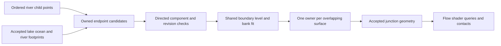

# UC-T04 — public engine research and automatic water connections

Retrieved on 2026-11-16 for UC-T04-05A/06/07/08/09/09A/11. Target contracts: Unity 6000.5.2f1 and URP 17.5.0. This is a design and source record, not executed acceptance of the current UC draft. All cited successful URLs returned HTTP 200 during this continuation. No external implementation, package, sound, model or shader was imported.

## Owner goal and research scope — clarified 2026-11-16

I’m continuing UC-T04-06 from the shoreline and junction-geometry draft, drawing on SCS Software, Godot, Unity/URP, Activision, Epic and credible public water/simulation projects. I’ll compare their applicable ideas, assumptions and costs, record the sources and finish wiring UC’s connection path. The target is convincing real-world detail on the minimum supported devices, with bounded generation, rendering, memory and interaction work and measured quality tiers.

This is an ongoing requirement for UC-T04-06…11, not a restriction to one engine or a request to collect links without implementation. Use public SCS engine/material/world-building documentation when accessible and other credible engineering sources where relevant. Keep unavailable source claims explicit; SCS tool documentation alone does not prove its engine’s water algorithm. Adapt verified concepts in UC’s existing owners, preserving Unity 6000.5.2f1/URP 17.5 contracts, licensing and independent assemblies. Compare physical units, sampling/error bounds, transparency/overdraw, memory, threading, invalidation and fallback cost before adoption. Expensive distant detail should yield to cheaper coherent geometry/material cues; nearby banks, bends, mouths and interactions must retain useful detail. The exact minimum device and numerical budgets remain to be established by representative-device measurements; no source establishes UC realism or FPS.

Owner’s clarification, retained verbatim:

> i told you not epic only but also the other sources okaya like scs software  and other they are manay we can learn fromthem and get more upgrades and improvement to our system do not close yourself to little knowledge but see and get ideas and knowledge from the other also so not just epci even the other source and improve our system upgrade it to achieve my aim interms odf the mininmum device but high level of details look into it well to work well okay please update the task okay and make them to work well as possible

## Research data cleanup

UC-T04 follows the working-data retention rule in `UC_FULL_SYSTEM_AUDIT_2026-11-14.md`: extract the cited findings/decisions first, then delete confirmed obsolete raw downloads once their implementation and evidence no longer need them. Retain useful raw evidence only in a verified archive within a combined 1 GB research/archive ceiling. Read targeted public text in memory where possible. This resumed continuation has written no fetched pages to disk; current code-review originals, active validation inputs and the other chat’s research are preserved. Record exact cleanup paths and reclaimed bytes before claiming disk savings.

## What the public sources establish

| Source | Observed public behavior | Decision for UC and limits |
| --- | --- | --- |
| [Epic: Water Body Actors](https://dev.epicgames.com/documentation/en-us/unreal-engine/water-body-actors-in-unreal-engine) — page identified Unreal Engine 5.9 | Ocean/lake/river types share a water meshing system. River splines have varying height, per-point width/depth/velocity and audio intensity; river surface motion uses velocity/flow maps. Lakes use a common level. River-to-lake/ocean transitions have dedicated material treatment. Water depths and flow can be queried for gameplay. Landscape carving uses enabled Edit Layers and the water brush. | **06/07:** use one owned junction geometry contract across body types, including sloping river receivers and level lake/ocean receivers. **08/09:** local flow and body state feed rendering and gameplay. **09A:** audio intensity derives from body/contact/flow data. UC retains its strict read/carve permission model; Epic's automatic brush behavior does not authorize UC terrain writes. A transitional material cannot repair a geometric overlap or hanging edge. |
| [Epic: Water Meshing System and Surface Rendering](https://dev.epicgames.com/documentation/en-us/unreal-engine/water-meshing-system-and-surface-rendering-in-unreal-engine) | The Water Zone controls shared visible mesh tiles. All water bodies use that mesh for seamless transitions. Camera-dependent quadtree LODs collapse and morph tiles; tessellation and extent affect cost. A simpler low-vertex far mesh fills the horizon. | **06/07:** shared ownership removes duplicate surface coverage rather than stacking individual planes. Keep UC's existing per-body surfaces initially, but subtract receiver coverage and match the whole common boundary; a later shared zone is conditional on measured need. **08/09/11:** detail depends on visibility/distance, with separate geometric and material detail costs; retain the existing far ring and measure quality transitions. Do not mechanically port a desktop quadtree or promise matching mobile cost. |
| [Godot: Curve3D](https://docs.godotengine.org/en/stable/classes/class_curve3d.html) | Curve3D caches sampled points. `bake_interval` is in metres; reducing it increases cache memory. Closest-point/offset operations use curve-local coordinates. Baked arc-distance sampling supports linear/cubic interpolation, and tessellation has a bounded subdivision stage count. | **05B/06/07/09:** preserve authored points, bake/invalidate a shared course, choose density from physical error and a station limit, and reuse the result in fitting, flow and query consumers. Convert spaces explicitly. Smoothness is not proof that a ribbon does not self-overlap; test actual edges/triangles. Godot APIs are conceptual references, not Unity runtime dependencies. |
| [Waterways: README](https://github.com/Arnklit/Waterways/blob/master/README.md), [MIT license](https://github.com/Arnklit/Waterways/blob/master/LICENSE) | The public Godot add-on builds river meshes from Bezier curves and bakes flow/foam maps. Its WaterSystem can combine child river height/flow data for shaders and buoyancy. Authoring exposes mesh subdivisions, smoothing, edge fade and flow/foam controls. Flow strengths can respond to slope, available space and distance from shore. | **08/09:** evaluate an optional bounded baked obstacle/flow field only after existing mesh attributes and ripple owners are audited. Static rocks can inform local flow/foam cues once at bake/edit time; moving objects use bounded wake events. One accepted coordinate/data convention should reach shaders and physics. MIT permits reuse with attribution, but no code was copied and no automatic import is planned. Baking cost, memory, interpolation and invalidation still need measurement. |
| [Crest Water 4: README](https://github.com/wave-harmonic/crest/blob/master/README.md), [MIT license](https://github.com/wave-harmonic/crest/blob/master/LICENSE) | The fetched repository explicitly targets Unity's Built-In renderer. Separate URP/HDRP products are listed. The README requires shader target 4.5 or higher and excludes OpenGL/WebGL. Its repository license is MIT. | **08/09/11:** use this as evidence that advanced water has explicit renderer/device constraints and quality costs. Do not import the Built-In shaders into URP 17.5 or assume all phone backends support the same simulation. Any deeper ripple/LOD idea requires reading its actual owner and costs first; the README alone does not prove an algorithm or phone benchmark. |
| [Activision: research publications](https://research.activision.com/publications) | The public index describes *Task Graph Renderer at Activision* (2023), *Rendering Engine Architecture at Activision* (2021), and geometry/culling/transparency work. Its architecture description includes decoupled simulation/rendering, worker command preparation, latency minimization and amortized work. The Caldera data entry explicitly limits the dataset to non-commercial use. | **07–11:** prepare plain immutable geometry/data off the native renderer path where supported, keep Unity/native calls in their declared domain, admit bounded work and retire old revisions deliberately. Amortize/static-bake expensive work rather than recomputing it in Update. This source does **not** establish Activision's river connection algorithm; no such claim is made. No Caldera asset was downloaded or used. |
| [SCS Software: official Blender Tools](https://github.com/SCSSoftware/BlenderTools/blob/master/README.md), [GPL v2 license](https://github.com/SCSSoftware/BlenderTools/blob/master/LICENSE) | The official tools describe a multi-object asset workflow, part/variant controls, locators, import/export and a material system using shader presets. The repository is GPL v2. | **05B/08:** coherent parent/child data and material presets are useful authoring concepts. Keep UC material/mesh ownership explicit across multiple child objects. This does **not** establish SCS's automatic river meshing or a proprietary engine algorithm. No GPL source was copied or translated into UC. |
| [NVIDIA GPU Gems 1: Effective Water Simulation from Physical Models, Mark Finch / Cyan Worlds](https://developer.nvidia.com/gpugems/gpugems/part-i-natural-effects/chapter-1-effective-water-simulation-physical-models) — HTTP 200 during this resumed continuation | The published Uru water system combines geometric waves with finer normal-map waves; summed periodic waves provide height and derivative-based surface orientation. Vertex depth controls opacity, reflection and geometric wave amplitude. The chapter separates detail below mesh resolution from geometric undulations. | **08/09:** use physical depth and shoreline/junction weights to attenuate displacement, keep shared CPU/HLSL wave parameters, and use normal detail for wavelengths too small to justify extra geometry. Inspect the existing derivative/steepness owners before changing them; normal shading cannot change actual bank contact. This historical chapter supplies modeling ideas, not current Unity APIs or modern phone benchmarks. No chapter code, textures or demo was imported. |
| [Unity/URP 17.5: reconstruct world position](https://docs.unity3d.com/Packages/com.unity.render-pipelines.universal@17.5/manual/writing-shaders-urp-reconstruct-world-position.html) — fetched page identified Unity 6000.5 | Camera depth reconstruction requires Depth Texture, scaled screen UVs, `DeclareDepthTexture.hlsl` / `SampleSceneDepth`, platform-dependent reversed-Z handling and the inverse view-projection matrix. | **08/09:** use the installed URP contracts for shore/obstacle depth effects and validate renderer feature availability. Screen-space contact cues depend on the camera depth buffer and cannot establish physical bank containment, offscreen wetness or gameplay contact. Keep a cheaper path for devices/tiers where the feature is disabled. |

Source availability limits: the SCS engine documentation page timed out outside the sandbox after the sandbox connection failed. The public GitHub contents request for its water-shader directory returned HTTP 403; no workaround or source import was attempted. The official README/license above were readable. Initial sandbox requests for Epic/Godot failed; the owner approved the public documentation reads, which then succeeded. Website failures are not UC test failures.

## How separate child objects recognize and connect

The following is the UC design derived from the requirements and inspected code. It is not a claim that another engine uses these particular IDs or algorithms.

1. **World ownership:** a body belongs to its nearest `UniverseCreatorObject` and scene. The resolver inventories that owner's actual water bodies, including bodies under different grouping transforms. It never uses a child name or nearest object in an unrelated overlapping world. Scene water keeps a stable saved body GUID; procedural reaches retain world/producer/reach identity from the accepted channel publications.
2. **Directed candidate:** each river's first/last course section is compared with accepted water footprints and directed procedural channel destinations. An explicit authored endpoint reference is respected after scope validation. Automatic candidates use actual intersecting wet footprints or a bounded channel-end extension, not an arbitrary bounding-circle overlap. Ambiguous matches, unsupported uphill flow or unavailable ground/receiver data produce a diagnostic.
3. **Topology and order:** lake→river is a supplying connection; river→lake/ocean is receiving; a tributary points downstream into its receiving river. Solve the owned connected component in bounded dependency order, rejecting invalid cycles. Saved IDs resolve again after reload; removed targets and older revisions retire their owned connections.
4. **Shared level and clearance:** lakes/oceans supply their accepted still-water level. A river receiver supplies its local sloping surface along the entire shared boundary. Blend the incoming bed/water section over a bounded length without moving authored points or granting excavation in read mode. Validate actual bed clearance and both banks.
5. **Surface union:** let the receiver own the overlapping surface. Clip the incoming mesh to the receiver's actual wet triangles and interpolate common-edge positions/levels from that receiver. Avoid stacked coplanar transparent planes, gaps and height discontinuities. Validate triangle winding, bank contact and boundary area before accepting the junction record.
6. **Coherent appearance and queries:** the accepted mesh/footprint, local depth/velocity, transition/wave parameters and body kind feed rendering, physics and interaction. Material flow/foam can blend after geometry accepts. Shader-displaced boundary positions must still agree between bodies. Static obstacle cues and moving wakes use explicit bounded owners; camera depth effects supplement accepted physical data.
7. **Rebuild and retirement:** editing either side revalidates affected connected bodies using current world/run/ground witnesses. Missing targets, Undo, deletion, disabling, streaming and cancelled older work cannot publish a ghost junction. Preserve the previous valid surface only when its ownership remains valid; withdraw deleted/empty owned surfaces.

## Current implementation and acceptance

Latest owner correction: stay on UC-T04-11 and earlier-topic acceptance until their complete checks pass; preserve Topic 5 drafts. The lifelike-detail objective includes natural physical behaviour and coherent rendering/query/contact state. 30, 60 and 120 FPS all remain available, starting with high-detail 30 on Redmi Note 14-class midrange phones. Current work adds explicit shared FPS controls and bounded timing evidence, removes confirmed governor allocations and repairs world-local streamed-water quality. These changes have not yet executed; no measured phone FPS or visual result is claimed.

Additional public API research read in memory on 2026-11-16:

| Source and SHA-256 of fetched page | Finding and adaptation |
| --- | --- |
| [Unity 6: Application.targetFrameRate](https://docs.unity3d.com/6000.0/Documentation/ScriptReference/Application-targetFrameRate.html), `6EDC7C31AC2A46307A1D118777F03318561AB4AD090C5C259B022D56795911DB` | Desktop VSync overrides a software FPS cap and gives hardware pacing; mobile ignores vSyncCount and obeys display divisors. Shared `AdaptiveQuality` presets prefer a matching desktop VSync divisor and keep requested and known display budgets separate. 120 is a selectable target, not proof of that display cadence. |
| [Unity 6: FrameTimingManager](https://docs.unity3d.com/6000.0/Documentation/ScriptReference/FrameTimingManager.html), `A63B1E04DA902F29C3D6039F574EEA7C79BE1DBF74F14249DBD37E2A139B2AEF` | Timings arrive four frames late; unsupported GPU timings are zero. Explicit capture uses one reused timing buffer, de-duplicates timestamps, exports valid-sample counts, and does not enable release build settings without authorization. |
| [Unity 6: FrameTiming](https://docs.unity3d.com/6000.0/Documentation/ScriptReference/FrameTiming.html), `59B42BB852BA15C84796A7E3392A6F31BB6C26650F4C40D23F5C034920F0E063` | CPU frame duration includes its timing interval; GPU work is a distinct metric. Store and report separate distributions; a frame cap/wall interval does not measure CPU or GPU workload. Compile all adopted APIs against installed Unity 6000.5.2f1. |

The additional Godot optimization-page request returned HTTP 403; the additional SCS units-page request timed out. These attempts supply no new source evidence. Previously recorded successful Godot/SCS/Activision/Epic/GPU Gems research remains applicable within its stated limits. No fetched page, asset or sound was saved to disk.

Latest continuation, 2026-11-16: UC-T04-05B creation and inherited-field Undo/Redo pass actual Editor-frame acceptance **6/0**, focused water **1,491/0/exit 0** and complete package **18,013/0/exit 0**, on 636-file SHA-256 `6492F01ED65947152DDBA1E5696A1A6BF07C35E1A9A9D46B897C7C31D5421F13`. Water lifetime, river-mode recovery, terrain-river reload, snapshot-scene and managed-domain gates also pass **3/0, 3/0, 24/0, 9/0, 9/0**, each exit 0; exact commands/logs are in the current audit checkpoint. The separate Editor-frame process exited naturally; its OS exit code was not captured. The actual cause was generated-surface picking changing global Undo history. [Unity's public SceneVisibilityManager implementation](https://github.com/Unity-Technologies/UnityCsReference/blob/master/Editor/Mono/SceneVisibility/SceneVisibilityManager.cs), read on 2026-11-16, explicitly calls `Undo.RecordObject` in `DisablePicking`. UC now uses native read-only flags on temporary water/horizon children without calling that helper. No reference code was copied; installed Unity 6000.5.2f1 verifies the adaptation. Scene picking, graphics/audio/Play/device checks remain pending. This supersedes the failed-Redo and source-only status below without turning numerical evidence into a realism or performance claim.

The owner requires **Redmi Note 14-class midrange phones and stronger**, excluding entry-level phones, and retains **30, 60 and 120 FPS modes**. Prioritize high-detail sustained **30 FPS first** (33.33 ms frame envelope), then optimize high-detail **60 FPS on that minimum class** (16.67 ms), and **120 FPS** (8.33 ms) where the recorded device/display and scene budget support it. The earlier interpretation removing 30 FPS is superseded. Record the exact variant/RAM/OS/backend/display, selected FPS mode, resolution, visible scene and quality settings; measure CPU/GPU/frame-time percentiles, generation/streaming spikes, memory and sustained thermal behavior for each mode. These are acceptance requirements, not existing benchmarks. Continue learning from the cited Unity/URP, Godot, SCS, Activision, Epic, GPU Gems and other credible sources, adapting their costs and assumptions to this device class. Bounded scheduling/uploads, cached physical queries, culling/LOD, fine normal detail and selective camera effects must preserve near-field detail, bank/junction continuity and coherent water behavior. The owner's eFootball comparison motivates the target but does not establish UC's workload or performance.

Verification update, 2026-11-16: the latest focused gates compiled and executed **1,477 checks / 1 failure**, with the remaining failure in native river-point Redo. A separate actual Editor-frame reproduction failed **2/1** on current 636-file SHA-256 `79C126DD59362125C6041A43C05BFAEE290444978BB03B4A46F30CC39A29F95F`; commands/logs are in the active audit checkpoint. The current corrections repair feasible endpoint-blend dips with a bounded backward pass, test overlap against actual conformed receiver triangles using an independent separating-axis oracle, preserve exact native buffers after Unity quantization, retain recovery references through native component serialization, and preserve cycle diagnostics after retirement. Audio routing/admission checks passed on the focused scopes; actual audible quality and device costs remain unobserved. UC-T04-05B is partial and UC-T04-11 cannot close; speculative creator Undo changes were withdrawn and the repeated-fix stop condition is recorded. No downloaded research or sound assets were added. The following earlier source-only notes are historical and do not override these evidence boundaries.

UC-T04-01…06 are implemented/source-reviewed and await the complete-topic gate. The resumed UC-T04-06 path discovers owned receivers across grouping transforms, spatially indexes copied receiver triangles, subtracts overlapping coverage and interpolates its full sloping boundary, then rechecks wet ground and winding. Explicit sources participate in the profile weld; manual and procedural spring depth/width introduce gradually. Candidate records remain unaccepted during preparation and are promoted after native surface publication. Parent/child inspectors describe pending versus accepted connections. Registered area/boundary/clearance/transform/grouped-production/native/source fixtures have not been compiled or executed. Stable order, revision/deletion/reload reconciliation continues under UC-T04-07; shader/query and actual visual/device acceptance remain open.

The owner’s original request stays in the active audit until all its geometry, authoring, flow, interaction/audio and verification requirements are fulfilled; an implementation tick or a numerical gate alone is insufficient to remove it.

Resumed implementation on 2026-11-16: UC-T04-07…10 drafts are now reconciled with production callers and registered fixtures. Godot's cached-course concept remains in the existing baked profiles; GPU Gems' geometric/normal-detail separation informs depth-limited CPU/HLSL ambient motion and bounded GPU-only micro-height; URP camera requirements now gate depth/refraction reads, with local-bathymetry fallback and a Low-quality cap. Existing obstacle emitters retain world ownership and bounded rate. These are adaptations in UC's owners, not copied source code or measured device results.

The owner approved Unity Audio 1.0.0 and optional licensed clips. `UCWaterAudio` consumes the existing character/hull state without additional water queries, supports per-kind/fallback ambience, rapids, swimming, vehicle-wake and entry/splash/exit clips, and caps admission at 16 actors with two reused spatial sources each. Missing clips stay silent without creating voices. Native routing/admission/retirement fixtures are registered; audible quality remains unobserved. No raw source pages or sound assets were downloaded in this resume. The isolated full/native gates remain pending until their exact results are recorded in the active checkpoint.

The implementation must register actual production-path fixtures for differently parented bodies, all directed kinds, sloping receivers, multiple tributaries, ambiguous/foreign/missing receivers, no triangle overlap, exact boundary continuity, bank contact, authored-point preservation and native read-mode equality. Complete package/scene/domain/native gates use a new frozen isolated UC snapshot when all Topic 4 implementation is ready. Graphics/Play/audio and representative phone timing/thermal/quality acceptance remain open until observed; none of these sources is a UC performance result.
